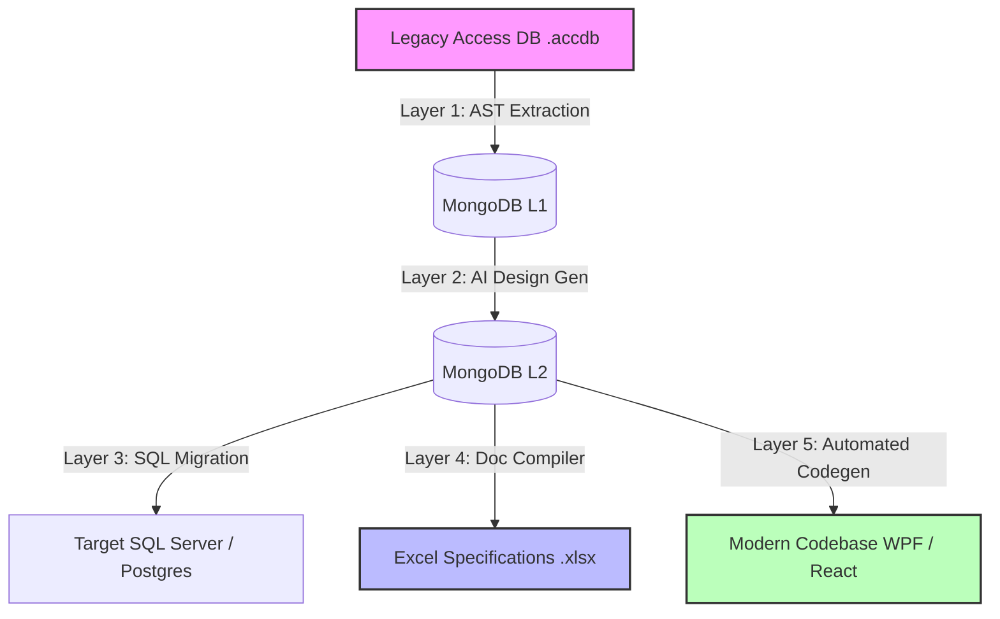

# 🚀 VBA & Access Modernization Pipeline (vba_brain)

[](https://opensource.org/licenses/MIT)
[](https://www.python.org/)
[](https://nextjs.org/)
[](https://www.mongodb.com/)
[](https://github.com/langchain-ai/langgraph)

An enterprise-grade, 5-layer AI-assisted pipeline designed to parse legacy MS Access databases (`.accdb` / `.mdb`) and VBA codebases, generate modern English design specifications (BD/DD), migrate databases, and automatically compile target modern application source code (e.g., WPF/C#, React/TypeScript).

---

## 🏗️ 5-Layer Pipeline Architecture



### 🔹 Layer 1: AST Extraction & Parsing
Parses MS Access files using AST parser scripts to extract tables, query definitions, form/report layouts, and VBA modules. All raw data is stored in the MongoDB Layer 1 collection.

### 🔹 Layer 2: Business & Detailed Design (BD/DD) Generation
Invokes LangGraph parallel LLM agents (`alibaba/qwen-max`, `deepseek-v4-flash`, etc.) to generate Business Design (BD) and Detailed Design (DD) metadata in English.
*   **Forms & Reports**: Generate both BD and DD.
*   **Modules & Macros**: Generate only DD (bypassing BD).
*   *Note: All Japanese names and variables from legacy code are automatically translated to English.*

### 🔹 Layer 3: SQL & Database Migration
Translates MS Access database structures, relationships, and queries into modern SQL dialects (e.g., T-SQL for SQL Server or PL/pgSQL for PostgreSQL).

### 🔹 Layer 4: Design Documentation Compiler (Excel Export)
Reads Layer 2 design JSON metadata and writes it back into beautifully formatted, structured, and translated Excel design specification sheets (`.xlsx` templates) using `openpyxl`.

### 🔹 Layer 5: Automated Source Code Modernization (Codegen)
Translates the structural specifications and logic steps from DD specifications into modern modular target code (e.g., C#/WPF, React/TypeScript components).

---

## 🛠️ Technology Stack

*   **Frontend**: Next.js 15, TailwindCSS (for styling), Lucide icons, React Flow (for canvas pipeline visualization).
*   **Backend & Gateway**: Python, gRPC API Gateway, FastAPI.
*   **Agentic Orchestration**: LangGraph, LangChain, ThreadPoolExecutor.
*   **Database**: MongoDB (state tracking, backups, document registry).
*   **Office Automation**: `openpyxl` (Excel sheet processing & styling).

---

## 📁 Repository Structure

```
workflow/
├── src/
│   ├── frontend/             # Next.js Web UI Console
│   └── backend/
│       ├── api_gateway/      # Unified gRPC server gateway
│       └── workflow/
│           ├── layer1/       # AST parser and Access extractor
│           ├── layer2/       # AI BD & DD generators (agents/)
│           ├── layer3/       # SQL migration compiler
│           ├── layer4/       # Excel specification exporter
│           └── layer5/       # C# / React source code generator
├── data/                     # Backups folder (bds/ and dds/ JSONs)
├── start.py                  # CLI and Web UI Server Launcher
├── config.json               # Environment configurations & Models
└── README.md
```

---

## ⚡ Getting Started

### 📋 Prerequisites
*   Python 3.9+
*   Node.js 18+
*   MongoDB Instance (Running on default port `27017` or configured in `config.json`)

### 📦 Installation

1.  Clone the repository:
    ```bash
    git clone https://github.com/yourusername/vba-modernization.git
    cd vba-modernization
    ```

2.  Install Backend Dependencies:
    ```bash
    pip install -r src/backend/requirements.txt
    ```

3.  Install Frontend Dependencies:
    ```bash
    cd src/frontend
    npm install
    cd ../..
    ```

4.  Configure `config.json` in the root folder with your LLM API keys:
    ```json
    {
      "MONGO_URI": "mongodb://localhost:27017",
      "MONGO_DB": "vba_brain_core",
      "GOOGLE_API_KEY": "your-key",
      "OPENAI_API_KEY": "your-key",
      "ALIBABA_API_KEY": "your-key"
    }
    ```

---

## 🚀 Running the Pipeline

You can run both the frontend console and the backend gRPC server simultaneously with a single launcher script:

```bash
python start.py
```

### 💡 Launcher Options:
*   `python start.py --fe-only` — Start only the Next.js frontend UI (default port `3000`).
*   `python start.py --be-only` — Start only the python gRPC API Gateway (default port `50051`).

### 💻 Running Batch Generation via CLI
To parse and migrate the entire MS Access file, run the batch extraction script:
```bash
cd src/backend/workflow/layer1
python run_all.py --source legacy_db.accdb
```
This will:
1.  Extract AST structures from `legacy_db.accdb`.
2.  Seed MongoDB collections.
3.  Automatically trigger Layer 2 to generate BD & DD JSONs for all forms, reports, and modules.

---

## 📄 License
This project is licensed under the MIT License - see the [LICENSE](LICENSE) file for details.
