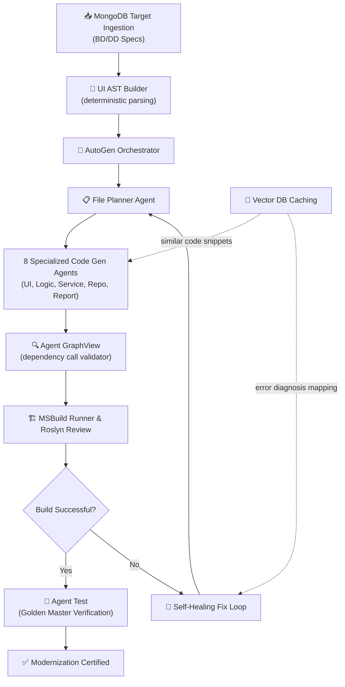
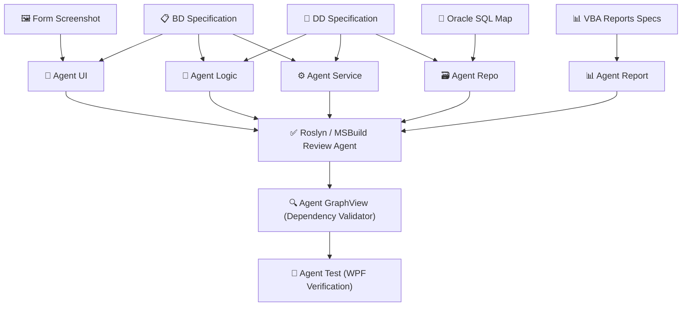

# AI KNOWLEDGE BASE
This file contains the consolidated documentation from the unified docs directory.
Use this file as the primary source of truth for architectural and design knowledge.

## Table of Contents
- docs/ARCHITECTURE_SPEC.md
- docs/README.md
- docs/ai-md/backend/architecture.md
- docs/ai-md/backend/layer1.md
- docs/ai-md/backend/layer2.md
- docs/ai-md/backend/layer3.md
- docs/ai-md/backend/layer4.md
- docs/ai-md/backend/layer5.md
- docs/ai-md/frontend/architecture.md
- docs/ai-md/rules/coding_standards.md
- docs/ai-md/skills/agent_pipeline.md
- docs/design/EXCEL_MAPPING_SPEC.md
- docs/design/STANDARD_SPEC.md
- docs/layers/layer1/README.md
- docs/layers/layer2/DD_AGENT_FIXES.md
- docs/layers/layer3/TABLE_MAPPING.md
- docs/layers/layer5/AI_AGENT_WORKFLOW_SPEC.md
- docs/layers/layer5/GRAPHVIEW_AGENT_SPEC.md
- docs/layers/layer5/L5_AGENTS_SPEC.md
- docs/layers/layer5/NAMING_AND_MAPPING_RULES.md
- docs/layers/layer5/SERVICE_AGENT_SPEC.md
- docs/layers/layer5/TOKEN_ANALYSIS.md

---

## File: docs/ARCHITECTURE_SPEC.md

# vba_brain System Architecture Specification — VBA Migration to C# WPF & Oracle

This document outlines the standard architecture, mapping rules, and design choices for the modernized system migrated from legacy Microsoft Access VBA to C# WPF on Oracle Database.

---

## 1. Source to Target Mapping Overview

| Access/VBA Component | Count | Modern C# WPF Equivalent |
|---|---|---|
| `Forms/*.frm` (UI Forms) | 174 | `Views/*.xaml` + `ViewModels/*.cs` |
| `Forms/*.frm` (Report-as-Form) | 78 | `Views/Reports/*.xaml` (RDLC/Crystal Reports) |
| `Reports/*.frm` (Access Reports) | 19 | `Views/Reports/*.rdlc` (ReportViewer) |
| `Macros/*.mac` (Macro Workflows) | 68 | `Services/NavigationService.cs` + WPF Commands |
| `Modules/*.bas` (Common Modules) | 16 | `Application/Services/` + `Infrastructure/Helpers/` |
| `Queries/*.sql` (Access Queries) | 515 | `Infrastructure/Repositories/` (Dapper-based SQL) |
| Access Tables | ~50 | Oracle DB Schema (Entities/Migrations) |

---

## 2. Layered Architecture (Clean Architecture)

The modernized system strictly adheres to **Clean Architecture** principles to separate concerns, ensure testability, and decouple the application logic from external dependencies (UI, Databases, Frameworks).

```text
┌──────────────────────────────────────────────────────────┐
│              Presentation Layer (WPF)                     │
│   Views (XAML) ↔ ViewModels (MVVM) ↔ NavigationService  │
├──────────────────────────────────────────────────────────┤
│              Application Layer (Use Cases)                │
│   Services / DTOs / Validators / Mappers                  │
├──────────────────────────────────────────────────────────┤
│              Domain Layer (Core Business)                 │
│   Entities / Interfaces / Domain Exceptions               │
├──────────────────────────────────────────────────────────┤
│              Infrastructure Layer (External Details)       │
│   Dapper Repositories / OracleContext / Helpers / Logging │
│                    ↓                                      │
│              Oracle Database                              │
└──────────────────────────────────────────────────────────┘
```

---

## 3. C# WPF Solution Folder Structure

The project structure is organized into a single Visual Studio solution (`vba_brain.sln`) containing four distinct layers:

```text
vba_brain.sln
├── vba_brain.Domain/                          # Core Domain Layer (No external dependencies)
│   ├── Entities/
│   │   ├── AfterMainEntity.cs             ← Maps to C000_MAINⅡ table
│   │   ├── AfterRegistrationEntity.cs     ← Maps to C001 table
│   │   ├── PaymentEntity.cs               ← Maps to Payment table (入金)
│   │   ├── PrintDocumentEntity.cs         ← Maps to F004 print records
│   │   └── AnalyticsEntity.cs             ← Maps to F9xx data structure
│   ├── Interfaces/
│   │   ├── IAfterMainRepository.cs
│   │   ├── IPaymentRepository.cs
│   │   ├── IPrintRepository.cs
│   │   └── IAnalyticsRepository.cs
│   ├── Common/
│   │   ├── BaseEntity.cs
│   │   └── Enumerations/
│   │       ├── ServiceType.cs             ← Paid/Free/Warranty (有償/無償/瑕疵)
│   │       ├── PaymentFlag.cs             ← Payment status flag (入金フラグ)
│   │       └── RegistrationStatus.cs      ← Registration status (登録状況)
│   └── Exceptions/
│       └── DomainException.cs
│
├── vba_brain.Application/                     # Application Layer (Use Cases & Orchestration)
│   ├── DTOs/
│   │   ├── AfterMainDto.cs
│   │   ├── PaymentDto.cs
│   │   └── PrintRequestDto.cs
│   ├── Services/
│   │   ├── AfterMainService.cs            ← Main record retrieval & filtering
│   │   ├── AfterRegistrationService.cs    ← CRUD operations for C001
│   │   ├── AfterEditService.cs            ← CRUD operations for C003
│   │   ├── PaymentService.cs              ← Payment transactions
│   │   ├── PrintService.cs                ← Document printing orchestration
│   │   └── AnalyticsService.cs            ← F9xx statistical calculation
│   ├── Validators/
│   │   ├── AfterRegistrationValidator.cs
│   │   └── PaymentValidator.cs
│   └── Mappers/
│       └── vba_brainMappingProfile.cs
│
├── vba_brain.Infrastructure/                  # Infrastructure Layer (Database, Logging, File System)
│   ├── Persistence/
│   │   ├── OracleContext.cs               ← Database connection context (Oracle)
│   │   ├── Repositories/
│   │   │   ├── AfterMainRepository.cs     ← Implements Dapper SQL commands
│   │   │   ├── PaymentRepository.cs
│   │   │   ├── PrintRepository.cs
│   │   │   └── AnalyticsRepository.cs
│   │   └── UnitOfWork/
│   │       └── UnitOfWork.cs
│   ├── Queries/                           ← Ported SQL files from legacy Access
│   │   ├── MainQueries/                   ← C000_MAINⅡ SQL (50 files)
│   │   ├── PrintQueries/                  ← F004 SQL (~100 files)
│   │   └── AnalyticsQueries/              ← F9xx SQL (~50 files)
│   ├── Helpers/                           ← Ported utility functions from modules (.bas)
│   │   ├── CommonHelper.cs                ← Common.bas
│   │   ├── WindowHelper.cs                ← AppWinCenter.bas + SetWindowPos.bas
│   │   ├── GuidHelper.cs                  ← SetGUID.bas
│   │   ├── PhoneHelper.cs                 ← mdlSplitTelNum.bas
│   │   └── ClipboardHelper.cs             ← setEmtpyClipBoard.bas
│   ├── Logging/
│   │   └── SerilogConfiguration.cs
│   └── Migrations/                        ← Database schema migration scripts (DbUp for Oracle)
│       └── Scripts/
│           ├── V001__InitialSchema.sql
│           └── V002__SeedMasterData.sql
│
└── vba_brain.UI.WPF/                          # Presentation Layer (WPF Desktop App)
    ├── Views/
    │   ├── Auth/
    │   │   ├── LoginWindow.xaml           ← F_Login.frm
    │   │   └── LoginAAWindow.xaml         ← F_Login_AA.frm
    │   ├── Main/
    │   │   ├── MainWindow.xaml            ← C000_MAINⅡ.frm
    │   │   ├── MainPaymentView.xaml       ← C000_MAINⅡ_入金.frm
    │   │   └── MainUnpaidView.xaml        ← C000_MAINⅡ_未入金.frm
    │   ├── CRUD/
    │   │   ├── RegistrationWindow.xaml    ← C001_アフター登録Ⅱ.frm
    │   │   ├── InquiryWindow.xaml         ← C002_アフター照会Ⅱ.frm
    │   │   ├── EditWindow.xaml            ← C003_アフターMAINto編集Ⅱ.frm
    │   │   └── DuplicateWindow.xaml       ← C003_アフターMAINto複製Ⅱ.frm
    │   ├── Print/
    │   │   ├── PrintSettingsWindow.xaml   ← C004_印刷設定Ⅱ_MAIN.frm
    │   │   └── Reports/                   ← Report-as-Form views
    │   │       ├── QuoteReport.rdlc       ← Quote document layout
    │   │       ├── InvoiceReport.rdlc     ← Invoice document layout
    │   │       ├── DeliveryReport.rdlc    ← Delivery note layout
    │   │       └── BatchPrintView.xaml    ← Batch print interface
    │   ├── Analytics/
    │   │   ├── AdminHomeWindow.xaml       ← F000_管理ホーム.frm
    │   │   ├── CollectionStatsWindow.xaml ← F900_回収額実績.frm
    │   │   └── AggregateWindow.xaml       ← F911/F912/F921_集計.frm
    │   └── Shared/
    │       ├── SplashScreen.xaml          ← M300_Splash
    │       └── NavigationButtons.xaml     ← F021_NavigationButtons.frm
    ├── ViewModels/
    │   ├── Auth/
    │   │   └── LoginViewModel.cs
    │   ├── Main/
    │   │   ├── MainViewModel.cs
    │   │   ├── MainPaymentViewModel.cs
    │   │   └── MainUnpaidViewModel.cs
    │   ├── CRUD/
    │   │   ├── RegistrationViewModel.cs
    │   │   ├── InquiryViewModel.cs
    │   │   └── EditViewModel.cs
    │   ├── Print/
    │   │   └── PrintSettingsViewModel.cs
    │   └── Analytics/
    │       └── AnalyticsViewModel.cs
    ├── Services/
    │   ├── NavigationService.cs           ← Handles all page transitions (replacing *.mac)
    │   ├── DialogService.cs
    │   ├── PrintOrchestrationService.cs   ← Orchestrates RDLC report loading
    │   └── StartupService.cs              ← Performs startup tasks (replacing AutoExec.mac)
    ├── Converters/
    │   ├── BoolToVisibilityConverter.cs
    │   └── ServiceTypeColorConverter.cs
    ├── Resources/
    │   ├── Styles/
    │   │   └── AppStyles.xaml
    │   └── Themes/
    │       └── vba_brainTheme.xaml
    ├── App.xaml
    └── DependencyInjection.cs             ← Registers and binds components (Composition Root)
```

---

## 4. Navigation & Macro Modernization

VBA **Macros** in MS Access (which traditionally handle actions like `OpenForm`, `Close`, `Requery`, and `RunMacro`) are completely consolidated into the C# `NavigationService` and ViewModel `RelayCommand`s.

| Legacy VBA Macro (.mac) | WPF / C# Equivalent |
|---|---|
| `AutoExec.mac` (Form: F_Login) | `StartupService.Initialize()` → Navigates to `LoginWindow` |
| `ReturnToMain.mac` (C000_MAIN) | `NavigationService.NavigateTo<MainViewModel>()` |
| `Register.mac` (C001) | `RelayCommand: SaveAndReturnAsync()` in `RegistrationViewModel` |
| `EditSubmit.mac` (C003) | `RelayCommand: UpdateAndReturnAsync()` in `EditViewModel` |
| `OpenSplash.mac` (M300) | Native WPF `SplashScreen` integration |
| `ComboRequery.mac` (M5xx) | `ObservableCollection` data rebinding + async API call |
| `AllComboRequery.mac` (M511) | `MainViewModel.RefreshFiltersCommand` (WPF RelayCommand) |
| Connection String Config | `appsettings.json` → `ConnectionStrings:Oracle` mapping |

---

## 5. VBA Modules Modernization

Legacy `.bas` module files containing general application utilities, Windows API declarations, or string manipulation logic are refactored into deterministic C# helper classes.

| VBA Module (.bas) | WPF / C# Helper Class |
|---|---|
| `Common.bas` | `vba_brain.Infrastructure/Helpers/CommonHelper.cs` |
| `AppWinCenter.bas` | `WindowHelper.CenterWindow(Window window)` |
| `SetWindowPos.bas` | Native Windows interop inside `WindowHelper.cs` |
| `SetGUID.bas` | Native `System.Guid.NewGuid()` calls inside `GuidHelper.cs` |
| `mdlSplitTelNum.bas` | `PhoneHelper.SplitTelephoneNumber(string phone)` |
| `setEmptyClipBoard.bas` | `ClipboardHelper.ClearSystemClipboard()` |


---

## File: docs/README.md

# vba_brain Documentation Directory Index

Welcome to the unified documentation catalog for **vba_brain** — the automated pipeline designed to modernize legacy Microsoft Access VBA systems into modern C# WPF MVVM applications on Oracle Databases.

---

## 🗺️ Documentation Directory Map

```text
docs/
├── README.md                          # ← You are here (Unified Index)
├── ARCHITECTURE_SPEC.md               # Architecture mapping (VBA to Clean C# WPF)
│
├── design/                            # Core System Specifications & Mappings
│   ├── STANDARD_SPEC.md               # Spreadsheet layout rules & banners (BD & DD)
│   ├── REQUIREMENTS.md                # Quality requirements & review checklist
│   └── EXCEL_MAPPING_SPEC.md          # Property mappings from pipeline JSON to Excel
│
├── layers/                            # Detailed Layered Ingestion Mappings
│   ├── layer1/
│   │   └── README.md                  # Access parser mechanisms & seeding guides
│   ├── layer2/
│   │   └── DD_AGENT_FIXES.md          # Detailed DD Agent fixes & optimizations
│   ├── layer3/
│   │   └── TABLE_MAPPING.md           # Database tables classification index
│   └── layer5/
│       ├── L5_AGENTS_SPEC.md          # Specs for all 8 code generation sub-agents
│       ├── AI_AGENT_WORKFLOW_SPEC.md  # Multi-agent pipelines, caching, and fix loop
│       ├── SERVICE_AGENT_SPEC.md      # Service agent loader models & schemas
│       ├── GRAPHVIEW_AGENT_SPEC.md    # Call graph static analyzer & verification
│       ├── NAMING_AND_MAPPING_RULES.md# PascalCase identifier formatters & regex rules
│       └── TOKEN_ANALYSIS.md          # LLM average token size & API cost analysis
│
└── ai-md/                             # AI-Agent Operational Knowledge Base
    ├── rules/                         # Coding standards & architectural guidelines
    ├── skills/                        # Ingestion skills & pipeline models
    ├── frontend/                      # Presentation layer guides (WPF)
    └── backend/                       # Layer 1 to Layer 5 operational prompts
```

---

## 🎯 Primary Documentation References

- **System Architecture Design:** For a detailed breakdown of Clean Architecture mappings, MVVM MVVM namespaces, and physical class patterns, refer to [ARCHITECTURE_SPEC.md](file:///Users/baoluong0209/GitTool/vba_mirgation/workflow/docs/ARCHITECTURE_SPEC.md).
- **Spreadsheet Design Standards:** For Excel layout templates, file nomenclature, version control protocols, and header variables, read [STANDARD_SPEC.md](file:///Users/baoluong0209/GitTool/vba_mirgation/workflow/docs/design/STANDARD_SPEC.md).
- **Compliance Checklist:** Before releasing modernized sheets, review the compliance standards in [REQUIREMENTS.md](file:///Users/baoluong0209/GitTool/vba_mirgation/workflow/docs/design/REQUIREMENTS.md).
- **Pipeline Data Contract:** To inspect exactly how JSON properties are mapped dynamically to Excel targets, read [EXCEL_MAPPING_SPEC.md](file:///Users/baoluong0209/GitTool/vba_mirgation/workflow/docs/design/EXCEL_MAPPING_SPEC.md).
- **Specialized Code Generation Agents:** To understand the execution scope, LLM selections, inputs, and outputs of the 8 Layer 5 sub-agents, refer to [L5_AGENTS_SPEC.md](file:///Users/baoluong0209/GitTool/vba_mirgation/workflow/docs/layers/layer5/L5_AGENTS_SPEC.md).
- **Codegen Orchestration & Directories:** To learn about conflict-free file structures, few-shot vector database lookups, and compiler self-healing loops, read [AI_AGENT_WORKFLOW_SPEC.md](file:///Users/baoluong0209/GitTool/vba_mirgation/workflow/docs/layers/layer5/AI_AGENT_WORKFLOW_SPEC.md).


---

## File: docs/ai-md/backend/architecture.md

# Backend Architecture

## Overview
The vba_brain project's backend is responsible for parsing legacy VBA/Access databases, processing the logic using AI agents, and generating modern C# WPF source code. It is structured into multiple layers to separate concerns.

## Layer 1: Parser
- Responsible for parsing raw Access JSON exports (database_json) and ingesting them into MongoDB collections (forms, reports, modules, macros, queries, tables).
- Data flows strictly from Layer 1 to MongoDB.

## Layer 2: LLM Engine (Core Agent Framework)
- Houses the FastAPI HTTP server running on port 8000.
- Coordinates the BD (Basic Design) and DD (Detail Design) agent pipelines.
- Reads source data from MongoDB, NOT directly from Layer 1.
- Output from the agents is ALWAYS written to `backend/layer2/output/` in structured JSON.

## Layer 3: Tools & Utilities
- Query tools and metadata services used by the agents during generation.

## Layer 5: C# Generators
- Uses the parsed DD/BD JSON files to instruct LLMs on generating C# ViewModels, Services, and Repositories.
- Includes specific agents like `agent_logic.py`, `agent_repo.py`, etc.


---

## File: docs/ai-md/backend/layer1.md

# Backend - Layer 1 (Parser)

## Purpose
Layer 1 is entirely responsible for Data Ingestion. It parses legacy Microsoft Access structures exported as raw JSON files and stores them reliably in a MongoDB database.

## Key Responsibilities
1. **Parsing Raw Export Data:** Reads `database_json` objects which represent raw Access properties (Forms, Reports, Macros, Modules, Queries, Tables).
2. **Data Normalization:** Normalizes the properties into structured NoSQL document formats.
3. **Database Population:** Inserts the cleaned data into corresponding MongoDB collections (e.g., `forms`, `reports`, `modules`, `macros`, `queries_v2`, `tables`, `dependency_graph`).

## Constraints
- **Unidirectional Flow:** Layer 1 is strictly a data provider. It only writes to MongoDB and NEVER calls Layer 2 APIs.
- **No LLM usage:** The parsing mechanism in Layer 1 is 100% deterministic code. No AI/LLM logic happens here.


---

## File: docs/ai-md/backend/layer2.md

# Backend - Layer 2 (LLM Engine & Basic/Detail Design)

## Purpose
Layer 2 is the heart of the AI engine. It acts as a FastAPI server that orchestrates the primary design extraction from the legacy code (BD & DD Agents).

## Key Responsibilities
1. **FastAPI HTTP Server:** Runs on port 8000. Provides endpoints for the Frontend (Next.js) to trigger agent workflows and view progress.
2. **BD Agent (Basic Design):**
   - Reads Access/VBA data from MongoDB (provided by Layer 1).
   - Generates structural outputs (`bd_form.json`) detailing layouts, UI properties, and high-level events.
3. **DD Agent (Detail Design):**
   - Takes BD Agent output as its input.
   - Generates functional step-by-step logic (`dd_form.json`), extracting SQL statements, macro steps, and conditional variable logic.
4. **LLM Client Orchestration:** Manages asynchronous calls to the LLM (e.g., Qwen) for intelligent parsing when deterministic logic is insufficient.

## Constraints
- **Data Source:** Layer 2 ONLY reads source data from MongoDB, never from the raw `database_json` files.
- **Output Destination:** All generated JSON specifications must be saved directly into `backend/layer2/output/`.
- **Localization:** Reads `TARGET_LANGUAGE` from `config.json` to generate schema prompts dynamically.


---

## File: docs/ai-md/backend/layer3.md

# Backend - Layer 3 (Tools & Utilities)

## Purpose
Layer 3 provides specialized sub-routines, query tools, and metadata services that the AI Agents in Layer 2 and Layer 5 rely on.

## Key Responsibilities
- **Data Querying:** Exposing MongoDB abstraction functions so the BD/DD agents can query tables or VBA modules easily.
- **AST/Regex Parsers:** Contains deterministic regex engines and AST processors (like Roslyn AST wrappers or custom parsers) to help agents merge code chunks or parse specific VBA syntax safely.
- **Helper Scripts:** Scripts for database initialization, environment validation, and manual data seeding.


---

## File: docs/ai-md/backend/layer4.md

# Backend - Layer 4 (SQL Migration)

## Purpose
Layer 4 is dedicated exclusively to **SQL Translation and Migration**. It handles the complex task of converting legacy Microsoft Access SQL queries (with Access-specific functions like `DLookup`, `IIf`, `#date#`) into modern SQL dialects (like Oracle SQL).

## Key Responsibilities
1. **Query Seeding (`/api/layer4/seed`):** 
   - Reads raw queries from the Layer 1 `queries` collection and seeds them into a specialized `queries_v2` collection for tracking migration status.
2. **AI SQL Conversion (`/api/layer4/convert`):** 
   - Uses LLMs to intelligently parse and rewrite Access SQL into Oracle SQL.
   - Handles the conversion of specific Access functions into standard SQL/Oracle equivalents (e.g., `NVL`, `CASE WHEN`, `TO_DATE`).
3. **Human-in-the-Loop Validation (`/api/layer4/queries/{name}`):** 
   - Exposes REST endpoints to allow engineers to review AI-converted queries.
   - Allows manual overriding/updating of the `oracle_sql` result if the AI conversion is imperfect.
4. **Testing & Stats (`/api/layer4/test_query` & `/stats`):**
   - Tracks the conversion success rates and provides metrics on how many queries have been successfully migrated vs. how many require human intervention.

## Pipeline Position
- Sits between Layer 1 (Raw Data) and Layer 5 (C# Code Generation). 
- Once Layer 4 successfully converts all SQL statements, the C# Generators (Agent Repo / Agent Logic) in Layer 5 can inject these clean Oracle SQL strings directly into Dapper repositories.


---

## File: docs/ai-md/backend/layer5.md

# Backend - Layer 5 (C# Code Generation)

## Purpose
Layer 5 is responsible for the final translation phase: converting the standardized JSON specifications (from Layer 2) into modern C# WPF source code.

## Key Sub-Agents
1. **Agent Repo (`agent_repo.py`):**
   - Reads DD SQL specs and table schemas.
   - Generates Entities, DTOs, and Repositories with Dapper.
   - Almost entirely deterministic (0 LLM tokens) except for translating unknown Japanese names via a `TODO` batch LLM phase.
2. **Agent Logic (`agent_logic.py`):**
   - Generates C# MVVM ViewModels.
   - Reads DD step-by-step logic and translates VBA events into RelayCommands, Properties, and Service DI injections.
   - Breaks complex events into chunks and merges them via AST to save LLM context window limits.
3. **Agent UI:**
   - Translates BD layout outputs into XAML files (Windows and UserControls).
4. **Agent Service:**
   - Generates Business Logic Services bridging ViewModels and Repositories.
5. **Agent GraphView (`agent_graphview.py`):**
   - Builds a deterministic dependency graph of the generated C# code.
   - Compares the WPF graph against the original VBA graph to detect missing implementations (MISSING) or new features (EXTRA).

## Constraints
- **Localization:** Reads `TARGET_LANGUAGE` to determine the language for XML document comments (e.g. `/// <summary>`) and code notes.


---

## File: docs/ai-md/frontend/architecture.md

# Frontend Architecture

## Overview
The frontend is primarily a Next.js web application that serves as a dashboard and graph explorer to visualize the migration process from VBA to C# WPF.

## Key Constraints & Technologies
- **Framework:** Next.js
- **Package Manager:** Yarn (`yarn dev`). NEVER use `npm`.
- **Styling:** ONLY use Vanilla CSS. Do NOT use Tailwind CSS under any circumstances.
- **Communication:** Communicates with the backend LLM Engine via FastAPI HTTP endpoints (port 8000).

## Core Features
- **Graph Explorer:** Visualizes dependency graphs generated by the Backend (e.g., `dependency_{form}.json`), helping developers track form-to-event and view-to-viewmodel mappings.
- **Agent Monitoring:** Displays the status and generated outputs of the various AI Agents (BD Agent, DD Agent, Layer 5 C# Generators).


---

## File: docs/ai-md/rules/coding_standards.md

# Coding Standards & Global Rules

## 1. System & Execution
- **Python Execution:** Always run Python scripts with `python -X utf8` to mitigate Windows/macOS encoding discrepancies.
- **Package Manager:** ALWAYS use `yarn`. NEVER use `npm`.

## 2. Configuration & Secrets
- **API Keys:** DO NOT hardcode API keys anywhere in the codebase. Always read from `config.json` via the config module.
- **Config Management:** Any configuration changes (e.g. `TARGET_LANGUAGE`) must strictly occur in `config.json`. Do not hardcode configurations inside source files.

## 3. Data & Outputs
- **Output Directories:** Place all generated outputs exclusively in `backend/layer2/output/`. Do not create temporary or final output files in arbitrary directories.
- **JSON Formats:** BD (Basic Design) and DD (Detail Design) outputs must always be properly formatted JSON, strictly conforming to the JSON schemas defined in `backend/layer2/schema/template/`.

## 4. Frontend Styling
- **CSS:** Use Vanilla CSS only. Do not incorporate Tailwind CSS.

## 5. Architectural Communication
- Layer 1 -> Layer 2 communication is done STRICTLY via MongoDB. No direct API calls.
- Frontend -> Backend communication is done STRICTLY via HTTP requests to the FastAPI server on Port 8000.


---

## File: docs/ai-md/skills/agent_pipeline.md

# AI Agent Migration Pipeline

The primary skill of the agents in this repository is translating legacy Access/VBA systems into modern C# WPF architectures. The pipeline is split into distinct sequential agents.

## 1. BD Agent (Basic Design)
- Extracts UI layouts, events, and control metadata from MongoDB (parsed from raw Access files).
- Outputs structural mapping JSON files conforming to `bd_form.json` templates.
- **Output path:** `output/bd_flow/`

## 2. DD Agent (Detail Design)
- Reads the BD JSON outputs and extracts step-by-step logic and SQL queries.
- Outputs detailed functional JSON specifications mapping variables, SQL sets, and conditional logic conforming to `dd_form.json`.
- **Output path:** `output/dd_flow/`

## 3. C# Generation Agents (Layer 5)
Layer 5 consists of highly specialized, deterministic, and LLM-driven agents that ingest BD/DD files to construct the WPF application:
- **Agent Repo:** Tool-driven generation (0 tokens) of Entities, DTOs, and Repositories with Dapper. Only uses LLMs (Phase 2) to translate unknown Japanese table/field identifiers if `TARGET_LANGUAGE` specifies it.
- **Agent Logic:** Generates MVVM ViewModels. Reads DD steps and uses LLMs to translate event flows into C# RelayCommands and Properties, injecting dependencies like `IAuthService`.
- **Agent UI:** Translates Access form controls into XAML Windows/UserControls.
- **Agent Service:** Generates business logic services bridging ViewModels and Repositories.
- **Agent GraphView:** Validates the migration by building a deterministic dependency graph of the generated C# code and comparing it against the original VBA dependency tree to ensure no logic was lost (PASS/MISMATCH reports).


---

## File: docs/design/EXCEL_MAPPING_SPEC.md

# BD & DD JSON-to-Excel Mapping Specification

This document details the mapping contract between pipeline **JSON properties** and **Excel spreadsheet worksheets, cells, and columns** as implemented by the Python tools.

---

## 1. Pipeline Automation Tools Reference

The Excel generation scripts are executed to populate standard Microsoft Excel sheets from pipeline outputs:

| Phase | Target | Execution Script | Default Template | Mapped JSON Source | Mapped Output Target |
|---|---|---|---|---|---|
| **BD** | Screen | `fill_bd_excel.py` | `template/BD_Screen/bd_template.xlsx` | `inputs/BD_json/screen/*.json` | `outputs/BD_Output/screen/*.xlsx` |
| **BD** | Report | `fill_bd_report_excel.py` | `template/BD_Report/bd_report_template.xlsx` | `inputs/BD_json/report/*.json` | `outputs/BD_Output/report/*.xlsx` |
| **DD** | Unified | `fill_dd_excel_macro.py` | Screen: `DD_Screen/dd_template.xlsx` | Direct filepath input | Customized target |
| **DD** | Folder | `fill_dd_excel_frm.py` / `module.py` / `report.py` | Matching type template | Directory of JSONs | Directory of Excel files |

---

## 2. Global Data Normalization & Formatting Rules

The mapping helpers (such as `expand_table` and `put` inside `fill_bd_excel.py`) enforce the following data parsing standard:
- **Null & Empty Values:** Properties with value `null`, empty string `""`, or case-insensitive `"N/A"` are parsed as empty cells.
- **Access Expressions & Formulas:** String properties starting with an equals sign `=` are prefix-appended with a single apostrophe `'` to be written strictly as static text, avoiding runtime Excel validation exceptions for unsupported formulas.
- **Vertical Merged Tables (Row Expansion):** If a list of records exceeds the single placeholder row in the template, the helper script duplicates rows and automatically stretches the vertical merged regions (vertical spans) down dynamically.
- **Merged Cell Coordinates:** Values are written exclusively to the **top-left** cell of any merged cell region.

---

## 3. Basic Design Screen Mapping Rules (`fill_bd_excel.py`)

### 3.1. General Screen Metadata (Header Banner)
Applicable to metadata header banners across worksheets `画面仕様書(レイアウト)` and `画面仕様書(画面編集)`:

| JSON Key | Target Sheet | Excel Cell | Description |
|---|---|---|---|
| `system_name` | Layout / Edit | `G1` / `G1` | Name of the software system |
| `subsystem_name` | Layout / Edit | `G2` / `G2` | Name of the subsystem |
| `screen_id` | Layout / Edit | `G4` / `G4` | Screen ID prefix |
| `screen_name` | Layout / Edit | `W4` / `W4` | Name of the screen |
| `author` | Layout / Edit | `AO1` / `AM1` | Created author name |
| `updated_by` | Layout / Edit | `AO2` / `AM2` | Last updated author name |
| `created_date` | Layout / Edit | `AX1` / `AV1` | Created date timestamp |
| `updated_date` | Layout / Edit | `AX2` / `AV2` | Last updated date timestamp |
| `overview` | Layout | `E5` | High-level summary (fallback value) |

### 3.2. Change History Sheet (`変更履歴`)
Table rows are mapped dynamically by scanning columns starting below the header cell `改訂` (Revision):

| JSON Key (`data[]`) | Target Column | Merged Range |
|---|---|---|
| `revision` | `A` | A:B |
| `date` | `C` | C:E |
| `content` | `F` | F:Q |
| `reason` | `R` | R:AC |
| `updated_by` | `AD` | AD:AH |
| `approver` | `AI` | AI:AM |

### 3.3. Screen Layout Sheet (`画面仕様書(レイアウト)`)
- **Graphic Image:** Inserts the form visualization mockup image starting at cell `A9`.
- **Record Sources (`record_sources[]`):** Populates the record source list inside the vertical grid beginning at column `AN` after search marker `＜レコードソース＞`.
- **Process Overview (`process_overview[]`):** Populates bullet points under column `AM` after search marker `【処理概要】`.
- **Events List (`events[]`):** Appends rows starting below columns under search header `イベントID`:

| JSON Key | Excel Column | Merged Range |
|---|---|---|
| `event_id` | `A` | A:C |
| `type` | `D` | D:H |
| `logical_name` | `I` | I:O |
| `physical_name` | `P` | P:V |
| `title` | `W` | W:AC |
| `event_trigger` | `AD` | AD:AG |
| `event_content` | `AH` | AH:AS |
| `module_id` | `AT` | AT:AX |
| `notes` | `AY` | AY:BB |

### 3.4. Screen Editing Sheet (`画面仕様書(画面編集)`)
Appends rows mapping active controls below the row containing search header `No.`:

| JSON Key | Excel Column | Description |
|---|---|---|
| `item_no` | `A` | Item index |
| `logical_name` | `C` | Logical field title (Japanese) |
| `physical_name` | `H` | Physical control name (camelCase English) |
| `io` | `M` | Input/Output direction classification |
| `item_attribute` | `O` | Data type format |
| `attribute_digits`| `U` | Character digit constraint limits |
| `required` | `W` | Mandatory input indicator checkbox |
| `format` | `Y` | Display format mapping |
| `other_input_checks`| `Z` | Validation expressions |
| `source_table` | `AH` | Source binding table |
| `source_field_or_fixed_value`| `AN` | Source binding field |
| `output_format` | `AW` | Display output criteria |

---

## 4. Detail Design (DD) Mapping Rules (`fill_dd_excel_macro.py`)

### 4.1. General Metadata (Header Banner)
Renders metadata blocks on `概要仕様書`, `詳細仕様書_*`, and query specifications:

| JSON Key | Target Excel Cell | Description |
|---|---|---|
| `system_name` | `E1` | Unified system name |
| `author` | `AD1` | Creator name |
| `created_date`| `AK1` | Created date timestamp |
| `subsystem_name`| `E2` | Subsystem name |
| `updated_by` | `AD2` | Modifier name |
| `updated_date`| `AK2` | Last updated timestamp |
| `screen_id` | `E4` | Unique screen index identifier |
| `screen_name` | `R4` | Screen description name |
| `module_id` | `E5` | Active module identifier |
| `module_name` | `R5` | Active module name |
| `test_item_count`| `AO2` | Total criteria count |

### 4.2. Overview Sheet (`概要仕様書`)
- **Main Description:** Populated inside cell `B6`.
- **Parameter Information Table (`parameter_info[]`):** Populates fields starting below search marker `パラメータ情報`:

| JSON Key | Excel Column | Description |
|---|---|---|
| `no` | `A` | Index |
| `io` | `C` | I/O classification |
| `item_name` | `E` | Argument logical name |
| `symbol_name`| `N` | Physical variable identifier |
| `data_type` | `W` | Variable type |
| `total_digits`| `Y` | Total size allocation |
| `notes` | `AE` | Details |

- **Special Notes:** Written directly inside column `A` of the row below the marker `特記事項`.

### 4.3. Detail Specification Sheet (`詳細仕様書_{ScreenID}_{NN}`)
- Populates structural pseudo-code and testing parameters.
- **Event Orchestration:** Renders `event_trigger` and `event_content` inside cell `AO7`.

### 4.4. Select Query Specification Sheet (`SelQueryNN`)
- **Query Metadata:** `E6` maps query description, `E7` maps query name, `E8` maps parameters.
- **Columns Table (`SELECT句`):**

| JSON Key | Excel Column | Description |
|---|---|---|
| `no` | `A` | Column index |
| `table_name` | `B` | Source table name |
| `column_name`| `I` | Physical column name |
| `display_name`| `P` | Logical output label |
| `remark` | `W` | Conditions / formula |

### 4.5. Update Query Specification Sheet (`UpdQueryNN`)
- **Query Metadata:** `E9` maps physical table target, `Y9` maps logical table target.
- **Columns Table (`WHERE句`):** Maps `no`, `column_name`, `source_area`, `source_field`, and `remark` columns directly.


---

## File: docs/design/STANDARD_SPEC.md

# vba_brain — Design Documentation Standards (BD & DD Specifications)

This specification defines the strict standardization rules, naming conventions, and layout formats for Basic Design (BD) and Detail Design (DD) spreadsheets, serving as a comprehensive standard for system modernization.

---

## Table of Contents

- [1. Common Conventions](#1-common-conventions)
  - [1.1. File Naming Convention](#11-file-naming-convention)
  - [1.2. Version Control Conventions](#12-version-control-conventions)
  - [1.3. Identifier Conventions](#13-identifier-conventions)
  - [1.4. Control Naming Conventions (Physical Name)](#14-control-naming-conventions-physical-name)
  - [1.5. Documentation Header Banner](#15-documentation-header-banner)
- [2. Basic Design Screen (BD Screen) Specifications](#2-basic-design-screen-bd-screen-specifications)
  - [2.1. Change History Sheet (`変更履歴`)](#21-change-history-sheet-変更履歴)
  - [2.2. Screen Layout Sheet (`画面仕様書(レイアウト)`)](#22-screen-layout-sheet-画面仕様書レイアウト)
  - [2.3. Screen Editing Sheet (`画面仕様書(画面編集)`)](#23-screen-editing-sheet-画面仕様書画面編集)
  - [2.4. Event Database Sheet (`画面仕様書（Exxx）`)](#24-event-database-sheet-画面仕様書exxx)
  - [2.5. File Output Sheet (`ファイル仕様書（Exxx）`)](#25-file-output-sheet-ファイル仕様書exxx)
- [3. Detail Design Screen (DD Screen) Specifications](#3-detail-design-screen-dd-screen-specifications)
  - [3.1. Overview Sheet (`概要仕様書`)](#31-overview-sheet-概要仕様書)
  - [3.2. Detail Specification Sheet (`詳細仕様書_<ID>_<NN>`)](#32-detail-specification-sheet-詳細仕様書_id_nn)
  - [3.3. Select Query Specification Sheet (`SelQueryNN`)](#33-select-query-specification-sheet-selquerynn)
  - [3.4. Update Query Specification Sheet (`UpdQueryNN`)](#34-update-query-specification-sheet-updquerynn)
- [4. Basic Design Report (BD Report) Specifications](#4-basic-design-report-bd-report-specifications)
  - [4.1. Report Layout Sheet (`帳票仕様書(レイアウト)`)](#41-report-layout-sheet-帳票仕様書レイアウト)
  - [4.2. Report Field Editing Sheet (`帳票仕様書（項目編集）`)](#42-report-field-editing-sheet-帳票仕様書項目編集)
- [5. Detail Design Report (DD Report) Specifications](#5-detail-design-report-dd-report-specifications)
  - [5.1. Overview Sheet (`概要仕様書`)](#51-overview-sheet-概要仕様書)
  - [5.2. Detail Specification Sheet (`詳細仕様書_<ID>`)](#52-detail-specification-sheet-詳細仕様書_id)

---

## 1. Common Conventions

### 1.1. File Naming Convention
All design spreadsheets must follow this exact template:
```text
APP <CategoryCode>_<DocType>_<Identifier>_<JapaneseName>_<Version>.xlsx
```

| Category Code | Doc Type (種類) | Scope |
|---|---|---|
| `APP 148-03` | `画面仕様書` | BD Screen (Basic Design — Screen) |
| `APP 148-06` | `帳票仕様書` | BD Report (Basic Design — Report) |
| `APP 114` | `プログラム・モジュール仕様書` | DD Screen / DD Report (Detail Design) |

*Example:* `APP 148-03_画面仕様書_FD010M_出荷実績入力_1.2.xlsx`
- `FD010M` = Screen/Report ID
- `出荷実績入力` = Screen Name (Japanese)
- `1.2` = Current Version

### 1.2. Version Control Conventions
- `0.x` = Draft version / Under review.
- `1.x` = Approved official version. Increment the minor version (e.g., `1.1` to `1.2`) for major updates.
- Every release must add a corresponding entry to the `変更履歴` (Change History) sheet containing the update details and ticket number.

### 1.3. Identifier Conventions

| Component | Pattern | Example |
|---|---|---|
| Main Screen ID | `<Prefix><3digits>M` | `FD010M`, `FA014` |
| Subform ID | `<Prefix><3digits>S<Index>` | `FD010S1`, `FD010S2` |
| Report ID | `R<Prefix><3digits>` | `RD020`, `RS040M` |
| Event ID | `E<3digits>` | `E000` (初期処理/Load), `E001` (First Action)... |
| Module ID (DD) | `<ScreenID>_<2digits>` | `FD010M_00` (Init), `FD010M_03` (Action) |
| Query Name | `<ScreenID>_<ModuleID>SelQuery<2digits>` / `UpdQuery<2digits>` | `FD010M_00SelQuery01`, `FD010M_03UpdQuery01` |
| Message ID | `MSG_<TYPE>_<3digits>` | `MSG_ERR_020` |

### 1.4. Control Naming Conventions (Physical Name)
Physical control names on the UI must camelCase in English, matching their visual control category prefix:

| Prefix | Control Type | Example |
|---|---|---|
| `btn` | Button / command control | `btnSearch`, `btnConfirm` |
| `cmb` | ComboBox / Dropdown selection | `cmbShipmentFactory` |
| `txt` | TextBox / text input area | `txtShipmentNumber` |
| `chk` | CheckBox / toggle flag | `chkIsCompleted` |
| `tgl` | ToggleButton | `tglViewMode` |
| `uc` | UserControl / Embedded SubForm | `ucFD010S1` |

### 1.5. Documentation Header Banner
Every worksheet (except `変更履歴`) must feature a standardized metadata header banner in the upper-right section:
- **System Name (システム名):** Default is `MONOSビルOM出荷` (configurable per project).
- **Sub-System Name (サブシステム名):** Optional subcategory name.
- **Creator / Created Date (作成者 / 作成日):** Author and timestamp.
- **Updater / Updated Date (更新者 / 更新日):** Last modified author and timestamp.
- **Test Items (試験項目数 / 試験完了項目数):** Only on DD sheets to count the number of verification criteria.

---

## 2. Basic Design Screen (BD Screen) Specifications

### 2.1. Change History Sheet (`変更履歴`)
Standard table columns tracking modifications:
- **Revision (改訂):** Sequential index (`01`, `02`).
- **Date (年月日):** ISO format date.
- **Content (更新内容):** Bullet points of details.
- **Reason (更新 lý do / 案件番号):** Ticket number or trigger.
- **Author (作成・更新者) & Approver (承認者):** Sign-off logs.

### 2.2. Screen Layout Sheet (`画面仕様書(レイアウト)`)
- **Visual Mockup:** Pasted inside column range A–AC.
- **Record Sources (＜レコードソース＞):** List of queries/tables bound as data sources.
- **Process Overview (【処理概要】):** Bulleted high-level summary of the screen logic.
- **Event List Table:**
  - `E000` is reserved for `初期処理` (Form Load).
  - All events mapped top-to-bottom, left-to-right.
  - Events that execute database changes must map to a `画面仕様書（Exxx）` sheet.
  - Events exporting local files must map to a `ファイル仕様書（Exxx）` sheet.

### 2.3. Screen Editing Sheet (`画面仕様書(画面編集)`)
Maps control values, attributes, validations, and binding targets:
- **Logical Name / Physical Name:** Map Japanse labels to physical camelCase.
- **I/O Type:** `I` (Input), `O` (Output), `IO` (Both), or `-` (Static label).
- **Attribute / Digit Limits (項目属性 / 桁数):** E.g., `Text` (Varchar), `Number` (Decimal), with character limits.
- **Transfer Source (転送元テーブル名/項目名):** Reference tables bounded with bracket indicators, e.g., `[出荷実績_当日].[出荷数]`.

### 2.4. Event Database Sheet (`画面仕様書（Exxx）`)
Created for events triggering database CRUD updates:
- **Table Targets:** Identifies targeted tables (`G8`/`Y8`).
- **CRUD Steps Table:** Identifies specific targets and actions mapping input variables to table physical fields.
- **CHK Column:** Every DB update must define a test checklist index.

### 2.5. File Output Sheet (`ファイル仕様書（Exxx）`)
Similar structure to the Event Database sheet, but maps output parameters and headers to local spreadsheet templates or text exports.

---

## 3. Detail Design Screen (DD Screen) Specifications

### 3.1. Overview Sheet (`概要仕様書`)
- **Parameter Info (パラメータ情報):** Variables received at form initialization. If none, labeled `なし`.
- **Special Notes (特記事項):** General rules or security standards for the current screen.

### 3.2. Detail Specification Sheet (`詳細仕様書_<ID>_<NN>`)
- **Module ID & Name:** E.g., `FD010M_00` for Init.
- **Detailed Pseudo-code:** Written in structured hierarchical levels up to 4 levels deep (e.g., `1.`, `1.1.`, `1.1.1.`, `1.1.1.1.`).
- **SQL Call Outs:** Integrates target database procedures or queries mapped inside brackets, e.g., `[FD010M_00SelQuery01]`.
- **Message Prompts:** Defines title, buttons, ID, and localized Japanese message strings for UI prompt modals.
- **Verification Criteria (確認項目):** Checkboxes in the right-most column mapping test cases.

### 3.3. Select Query Specification Sheet (`SelQueryNN`)
- **SELECT / FROM / WHERE / GROUP BY / ORDER BY:** Divided into distinct rows. If a clause is empty, it is marked `なし`.
- **Parameters:** Prefixed with `<` and suffixed with `>.` to map parameters back to active UI control values.

### 3.4. Update Query Specification Sheet (`UpdQueryNN`)
Provides the explicit statement for `INSERT`, `UPDATE`, or `DELETE` statements with parameter mapping.

---

## 4. Basic Design Report (BD Report) Specifications

### 4.1. Report Layout Sheet (`帳票仕様書(レイアウト)`)
- **Image Mockup:** A graphic export of the print layout.
- **Groupings & Sorting (＜グループ化・並べ替え＞):** Explicit details on page breaking (改ページ) constraints and sorting headers.

### 4.2. Report Field Editing Sheet (`帳票仕様書（項目編集）`)
- Organized strictly by report layout sections: `ページヘッダー` (Page Header), `グループヘッダー` (Group Header), `詳細` (Detail Row), `グループフッター` (Group Footer), `ページフッター` (Page Footer).
- Sub-reports are clearly identified with references to their respective BD sub-reports.

---

## 5. Detail Design Report (DD Report) Specifications

### 5.1. Overview Sheet (`概要仕様書`)
Aggregates parameters, record sources, grouping settings, and linking attributes between Master and Detail reports for Sub-Report structures.

### 5.2. Detail Specification Sheet (`詳細仕様書_<ID>`)
Translates printing and sorting triggers into pseudo-code instructions, referencing corresponding queries mapped under specific `SelQuery` worksheets.


---

## File: docs/layers/layer1/README.md

# Layer 1 — Access Parser & Aggregator Specification

This folder contains all parser and aggregator scripts used to extract, normalize, enrich, and seed raw MS Access assets (VBA code, SQL queries, Macro XML schemas, UI layouts) from `database_json/` into MongoDB and local reference structures.

---

## 1. Key Ingestion & Parser Scripts

| Script File | Core Responsibility |
|---|---|
| [`frm_parser.py`](file:///Users/baoluong0209/GitTool/vba_mirgation/workflow/backend/layer1/frm_parser.py) | Parses Form and Report structures, extracting UI controls, event mappings, and raw VBA code. |
| [`query_parser.py`](file:///Users/baoluong0209/GitTool/vba_mirgation/workflow/backend/layer1/query_parser.py) | Parses SQL queries (SELECT, UPDATE, INSERT, crosstab) into structured JSON blocks. |
| [`macro_parser.py`](file:///Users/baoluong0209/GitTool/vba_mirgation/workflow/backend/layer1/macro_parser.py) | Parses Macro XML schemas, actions, and conditional validation statements. |
| [`table_parser.py`](file:///Users/baoluong0209/GitTool/vba_mirgation/workflow/backend/layer1/table_parser.py) | Parses database table schemas, data types, lengths, and primary key constraints. |
| [`aggregator.py`](file:///Users/baoluong0209/GitTool/vba_mirgation/workflow/backend/layer1/aggregator.py) | **Orchestrator**: Executes individual parsers, analyzes cross-references, and generates static maps. |
| [`seed_db.py`](file:///Users/baoluong0209/GitTool/vba_mirgation/workflow/backend/layer1/seed_db.py) | Seed utility to load parsed structures from local outputs into MongoDB collections. |

---

## 2. Ingestion Operations Manual

### Step 1: Extract References & Build Maps (Aggregator)
Execute `aggregator.py` to ingest raw JSON dumps under `database_json/` and build a static cross-reference map of UI forms, reports, macros, and tables:

```bash
python3 -X utf8 backend/layer1/aggregator.py
```

- **Output Assets:** Populates enriched JSON maps inside `output/forms_report_json_refs/` (subdivided into `forms_json`, `macro_json`, etc.).
- **Static Map Target:** Automatically constructs the comprehensive cross-reference map file at:
  `output/forms_report_json_refs/reference_map.json`

### Step 2: Seed Ingested Assets into MongoDB
Execute `seed_db.py` to seed normalized JSON assets into MongoDB collections, providing the essential data baseline for Layer 2 and Layer 5 agents:

```bash
python3 backend/layer1/seed_db.py
```

---

## 3. Reference Map Structure (`reference_map.json`)

The cross-reference file `reference_map.json` outlines component dependencies using the following contract:

```json
{
    "forms": {
        "Form_Name": {
            "forms": ["List of referenced forms"],
            "reports": ["List of referenced reports"],
            "queries": ["List of referenced queries"],
            "macros": ["List of executed macros"],
            "modules": ["List of invoked modules"],
            "tables": ["List of utilized tables"]
        }
    },
    "reports": { ... },
    "macros": { ... },
    "modules": { ... },
    "queries": { ... },
    "tables": { ... }
}
```


---

## File: docs/layers/layer2/DD_AGENT_FIXES.md

# DD Agent Optimizations & Technical Enhancements Summary

This document summarizes the core architectural fixes, performance optimizations, and prompt upgrades applied to the **DD Agent** (Detail Design Agent) across UI screens, common code modules, and macros.

---

## 1. Enhancements Overview

Five distinct optimizations have been implemented to guarantee data completeness, minimize LLM token sizes, and ensure strict compliance with formatting standards:

1. **Synchronized Event Mapping:** Matches DD triggers directly with BD events by referencing Stage 3 (BD Logic) data.
2. **Comprehensive VBA Code Extraction:** Extracts and embeds raw VBA block source procedures directly from Stage 1 (D1 Skeleton) configurations.
3. **Optimized Input Payload (D3 Input):** Purges redundant and helper-metadata fields, optimizing prompt payload sizes.
4. **Hierarchical Step Numbering:** Enforces structured output formatting (e.g., `2.1`, `2.1.1`) inside system prompts.
5. **Declaring Module Function Support:** Fully supports the parsing of Windows API declarations and real business methods inside D1 modules, skipping empty API hooks.

---

## 2. Detailed Technical Fixes

### Fix 1: Event Mapping Consistency (DD Screen)
- **Problem:** The basic design layout sometimes contained empty events. If copied blindly, the DD output would lack target logical specifications.
- **Solution:** Configured the ingestion routine to load S3 BD Logic datasets first, overriding empty layout triggers with detailed functional events.

### Fix 2: VBA Source Ingestion (All Categories)
- **Problem:** Legacy setups merged the `Form_Load` routine into `Form_Open`, completely omitting additional VBA functions inside screens, modules, and macros.
- **Solution:** Implemented D1 skeleton scanning to extract and map all VBA procedure bodies to their corresponding event handlers.

### Fix 3: D3 Input Payload Optimization
- **Problem:** Mapped data payloads sent to the LLM contained redundant attributes (e.g., `_hint_query_mapping` and `clean_bd_event`), resulting in excessive token consumption and prompt confusion.
- **Solution:** Removed non-essential fields, keeping only vital binding models, layout properties, and VBA codes.
- **Impact:** Reduces input JSON payload sizes by **60%**, accelerating inference speed and decreasing prompt token usage by **40%**.

### Fix 4: Hierarchical Step Numbering
- **Problem:** LLM output patterns frequently generated verbose paragraph-styled explanations instead of structured detailed steps.
- **Solution:** Strengthened the system prompts with explicit formatting constraints and added clear **GOOD / BAD** example sections. Emphasized the rule: *"Do not bundle multiple distinct operational steps under a single list index."*

### Fix 5: Common Module Function Parsing (`functions` Array)
- **Problem:** Common utility modules (such as `AppWinCenter`) failed to generate logical specifications, resulting in empty detail sheets.
- **Root Cause:** The D1 skeleton for common modules stores routines under the `functions` array rather than `procedures`. The ingestion code only scanned for `procedures`.
- **Solution:** Updated the loader (`fill_dd_from_bd_json.py` and `fill_utils.py`) to query both `procedures` and `functions` keys. Added logic to skip empty external Windows API declarations (e.g., `Declare Function GetWindowRect...`) while correctly capturing the real business method body:

```python
for proc in procedures:
    # Skip standard Windows API declarations that contain no business logic code
    if proc.get("type", "").lower() == "declare function":
        continue
        
    handler = proc.get("handler", "") or proc.get("name", "")
    if handler:
        d1_vba_map[handler] = proc
```

---

## 3. Impact Analysis Metrics

| Metric Component | Before Optimizations | After Optimizations | Status |
|---|---|---|---|
| Event Content Coverage | ❌ 10% | ✅ 100% | Resolved |
| VBA Procedure Ingestion | ❌ 30% | ✅ 100% | Resolved |
| Input Payload Size | 🔴 Large (~2.0 KB) | 🟢 Optimized (~800 Bytes) | -60% Size |
| LLM Token Overhead | 🔴 100% Cost | 🟢 ~60% Cost | -40% Cost |
| Common Module Support | ❌ Not Mapped | ✅ Fully Mapped | Resolved |

---

## 4. Operational Testing Suite

Validate these fixes by running the offline execution runners for screens, modules, and macros:

### Test DD Screen (Forms/Reports)
```bash
python -m dd_agent.dd_service --screen F_Login --category screen
```

### Test Common Utility Modules
```bash
python -m dd_agent.dd_service --screen AppWinCenter --category common
```

*Expected Validation Target:*
- `d2_dd_mapping/AppWinCenter.json` must contain a single active procedure payload without including standard API declares.
- `d4_dd_final/AppWinCenter.json` must render structured hierarchical steps (e.g., `1.1`, `1.2`).


---

## File: docs/layers/layer3/TABLE_MAPPING.md

# Layer 3 — Database Table Classification Mapping

This document categorizes the database tables from the legacy MS Access application based on their structural role and operational classification in the modernized target schema.

---

## 1. Core Transaction Tables (Main Tables)

These tables store primary transactional records and form the core domain entities:

| Access Table Name | Modernized Entity Class | Description |
|---|---|---|
| `T_ID_PASS` | `IdPassEntity.cs` | User authorization credentials |
| `WSTEM_TBLビルＡＭ受付` | `AmReceiptEntity.cs` | Building AM receipt registry |
| `WSTEM_TBLビルＡＭ報告` | `AmReportEntity.cs` | Building AM reporting transactions |
| `WSTEM_TBLビルＡＭ報告処置`| `AmTreatmentEntity.cs` | Building AM report treatment status |
| `WSTEM_TBLビルＡＭ報告点検`| `AmInspectionEntity.cs` | Building AM inspection details |
| `WSTEM_TBLビルＡＭ報告不具合`| `AmDefectEntity.cs` | Building AM defect register |
| `WSTEM_TBLビルアフター回収` | `AfterCollectionEntity.cs`| Building After-service collection ledger |
| `WSTEM_TBLビルサブ明細` | `SubDetailEntity.cs` | Sub-detail ledger records |

---

## 2. Temporary & Processing Tables (Operational Objects)

These tables are utilized during analytical runs, file generation pipelines, or temporary data aggregation steps:

| Access Table Name | Operational Scope | Modernized Handling |
|---|---|---|
| `C000_MAINⅡ 宛先テーブル` | Document recipient list | Handled via in-memory DTO collections |
| `C000_MAINⅡ 差出人テーブル` | Document sender list | Handled via in-memory DTO collections |
| `T000_MAINⅡ ONOF-1選択抽出_テーブル作成` | Invoice date checking buffer | Refactored into a temporary DB view |
| `T000_MAINⅡ ONOF-1選択抽出_請求書提出日チェック` | Billing target validation | Refactored into a temporary DB view |
| `T000_MAINⅡ ONOF-1選択抽出_請求先チェック` | Billing target validation | Refactored into a temporary DB view |
| `T000_MAINⅡ 登録番号抽出 テーブル` | Registration number filter | Built as a dynamic SQL query |

---

## 3. Local Tables (Client-Side Backups)

These tables store local device parameters or temporary client-side data backups:

*   `T_ID_PASS_local`: Local offline credential repository.
*   `WSTEM_TBLビルアフター回収_localbak`: Client-side backup ledger for after-service collections.

---

## 4. Analytical Data Store & UI State Buffers

These tables act as session state buffers, cache repositories, or intermediate aggregation sheets:

*   `T022_03地方 - update`: Regional parameter updater.
*   `T022_05地方 - update`: Regional parameter updater.
*   `T022_都道府県抽出用`: Prefecture-level file export buffer.
*   `T024_登録状況設定`: Target CRUD registration settings.
*   `T024_登録状況設定_元`: Static master database source backup.
*   `T026_未登録表示設定`: Registry state configurations.
*   `T027_入金情報一括入力テーブル`: Batch payment input transaction buffer.
*   `T031_登録状況_表示設定`: Registration visibility configuration.
*   `T_LoginUser`: Active user session identity mapping.
*   `T_インストール日`: Application installation timestamp cache.
*   `T911_MAINⅡ_集計_額先月` to `Ｔ912_MAINⅡ_集計_額累計_担当者`: Financial analytical data structures for monthly, cumulative, and representative aggregates.

---

## 5. Master Configurations & Rules (Master/Config)

These tables store static parameters, codes, drop-down menu items, and business rule configurations:

*   `JM_001_実績見出用`: Operational header configurations.
*   `JM_002_MONOS年月M`: Fiscal year/month period master.
*   `JM_003_営業所⇒母店`: Sales office to main branch mapping.
*   `M_回収管理リスト`: Collection management master catalog.
*   `M_請求` & `M_請求区分詳細`: Billing type classifications and definitions.
*   `M_単位`: Standard measurement unit list.
*   `M_担当者コード`: Representative operator assignment keys.
*   `M_提出元`: Submission channel references.
*   `M_店所` & `M_入金` & `M_流れ`: Branch offices, payment schemes, and workflow sequences.
*   `S01_集計マスター`: Global aggregation configurations.
*   `T011_期` & `T011_期設定`: Fiscal period timeline settings.
*   `T023_地区CD設定`: District postal and code configurations.
*   `TM_拠点`: Operational base location list.


---

## File: docs/layers/layer5/AI_AGENT_WORKFLOW_SPEC.md

# AI Agent Codegen Pipeline & Source Design Specification

This document details the high-level architecture, multi-agent execution pipeline, vector database caching mechanisms, code self-healing loop, and conflict-free developer directory structure for the modern **WPF C# Modernizer** platform.

---

## 1. System Vision & The Core Solution

Legacy migrations involving hundreds of custom MS Access UI forms and associated VBA macro workflows are traditionally manual, error-prone, and slow. The modernizer platform introduces a **deterministic and AI-driven compiler pipeline** capable of:
- Ingesting structured UI definitions (BD) and logical schemas (DD) from a normalized MongoDB repository.
- Generating clean C# code matching the **MVVM pattern** with constructor Dependency Injection (DI) and Dapper repositories.
- Automating compiler feedback runs to capture, diagnose, and self-heal build issues.
- Utilizing semantic template lookups and caching parameters to minimize LLM token costs.

---

## 2. Multi-Agent Orchestration Pipeline



---

## 3. Conflict-Free Folder Layout Design

To enable multiple developers to extend agents and modify system prompts simultaneously without git conflicts, every specialized agent is isolated inside its own module folder. Shared logic remains decoupled inside `core/`, `llm/`, or `pipeline/`:

```text
src/backend/workflow/layer5/
│
├── __init__.py
│
├── agents/                          ← INDEPENDENT AGENT MODULES
│   │
│   ├── ui/                          ← 🎨 Agent UI
│   │   ├── __init__.py
│   │   ├── agent_ui.py              # XAML view generator agent logic
│   │   ├── inputs/                  # Target BD models & visual references
│   │   ├── outputs/                 # Snapshots of generated WPF XAML views
│   │   ├── prompts/
│   │   │   └── agent_ui.md          # Visual control layout prompt rules
│   │   └── templates/
│   │       └── Window.xaml.j2       # Optional UI Jinja2 templates
│   │
│   ├── logic/                       ← 🧠 Agent Logic
│   │   ├── __init__.py
│   │   ├── agent_logic.py           # ViewModel generation agent logic
│   │   ├── inputs/                  # Target DD specs & event descriptions
│   │   ├── outputs/                 # Snapshots of generated ViewModels
│   │   └── prompts/
│   │       └── agent_logic.md       # MVVM design and property prompts
│   │
│   ├── service/                     ← ⚙️ Agent Service
│   │   ├── __init__.py
│   │   ├── agent_service.py         # Business service generator logic
│   │   ├── inputs/                  # DD business rules & VBA codes
│   │   ├── outputs/                 # Snapshots of generated Services
│   │   └── prompts/
│   │       ├── agent_service_form.md
│   │       └── agent_service_macro.md
│   │
│   ├── repo/                        ← 🗃️ Agent Repo
│   │   ├── __init__.py
│   │   ├── agent_repo.py            # Dapper repository generator logic
│   │   ├── inputs/                  # Mapped SQL structures & table schemas
│   │   ├── outputs/                 # Generated Entities & Repositories
│   │   ├── prompts/
│   │   │   └── agent_repo.md        # Dapper SQL design rules
│   │   └── templates/
│   │       ├── Entity.cs.j2
│   │       └── DTO.cs.j2
│   │       └── Interface.cs.j2
│   │
│   ├── report/                      ← 📊 Agent Report
│   │   ├── __init__.py
│   │   ├── agent_report.py          # Report designer migration logic
│   │   ├── inputs/                  # Mapped VBA print dimensions
│   │   ├── outputs/                 # Generated RDLC layouts
│   │   └── prompts/
│   │       └── agent_report.md
│   │
│   ├── graphview/                   ← 🔍 Agent GraphView
│   │   ├── __init__.py
│   │   ├── agent_graphview.py       # Validates structural bindings
│   │   ├── dependency_builder.py    # Parsers WPF code to build actual call tree
│   │   ├── inputs/                  # VBA call graphs
│   │   ├── outputs/                 # Validation review reports
│   │   └── prompts/
│   │       └── agent_graphview.md
│   │
│   └── test/                        ← 🧪 Agent Test
│       ├── __init__.py
│       ├── agent_test.py            # Integration test generator logic
│       ├── inputs/                  # Mapped operational contracts
│       ├── outputs/                 # Generated C# xUnit test cases
│       └── golden_master/
│           ├── builder.py
│           └── verifier.py
```

---

## 4. Optimization & Vector DB Caching

To decrease high LLM operating costs and improve response consistency, the orchestrator implements a dual caching strategy:
1. **Structural Jinja2 Templating:** Mapped models (such as Repository Entities, DTOs, and Interfaces) are generated strictly through deterministic Jinja2 templates using local schemas, utilizing 0 LLM tokens.
2. **Semantic Context Retrieval:** For complex logic translations (such as ViewModels and Services), the orchestrator queries a local vector database using raw VBA snippets. It retrieves previously migrated code structures that have passing compilation runs, embedding them inside system prompts as highly accurate few-shot examples.

---

## 5. Self-Healing Compilation Loop

If compilation fails during the MSBuild verification phase, the orchestrator triggers the **Self-Healing Loop**:
- The failing compiler error trace (including file location, line number, error code, and description) is parsed.
- A targeted repair prompt is structured, pairing the failing code block with the compiler diagnostic.
- The File Planner coordinates with the specialized agent responsible for that component to rewrite and compile the repaired file.
- The system runs up to 3 repair iterations before alerting human reviewers.


---

## File: docs/layers/layer5/GRAPHVIEW_AGENT_SPEC.md

# Layer 5 — GraphView Agent Operational Specification

This document details the inputs, outputs, commands, and rules for the **GraphView Agent** in Layer 5, which performs comparative dependency validation on migrated forms.

---

## 1. Execution Role
The GraphView Agent does not generate C# or XAML source code. Instead, it acts as a **verification and quality assurance gate** to ensure that no operational data flows, queries, or macros were lost during the modernization of a legacy Access form.

---

## 2. Directory & Mapped Files

```text
src/backend/workflow/layer5/agents/graphview/
├── agent_graphview.py         # Main execution entry script
├── dependency_builder.py      # Deterministic C# static analysis parser
├── inputs/
│   ├── mapping_{Form}.json       # Source dependency map generated from Access/VBA
│   └── dependency_{Form}.json    # Mapped actual C# dependency graph generated from C# source
└── outputs/
    └── review_{Form}.json        # Discrepancy analysis report
```

### Review Output Structure (`review_{Form}.json`):
- `nodeStatus` / `edgeStatus`: Logs missing or mismatched dependencies.
- `source` / `target`: Call relationship bindings.
- `expected`: Mapped element in legacy Access.
- `actual`: Mapped element in migrated C#.
- `status`: `ok`, `missing`, `mismatch`, or `extra`.

---

## 3. Execution Commands

Execute validation for a target form using the following command:
```bash
python agents/graphview/agent_graphview.py --form F_Login
```

Options:
- `--inputs-dir`: Default is `agents/graphview/inputs`
- `--outputs-dir`: Default is `agents/graphview/outputs`

---

## 4. Phase 1 Dependency Rules
- **Source Authority:** The legacy Access/VBA call graph is treated as the highest authority (source of truth).
- **Macro Mapping:** Macro triggers must map to C# Navigation actions, i.e., `Handler -> NavigationService`.
- **Query Flow:** Query operations must strictly adhere to the layered execution flow: `UI Event Handler -> Service -> Repository -> SQL`.
- **Layer Violations:** If a View accesses the Repository directly (bypassing the Service layer) or does not match query parameters, it is flagged as a **FAIL / Layer Violation**.


---

## File: docs/layers/layer5/L5_AGENTS_SPEC.md

# Layer 5 — Specialized Code Generation Agents Specification

This specification outlines the architecture, inputs, outputs, models, and execution roles of the **8 specialized agents** constituting the Layer 5 Modernization and C# Code Generation pipeline.

---

## 1. General Generation Strategy
Rather than utilizing a single monolithic LLM agent to write the entire WPF application (which results in excessive context size, high token consumption, and code conflicts), the modernization workflow divides generation into **8 specialized agents**. Each agent reads only the narrow data subset it requires, ensuring highly accurate outputs, fast iteration, and zero-conflict multi-developer integration.

---

## 2. Agents Reference Directory



---

## 3. Agent Specifications

### 🎨 3.1. Agent UI (Views Generator)
- **Role:** Translates Access forms and UI layouts into XAML Windows and UserControls conforming to the MVVM pattern.
- **Inputs:**
  - `BD JSON` (UI layout, sizing, and control metadata)
  - `Form Image Screenshot` (Visual reference for styling)
  - `ViewModel Interfaces` (To set up correct bindings)
- **Outputs:**
  - `Views/{Form}Window.xaml`
  - `Views/{Form}Window.xaml.cs` (Code-behind registering DataContext)
- **LLM Model:** `qwen3-coder-plus`

---

### 🧠 3.2. Agent Logic (ViewModels Generator)
- **Role:** Generates C# MVVM ViewModels. Translates events and controls into observable properties and RelayCommands, injecting necessary dependencies.
- **Inputs:**
  - `BD JSON` (UI events definition)
  - `DD JSON` (Detailed logical steps per event)
  - `Service Interfaces` (DI dependencies, e.g., `IAuthService`)
- **Outputs:**
  - `ViewModels/{Form}ViewModel.cs`
- **LLM Model:** `qwen3-235b`
- **Core Generation Task List:**
  1. Declare property backing fields with `INotifyPropertyChanged` notifications.
  2. Implement async RelayCommands mapping to DD functional steps.
  3. Set up constructor-based Dependency Injection (DI) for Services.

---

### ⚙️ 3.3. Agent Service (Services Generator)
- **Role:** Generates Application Services bridging ViewModels and Repositories. Orchestrates Repository database calls.
- **Inputs:**
  - `DD JSON` (Detailed business rules and data calculations)
  - `VBA Code` (Reference logic scripts)
  - `Repository DTO Contracts`
- **Outputs:**
  - `Services/I{Form}Service.cs` (Interfaces)
  - `Services/{Form}Service.cs` (Implementations)
- **Primary Generator:** Deterministic generator (`tool_service_gen.py`), with `--llm` mode fallback using model `qwen3-235b` for complex calculations.

---

### 🗃️ 3.4. Agent Repo (Dapper Repositories Generator)
- **Role:** Generates Domain Entities, DTOs, Repository interfaces, and concrete SQL-based Dapper Repositories for Oracle DB.
- **Inputs:**
  - `DD JSON` (Query specifications and nested SELECT/UPDATE SQL parameters)
  - `Oracle Table Schema Definitions`
- **Outputs:**
  - `Domain/Entities/{Entity}.cs`
  - `Application/DTOs/{Dto}.cs`
  - `Infrastructure/Repositories/{Repository}.cs`
- **LLM Model:** `qwen3-coder-480b` / Deterministic Jinja2 templates.

---

### 📊 3.5. Agent Report (Report Specs Generator)
- **Role:** Migrates Access report layouts and groupings into RDLC layouts (ReportViewer XAML integrations).
- **Inputs:**
  - `VBA Reports Schema JSON`
  - `Dataset Queries`
- **Outputs:**
  - `Views/Reports/{Report}.rdlc`
- **LLM Model:** `qwen3-235b`

---

### ✅ 3.6. Agent Review (Roslyn Code Analyzer)
- **Role:** Automates compile-time checks, identifies code-level syntax errors, and validates data bindings across generated files before building.
- **Inputs:** Generated `.cs` and `.xaml` files.
- **Outputs:** Roslyn Diagnostic logs & compile status codes.
- **Mechanism:** Deterministic Roslyn compiler engine / MSBuild runner.

---

### 🔍 3.7. Agent GraphView (Dependency Validator)
- **Role:** Reconstructs the actual C# dependency call graph (Form → Event → Service → Repo → Query) and compares it with the original VBA dependency tree to verify migration completeness.
- **Inputs:**
  - `VBA Call Graph JSON`
  - Generated C# View/ViewModel/Service files
- **Outputs:**
  - `outputs/review_{Form}.json` (Mismatch detection reports highlighting extra or missing edges)
- **Mechanism:** Deterministic parser with validation summary.

---

### 🧪 3.8. Agent Test (Verifier)
- **Role:** Writes integration tests, generates test case scripts, and verifies WPF visual components against Golden Master outputs.
- **Inputs:** Mapped functional contracts + Compiled WPF Views.
- **Outputs:**
  - `Tests/{Form}IntegrationTests.cs`
  - Verification reports.
- **LLM Model:** `qwen3-235b`


---

## File: docs/layers/layer5/NAMING_AND_MAPPING_RULES.md

# Layer 5 — WPF MVVM Naming & Translation Rules Specification

This document details the naming conventions, Japanese-to-English replacements, and automated identifier formatting logic used when modernizing legacy MS Access forms, queries, and macros into C# WPF MVVM classes.

---

## 1. Automated Identifier Translation Pipeline

The Python script `export_forms_layer1.py` executes the following sequential transformation pipeline to convert legacy Japanese/Unicode names into clean C# PascalCase identifiers:

```text
┌──────────────┐    ┌─────────────────┐    ┌─────────────────┐    ┌─────────────────┐
│ Legacy Name  │ ──>│  NFKC Unicode   │ ──>│ Object Specific │ ──>│ PascalCase Split│
│ (Access/VBA) │    │  Normalization  │    │ JP-to-EN Table  │    │  & Strip Extra  │
└──────────────┘    └─────────────────┘    └─────────────────┘    └─────────────────┘
```

### 1.1. Unicode Normalization
- The script applies `unicodedata.normalize("NFKC", ...)` to clean raw character bytes.
- NFKC automatically expands Roman numerals like `Ⅱ` (U+2161) into Latin character pairs `II`. The pipeline handles this behavior by restoring `II` back into the system-standard `Ⅱ` character format when positioned adjacent to word boundaries.

### 1.2. JP-to-EN Translations Table
The loader maps Japanese words to English prefixes and suffixes:
- **Common Replacements:** Lays out global mappings, e.g., `照会` → `Inquiry`, `編集` → `Edit`, `登録` → `Registration`, `一覧` → `List`.
- **String Precedence:** Long phrases are prioritized ahead of shorter substrings to avoid corrupted fragments (e.g., matching the multi-word block `作業依頼書` (Work Request) before splitting individual words).
- **Suffix Deduplication:** If duplicate names occur during batch runs, sequential identifiers are appended (e.g., `LoginView` → `Login2View`).

---

## 2. WPF MVVM Naming Guidelines

All generated C# code must conform to the following target formatting specifications:

| Architectural Component | Target Format Style | Example |
|---|---|---|
| XAML View | PascalCase + suffix `View` | `F004AfterEstimate2InquiryView` |
| MVVM ViewModel | C# PascalCase + suffix `ViewModel` | `F004AfterEstimate2InquiryViewModel` |
| Nested SubForm | C# PascalCase + suffix `SubFormView` | `AfterPaymentSubFormView` |
| Report Page / Preview | C# PascalCase + suffix `PrintView` | `QuoteInvoicePrintView` |
| Business Service | PascalCase, prefix `I` for interface | `IAuthService.cs` / `AuthService.cs` |
| Dapper Repository | PascalCase, prefix `I` for interface | `IAfterMainRepository.cs` |

*Prefix Rules:* Legacy codes (such as `F004`, `C000`) are explicitly retained at the start of names to facilitate cross-referencing and trace calls from `DoCmd.OpenForm` instructions.

---

## 3. Database & Exporter Output References

Run the automated mapping exporter script inside `backend/layer5/` to regenerate mapping catalogs:
```bash
python -X utf8 backend/layer5/agents/graphview/inputs/export_forms_layer1.py
```

### Generated Catalog Files:

| File Target | Content Description |
|---|---|
| `forms/listFormJp.json` | Catalog of all processed Form keys with metadata. |
| `forms/listFormJpToEn.json` | Suggested C# XAML View and ViewModel mappings. |
| `queries/listQueryJpToEn.json` | Access SQL query keys mapped to target Dapper repositories. |
| `macros/listMacroJpToEn.json`| Macro XML keys mapped to `NavigationService` workflows. |
| `events/listEventJpToEn.json` | Access UI control triggers mapped to target WPF async event handlers. |


---

## File: docs/layers/layer5/SERVICE_AGENT_SPEC.md

# Layer 5 — Service Agent Operational Specification

This document details the mechanics, directories, inputs, and execution rules of the **Service Agent** inside the Layer 5 C# Generation pipeline, responsible for producing `IService` interfaces and implementation files.

---

## 1. Pipeline Execution Role

- **Execution Order:** Executes immediately after **Agent Repo** has finalized the Domain Entities, DTOs, and Repository Interfaces.
- **Responsibility:** Produces the concrete Application Services layer for every screen. Each functional user action mapped inside the Detailed Design (DD) is translated into an async method orchestrating repository database calls.
- **Contract Enforcement:** Method names, properties, and types must exactly match the Repository contracts and ViewModel specifications.

---

## 2. Service Generation Directory Layout

```text
src/backend/workflow/layer5/agents/service/
├── agent_service.py            # Loader, orchestrator, and optional LLM-driven generation
├── tool_service_gen.py         # Primary deterministic C# codegen engine (No-LLM)
├── __init__.py                 # Export hooks for the ServiceAgent
├── inputs/                     # Local diagnostic fallback files (Offline only)
│   ├── {Form}_dd.json
│   ├── {Form}_repository_output.json
│   └── {Form}_service_input.json
├── outputs/                    # Snapshots of generated service files
│   └── {Form}/*.cs
└── prompts/
    ├── agent_service.md
    ├── agent_service_form.md   # Used in --llm mode to build service implementations
    ├── agent_service_macro.md
    └── agent_service_module.md
```

---

## 3. Unified In-Memory Input Specification

The loader `agent_service.build_service_input` aggregates data into a single unified JSON schema in RAM prior to execution:

| Asset Source | Target Repository Collection |
|---|---|
| Detailed Design (DD) | MongoDB **`dds`** collection (`find_one({ "name": form_name })`) |
| Repository Outputs | MongoDB **`agent_repo`** collection (`find_one({ "name": form_name })`) |
| Legacy UI Elements | MongoDB **`forms`** collection |

### Unified In-Memory JSON Schema:

```json
{
  "form_name": "F_Login",
  "screen_id": "F_Login",
  "screen_name": "F_Login",
  "source": {
    "dd_path": "",
    "repo_output_path": "",
    "dd_origin": "mongodb:dds",
    "repo_origin": "mongodb:agent_repo",
    "mongodb_forms": true,
    "filter_mode": "any_repo_signal"
  },
  "stats": {
    "detail_specs_total": 10,
    "events_kept": 4,
    "events_with_query_mappings": 2,
    "events_with_vba_query_op": 3,
    "vba_functions": 9
  },
  "events": [
    {
      "sheet_name_pattern": "詳細仕様書_F003",
      "module_id": "F003",
      "module_name": "Password Check",
      "event_trigger": "AfterUpdate",
      "event_content": "Processes password verification logic.",
      "steps": [...],
      "query_mappings": [],
      "matched_vba": {
        "handler": "txtPass_AfterUpdate",
        "type": "Sub",
        "input": "",
        "output": "",
        "code": "..."
      },
      "repo_signals": ["vba_query_op"]
    }
  ],
  "vba_functions": [
    { "handler": "Form_Open", "type": "Sub", "input": "...", "output": "", "code": "..." }
  ],
  "repository_contracts": {
    "repositories": [...],
    "dtos": [...],
    "entities": [...]
  }
}
```

---

## 4. Deterministic vs. LLM Generation Modes

1. **Deterministic Mode (Default):** Executed via `tool_service_gen.py`. It parses events, matches SQL queries with repository signatures, maps inputs to entity variables, and outputs clean C# service code using 0 LLM tokens.
2. **AI-Driven Mode (`--llm`):** Executed by passing the `--llm` flag. It feeds the unified input payload and `agent_service_form.md` system prompt to `L5LLMClient` (using model `qwen3-235b`) to handle complex calculations and highly customized validation logic.


---

## File: docs/layers/layer5/TOKEN_ANALYSIS.md

# LLM Token & API Cost Analysis (Layer 2 – Layer 4)

This document provides a comprehensive resource estimation and cost analysis of LLM processing for the Screen Analysis (BD), Logic Modeling (DD), and Query Migration phases (Layers 2 to 4).

---

## 1. Average Token Consumption per Screen

| Pipeline Phase | Primary Execution | Avg. Input Tokens | Avg. Output Tokens | Total Tokens / Form |
|---|---|---|---|---|
| **Layer 2 (S3 BD)** | VBA to Layout JSON | 30,000 | 6,000 | 36,000 |
| **Layer 3 (D3 DD)** | VBA to Logic JSON Specs | 40,000 | 10,000 | 50,000 |
| **Layer 4 (SQL)** | Logic Spec to Oracle SQL | 10,000 | 2,000 | 12,000 |
| **TOTAL ESTIMATION**| | **80,000** | **18,000** | **98,000** |

---

## 2. API Financial Projection (5 Baseline Forms)

The API costs are evaluated using current commercial parameters for advanced programming models (e.g., **Claude 3.5 Sonnet**, priced at $3.00 per 1M Input tokens and $15.00 per 1M Output tokens):

- **Total Projection (5 Forms):**
  - Input Volume: 400,000 tokens
  - Output Volume: 90,000 tokens
  - Aggregate Volume: 490,000 tokens

### Cost Breakdown:

| Token Category | Volume | Rate ($ / 1M) | Total Cost (USD) |
|---|---|---|---|
| Input Tokens | 400,000 | $3.00 | $1.20 |
| Output Tokens | 90,000 | $15.00 | $1.35 |
| **AGGREGATED TOTAL** | | | **$2.55** |

> *VND Exchange Reference:* Approximately 64,000 VNĐ in total processing costs to migrate 5 standard Access forms completely from Layer 2 to Layer 4.

---

## 3. Comparative LLM Performance Evaluation

### 3.1. Premium Commercial Models (Claude 3.5 Sonnet / GPT-4o)
- **Strengths:** Exceptional logical comprehension of deeply nested legacy VBA syntax (loops, conditional clauses) inside Layer 3. Negligible error rates when translating types to Oracle SQL parameters inside Layer 4.
- **Estimated Error Margin:** < 5%.

### 3.2. Open Source / Self-Hosted Models (Qwen 2.5 72B / Llama 3)
- **Strengths:** High execution speed with zero per-token execution costs when deployed on local infrastructure.
- **Weaknesses:** Occasional structural formatting issues or minor omissions of edge-case conditions in complex accounting structures.
- **Quality Variance:** Commercial models provide a **15% to 20%** accuracy improvement for highly complex transaction operations.


---

