# AI KNOWLEDGE BASE
This file contains the consolidated documentation from the design and docs directories.
Use this file as the primary source of truth for architectural and design knowledge.

## Table of Contents
- backend/layer5/docs/Design/AI Agent workflow/Agent_GraphView.md
- backend/layer5/docs/Design/AI Agent workflow/Agent_Logic.md
- backend/layer5/docs/Design/AI Agent workflow/Agent_Repo.md
- backend/layer5/docs/Design/AI Agent workflow/Agent_Report.md
- backend/layer5/docs/Design/AI Agent workflow/Agent_Service.md
- backend/layer5/docs/Design/AI Agent workflow/Agent_Test.md
- backend/layer5/docs/Design/AI Agent workflow/Agent_UI.md
- backend/layer5/docs/Design/AI_Agent_Design.md
- backend/layer5/docs/Design/AI_Agent_Workflow.md
- backend/layer5/docs/Task List/Agent_Logic_TaskList.md
- backend/layer5/docs/token_analysis_L2_L4.md
- design/_STANDARD.md
- design/requirements.md
- docs/architecture_vba_brain.md
- docs/architecture_OM.md
- docs/review_V2/forms/C000_MAINⅡ_未入金.md
- docs/review_V2/forms/F004_アフター_画面明細Ⅱ.md
- docs/review_V2/forms/F911_集計_00有償無償瑕疵_額先月.md
- docs/review_V2/forms/F921_集計_00有償無償瑕疵_額先月.md
- docs/review_V2/forms/F_Login.md
- docs/review_V2/reports/R000_作業依頼書報告書合体_白紙.md
- docs/review_V2/reports/R005_作業報告書_お客様控え_保証書.md
- docs/review_V2/reports/R005_作業報告書_弊社控え.md
- docs/review_V2/reports/R005_作業報告書_弊社控え_依頼の情報のみ.md
- docs/review_V2/reports/R005_作業報告書_支店施工管理.md

---

## File: backend/layer5/docs/Design/AI Agent workflow/Agent_GraphView.md

# 🔍 Agent GraphView — Mapping File + Dependency Review

> **Mục đích:** AI Agent tạo file **mapping** (JP→EN, VBA→WPF) + kết hợp Repo/Logic output tạo **dependency graph** → đảm bảo migration không ảnh hưởng  
> **Model:** `qwen3-235b-a22b-instruct-2507` (mapping gen) + Deterministic (dependency build)  
> **Ref:** [AI_Agent_Workflow.md](./AI_Agent_Workflow.md) — Slide 6

---

## 2 Nhiệm Vụ

| # | Task | Input | Output | Tool |
|---|---|---|---|---|
| ① | **Gen Mapping File** | VBA graph (FE) + generated WPF files | `mapping_{form}.json` | **AI Agent** |
| ② | **Build Dependency + Review** | Mapping file + Repo/Logic/Service outputs | Dependency graph + Review report | **Deterministic** |

> **User tool:** Bạn viết tool convert GraphView FE source → GraphView WPF  
> **Agent output:** Mapping file để tool biết tên cũ ↔ tên mới

---

## Input / Output

| | Nguồn | Chi tiết |
|---|---|---|
| **Input 1** | FE GraphView API `/api/graph?name=F_Login` | VBA dependency data (nodes, edges) |
| **Input 2** | Agent Repo output | Entity, IRepo, Repository files |
| **Input 3** | Agent Service output | IService, Service files |
| **Input 4** | Agent Logic output | ViewModel files |
| **Input 5** | Agent UI output | XAML Window files |
| **Output 1** | `mapping_{form}.json` | JP→EN name mapping + VBA→WPF file mapping |
| **Output 2** | `dependency_{form}.json` | WPF dependency graph (Cytoscape) |
| **Output 3** | `review_{form}.json` | Missing/extra items report |

---

## Layer5 Files

```
agents/agent_graphview.py        ← Mapping gen + dependency build
core/prompts/agent_graphview.md  ← Mapping rules (JP→EN naming)
ast/dependency_builder.py        ← Parse C# → build graph (deterministic)
```

---

## ① Gen Mapping File (AI Agent)

### Logic Flow

```
1. Load VBA graph từ FE API (nodes: forms, events, tables, macros, modules)
2. Load generated WPF files (from Agent UI/Logic/Service/Repo)
3. AI Agent tạo mapping:
   ├── JP name → EN name (table, field, event, form)
   ├── VBA source file → WPF target file
   ├── VBA function → C# method
   └── VBA table → Entity class
4. Output: mapping_{form}.json
```

### Mapping Rules

```
VBA (Japanese)                    WPF (English)
──────────────────                ────────────────────
F_Login                          → LoginWindow
T_ID_PASS                       → IdPassEntity
管理者FLG                        → KanriFLG (property)
工事担当_担当者名                 → KojiTantoName
txtPass_AfterUpdate              → LoginCommand
閉じる_Click                     → CloseCommand
Form_Open                       → constructor / OnNavigatedTo
DLookup("Pass","T_ID_Pass")     → IdPassRepository.GetByIdAsync()
DCount("T023_地区CD設定")        → ChikuCdRepository.GetCountAsync()
DoCmd.RunMacro "AutoExec_A"     → NavigationService.NavigateToMain()
Call タイマーを開く               → CommonService.StartSplash()
```

### VBA Graph Input (từ FE API `/api/graph?name=F_Login&type=form`)

> FE graph cấu trúc: `form → event(handler) → {opens form, closes form, opens query, calls macro, references module}`

```json
{
  "elements": {
    "nodes": [
      { "data": { "id": "form:F_Login",                      "label": "F_Login",           "type": "form",   "badge": "9 events" } },
      { "data": { "id": "event:F_Login::Form_Open",          "label": "Form_Open",         "type": "event"  } },
      { "data": { "id": "event:F_Login::Form_Load",          "label": "Form_Load",         "type": "event"  } },
      { "data": { "id": "event:F_Login::txtPass_AfterUpdate","label": "txtPass_AfterUpdate","type": "event"  } },
      { "data": { "id": "event:F_Login::閉じる_Click",        "label": "閉じる_Click",       "type": "event"  } },
      { "data": { "id": "query:Q000_T_LoginUser",            "label": "Q000_T_LoginUser",  "type": "query"  } },
      { "data": { "id": "query:Q000_T_ID_PASS",              "label": "Q000_T_ID_PASS",    "type": "query"  } },
      { "data": { "id": "macro:AutoExec_A",                  "label": "AutoExec_A",        "type": "macro"  } },
      { "data": { "id": "form:F_Main",                       "label": "F_Main",            "type": "form"   } },
      { "data": { "id": "module:Common",                     "label": "Common",            "type": "module" } }
    ],
    "edges": [
      { "data": { "source": "form:F_Login",                       "target": "event:F_Login::Form_Open",          "label": "event" } },
      { "data": { "source": "form:F_Login",                       "target": "event:F_Login::Form_Load",          "label": "event" } },
      { "data": { "source": "form:F_Login",                       "target": "event:F_Login::txtPass_AfterUpdate","label": "event" } },
      { "data": { "source": "form:F_Login",                       "target": "event:F_Login::閉じる_Click",        "label": "event" } },
      { "data": { "source": "event:F_Login::Form_Open",           "target": "query:Q000_T_LoginUser",            "label": "opens query" } },
      { "data": { "source": "event:F_Login::txtPass_AfterUpdate", "target": "query:Q000_T_ID_PASS",              "label": "opens query" } },
      { "data": { "source": "event:F_Login::txtPass_AfterUpdate", "target": "macro:AutoExec_A",                  "label": "calls" } },
      { "data": { "source": "event:F_Login::txtPass_AfterUpdate", "target": "module:Common",                     "label": "references" } },
      { "data": { "source": "macro:AutoExec_A",                   "target": "form:F_Main",                       "label": "opens form" } },
      { "data": { "source": "event:F_Login::閉じる_Click",         "target": "form:F_Login",                      "label": "closes form" } }
    ]
  }
}
```

### Edge Types (FE graph labels)

| Edge Label | Ý nghĩa | WPF Tương ứng |
|---|---|---|
| `event` | Form → Event handler | Window → Command/Method |
| `opens query` | Event → DoCmd.OpenQuery | Service → Repository method |
| `opens form` | Event/Macro → DoCmd.OpenForm | NavigationService.NavigateTo() |
| `closes form` | Event → DoCmd.Close acForm | Window.Close() |
| `calls` | Event → DoCmd.RunMacro | Service method call |
| `references` | Event → Call Module procedure | CommonService method |
| `record source` | Form → RecordSource query | ViewModel constructor query |
| `opens report` | Event → DoCmd.OpenReport | ReportService.Show() |

### Output: `mapping_F_Login.json`

```json
{
  "form_name": "F_Login",

  "node_mapping": [
    { "vba_id": "form:F_Login",              "wpf_id": "window:LoginWindow",          "wpf_file": "Views/LoginWindow.xaml" },
    { "vba_id": "event:F_Login::Form_Open",  "wpf_id": "method:LoginViewModel.OnLoaded", "wpf_file": "ViewModels/LoginViewModel.cs" },
    { "vba_id": "event:F_Login::txtPass_AfterUpdate", "wpf_id": "command:LoginViewModel.LoginCommand", "wpf_file": "ViewModels/LoginViewModel.cs" },
    { "vba_id": "event:F_Login::閉じる_Click", "wpf_id": "command:LoginViewModel.CloseCommand", "wpf_file": "ViewModels/LoginViewModel.cs" },
    { "vba_id": "query:Q000_T_LoginUser",    "wpf_id": "method:IdPassRepository.GetLoginUserAsync", "wpf_file": "Infrastructure/Repositories/IdPassRepository.cs" },
    { "vba_id": "query:Q000_T_ID_PASS",      "wpf_id": "method:IdPassRepository.GetAllAsync",       "wpf_file": "Infrastructure/Repositories/IdPassRepository.cs" },
    { "vba_id": "macro:AutoExec_A",          "wpf_id": "method:NavigationService.NavigateToMain",    "wpf_file": "Application/Services/NavigationService.cs" },
    { "vba_id": "form:F_Main",               "wpf_id": "window:MainWindow",           "wpf_file": "Views/MainWindow.xaml" },
    { "vba_id": "module:Common",             "wpf_id": "service:CommonService",        "wpf_file": "Application/Services/CommonService.cs" }
  ],

  "edge_mapping": [
    { "vba_edge": "form:F_Login → event:Form_Open (event)",                        "wpf_edge": "window:LoginWindow → method:OnLoaded (DataContext)" },
    { "vba_edge": "event:Form_Open → query:Q000_T_LoginUser (opens query)",         "wpf_edge": "method:OnLoaded → method:GetLoginUserAsync (calls)" },
    { "vba_edge": "event:txtPass_AfterUpdate → macro:AutoExec_A (calls)",           "wpf_edge": "command:LoginCommand → method:NavigateToMain (calls)" },
    { "vba_edge": "event:txtPass_AfterUpdate → module:Common (references)",         "wpf_edge": "command:LoginCommand → service:CommonService (DI inject)" },
    { "vba_edge": "macro:AutoExec_A → form:F_Main (opens form)",                   "wpf_edge": "method:NavigateToMain → window:MainWindow (navigate)" },
    { "vba_edge": "event:閉じる_Click → form:F_Login (closes form)",                "wpf_edge": "command:CloseCommand → Window.Close() (close)" }
  ],

  "name_mapping": [
    { "jp": "F_Login",           "en": "LoginWindow",        "type": "form" },
    { "jp": "F_Main",            "en": "MainWindow",         "type": "form" },
    { "jp": "Q000_T_LoginUser",  "en": "GetLoginUserAsync",  "type": "query" },
    { "jp": "AutoExec_A",        "en": "NavigateToMain",     "type": "macro" },
    { "jp": "閉じる_Click",       "en": "CloseCommand",       "type": "event" },
    { "jp": "txtPass_AfterUpdate","en": "LoginCommand",      "type": "event" },
    { "jp": "Common",            "en": "CommonService",      "type": "module" }
  ]
}
```

---

## ② Build Dependency + Review (Deterministic)

### Logic Flow

```
1. Parse generated C# files:
   ├── Extract: class names, DI injections, method calls, using statements
   └── Source: Agent UI + Logic + Service + Repo outputs

2. Build WPF Dependency Graph:
   LoginWindow.xaml
     → DataContext: LoginViewModel
       → DI: IAuthService
         → DI: IIdPassRepository
           → Entity: IdPassEntity
         → DI: IChikuCdRepository
       → DI: INavigationService
       → DI: ICommonService

3. Load VBA Graph (from FE API / mapping file)

4. Compare: mỗi VBA node/edge phải có WPF counterpart
   ├── MATCH: VBA edge có WPF mapping
   ├── MISSING: VBA edge chưa implement → migration risk ⚠️
   └── EXTRA: WPF edge không có VBA source → new feature

5. Output: dependency + review report
```

### Output: `dependency_F_Login.json`

```json
{
  "form_name": "F_Login",

  "wpf_graph": {
    "nodes": [
      { "id": "window:LoginWindow",           "type": "view",       "file": "Views/LoginWindow.xaml" },
      { "id": "vm:LoginViewModel",            "type": "viewmodel",  "file": "ViewModels/LoginViewModel.cs" },
      { "id": "service:AuthService",          "type": "service",    "file": "Application/Services/AuthService.cs" },
      { "id": "service:NavigationService",    "type": "service",    "file": "Application/Services/NavigationService.cs" },
      { "id": "service:CommonService",        "type": "service",    "file": "Application/Services/CommonService.cs" },
      { "id": "repo:IdPassRepository",        "type": "repository", "file": "Infrastructure/Repositories/IdPassRepository.cs" },
      { "id": "repo:ChikuCdRepository",       "type": "repository", "file": "Infrastructure/Repositories/ChikuCdRepository.cs" },
      { "id": "entity:IdPassEntity",          "type": "entity",     "file": "Domain/Entities/IdPassEntity.cs" }
    ],
    "edges": [
      { "source": "window:LoginWindow",    "target": "vm:LoginViewModel",        "label": "DataContext" },
      { "source": "vm:LoginViewModel",     "target": "service:AuthService",      "label": "DI inject" },
      { "source": "vm:LoginViewModel",     "target": "service:NavigationService","label": "DI inject" },
      { "source": "vm:LoginViewModel",     "target": "service:CommonService",    "label": "DI inject" },
      { "source": "service:AuthService",   "target": "repo:IdPassRepository",    "label": "DI inject" },
      { "source": "service:AuthService",   "target": "repo:ChikuCdRepository",   "label": "DI inject" },
      { "source": "repo:IdPassRepository", "target": "entity:IdPassEntity",      "label": "returns" }
    ]
  },

  "review": {
    "matched": 8,
    "missing": 0,
    "extra": 0,
    "missing_items": [],
    "status": "PASS"
  }
}
```

### Review Report (khi có MISSING)

```json
{
  "review": {
    "matched": 7,
    "missing": 1,
    "extra": 0,
    "missing_items": [
      {
        "vba_source": "AutoExec_Restart → OpenForm F022_ベースオフィス",
        "expected_wpf": "NavigationService.NavigateToSetup()",
        "risk": "HIGH",
        "note": "Migration sẽ thiếu navigation path khi branch count = 0"
      }
    ],
    "status": "MISMATCH ⚠️"
  }
}
```

---

## Pipeline Integration

```
Agent UI    ──┐
Agent Logic ──┤
Agent Service─┼──→ Agent GraphView
Agent Repo  ──┘         │
                        ├── ① Gen mapping file (AI)
FE GraphView ───────────┤
                        ├── ② Build dependency graph (deterministic)
                        └── ③ Review report → PASS / MISMATCH
                                │
                        User tool: mapping file → convert FE GraphView → WPF GraphView
```

---

## Verification

- [ ] Mapping file cover tất cả JP→EN names (tables, fields, controls)
- [ ] File mapping cover tất cả VBA source → WPF target
- [ ] Method mapping cover tất cả VBA calls → C# methods
- [ ] WPF dependency graph đúng (DI chain: Window→VM→Service→Repo→Entity)
- [ ] `review.missing == 0` → PASS (migration safe)
- [ ] `review.status == "PASS"` trước khi chạy user conversion tool


---

## File: backend/layer5/docs/Design/AI Agent workflow/Agent_Logic.md

# 🧠 Agent Logic — Gen ViewModel

> **Mục đích:** Đọc BD events + DD steps → sinh ViewModel C# với Commands + Properties  
> **Model:** `qwen3-235b-a22b-instruct-2507` (~6K tokens/form, think mode)  
> **Ref:** [AI_Agent_Workflow.md](./AI_Agent_Workflow.md) — Slide 3

---

## Input / Output

| | Nguồn | Chi tiết |
|---|---|---|
| **Input 1** | BD JSON `sheet_2_layout.events[]` | Event names, triggers, descriptions |
| **Input 2** | DD JSON `sheet_3_detail_specs[]` | Step-by-step logic per event |
| **Input 3** | `IAuthService` interface (Agent Service output) | Service method signatures để gọi |
| **Input 4** | XAML bindings (Agent UI output) | Property/Command names cần implement |
| **Output** | `ViewModels/{Form}ViewModel.cs` | MVVM ViewModel with RelayCommand |

---

## Layer5 Folder / Files

```
backend/layer5/
├── agents/
│   └── agent_logic.py                ← Main agent logic
├── core/
│   └── prompts/
│       └── agent_logic.md            ← System prompt (MVVM + DI rules)
└── ast/
    └── event_mapper.py               ← VBA event → C# command mapping
```

---

## Logic Flow

```
BD events + DD steps
    ↓
event_mapper.py: VBA events → C# RelayCommand names
    Form_Open      → constructor / Window_Loaded
    Form_Load      → Window_Loaded
    btnSave_Click  → SaveCommand
    txtPass_After  → LoginCommand
    閉じる_Click    → CloseCommand
    ↓
agent_logic.py: build prompt
    ├── Events + mapped command names
    ├── DD steps (step-by-step logic cho mỗi event)
    ├── IService interface (method signatures)
    └── Property list (từ XAML bindings)
    ↓
LLM (qwen3-235b, think mode) → C# ViewModel code
    ↓
Output: ViewModels/LoginViewModel.cs
```

---

## VBA Event → C# Command Mapping

| VBA Event | C# Command/Method | Trigger |
|---|---|---|
| `Form_Open` | Constructor or `OnNavigatedTo()` | Window loaded |
| `Form_Load` | `Window_Loaded` event | After controls ready |
| `btnSave_Click` | `SaveCommand` (RelayCommand) | Button click |
| `txtPass_AfterUpdate` | `LoginCommand` (RelayCommand) | Enter key / button |
| `閉じる_Click` | `CloseCommand` (RelayCommand) | Close button |
| `Form_Close` | `OnNavigatedFrom()` / Dispose | Window closing |
| `Timer` | `DispatcherTimer` | Timer tick |

---

## Prompt Template (概要)

```
## Task: Generate WPF ViewModel for {form_name}

## Events to implement:
{events_with_dd_steps}

## Service interface available:
{iservice_code}

## Properties needed (from XAML bindings):
{property_list}

## Rules:
- Inherit ViewModelBase (INotifyPropertyChanged)
- Use RelayCommand for ICommand
- Constructor inject IAuthService via DI
- Think mode: reason through DD steps before coding
- Namespace: vba_brain.ViewModels
```

---

## Strategy: Chunk per Event

> **Vấn đề:** Form phức tạp có 10+ events → JSON quá lớn → LLM mất focus  
> **Giải pháp:** Chunk theo từng event → mỗi LLM call = 1 BD event + DD steps tương ứng  
> **Merge:** Roslyn AST merge các method output → 1 ViewModel file

```
F_Login có 5 events → 5 chunks → 5 LLM calls → merge → LoginViewModel.cs

Chunk 0: E000 Form_Open       → constructor logic          (SYS - skip/minimal)
Chunk 1: E001 Form_KeyDown    → OnKeyDown handler          (UI  - skip/minimal)
Chunk 2: E002 Form_Load       → Window_Loaded method       (SYS - version check)
Chunk 3: E003 txtPass_After   → LoginCommand + LoginAsync  (VALID - main logic ⭐)
Chunk 4: E004 閉じる_Click     → CloseCommand              (SYS - simple)
```


---

## Ví dụ Input Files (F_Login → 5 events = 5 JSON files)

> Source: `BD_json/F_Login.json` → `sheet_2_layout.events[]`  
> Source: `DD_json/F_Login.json` → `sheet_3_detail_specs[]`

### `chunks/F_Login_E000.json` — Form_Open (SYS)

```json
{
  "form_name": "F_Login", "chunk": "0/4",
  "bd_event": {
    "event_id": "E000", "module_id": "F000",
    "type": "フォーム", "event_trigger": "画面を開く時",
    "event_content": "アプリケーション起動時にShiftキーを無効化し、UI要素を非表示にしてシステムを初期化する",
    "notes": "Form_Open", "action_type": "SYS"
  },
  "dd_steps": { "step_1_init": "", "step_2_main": "", "step_3_error": "" }
}
```

### `chunks/F_Login_E001.json` — Form_KeyDown (UI)

```json
{
  "form_name": "F_Login", "chunk": "1/4",
  "bd_event": {
    "event_id": "E001", "module_id": "F001",
    "type": "フォーム", "event_trigger": "キー押下時",
    "event_content": "F11とF12キーの押下をブロックして無効化メッセージを表示する",
    "notes": "Form_KeyDown", "action_type": "UI"
  },
  "dd_steps": { "step_2_main": "" }
}
```

### `chunks/F_Login_E002.json` — Form_Load (SYS)

```json
{
  "form_name": "F_Login", "chunk": "2/4",
  "bd_event": {
    "event_id": "E002", "module_id": "F002",
    "type": "フォーム", "event_trigger": "フォーム読み込み後",
    "event_content": "バージョン確認を行い、最新版でなければインストール処理を実行する",
    "notes": "Form_Load", "action_type": "SYS"
  },
  "dd_steps": { "step_2_main": "" }
}
```

### `chunks/F_Login_E003.json` — txtPass_AfterUpdate (VALID ⭐)

```json
{
  "form_name": "F_Login", "chunk": "3/4",
  "bd_event": {
    "event_id": "E003", "module_id": "F003",
    "type": "テキストボックス", "physical_name": "txtPass",
    "event_trigger": "更新後処理",
    "event_content": "IDとパスワードで認証し、管理者フラグ確認後にログイン処理を実行する",
    "notes": "txtPass_AfterUpdate", "action_type": "VALID"
  },
  "dd_steps": {
    "step_1_init": "エラーハンドリングを設定する\n1.1. エラー発生時のジャンプ先を『Err_Shori』に指定する",
    "step_2_main": "2.1. IDフィールドが空の場合のチェック\n2.2. パスワードフィールドが空の場合のチェック\n2.3. T_ID_Passから管理者フラグ取得 → 0の場合エラー\n2.4. T_ID_passからパスワード取得 → 存在しない場合エラー\n2.5. パスワード一致 → F_Login閉じる → T023_地区CD設定カウント → 0: AutoExec_Restart, >0: タイマーを開く+AutoExec_A\n2.6. パスワード不一致 → エラーメッセージ表示",
    "step_3_error": "Err_Shoriで通信接続エラーメッセージ表示"
  }
}
```

### `chunks/F_Login_E004.json` — 閉じる_Click (SYS)

```json
{
  "form_name": "F_Login", "chunk": "4/4",
  "bd_event": {
    "event_id": "E004", "module_id": "F004",
    "type": "コマンドボタン", "physical_name": "cmdClose",
    "event_trigger": "クリック時",
    "event_content": "アプリケーションを終了する",
    "notes": "閉じる_Click", "action_type": "SYS"
  },
  "dd_steps": { "step_2_main": "Application.Quit" }
}
```

---

## Output per Chunk → Merge

### E003 → `LoginAsync()`
```csharp
private async Task LoginAsync(object? passwordBox)
{
    if (string.IsNullOrEmpty(LoginId)) { ErrorMessage = "IDを入力してください"; HasError = true; return; }
    var pass = (passwordBox as PasswordBox)?.Password;
    if (string.IsNullOrEmpty(pass)) { ErrorMessage = "パスワードを入力してください"; HasError = true; return; }
    try {
        var result = await _authService.AuthenticateAsync(new LoginRequest { LoginId = LoginId, Password = pass });
        if (!result.Success) { ErrorMessage = result.ErrorMessage; HasError = true; return; }
        CloseApp();
    }
    catch (Exception) { ErrorMessage = "通信接続エラー"; HasError = true; }
}
```

### E004 → `CloseApp()`
```csharp
private void CloseApp() => Application.Current.Shutdown();
```

### Merge (Roslyn AST)
```
5 JSON files → 5 LLM calls → 5 method outputs
    ↓
ast/method_merger.py: merge → LoginViewModel.cs
    ├── Auto-generate: class, constructor, DI, properties
    ├── Insert: each method body
    └── Build check → compile OK → done
```

---

## Ví dụ Output (Merged): LoginViewModel.cs

```csharp
namespace vba_brain.ViewModels;

public class LoginViewModel : ViewModelBase
{
    private readonly IAuthService _authService;

    // Properties (auto-generated from XAML bindings)
    private string _loginId = string.Empty;
    public string LoginId { get => _loginId; set => SetProperty(ref _loginId, value); }

    private string _errorMessage = string.Empty;
    public string ErrorMessage { get => _errorMessage; set => SetProperty(ref _errorMessage, value); }

    private bool _hasError;
    public bool HasError { get => _hasError; set => SetProperty(ref _hasError, value); }

    // Commands (auto-generated from event_mapper)
    public RelayCommand LoginCommand { get; }
    public RelayCommand CloseCommand { get; }

    // E000: Form_Open → constructor
    public LoginViewModel(IAuthService authService)
    {
        _authService = authService;
        LoginId = Environment.UserName;

        LoginCommand = new RelayCommand(async o => await LoginAsync(o));
        CloseCommand = new RelayCommand(_ => CloseApp());
    }

    // E003: txtPass_AfterUpdate → LoginCommand
    private async Task LoginAsync(object? passwordBox)
    {
        HasError = false;
        if (string.IsNullOrEmpty(LoginId))
        { ErrorMessage = "IDを入力してください"; HasError = true; return; }

        var pass = (passwordBox as PasswordBox)?.Password;
        if (string.IsNullOrEmpty(pass))
        { ErrorMessage = "パスワードを入力してください"; HasError = true; return; }

        try
        {
            var result = await _authService.AuthenticateAsync(
                new LoginRequest { LoginId = LoginId, Password = pass });
            if (!result.Success)
            { ErrorMessage = result.ErrorMessage; HasError = true; return; }

            CloseApp();
        }
        catch (Exception)
        { ErrorMessage = "通信接続エラー"; HasError = true; }
    }

    // E004: 閉じる_Click → CloseCommand
    private void CloseApp() => Application.Current.Shutdown();
}
```

---

## Verification

- [ ] Tất cả events từ BD đều có Command/Method tương ứng
- [ ] DD steps đều được implement trong method body
- [ ] Properties match XAML bindings
- [ ] DI injection đúng (IAuthService)
- [ ] Compile thành công


---

## File: backend/layer5/docs/Design/AI Agent workflow/Agent_Repo.md

# 🗃️ Agent Repo — Gen Entity + DTO + Repository

> **Mục đích:** Đọc DD SQL specs + table schema → sinh Entity, DTO, Interface + Repository hoàn chỉnh.  
> **Đặc điểm quan trọng:** Quá trình sinh code C# được thực hiện **100% bởi Tool** (0 tokens) để đảm bảo cấu trúc chuẩn xác tuyệt đối. LLM chỉ được triệu gọi trong Phase 2 để dịch các key tiếng Nhật dạng `TODO` trong config.  
> **Ref:** [AI_Agent_Workflow.md](./AI_Agent_Workflow.md)

---

## Output Naming Rules

| Output | Đặt tên theo | Thư mục đích / Namespace | Ví dụ |
|---|---|---|---|
| **Entity** | Tên table (ENG) | `Domain/Entities/{BaseName}Entity.cs` | `T_ID_PASS` → `IdPassEntity.cs` |
| **Input DTO** | Method base name + `InputDto` | `Domain/DTOs/{BaseName}/{Method}InputDto.cs` | `SearchInputDto.cs` |
| **Output DTO** | Method base name + `Dto` | `Domain/DTOs/{BaseName}/{Method}Dto.cs` | `GetLoginUserDto.cs` |
| **IRepository** | Table/Entity + `Repository` | `Domain/Interfaces/I{BaseName}Repository.cs` | `IIdPassRepository.cs` |
| **Repository** | Table/Entity + `Repository` | `Infrastructure/.../{BaseName}Repository.cs` | `IdPassRepository.cs` |

### 💡 Quy tắc Sinh DTO & Data Types
1. **Input DTO:** Chỉ sinh khi số lượng tham số đầu vào (VBA variables/SQL Parameters) của query **> 3**. Ngược lại truyền tham số trực tiếp.
2. **Return Type (Output):**
   - Trả về **Scalar Type** (`string`, `int`, `DateTime?`, etc.) nếu query chỉ SELECT đúng 1 cột.
   - Trả về **Entity Class** nếu query trả về nhiều cột và các cột đó khớp hoàn toàn (hoặc là subset) các trường của Entity tương ứng.
   - Trả về **Output DTO** riêng biệt `{MethodBaseName}Dto` nếu SELECT có thêm các trường ngoài Entity (JOIN fields, computed fields).
3. **Deduplication:** Các DTO có cấu trúc properties giống nhau sẽ được gom lại và tái sử dụng (sử dụng Cache chữ ký signature).

---

## Layer5 Folder / Files

```
backend/layer5/agents/repo/
├── agent_repo.py                 ← Điều phối chính (Main Agent)
├── tool_repo.py                  ← Trực tiếp phân tích & sinh mã nguồn C#
├── fill_json.py                  ← Sinh Repository Reference JSON phục vụ các Layer trên
├── config/
│   └── name_config.json          ← Tự động mapping (JP -> ENG) cho Tables, Fields, Params, Functions, CTEs
├── prompts/
│       └── agent_translate.md    ← System prompt (Translate Japanese to English)
```

---

## Logic Flow — 4 Phases

### Phase 1: Tải Dữ liệu & Đăng ký Config (0 tokens)
Agent tự động tải DD JSON từ MongoDB (`dds`, `bds`, `tables`). Nếu table schema chưa đầy đủ, Agent truy vấn trực tiếp MongoDB bằng thuật toán so khớp chữ cái Fullwidth/Halfwidth (NFKC Normalization) để lấy chính xác cấu trúc cột.
- Tự động trích xuất SQL queries, parameters và table schemas.
- Đăng ký tất cả các định danh tiếng Nhật (Tables, Fields, Params, Functions, CTEs) vào `config/name_config.json`.
- Nếu định danh đã có bản dịch tiếng Anh: Sử dụng trực tiếp. Chưa có: Gán mặc định `"TODO"` hoặc `"TODO_" + jp_name`.

### Phase 2: LLM Translator (Bản dịch "TODO" hàng loạt, ~1.5k token)
Agent quét `name_config.json`. Nếu có bất kỳ khóa nào mang giá trị `"TODO"`, Agent sẽ đóng gói chúng lại và gọi LLM để dịch toàn bộ cùng một lúc thông qua prompt `agent_translate.md`.
- Sau khi dịch thành công, Agent lưu kết quả ngược lại vào file config.
- Trường hợp lỗi API/Quota LLM: Agent log warning, thực hiện Fallback tự động và vẫn tiếp tục chạy Phase 3 an toàn với các định danh `TODO_` gốc.

### Phase 3: Code Generation & Merge (Tool-driven, 0 tokens)
`tool_repo.py` tiến hành sinh mã nguồn C# dựa trên file config hoàn chỉnh:
1. **Entity & DTO Generation**: Tạo class, kế thừa `BaseEntity`, sinh các thuộc tính với annotation `[Column("Tên_Tiếng_Nhật")]`.
2. **Signature Cache Deduplication**: Gom nhóm các DTO (cả Input DTO và Output DTO) có cùng cấu trúc bằng cơ chế Cache theo chữ ký, đảm bảo không sinh thừa các file DTO giống hệt nhau.
3. **Dependency & SQL Analysis**: Phân tích đệ quy mối quan hệ giữa các Query, bóc tách biểu thức WITH AS (CTE) thành các private helper method trả về SQL String. Sử dụng `StringBuilder` và ký pháp `@""` có escape ký tự nháy đúp chuẩn xác.
4. **Repository Generation**: Ánh xạ các phương thức truy vấn. Tự động bổ sung **XML Document Comments** chi tiết (`/// <summary>`, `<param>`, `<returns>`) chứa cả mục đích nghiệp vụ (`query_purpose`). Tự động quyết định hàm Dapper tối ưu (`QueryAsync`, `QueryFirstOrDefaultAsync`, `ExecuteScalarAsync` cho Single Column).

### Phase 4: Reference JSON & Legacy Cleanup
Sau khi sinh code, Agent kích hoạt quy trình dọn dẹp và đồng bộ tự động:
1. **Reference JSON Generation**: Kích hoạt `fill_json.generate_reference_json` để tạo file ánh xạ API Repository cho các Layer cao hơn (Service).
2. **Legacy File Cleanup**: Quét toàn bộ thư mục đích và xóa bỏ vĩnh viễn các file `TODO_*.cs` cũ (DTO/Entity) nếu chúng có cấu trúc cột trùng khớp hoàn toàn với file sạch mới sinh.

---

## Ví dụ Chi tiết mã nguồn được Sinh ra (Generated Code)

Dưới đây là ví dụ mô tả cấu trúc code được tạo ra sau khi qua Tool:

### Output 1: Domain/Entities/IdPassEntity.cs

```csharp
using System.ComponentModel.DataAnnotations.Schema;
using vba_brain.Domain.Entities.Base;

namespace vba_brain.Domain.Entities;

public class IdPassEntity : BaseEntity
{
    [Column("ID")]
    public string Id { get; set; } = string.Empty;

    [Column("PASS")]
    public string Pass { get; set; } = string.Empty;

    [Column("管理者FLG")]
    public int KanriFlg { get; set; }

    [Column("工事担当_担当者名")]
    public string KojiTantoName { get; set; } = string.Empty;  // 工事担当_担当者名
}
```

### Output 2: Domain/DTOs/IdPass/GetLoginUserDto.cs (Custom Output DTO)

```csharp
using System.ComponentModel.DataAnnotations.Schema;

namespace vba_brain.Domain.DTOs.IdPass;

public class GetLoginUserDto
{
    [Column("氏")]
    public string Sei { get; set; } = string.Empty;

    [Column("工事担当_担当者名")]
    public string KojiTantoName { get; set; } = string.Empty;

    [Column("支店名")]
    public string ShitenName { get; set; } = string.Empty;

    [Column("ID")]
    public string Id { get; set; } = string.Empty;
}
```

### Output 3: Domain/Interfaces/IIdPassRepository.cs

```csharp
using vba_brain.Domain.Entities;
using vba_brain.Domain.DTOs;
using vba_brain.Domain.DTOs.IdPass;

namespace vba_brain.Domain.Interfaces;

public interface IIdPassRepository
{
    Task<IdPassEntity?> GetByIdAsync(string id);
    Task<IEnumerable<GetLoginUserDto>> GetLoginUserAsync(string id);
}
```

### Output 4: Infrastructure/.../Repositories/IdPassRepository.cs

```csharp
using System.Text;
using vba_brain.Domain.Entities;
using vba_brain.Domain.Interfaces;
using vba_brain.Domain.DTOs;
using vba_brain.Domain.DTOs.IdPass;
using vba_brain.Infrastructure.Persistence;
using Dapper;

namespace vba_brain.Infrastructure.Persistence.Repositories;

public class IdPassRepository : IIdPassRepository
{
    private readonly DapperContext _context;
    public IdPassRepository(DapperContext context) => _context = context;

    /// Q000_Auth_SubQuery
    private string GetCte_AuthSubQuery()
    {
        var sql = new StringBuilder();
        sql.AppendLine(@"""Q000_Auth_SubQuery"" AS (");
        sql.AppendLine(@"    SELECT ID, ROLE_CD");
        sql.AppendLine(@"    FROM T_USER_ROLES");
        sql.AppendLine(@")");
        return sql.ToString();
    }

    /// <summary>
    /// Q000_T_LoginUser
    /// </summary>
    /// <param name="id"></param>
    /// <returns></returns>
    public async Task<IEnumerable<GetLoginUserDto>> GetLoginUserAsync(string id)
    {
        var sql = new StringBuilder();
        sql.Append("WITH ");
        sql.Append(GetCte_AuthSubQuery());
        sql.Append("\n");
        sql.AppendLine(@"SELECT SUBSTR(main.工事担当_担当者名, 1, INSTR(main.工事担当_担当者名, ' ') - 1) AS 氏,");
        sql.AppendLine(@"main.工事担当_担当者名, main.支店名, main.ID");
        sql.AppendLine(@"FROM T_ID_PASS main");
        sql.AppendLine(@"WHERE main.ID = :txtID");

        using var conn = _context.CreateConnection();
        return await conn.QueryAsync<GetLoginUserDto>(sql.ToString(), new { txtID = id });
    }

    /// <summary>
    /// DLookup_管理者FLG
    /// </summary>
    /// <param name="id"></param>
    /// <returns></returns>
    public async Task<IdPassEntity?> GetByIdAsync(string id)
    {
        var sql = new StringBuilder();
        sql.AppendLine(@"SELECT ID, PASS, 管理者FLG");
        sql.AppendLine(@"FROM T_ID_PASS");
        sql.AppendLine(@"WHERE ID = :txtID");

        using var conn = _context.CreateConnection();
        return await conn.QueryFirstOrDefaultAsync<IdPassEntity>(sql.ToString(), new { txtID = id });
    }
}
```

---

## Cơ chế Merge C# (Robust Merge Logic)

Hệ thống tích hợp thuật toán phân tích, lọc và trộn mã nguồn C# cấp độ khối code (`merge_csharp_code`):

1. **Auto-Healing:** Tự động phân tích số lượng dấu ngoặc `{` và `}`. Nếu file gốc bị thiếu ngoặc do lỗi lưu trước đó, hệ thống tự động chèn thêm `}` vào cuối để đảm bảo tính hợp lệ trước khi xử lý.
2. **Pre-Cleanup Legacy TODOs:** Trước khi chèn phương thức hoặc Interface mới, hệ thống quét và loại bỏ triệt để tất cả phương thức/Interface cũ mang tiền tố `TODO_` ứng với cùng một Query tiếng Nhật.
3. **Smart Property Replacement:** Đối với Properties trong Entity/DTO, thuật toán ưu tiên so khớp chuẩn xác thông qua Annotation `[Column("Tên_Tiếng_Nhật")]`. Nếu không có, thuật toán so khớp qua comment `TODO: translate '...'` để ghi đè, dọn sạch các Property `TODO_` cũ mà không làm biến dạng thứ tự code.
4. **Matching Anchors for Methods & CTEs:**
   - **Cấp độ 1:** Định vị tuyệt đối bằng Comment Query tiếng Nhật (ví dụ: `/// Q000_T_LoginUser`). Hệ thống tự động định vị và cắt bỏ toàn bộ khối lệnh bao gồm các dòng `///` comment cũ mà không để lại rác.
   - **Cấp độ 2:** So khớp theo chữ ký phương thức (`public async Task<...>`, `private string Cte_...`).
5. **Safe Insertion:** Đối với các thành phần hoàn toàn mới, hệ thống tìm vị trí dấu ngoặc nhọn kết thúc Class (`}`) để chèn an toàn vào cuối class, đồng thời tự động gộp và sắp xếp lại các khối `using` ở đầu file.

---

## Verification

- [ ] Check `name_config.json` xem đã dịch hết các key `TODO` chưa.
- [ ] Đảm bảo Entity Class kế thừa `BaseEntity` và có đủ data annotation `[Column("...")]`.
- [ ] Các tham số Oracle được binding đúng dạng `:param` thông qua anonymous object trong Dapper.
- [ ] Các truy vấn có CTE (WITH) đã được sinh phương thức private string builder phụ trợ chưa.
- [ ] Hàm có > 3 param đã được gói thành `InputDto` đặt tại `Domain/DTOs/{TableBaseName}/` chưa.
- [ ] File code C# tại thư mục `source/` đã được merge đầy đủ phương thức mới mà không làm mất code cũ hay thiếu ngoặc chưa.
- [ ] Entity fields khớp table schema (MongoDB `tables[]`)
- [ ] Entity đặt tên theo table gốc + `Entity` suffix
- [ ] Repository đặt tên theo table/entity + `Repository` suffix
- [ ] Interface methods cover tất cả queries cần dùng
- [ ] Repository SQL khớp queries_v2 (Oracle syntax)

---

## File: backend/layer5/docs/Design/AI Agent workflow/Agent_Report.md

# 📊 Agent Report — Gen Report / Print File

> **Mục đích:** Đọc BD layout + MongoDB form (印刷) → sinh WPF Print Preview hoặc PDF  
> **Status:** ⚠️ **OPEN CHALLENGE** — cần prototype trước  
> **Ref:** [AI_Agent_Workflow.md](./AI_Agent_Workflow.md) — Slide 10c

---

## Input / Output

| | Nguồn | Chi tiết |
|---|---|---|
| **Input 1** | BD JSON `sheet_3_screen_edit` | Control list: buttons, labels |
| **Input 2** | MongoDB `forms[]` (印刷 forms) | items[]: CommandButton, Label, section, properties |
| **Input 3** | DD JSON `sheet_3_detail_specs` | Event logic (PDF出力_Click, 印刷する_Click) |
| **Input 4** | DD JSON `sheet_4_sel_query_templates` | Data source query cho report |
| **Output 1** | `Views/Reports/{Name}PrintWindow.xaml` | Print preview UI |
| **Output 2** | `ViewModels/{Name}PrintViewModel.cs` | Print logic |

---

## Layer5 Folder / Files

```
backend/layer5/
├── agents/
│   └── agent_report.py               ← Main agent logic
├── core/
│   └── prompts/
│       └── agent_report.md           ← System prompt
└── codegen/
    └── templates/
        └── PrintWindow.xaml.j2       ← Print preview template
```

---

## Ví dụ Input JSON (AM依頼_印刷_PDF)

> Source: MongoDB `forms` collection → `AM依頼_印刷_PDF`  
> Source: BD JSON / DD JSON tương ứng

```json
{
  "form_name": "AM依頼_印刷_PDF",

  "form_properties": {
    "popup": true,
    "defaultview": 0,
    "width": 2985,
    "left": 5190, "top": 705
  },

  "items": [
    {
      "name": "詳細",
      "type": "section",
      "properties": { "height": 1065 }
    },
    {
      "name": "PDF出力",
      "type": "CommandButton",
      "properties": {
        "left": 90, "top": 480,
        "width": 1020, "height": 360,
        "caption": "PDF出力"
      },
      "event": { "onclick": "PDF出力_Click" }
    },
    {
      "name": "印刷する",
      "type": "CommandButton",
      "properties": {
        "left": 1290, "top": 480,
        "width": 705, "height": 397,
        "caption": "印刷"
      },
      "event": { "onclick": "印刷する_Click" }
    },
    {
      "name": "閉じる",
      "type": "CommandButton",
      "properties": {
        "left": 2145, "top": 480,
        "width": 795, "height": 397,
        "caption": "閉じる"
      },
      "event": { "onclick": "閉じる_Click" }
    },
    {
      "name": "ラベル15",
      "type": "Label",
      "properties": {
        "width": 1875, "height": 270,
        "caption": "【出力用メニュー】",
        "fontweight": 700
      }
    }
  ]
}
```

---

## Control Mapping (Access Report → WPF)

| Access Control | WPF Control | Binding |
|---|---|---|
| `CommandButton` (PDF出力) | `<Button>` | `Command="{Binding ExportPdfCommand}"` |
| `CommandButton` (印刷) | `<Button>` | `Command="{Binding PrintCommand}"` |
| `CommandButton` (閉じる) | `<Button>` | `Command="{Binding CloseCommand}"` |
| `Label` | `<Label>` | `Content="【出力用メニュー】"` |
| `Section` (詳細) | `<DocumentViewer>` | Print preview area |

---

## Ví dụ Output: AMIraiPrintWindow.xaml

```xml
<Window x:Class="vba_brain.Views.Reports.AMIraiPrintWindow"
        xmlns="http://schemas.microsoft.com/winfx/2006/xaml/presentation"
        xmlns:x="http://schemas.microsoft.com/winfx/2006/xaml"
        Title="AM依頼 印刷" Width="400" Height="300"
        WindowStyle="ToolWindow" ResizeMode="NoResize"
        WindowStartupLocation="CenterOwner">

  <Grid Margin="10">
    <Grid.RowDefinitions>
      <RowDefinition Height="Auto"/>
      <RowDefinition Height="*"/>
      <RowDefinition Height="Auto"/>
    </Grid.RowDefinitions>

    <!-- Header -->
    <Label Grid.Row="0" Content="【出力用メニュー】"
           FontWeight="Bold" FontSize="14"/>

    <!-- Preview Area -->
    <DocumentViewer Grid.Row="1" x:Name="docViewer"
                    Document="{Binding PrintDocument}"/>

    <!-- Buttons -->
    <StackPanel Grid.Row="2" Orientation="Horizontal"
                HorizontalAlignment="Center" Margin="0,10">
      <Button Content="PDF出力" Width="100" Margin="5"
              Command="{Binding ExportPdfCommand}"/>
      <Button Content="印刷" Width="80" Margin="5"
              Command="{Binding PrintCommand}"/>
      <Button Content="閉じる" Width="80" Margin="5"
              Command="{Binding CloseCommand}"/>
    </StackPanel>
  </Grid>
</Window>
```

---

## Hướng giải quyết (Output format)

| Hướng | Công nghệ | Note |
|:---:|---|---|
| A | RDLC Reports (.NET) | Microsoft native, cũ |
| **B** | **FlowDocument + DocumentViewer** | **Native WPF, recommended** |
| C | HTML → PDF (Puppeteer) | Modern, flexible |

> **Action:** Prototype 1 report (AM依頼_印刷_PDF) → FlowDocument approach → đánh giá → chốt solution.

---

## Verification

- [ ] Tất cả items từ MongoDB → control WPF tương ứng
- [ ] Events (PDF出力_Click, 印刷する_Click) → Commands
- [ ] Layout match: popup window, button positions
- [ ] Data source query → FlowDocument bindings


---

## File: backend/layer5/docs/Design/AI Agent workflow/Agent_Service.md

# ⚙️ Agent Service — Gen Service Layer

> **Mục đích:** Đọc DD logic + Macro + Module → sinh Service C# theo 3 loại  
> **Model:** `qwen3-235b-a22b-instruct-2507` (~4K tokens/form, think mode)  
> **Ref:** [AI_Agent_Workflow.md](./AI_Agent_Workflow.md) — Slide 3

---

## Input / Output

| | Nguồn | Chi tiết |
|---|---|---|
| **Input 1** | DD JSON `sheet_3_detail_specs` | Event logic (steps, event_trigger) |
| **Input 2** | MongoDB `forms.functions[]` | VBA code gốc (handler, code, references) |
| **Input 3** | MongoDB `macros[]` | Macro steps, references |
| **Input 4** | MongoDB `modules[]` | Module VBA code (handler, code) |
| **Input 5** | Agent Repo output: `LoginRequest.cs` | DTO — param cho Service method |
| **Input 6** | Agent Repo output: `LoginResponse.cs` | DTO — return type |
| **Input 7** | Agent Repo output: `IUserRepository.cs` | Interface — inject vào Service (DI) |
| **Input 8** | Agent Repo output: `UserEntity.cs` | Entity — dùng map fields trong logic |
| **Output 1** | `Application/Interfaces/IAuthService.cs` | Interface — Jinja2 |
| **Output 2** | `Application/Services/AuthService.cs` | Implementation — LLM |
| **Output 3** | `Application/Services/NavigationService.cs` | Macro → Navigation |
| **Output 4** | `Application/Services/CommonService.cs` | Module → Utility |

> **Output → downstream:** `IAuthService.cs` + DTOs → Agent Logic (ViewModel inject DI)

---

## 3 Loại Service (chia theo source)

| Loại | Source | Input | Output | Ví dụ |
|:---:|---|---|---|---|
| **Form Service** | DD `sheet_3` + Repo DTOs | Events có query/logic | `AuthService.cs` + DTOs | Login, CRUD |
| **Macro Service** | DD events + MongoDB `macros[]` | Macro steps + VBA code | `NavigationService.cs` | OpenForm, RunSQL |
| **Module Service** | DD events + MongoDB `modules[]` | Module code + VBA code | `CommonService.cs` | Utility functions |

---

## Layer5 Folder / Files

```
backend/layer5/
├── agents/
│   └── agent_service.py              ← Main agent (route 3 loại)
├── core/
│   └── prompts/
│       ├── agent_service_form.md     ← Prompt cho Form Service
│       ├── agent_service_macro.md    ← Prompt cho Macro Service
│       └── agent_service_module.md   ← Prompt cho Module Service
└── codegen/
    └── templates/
        └── Interface.cs.j2          ← IService interface template
```

---

## Logic Flow

```
agent_service.py nhận form_name
    ↓
1. Scan DD detail_specs → events nào có query/DLookup/DCount?
   → Tạo Form Service (AuthService, CrudService...)
    ↓
2. Scan DD detail_specs → events nào gọi RunMacro?
   → Lấy macro từ MongoDB → Tạo Macro Service (NavigationService...)
    ↓
3. Scan DD detail_specs → events nào gọi module procedure?
   → Lấy module từ MongoDB → Tạo Module Service (TimerService...)
    ↓
4. Output: N service files
```

---

## ① Form Service (DD → Business Logic + DTOs)

> Dành cho màn hình có tương tác query (DLookup, DCount, RunSQL...)  
> Input: DD `sheet_3_detail_specs` + DD queries + MongoDB `forms.functions[].code`  
> Output: Service.cs **+ Request/Response DTOs**

### Input: `service_inputs/F_Login_form.json`

> Gom theo event — mỗi event = 1 chunk chứa đủ DD + VBA + queries

```json
{
  "form_name": "F_Login",
  "service_type": "form",

  "events": [
    {
      "module_id": "F003",
      "module_name": "パスワード：",
      "event_trigger": "更新後処理",
      "event_content": "パスワードフィールドの更新後に、IDとパスワードによるログイン認証を行い...",
      "steps": [
        {
          "step": "2. 主処理",
          "detail": "2.1. IDフィールドが空の場合のチェック\n2.2. パスワードフィールドが空の場合のチェック\n2.3. テーブル『T_ID_Pass』からIDに一致する管理者フラグを取得する\n2.3.2. 管理者フラグが0の場合エラー\n2.4. テーブル『T_ID_pass』からIDに一致するパスワードを取得する\n2.5. パスワード一致 → F_Login閉じる → T023_地区CD設定カウント\n2.6. パスワード不一致 → エラーメッセージ表示"
        },
        {
          "step": "3. 終了処理",
          "detail": "Err_Shoriで通信接続エラーメッセージ表示"
        }
      ],
      "vba_code": "Dim res\nDim res1\nOn Error GoTo Err_Shori\n If IsNull(Me.txtID) Then\n  MsgBox \"IDを入力してください\"\n  Exit Sub\n End If\n If IsNull(Me.txtPass) Then\n  MsgBox \"パスワードを入力してください\"\n  Exit Sub\n End If\n res1 = DLookup(\"管理者FLG\", \"T_ID_Pass\", \"ID='\" & Me.txtID & \"'\")\n If res1 = 0 Then\n  MsgBox \"施工管理ではありませんのでログインできません！！\"\n  Exit Sub\n Else\n  res = DLookup(\"Pass\", \"T_ID_pass\", \"ID='\" & Me.txtID & \"'\")\n  If IsNull(res) Then\n   MsgBox \"該当するID,PWがありません！！\"\n   Exit Sub\n  End If\n End If\n If res = Me.txtPass Then\n  DoCmd.Close acForm, \"F_Login\"\n  RCount = DCount(\"*\", \"T023_地区CD設定\")\n  If RCount = 0 Then\n   DoCmd.RunMacro \"AutoExec_Restart\"\n  Else\n   Call タイマーを開く\n   DoCmd.RunMacro \"AutoExec_A\"\n  End If\n Else\n  MsgBox \"パスワードが異なります！！\"\n End If\nErr_Shori:\n MsgBox \"通信接続エラーです！！\"",
      "references": {
        "forms": ["F_Login"],
        "macros": ["AutoExec_Restart", "AutoExec_A"],
        "tables": ["T_ID_Pass", "T023_地区CD設定"]
      },
      "queries": ["Q000_T_LoginUser"]
    }
  ]
}
```

### → Output 1: `IAuthService.cs` (Interface — Jinja2)

```csharp
namespace vba_brain.Application.Interfaces;

public interface IAuthService
{
    Task<LoginResponse> AuthenticateAsync(LoginRequest request);
}
```

### → Output 2: `AuthService.cs` (LLM)

```csharp
namespace vba_brain.Application.Services;

public class AuthService : IAuthService
{
    private readonly IUserRepository _userRepo;

    public AuthService(IUserRepository userRepo) => _userRepo = userRepo;

    // F003: txtPass_AfterUpdate → ログイン認証
    public async Task<LoginResponse> AuthenticateAsync(LoginRequest request)
    {
        // DD 2.1: ID空チェック
        if (string.IsNullOrEmpty(request.LoginId))
            return new LoginResponse { Success = false, ErrorMessage = "IDを入力してください" };

        // DD 2.2: パスワード空チェック
        if (string.IsNullOrEmpty(request.Password))
            return new LoginResponse { Success = false, ErrorMessage = "パスワードを入力してください" };

        // DD 2.3: ユーザー取得 (Q000_T_LoginUser)
        var user = await _userRepo.GetByIdAsync(request.LoginId);
        if (user == null)
            return new LoginResponse { Success = false, ErrorMessage = "該当ログインID,PWを確認!!" };

        // DD 2.3.2: 管理FLGチェック
        if (user.KanriFLG == 0)
            return new LoginResponse { Success = false, ErrorMessage = "本工事管理ではありませんのでログインできません!!" };

        // DD 2.4: パスワード照合
        if (user.Pass != request.Password)
            return new LoginResponse { Success = false, ErrorMessage = "パスワードが違います!!" };

        // DD 2.5: 支店CDルーティング (DCount T023_地区CD設定)
        var branchCount = await _userRepo.GetBranchCountAsync();
        return new LoginResponse
        {
            Success = true,
            HasBranch = branchCount > 0,
            UserName = user.KojiTantoName
        };
    }
}
```

### → Output 3: `LoginRequest.cs` (DTO)

```csharp
namespace vba_brain.Application.DTOs;

public class LoginRequest
{
    public string LoginId { get; set; } = string.Empty;
    public string Password { get; set; } = string.Empty;
}
```

### → Output 4: `LoginResponse.cs` (DTO)

```csharp
namespace vba_brain.Application.DTOs;

public class LoginResponse
{
    public bool Success { get; set; }
    public string? ErrorMessage { get; set; }
    public bool HasBranch { get; set; }
    public string? UserName { get; set; }
}
```

---

## ② Macro Service (DD events + MongoDB macros → Navigation/Action)

> Dành cho events có gọi RunMacro / 参照マクロ  
> Input: DD events + MongoDB `macros` collection  
> Output: NavigationService.cs  
> **Note:** Macro có thể gọi OpenForm (→ navigation) + OpenQuery (→ repo call)

### Input: `service_inputs/F_Login_macro.json`

> Gom theo event — mỗi event = 1 chunk chứa đủ DD + VBA + macro data

```json
{
  "form_name": "F_Login",
  "service_type": "macro",

  "events": [
    {
      "module_id": "F003",
      "event_trigger": "更新後処理",
      "macro_call": "RunMacro AutoExec_A / AutoExec_Restart",
      "detail": "2.5.4. レコード数が0の場合、マクロ『AutoExec_Restart』を実行する\n2.5.5. レコード数が存在する場合、マクロ『AutoExec_A』を実行する",
      "vba_code": "RCount = DCount(\"*\", \"T023_地区CD設定\")\nIf RCount = 0 Then\n  DoCmd.RunMacro \"AutoExec_Restart\"\nElse\n  Call タイマーを開く\n  DoCmd.RunMacro \"AutoExec_A\"\nEnd If",
      "macros": [
        {
          "name": "AutoExec_A",
          "steps": [
            { "action": "RunMacro", "macro_name": "M300_Splash(M)を開く" },
            { "condition": "DCount(\"*\",\"T023_地区CD設定\")=0", "action": "OpenForm", "form_name": "F022_支店選択フォーム" },
            { "action": "OpenForm", "form_name": "C000_MAINⅡ" }
          ]
        },
        {
          "name": "AutoExec_Restart",
          "steps": [
            { "condition": "DCount(\"*\",\"T023_地区CD設定\")=0", "action": "OpenForm", "form_name": "F022_ベースオフィス" }
          ]
        }
      ],
      "references": {
        "forms": ["C000_MAINⅡ", "F022_支店選択フォーム", "F022_ベースオフィス"],
        "tables": ["T023_地区CD設定"]
      }
    },
    {
      "module_id": "F006",
      "event_trigger": "クリック時",
      "macro_call": "参照マクロ: A_メニューバーを表示",
      "detail": "マクロ『A_メニューバーを表示』を実行",
      "vba_code": "(参照マクロ — BD直接参照)",
      "macros": [
        {
          "name": "A_メニューバーを表示",
          "steps": [{ "action": "ShowToolbar", "toolbar_name": "Ribbon" }]
        }
      ]
    }
  ]
}
```

### → Output: `NavigationService.cs`

```csharp
namespace vba_brain.Application.Services;

public class NavigationService : INavigationService
{
    private readonly IWindowService _windowService;

    public NavigationService(IWindowService windowService) => _windowService = windowService;

    // F003 DD 2.5.5: AutoExec_A → OpenForm C000_MAINⅡ
    public void NavigateToMain() => _windowService.Show<MainWindow>();

    // F003 DD 2.5.4: AutoExec_Restart → OpenForm F022_ベースオフィス
    public void NavigateToSetup() => _windowService.Show<SetupWindow>();

    // F006: A_メニューバーを表示 → ShowToolbar
    public void ShowMenuBar() { /* WPF: Menu.Visibility = Visible */ }
}
```

---

## ③ Module Service (DD events + MongoDB modules → Utility)

> Dành cho events có gọi VBA module procedure (Call, Sub)  
> Input: DD events + MongoDB `modules` collection  
> Output: Utility Service.cs  
> **Note:** Module code có thể gọi OpenForm (→ navigation) + DLookup/OpenQuery (→ repo call)

### Input: `service_inputs/F_Login_module.json`

> Gom theo event — mỗi event = 1 chunk chứa đủ DD + VBA + module code

```json
{
  "form_name": "F_Login",
  "service_type": "module",

  "events": [
    {
      "module_id": "F003",
      "event_trigger": "更新後処理",
      "module_call": "Call タイマーを開く",
      "detail": "2.5.5. プロシージャ『タイマーを開く』を呼び出し",
      "vba_code": "Call タイマーを開く\nDoCmd.RunMacro \"AutoExec_A\"",
      "module": {
        "name": "Common",
        "handler": "タイマーを開く",
        "type": "Sub",
        "code": "Public Sub タイマーを開く()\n  DoCmd.OpenForm \"F300_Splash(M)\"\nEnd Sub"
      },
      "references": {
        "forms": ["F300_Splash(M)"]
      }
    },
    {
      "module_id": "F002",
      "event_trigger": "フォーム読み込み後",
      "module_call": "Call Judge_Inst",
      "detail": "バージョン確認を行い、最新版でなければインストール処理を実行する",
      "vba_code": "sCmnt = DLookup(\"コメント\", \"Access配信日\")\nIf sLvlCmnt <> sCmnt Then\n  MsgBox \"最新版ではありません！\"\n  Call Judge_Inst\nEnd If",
      "module": {
        "name": "Common",
        "handler": "Judge_Inst",
        "type": "Sub",
        "code": "Public Sub Judge_Inst()\n  If MsgBox(\"最新版ではありません！！インストールします。\", 4+48) = 7 Then Exit Sub\n  ' バージョンチェック → OpenCurrentDatabase\nEnd Sub"
      },
      "references": {
        "queries": ["Access配信日"]
      }
    }
  ]
}
```

### → Output: `CommonService.cs`

```csharp
namespace vba_brain.Application.Services;

public class CommonService : ICommonService
{
    private readonly IWindowService _windowService;

    public CommonService(IWindowService windowService) => _windowService = windowService;

    // Module Common.タイマーを開く → OpenForm F300_Splash
    // F003 DD 2.5.5: プロシージャ呼び出し
    public void StartSplash() => _windowService.Show<SplashWindow>();

    // Module Common.Judge_Inst → バージョンチェック
    // F002: フォーム読み込み後
    public async Task<bool> CheckVersionAsync()
    {
        // TODO: ネットワークパス → API endpoint に変換
        return true;
    }
}
```

---

## Pipeline Dependencies (DTO Flow)

> Đảm bảo DTOs chạy xuyên suốt: Repo → Service → Logic → UI

### Agent Repo → Agent Service (upstream)

```
Agent Repo Output              Agent Service sử dụng
─────────────────               ──────────────────────
LoginRequest.cs                 → AuthService nhận LoginRequest param
LoginResponse.cs                → AuthService trả LoginResponse
UserEntity.cs                   → AuthService dùng để map fields
IUserRepository.cs              → AuthService inject _userRepo (DI)
UserRepository.cs               → Infrastructure (runtime)
```

| Repo Output | Service Input | Ràng buộc |
|---|---|---|
| `LoginRequest { LoginId, Password }` | `AuthenticateAsync(LoginRequest request)` | **Field names phải khớp** |
| `LoginResponse { Success, ErrorMessage, HasBranch, UserName }` | `return new LoginResponse { ... }` | **Field names phải khớp** |
| `IUserRepository.GetByIdAsync(string id)` | `_userRepo.GetByIdAsync(request.LoginId)` | **Method name + param type phải khớp** |
| `IUserRepository.GetBranchCountAsync()` | `_userRepo.GetBranchCountAsync()` | **Return type phải khớp (int)** |

### Agent Service → Agent Logic (downstream)

```
Agent Service Output            Agent Logic sử dụng
────────────────────            ──────────────────────
IAuthService.cs                 → ViewModel inject _authService (DI)
LoginRequest.cs                 → ViewModel tạo new LoginRequest { }
LoginResponse.cs                → ViewModel đọc result.Success, result.ErrorMessage
INavigationService.cs           → ViewModel inject _navService (DI)
ICommonService.cs               → ViewModel inject _commonService (DI)
```

| Service Output | Logic Input | Ràng buộc |
|---|---|---|
| `IAuthService.AuthenticateAsync(LoginRequest)` | `await _authService.AuthenticateAsync(new LoginRequest { LoginId, Password })` | **Method signature khớp** |
| `LoginResponse.Success` | `if (!result.Success)` | **Property name khớp** |
| `LoginResponse.ErrorMessage` | `ErrorMessage = result.ErrorMessage` | **Property name khớp** |
| `LoginResponse.HasBranch` | `if (result.HasBranch)` → navigate | **Property name khớp** |
| `INavigationService.NavigateToMain()` | `_navService.NavigateToMain()` | **Method name khớp** |
| `ICommonService.StartSplash()` | `_commonService.StartSplash()` | **Method name khớp** |

### Full Pipeline (F_Login)

```
Agent Repo                  Agent Service               Agent Logic                Agent UI
──────────                  ─────────────               ───────────                ────────
UserEntity.cs          →    AuthService.cs          →    LoginViewModel.cs     →    LoginWindow.xaml
LoginRequest.cs        →    IAuthService.cs         →    (inject DI)          →    (bind properties)
LoginResponse.cs       →    (return type)           →    (check result)       →    ErrorMessage display
IUserRepository.cs     →    (inject _userRepo)
UserRepository.cs      →    (runtime Dapper)
                            NavigationService.cs    →    (inject _navService)
                            CommonService.cs        →    (inject _commonService)
```

---

## VBA → Service Mapping

| VBA Construct | Service Type | C# Output |
|---|:---:|---|
| `DLookup(...)` / `DCount(...)` | ① Form | `_repo.GetByIdAsync()` |
| `DoCmd.RunMacro "AutoExec_A"` | ② Macro | `_navService.NavigateToMain()` |
| `DoCmd.OpenForm "F_Main"` | ② Macro | `_windowService.Show<MainWindow>()` |
| `参照マクロ: A_メニューバーを表示` | ② Macro | `_navService.ShowMenuBar()` |
| `Call タイマーを開く` | ③ Module | `_commonService.StartSplash()` |
| `Call Judge_Inst` | ③ Module | `_commonService.CheckVersionAsync()` |
| `DoCmd.RunSQL "UPDATE..."` | ① Form | `_repo.ExecuteAsync(sql)` |
| `MsgBox "エラー!!"` | ① Form | `return Response { ErrorMessage }` |

---

## Verification

### Code Contract
- [ ] Tất cả DD steps (query/DLookup/DCount) → Form Service method
- [ ] Tất cả RunMacro references → Macro Service (NavigationService)
- [ ] Tất cả Module calls → Module Service (TimerService, CommonService)
- [ ] Error messages khớp VBA gốc (exact match)
- [ ] Interface khớp implementation (method signatures)

### DTO Cross-Check (Pipeline Integrity)
- [ ] `LoginRequest` fields khớp giữa Repo output vs Service param vs Logic `new LoginRequest{}`
- [ ] `LoginResponse` fields khớp giữa Service return vs Logic `result.Success`, `result.ErrorMessage`
- [ ] `IAuthService` method signatures khớp giữa Service output vs Logic DI inject
- [ ] `IUserRepository` method signatures khớp giữa Repo output vs Service `_userRepo.xxx()`
- [ ] `INavigationService` methods khớp giữa Service output vs Logic `_navService.xxx()`
- [ ] `ICommonService` methods khớp giữa Service output vs Logic `_commonService.xxx()`
- [ ] DI registration: tất cả interfaces → implementations đăng ký trong `Program.cs`


---

## File: backend/layer5/docs/Design/AI Agent workflow/Agent_Test.md

# 🧪 Agent Test — Gen Test Cases từ BD/DD per Agent Output

> **Mục đích:** Đọc BD/DD JSON → sinh test cases cho từng agent output, verify migration đúng 100%  
> **Model:** `qwen3-235b-a22b` (gen test code) + Deterministic (run tests)  
> **Ref:** [AI_Agent_Workflow.md](./AI_Agent_Workflow.md) — Slide 6b, 6c, 6d

---

## Input / Output

| | Nguồn | Chi tiết |
|---|---|---|
| **Input 1** | BD JSON | `sheet_2_layout.events[]`, `sheet_3_screen_edit` |
| **Input 2** | DD JSON | `sheet_3_detail_specs[]`, `sheet_4_sel_query_templates[]` |
| **Input 3** | Generated C# / XAML files | Output từ all agents |
| **Output** | Test files per agent | `Tests/{Agent}/{Form}*.cs` (xUnit) |

---

## Layer5 Files

```
agents/agent_test.py             ← Main agent logic
core/prompts/agent_test.md       ← System prompt (xUnit rules)
tests/
├── ui/                          ← Agent UI tests
├── logic/                       ← Agent Logic tests
├── service/                     ← Agent Service tests
├── repo/                        ← Agent Repo tests
└── graph/                       ← Agent GraphView tests
```

---

## Test Generation per Agent

### ① Agent UI Tests

> **Source:** BD `sheet_3_screen_edit` (controls) + BD `sheet_2_layout.events[]`  
> **Target:** `Views/{Form}Window.xaml`

| Test File | BD/DD Source | Kiểm tra |
|---|---|---|
| `Tests/UI/LoginWindow_ControlTests.cs` | BD `sheet_3_screen_edit.controls[]` | Control tồn tại, type đúng, label đúng |
| `Tests/UI/LoginWindow_BindingTests.cs` | BD `events[].trigger` | DataBinding đúng property, Command đúng tên |
| `Tests/UI/LoginWindow_LayoutTests.cs` | BD `screen_edit.positions[]` | Grid layout, row/column đúng |

```json
{
  "agent": "UI",
  "source_file": "Views/LoginWindow.xaml",
  "test_cases": [
    {
      "id": "UI_TC001",
      "bd_source": "sheet_3_screen_edit.controls[0]",
      "check": "TextBox x:Name='txtID' exists",
      "expected": "TextBox with Text='{Binding LoginId}'"
    },
    {
      "id": "UI_TC002",
      "bd_source": "sheet_3_screen_edit.controls[1]",
      "check": "PasswordBox x:Name='txtPass' exists",
      "expected": "PasswordBox bound to Password"
    },
    {
      "id": "UI_TC003",
      "bd_source": "sheet_2_layout.events['閉じる_Click']",
      "check": "Button Command binding",
      "expected": "Command='{Binding CloseCommand}'"
    }
  ]
}
```

---

### ② Agent Logic Tests

> **Source:** BD `events[]` + DD `sheet_3_detail_specs[]` (steps)  
> **Target:** `ViewModels/{Form}ViewModel.cs`

| Test File | BD/DD Source | Kiểm tra |
|---|---|---|
| `Tests/Logic/LoginViewModel_CommandTests.cs` | BD `events[].trigger` | Command tồn tại, type RelayCommand |
| `Tests/Logic/LoginViewModel_PropertyTests.cs` | BD `events[].controls` | Property tồn tại, INotifyPropertyChanged |
| `Tests/Logic/LoginViewModel_DITests.cs` | DD `detail_specs[].steps` | DI inject đúng services |
| `Tests/Logic/LoginViewModel_FlowTests.cs` | DD `detail_specs[].steps` | Logic flow khớp DD steps |

```json
{
  "agent": "Logic",
  "source_file": "ViewModels/LoginViewModel.cs",
  "test_cases": [
    {
      "id": "LG_TC001",
      "bd_source": "events['txtPass_AfterUpdate']",
      "check": "LoginCommand exists as RelayCommand",
      "expected": "public RelayCommand LoginCommand { get; }"
    },
    {
      "id": "LG_TC002",
      "dd_source": "detail_specs[F003].steps[1]",
      "check": "Login flow calls AuthService.AuthenticateAsync",
      "expected": "_authService.AuthenticateAsync(new LoginRequest{...})"
    },
    {
      "id": "LG_TC003",
      "dd_source": "detail_specs[F003].steps[2]",
      "check": "Error message matches VBA MsgBox",
      "expected": "パスワードが違います!!"
    },
    {
      "id": "LG_TC004",
      "bd_source": "events['閉じる_Click']",
      "check": "CloseCommand calls Window.Close()",
      "expected": "CloseCommand invokes close action"
    }
  ]
}
```

---

### ③ Agent Service Tests

> **Source:** DD `sheet_3_detail_specs[]` (steps with DLookup/DCount) + DD `sheet_4` queries  
> **Target:** `Application/Services/AuthService.cs`, `NavigationService.cs`, `CommonService.cs`

| Test File | DD Source | Kiểm tra |
|---|---|---|
| `Tests/Service/AuthService_MethodTests.cs` | DD `detail_specs[].steps` (DLookup) | Method tồn tại, return type đúng |
| `Tests/Service/AuthService_DITests.cs` | DD queries → Repo inject | DI constructor inject đúng IRepo |
| `Tests/Service/NavigationService_Tests.cs` | DD events (RunMacro) | Macro → NavigateTo method |
| `Tests/Service/CommonService_Tests.cs` | DD events (Call Module) | Module → Utility method |

```json
{
  "agent": "Service",
  "test_cases": [
    {
      "id": "SV_TC001",
      "source_file": "Application/Services/AuthService.cs",
      "dd_source": "detail_specs[F003].steps['DLookup']",
      "check": "AuthenticateAsync method exists",
      "expected": "Task<LoginResponse> AuthenticateAsync(LoginRequest request)"
    },
    {
      "id": "SV_TC002",
      "source_file": "Application/Services/AuthService.cs",
      "dd_source": "detail_specs[F003].steps['DCount']",
      "check": "AuthService injects IChikuCdRepository",
      "expected": "constructor param: IChikuCdRepository"
    },
    {
      "id": "SV_TC003",
      "source_file": "Application/Services/NavigationService.cs",
      "dd_source": "detail_specs[F003].steps['RunMacro AutoExec_A']",
      "check": "NavigateToMain method exists",
      "expected": "void NavigateToMain()"
    },
    {
      "id": "SV_TC004",
      "source_file": "Application/Services/CommonService.cs",
      "dd_source": "detail_specs[F002].steps['Call タイマーを開く']",
      "check": "StartSplash method exists",
      "expected": "Task StartSplash()"
    }
  ]
}
```

---

### ④ Agent Repo Tests

> **Source:** DD `sheet_4_sel_query_templates[]` + MongoDB `tables[]`  
> **Target:** `IdPassEntity.cs`, `IdPassRepository.cs`, `ChikuCdRepository.cs`

| Test File | DD Source | Kiểm tra |
|---|---|---|
| `Tests/Repo/IdPassEntity_FieldTests.cs` | DD `sheet_4` columns | Entity fields khớp table schema |
| `Tests/Repo/IdPassRepository_MethodTests.cs` | DD `sheet_4` queries | SQL method tồn tại, SQL syntax đúng |
| `Tests/Repo/IdPassRepository_SQLTests.cs` | DD `sheet_4.sql` | Oracle SQL khớp, params `:param` đúng |
| `Tests/Repo/ChikuCdRepository_Tests.cs` | DD inline DCount | GetCountAsync SQL đúng |
| `Tests/Repo/LoginDTO_Tests.cs` | BD form controls | Request/Response DTO fields đúng |

```json
{
  "agent": "Repo",
  "test_cases": [
    {
      "id": "RP_TC001",
      "source_file": "Domain/Entities/IdPassEntity.cs",
      "dd_source": "sheet_4[F000_SelQuery01].columns",
      "check": "Entity has field 工事担当_担当者名 mapped",
      "expected": "public string KojiTantoName { get; set; }"
    },
    {
      "id": "RP_TC002",
      "source_file": "Infrastructure/Repositories/IdPassRepository.cs",
      "dd_source": "sheet_4[F000_SelQuery01].sql",
      "check": "GetLoginUserAsync SQL matches DD",
      "expected": "SELECT ... FROM T_ID_PASS main WHERE main.ID = :id"
    },
    {
      "id": "RP_TC003",
      "source_file": "Infrastructure/Repositories/IdPassRepository.cs",
      "dd_source": "sheet_4[F000_SelQuery01]",
      "check": "Oracle param binding uses ':'",
      "expected": "new { id } — NOT @id"
    },
    {
      "id": "RP_TC004",
      "source_file": "Infrastructure/Repositories/ChikuCdRepository.cs",
      "dd_source": "inline DCount(T023_地区CD設定)",
      "check": "GetCountAsync returns int",
      "expected": "ExecuteScalarAsync<int>(\"SELECT COUNT(*) FROM T023_地区CD設定\")"
    },
    {
      "id": "RP_TC005",
      "source_file": "Application/DTOs/LoginRequest.cs",
      "bd_source": "sheet_3_screen_edit.controls[txtID, txtPass]",
      "check": "Request DTO has LoginId and Password",
      "expected": "{ LoginId: string, Password: string }"
    }
  ]
}
```

---

### ⑤ Agent GraphView Tests

> **Source:** FE Graph API + generated WPF files  
> **Target:** `mapping_{form}.json`, `dependency_{form}.json`

| Test File | Source | Kiểm tra |
|---|---|---|
| `Tests/Graph/LoginMapping_NodeTests.cs` | FE graph nodes | Mỗi VBA node có WPF mapping |
| `Tests/Graph/LoginMapping_EdgeTests.cs` | FE graph edges | Mỗi VBA edge có WPF edge |
| `Tests/Graph/LoginDependency_DITests.cs` | WPF dependency graph | DI chain đúng (Window→VM→Service→Repo) |
| `Tests/Graph/LoginDependency_CoverageTests.cs` | VBA graph vs WPF graph | review.missing == 0 |

```json
{
  "agent": "GraphView",
  "test_cases": [
    {
      "id": "GV_TC001",
      "source_file": "mapping_F_Login.json",
      "check": "All VBA nodes have wpf_id mapping",
      "expected": "node_mapping.length >= vba_graph.nodes.length"
    },
    {
      "id": "GV_TC002",
      "source_file": "mapping_F_Login.json",
      "check": "All VBA edges have wpf edge mapping",
      "expected": "edge_mapping covers: event, opens query, opens form, closes form, calls, references"
    },
    {
      "id": "GV_TC003",
      "source_file": "dependency_F_Login.json",
      "check": "DI chain complete",
      "expected": "window → vm → service → repo → entity (no broken links)"
    },
    {
      "id": "GV_TC004",
      "source_file": "dependency_F_Login.json",
      "check": "No missing migration items",
      "expected": "review.missing == 0, review.status == 'PASS'"
    }
  ]
}
```

---

## Test Summary Table (F_Login)

| Agent | Source File | Test File | # Tests | BD/DD Source |
|---|---|---|---|---|
| **UI** | `LoginWindow.xaml` | `Tests/UI/LoginWindow_*.cs` | 3+ | BD `sheet_3_screen_edit` |
| **Logic** | `LoginViewModel.cs` | `Tests/Logic/LoginViewModel_*.cs` | 4+ | BD `events[]` + DD `detail_specs[]` |
| **Service** | `AuthService.cs` + others | `Tests/Service/*_Tests.cs` | 4+ | DD `detail_specs[]` steps |
| **Repo** | Entity + Repository | `Tests/Repo/*_Tests.cs` | 5+ | DD `sheet_4` queries + `tables[]` |
| **GraphView** | mapping + dependency | `Tests/Graph/*_Tests.cs` | 4+ | FE graph + WPF files |

---

## Logic Flow

```
1. agent_test.py nhận form_name
    ↓
2. Load BD JSON → extract controls, events
   Load DD JSON → extract detail_specs, queries
    ↓
3. Per agent:
   ├── UI:       BD screen_edit → control/binding tests
   ├── Logic:    BD events + DD steps → command/flow tests
   ├── Service:  DD steps (DLookup/RunMacro/Call) → method/DI tests
   ├── Repo:     DD sheet_4 queries → Entity/SQL/param tests
   └── GraphView: FE graph + mapping → coverage tests
    ↓
4. LLM gen xUnit test code per test case
    ↓
5. Run tests → report
```

---

## Migration Certificate

```
┌──────────────────────────────────────────┐
│  🏆 MIGRATION CERTIFICATE — F_Login     │
├──────────────────────────────────────────┤
│  Agent UI       3/3  ✅ PASS            │
│  Agent Logic    4/4  ✅ PASS            │
│  Agent Service  4/4  ✅ PASS            │
│  Agent Repo     5/5  ✅ PASS            │
│  Agent GraphView 4/4 ✅ PASS            │
├──────────────────────────────────────────┤
│  Total: 20/20 — 100% ✅                 │
│  Status: MIGRATION CERTIFIED 🏆         │
└──────────────────────────────────────────┘
```

---

## Verification

- [ ] Mỗi agent output có ít nhất 3 test cases
- [ ] Test cases trace back tới BD/DD source (field `bd_source`/`dd_source`)
- [ ] Error messages khớp exact (Japanese text)
- [ ] SQL queries đúng Oracle syntax (`:param` not `@param`)
- [ ] DI chain test: Window→VM→Service→Repo→Entity
- [ ] GraphView coverage: `review.missing == 0`
- [ ] `status == "MIGRATION CERTIFIED"` khi all pass


---

## File: backend/layer5/docs/Design/AI Agent workflow/Agent_UI.md

# 🎨 Agent UI — Gen XAML View

> **Mục đích:** Đọc BD layout + form image → sinh WPF XAML view hoàn chỉnh  
> **Model:** `qwen3-coder-plus` (~4K tokens/form)  
> **Ref:** [AI_Agent_Workflow.md](./AI_Agent_Workflow.md) — Slide 3

---

## Input / Output

| | Nguồn | Chi tiết |
|---|---|---|
| **Input 1** | BD JSON `sheet_3_screen_edit` | Control list, positions, sizes |
| **Input 2** | MongoDB `forms.items[]` | Control types, properties, labels |
| **Input 3** | Form Image (screenshot) | Visual reference cho layout |
| **Input 4** | ViewModel interface (step trước) | Property names + Command names để bind |
| **Output** | `Views/{Form}Window.xaml` | WPF XAML with Grid layout + bindings |

---

## Layer5 Folder / Files

```
backend/layer5/
├── agents/
│   └── agent_ui.py                   ← Main agent logic
├── core/
│   └── prompts/
│       └── agent_ui.md               ← System prompt (XAML rules)
├── ast/
│   ├── control_mapper.py             ← Access TextBox → WPF TextBox
│   └── ui_ast_builder.py             ← JSON → XAML layout tree
└── codegen/
    └── templates/
        └── Window.xaml.j2            ← Base window template
```

---

## Logic Flow

```
BD layout + MongoDB items
    ↓
control_mapper.py: Access controls → WPF controls
    ↓
ui_ast_builder.py: left/top/width/height → Canvas positions
    ↓
agent_ui.py: build prompt
    ├── UI AST tree (controls + Canvas positions)
    ├── ViewModel bindings (Property names, Command names)
    ├── Form image (visual reference)
    └── Access → WPF mapping rules
    ↓
LLM (qwen3-coder-plus) → XAML code
    ↓
Output: Views/LoginWindow.xaml
```

---

## Control Mapping (Access → WPF)

| Access Control | WPF Control | Binding Pattern |
|:---:|:---:|---|
| TextBox | `TextBox` | `Text="{Binding Prop}"` |
| Label | `Label` | `Content="{Binding Prop}"` |
| ComboBox | `ComboBox` | `ItemsSource + SelectedItem` |
| CommandButton | `Button` | `Command="{Binding Cmd}"` |
| CheckBox | `CheckBox` | `IsChecked="{Binding Prop}"` |
| SubForm | `DataGrid` / `UserControl` | Sub-ViewModel |
| TabControl | `TabControl` | `TabItem` per page |

---

## Prompt Template (概要)

```
## Task: Generate WPF XAML for {form_name}

## UI AST (controls + layout):
{ui_ast_json}

## ViewModel Bindings (must match exactly):
Properties: {property_list}
Commands: {command_list}

## Rules:
- Use Canvas layout with Canvas.Left/Canvas.Top (maps directly from Access positions)
- Bind ALL controls to ViewModel properties
- Use MaterialDesign or modern styling
- PasswordBox for password fields (no direct binding — use attached behavior)
- Output ONLY XAML, no code-behind
- Namespace: vba_brain.Views
```

---

## Ví dụ Input JSON (F_Login)

```json
{
  "form_name": "F_Login",
  "form_properties": {
    "caption": "ログイン",
    "width": 4988,
    "popup": true,
    "modal": true,
    "autocenter": true,
    "maxbutton": false,
    "minbutton": false,
    "closebutton": false,
    "controlbox": false,
    "scrollbars": 0,
    "borderstyle": 3,
    "moveable": 0,
    "fittoscreen": 1,
    "events": { "onopen": "Form_Open", "onload": "Form_Load", "onkeydown": "Form_KeyDown" }
  },

  "bd_layout": {
    "items": [
      { "logical_name": "ログインID", "physical_name": "txtID", "item_attribute": "テキストボックス", "io_type": "出力", "note": "PCから自動取得、編集不可" },
      { "logical_name": "パスワード", "physical_name": "txtPass", "item_attribute": "パスワードボックス", "io_type": "入力" }
    ]
  },

  "mongodb_controls": [
    { "name": "txtID",     "type": "TextBox",       "format": { "left": 2191, "top": 930,  "width": 1701, "height": 270 }, "data": { "locked": true },  "labelname": "ログインID" },
    { "name": "txtPass",   "type": "TextBox",       "format": { "left": 2191, "top": 1530, "width": 1701, "height": 270 }, "data": { "inputmask": "Password" }, "labelname": "パスワード" },
    { "name": "cmdLogin",  "type": "CommandButton", "format": { "left": 2211, "top": 1814, "width": 1701, "height": 435 }, "caption": "ログイン" },
    { "name": "閉じる",    "type": "CommandButton",  "format": { "left": 4480, "top": 60,   "width": 454,  "height": 454 }, "caption": "閉じる", "event": "閉じる_Click" },
    { "name": "施工店情報", "type": "Label",          "format": { "left": 1080, "top": 150,  "width": 2830, "height": 340 }, "caption": "新アフター管理DB" }
  ],

  "viewmodel_bindings": {
    "properties": ["LoginId", "ErrorMessage", "HasError"],
    "commands": ["LoginCommand", "CloseCommand"]
  }
}
```

---

## Ví dụ Output: LoginWindow.xaml

```xml
<Window x:Class="vba_brain.Views.LoginWindow"
        xmlns="http://schemas.microsoft.com/winfx/2006/xaml/presentation"
        Title="ログイン" Width="499" Height="300"
        WindowStartupLocation="CenterScreen"
        WindowStyle="None"
        ResizeMode="NoResize"
        ShowInTaskbar="False"
        Topmost="True">
    <Canvas>
        <!-- Title label -->
        <Label   Canvas.Left="108" Canvas.Top="15"  Width="283" Height="34"
                 Content="新アフター管理DB" FontSize="12" FontWeight="Bold"/>
        <!-- Close button (閉じる) -->
        <Button  Canvas.Left="448" Canvas.Top="6"   Width="45"  Height="45"
                 Content="✕" Command="{Binding CloseCommand}"/>
        <!-- ログインID label -->
        <Label   Canvas.Left="81"  Canvas.Top="93"  Width="129" Height="27"
                 Content="ログインID：" FontWeight="Bold"/>
        <!-- ログインID textbox (ReadOnly — auto-fill from Windows) -->
        <TextBox Canvas.Left="219" Canvas.Top="93"  Width="170" Height="27"
                 Text="{Binding LoginId}" IsReadOnly="True"/>
        <!-- パスワード label -->
        <Label       Canvas.Left="85"  Canvas.Top="153" Width="122" Height="27"
                     Content="パスワード：" FontWeight="Bold"/>
        <!-- パスワード input -->
        <PasswordBox Canvas.Left="219" Canvas.Top="153" Width="170" Height="27"
                     x:Name="pbPass"/>
        <!-- ログイン button -->
        <Button  Canvas.Left="221" Canvas.Top="181" Width="170" Height="44"
                 Content="ログイン" FontWeight="Bold"
                 Command="{Binding LoginCommand}"
                 CommandParameter="{Binding ElementName=pbPass}"/>
        <!-- Version label -->
        <Label   Canvas.Left="8"   Canvas.Top="227" Width="162" Height="35"
                 Content="2025/06/30公開Ver" FontSize="8"/>
    </Canvas>
</Window>
```

---

## Verification

- [ ] Tất cả controls từ BD đều có trong XAML
- [ ] Bindings match ViewModel properties/commands
- [ ] Layout positions tương đối khớp Access form
- [ ] XAML parse thành công (no syntax errors)


---

## File: backend/layer5/docs/Design/AI_Agent_Design.md

# 🤖 AI Agent Design — Source Structure & Index

> **7 Agents** — Mỗi agent có folder riêng → dev sửa agent nào chỉ touch folder đó → **zero conflict khi push**  
> **Design docs:** [AI Agent workflow/](./AI%20Agent%20workflow/)  
> **Ref:** [AI_Agent_Workflow.md](./AI_Agent_Workflow.md)

---

## Agent Index

| # | Agent | Design Doc | Source Folder | Owner |
|---|-------|-----------|---------------|-------|
| 🎨 | **Agent UI** | [Agent_UI.md](./AI%20Agent%20workflow/Agent_UI.md) | `agents/ui/` | Dev A |
| 🧠 | **Agent Logic** | [Agent_Logic.md](./AI%20Agent%20workflow/Agent_Logic.md) | `agents/logic/` | Dev B |
| ⚙️ | **Agent Service** | [Agent_Service.md](./AI%20Agent%20workflow/Agent_Service.md) | `agents/service/` | Dev C |
| 🗃️ | **Agent Repo** | [Agent_Repo.md](./AI%20Agent%20workflow/Agent_Repo.md) | `agents/repo/` | Dev D |
| 📊 | **Agent Report** | [Agent_Report.md](./AI%20Agent%20workflow/Agent_Report.md) | `agents/report/` | Dev E |
| 🔍 | **Agent GraphView** | [Agent_GraphView.md](./AI%20Agent%20workflow/Agent_GraphView.md) | `agents/graphview/` | Dev F |
| 🧪 | **Agent Test** | [Agent_Test.md](./AI%20Agent%20workflow/Agent_Test.md) | `agents/test/` | Dev G |

---

## Source Structure (Conflict-Free)

> **Rule:** Mỗi agent = 1 folder riêng (agent code + prompt + template)  
> **Shared:** `core/`, `llm/`, `pipeline/` — chỉ 1 người maintain, ít thay đổi

```
backend/layer5/
│
├── __init__.py
│
├── agents/                          ← MỖI AGENT = 1 FOLDER RIÊNG
│   │
│   ├── ui/                          ← 🎨 Agent UI (Dev A)
│   │   ├── __init__.py
│   │   ├── agent_ui.py              ← Main agent logic
│   │   ├── inputs/                  ← BD JSON, form image, ViewModel interface
│   │   ├── outputs/                 ← LoginWindow.xaml
│   │   ├── prompts/
│   │   │   └── agent_ui.md          ← System prompt (XAML gen rules)
│   │   └── templates/
│   │       └── Window.xaml.j2       ← Jinja2 template (nếu cần)
│   │
│   ├── logic/                       ← 🧠 Agent Logic (Dev B)
│   │   ├── __init__.py
│   │   ├── agent_logic.py           ← Main agent logic
│   │   ├── inputs/                  ← BD events, DD detail_specs, IService interfaces
│   │   ├── outputs/                 ← LoginViewModel.cs
│   │   └── prompts/
│   │       └── agent_logic.md       ← System prompt (MVVM + DI rules)
│   │
│   ├── service/                     ← ⚙️ Agent Service (Dev C)
│   │   ├── __init__.py
│   │   ├── agent_service.py         ← Main agent (route 3 loại)
│   │   ├── inputs/                  ← DD detail_specs, VBA code, Repo DTOs
│   │   ├── outputs/                 ← IAuthService.cs, AuthService.cs, NavigationService.cs
│   │   └── prompts/
│   │       ├── agent_service_form.md
│   │       ├── agent_service_macro.md
│   │       └── agent_service_module.md
│   │
│   ├── repo/                        ← 🗃️ Agent Repo (Dev D)
│   │   ├── __init__.py
│   │   ├── agent_repo.py            ← Main agent (Jinja2 + LLM)
│   │   ├── inputs/                  ← DD sheet_4 queries, table schemas
│   │   ├── outputs/                 ← IdPassEntity.cs, IdPassRepository.cs, DTOs
│   │   ├── prompts/
│   │   │   └── agent_repo.md        ← System prompt (Dapper + Oracle rules)
│   │   └── templates/
│   │       ├── Entity.cs.j2
│   │       ├── DTO.cs.j2
│   │       └── Interface.cs.j2
│   │
│   ├── report/                      ← 📊 Agent Report (Dev E)
│   │   ├── __init__.py
│   │   ├── agent_report.py          ← Main agent logic
│   │   ├── inputs/                  ← BD/DD JSON raw
│   │   ├── outputs/                 ← Report Excel/PDF
│   │   └── prompts/
│   │       └── agent_report.md
│   │
│   ├── graphview/                   ← 🔍 Agent GraphView (Dev F)
│   │   ├── __init__.py
│   │   ├── agent_graphview.py       ← Mapping gen + dependency build
│   │   ├── dependency_builder.py    ← Parse C# → build graph (deterministic)
│   │   ├── inputs/                  ← FE graph JSON, all agent outputs
│   │   ├── outputs/                 ← mapping_F_Login.json, dependency_F_Login.json
│   │   └── prompts/
│   │       └── agent_graphview.md
│   │
│   └── test/                        ← 🧪 Agent Test (Dev G)
│       ├── __init__.py
│       ├── agent_test.py            ← Main agent logic
│       ├── inputs/                  ← BD/DD JSON, all generated C#/XAML
│       ├── outputs/                 ← Test files, migration certificate
│       ├── golden_master/
│       │   ├── builder.py
│       │   ├── verifier.py
│       │   └── masters/
│       └── prompts/
│           └── agent_test.md
│
├── core/                            ← 🔧 SHARED — ít thay đổi
│   ├── __init__.py
│   ├── config.py                    ← Config loader (MongoDB, LLM endpoints)
│   ├── models.py                    ← Pydantic models (shared DTOs)
│   └── utils.py                     ← Common utilities (file IO, logging)
│
├── llm/                             ← 🤖 SHARED — ít thay đổi
│   ├── __init__.py
│   └── llm_client.py               ← LLM API client (OpenRouter, Alibaba)
│
├── pipeline/                        ← 🔄 SHARED — orchestration
│   ├── __init__.py
│   ├── orchestrator.py              ← Main pipeline (call agents in order)
│   └── file_planner.py              ← Gen file_plan.json
│
└── output/                          ← 📁 Final merged output (gitignored)
    └── {form_name}/
```

---

## Data Flow: inputs/ → outputs/ per Agent

> **Review:** Bạn vào `agents/{name}/inputs/` xem data vào, `agents/{name}/outputs/` xem kết quả  
> **Pipeline** tự copy output agent trước → input agent sau

| Agent | `inputs/` chứa gì | `outputs/` chứa gì |
|---|---|---|
| 🗃️ **Repo** | DD `sheet_4` queries JSON, `tables[]` schema, VBA form code | `IdPassEntity.cs`, `LoginRequest.cs`, `LoginResponse.cs`, `IIdPassRepository.cs`, `IdPassRepository.cs` |
| ⚙️ **Service** | DD `detail_specs[]`, VBA code, **Repo outputs** (DTOs + IRepo) | `IAuthService.cs`, `AuthService.cs`, `NavigationService.cs`, `CommonService.cs` |
| 🧠 **Logic** | BD `events[]`, DD `detail_specs[]`, **Service outputs** (IService) | `LoginViewModel.cs` |
| 🎨 **UI** | BD `screen_edit`, form image, **Logic outputs** (ViewModel bindings) | `LoginWindow.xaml` |
| 📊 **Report** | BD/DD JSON raw | Report Excel/PDF |
| 🔍 **GraphView** | FE graph JSON, **all agent outputs** (C#/XAML) | `mapping_F_Login.json`, `dependency_F_Login.json`, `review_F_Login.json` |
| 🧪 **Test** | BD/DD JSON, **all generated C#/XAML** | `Tests/UI/*.cs`, `Tests/Logic/*.cs`, `Tests/Service/*.cs`, `Tests/Repo/*.cs`, `Tests/Graph/*.cs`, `migration_certificate.json` |

### Pipeline copies data flow

```
orchestrator.py:
  1. Repo.run()     → agents/repo/outputs/
  2. Copy repo/outputs/ → service/inputs/       ← auto copy
  3. Service.run()  → agents/service/outputs/
  4. Copy service/outputs/ → logic/inputs/       ← auto copy
  5. Logic.run()    → agents/logic/outputs/
  6. Copy logic/outputs/ → ui/inputs/            ← auto copy
  7. UI.run()       → agents/ui/outputs/
  8. Copy all outputs/ → graphview/inputs/       ← auto copy
  9. GraphView.run()→ agents/graphview/outputs/
 10. Copy all → test/inputs/                     ← auto copy
 11. Test.run()     → agents/test/outputs/
 12. Merge all outputs/ → output/{form_name}/    ← final
```
```

---

## Conflict-Free Rules

### Rule 1: Mỗi agent = 1 folder

| Dev sửa | Chỉ touch files trong | Không touch |
|---|---|---|
| Dev A (UI) | `agents/ui/*` | `agents/logic/`, `agents/service/`... |
| Dev B (Logic) | `agents/logic/*` | `agents/ui/`, `agents/repo/`... |
| Dev C (Service) | `agents/service/*` | `agents/logic/`, `agents/repo/`... |
| Dev D (Repo) | `agents/repo/*` | `agents/service/`, `agents/ui/`... |
| Dev E (Report) | `agents/report/*` | tất cả agents khác |
| Dev F (GraphView) | `agents/graphview/*` | tất cả agents khác |
| Dev G (Test) | `agents/test/*` | tất cả agents khác |

### Rule 2: Shared code qua Interface/Contract

```python
# core/models.py — SHARED CONTRACT (1 người maintain)
@dataclass
class AgentInput:
    form_name: str
    bd_json: dict
    dd_json: dict

@dataclass
class AgentOutput:
    files: list[GeneratedFile]
    status: str  # "success" | "error"

# Mỗi agent implement cùng interface:
class BaseAgent(ABC):
    @abstractmethod
    async def run(self, input: AgentInput) -> AgentOutput: ...
```

### Rule 3: Agent giao tiếp qua file, không import lẫn nhau

```
❌ WRONG: agents/service/agent_service.py  import agents.repo.agent_repo
✅ RIGHT: agents/service/agent_service.py  đọc output/ files từ Agent Repo
```

```python
# agents/service/agent_service.py
class ServiceAgent(BaseAgent):
    async def run(self, input: AgentInput) -> AgentOutput:
        # Đọc Repo output từ disk (KHÔNG import agent_repo)
        repo_output = load_json(f"output/{input.form_name}/Domain/Interfaces/")
        ...
```

---

## Execution Order (Pipeline)

```
pipeline/orchestrator.py gọi agents theo thứ tự:

 1.  pipeline/file_planner.py      → output/{form}/file_plan.json
     ↓
 2.  agents/repo/agent_repo.py     → Entity, DTO, Interface (Jinja2)
 3.  agents/repo/agent_repo.py     → Repository.cs (LLM)
     ↓
 4.  agents/service/agent_service.py → IService, Service.cs
     ↓
 5.  agents/logic/agent_logic.py   → ViewModel.cs
     ↓
 6.  agents/ui/agent_ui.py         → Window.xaml
     ↓
 7.  agents/graphview/agent_graphview.py → mapping + dependency
     ↓
 8.  agents/test/agent_test.py     → test cases + report
```

---

## Git Branching Strategy

```
main
 ├── feature/agent-ui          ← Dev A chỉ sửa agents/ui/
 ├── feature/agent-logic       ← Dev B chỉ sửa agents/logic/
 ├── feature/agent-service     ← Dev C chỉ sửa agents/service/
 ├── feature/agent-repo        ← Dev D chỉ sửa agents/repo/
 ├── feature/agent-report      ← Dev E chỉ sửa agents/report/
 ├── feature/agent-graphview   ← Dev F chỉ sửa agents/graphview/
 └── feature/agent-test        ← Dev G chỉ sửa agents/test/
```

> **Merge:** Không conflict vì mỗi branch chỉ sửa folder riêng  
> **Shared code:** `core/`, `llm/`, `pipeline/` → chỉ tech lead maintain trên branch riêng

---

## Token Budget

| Agent | Model | Tokens/form | 154 forms |
|---|---|---|---|
| Repo (Jinja2) | Template | 0 | 0 |
| Repo (LLM) | `qwen3-coder-480b` | ~3K | ~462K |
| Service | `qwen3-235b` | ~4K | ~616K |
| Logic | `qwen3-235b` | ~6K | ~924K |
| UI | `qwen3-coder-plus` | ~4K | ~616K |
| Test | `qwen3-235b` | ~3K | ~462K |
| **Total** | | **~20K** | **~3M tokens** |


---

## File: backend/layer5/docs/Design/AI_Agent_Workflow.md

# 🎤 AI Agent Coding — Slide Deck

> **Project:** AI IDE: WPF Auto Builder  
> **Mục tiêu:** Tự động chuyển VBA/Access source → WPF Application (MVVM) thông qua multi-agent pipeline  
> **Author:** Bảo Lương

---

<!-- ═══════════════════════════════════════════════════════ -->

## 📌 Slide 1 — Vision & Vấn đề cần giải quyết

### ❓ Vấn đề

| Hiện tại (Manual) | Mong muốn (Automated) |
|---|---|
| 154 forms VBA/Access cần migrate | AI tự đọc specs + VBA → sinh code |
| Dev viết tay từng file C#/XAML | Multi-agent pipeline tự generate |
| Check dependency thủ công | GraphView agent review tự động |
| Token LLM tốn 40K+/form | Tối ưu chỉ còn ~10-14K/form |

### 🎯 Solution

> Xây dựng **AI Compiler Pipeline** — hệ thống multi-agent có khả năng:
> - Đọc UI specs (BD/DD) + VBA source code → **hiểu** form cần build
> - Tự động generate code theo **MVVM pattern** (WPF)
> - Tự **compile, phát hiện lỗi, và sửa** theo feedback loop
> - Giảm tối đa token qua **Jinja2 template + Qdrant cache**

---

<!-- ═══════════════════════════════════════════════════════ -->

## 📌 Slide 2 — Kiến trúc tổng quan (Core Architecture)

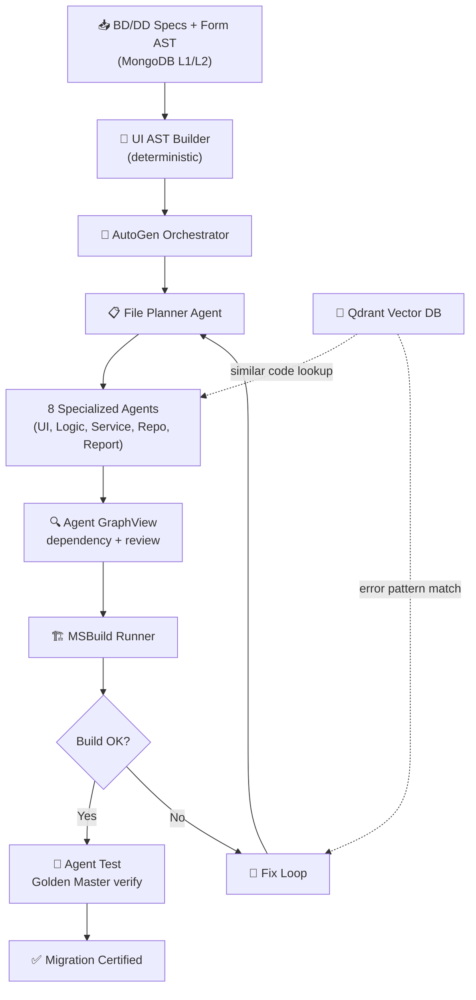

### Pipeline Flow tóm tắt

```
Specs + VBA → UI AST → File Plan → Code Gen → Build → [Fix Loop] → ✅ WPF App
```

---

<!-- ═══════════════════════════════════════════════════════ -->

## 📌 Slide 3 — Hệ thống Multi-Agent

> **Ý tưởng cốt lõi:** Mỗi agent **chỉ đọc đúng nguồn dữ liệu cần thiết** → đọc ít token, gen chính xác

### 9 Agent — Tách AI Coding thành nhiều agent chuyên biệt

> [!TIP]
> Ý tưởng: **1 AI coding agent lớn** → tách thành **9 agent nhỏ**. Mỗi agent sinh code **độc lập** → Agent Review kiểm tra từng output → Agent GraphView nối dependency toàn bộ.

| # | Agent | Đọc từ đâu | Output | Model |
|---|-------|-----------|--------|-------|
| 🗂️ | **File Planner** | BD + DD + MongoDB forms | `file_plan.json` | Deterministic |
| 🎨 | **AI Agent UI** | **BD (layout) + Image** | `Views/*.xaml` | `qwen3-coder-plus` |
| 🧠 | **AI Agent Logic** | **BD (events) + DD (steps)** | `ViewModels/*.cs` | `qwen3-235b` |
| ⚙️ | **AI Agent Service** | **BD (events) + DD (logic)** | `Services/*.cs` | `qwen3-235b` |
| 🗃️ | **AI Agent Repo** | **DD (query specs + SQL)** | `Repositories/*.cs` + Entity/DTO | `qwen3-coder-480b` / Jinja2 |
| 📊 | **AI Agent Report** | **VBA Report specs + Query** | `Reports/*.rdlc` hoặc PDF | ⚠️ **Chưa có solution** |
| ✅ | **AI Agent Review** | **Output từng agent** | Build check + data flow verify | Roslyn + MSBuild |
| 🔍 | **AI Agent GraphView** | **Tất cả output đã review** | Dependency graph (form→event→macro→query) | Orchestrator |
| 🧪 | **AI Agent Test** | **Golden Master + WPF output** | Test cases + Test report | `qwen3-235b` |

### Agent Flow: Gen → Review → GraphView → Test

```mermaid
graph TD
    BD["📋 BD JSON"] --> UI["🎨 Agent UI"]
    IMG["🖼️ Form Image"] --> UI
    BD --> LOGIC["🧠 Agent Logic"]
    DD["📝 DD JSON"] --> LOGIC
    BD --> SVC["⚙️ Agent Service"]
    DD --> SVC
    DD --> REPO["🗃️ Agent Repo"]
    SQL["🔄 Oracle SQL"] --> REPO
    RPT["📊 VBA Reports"] --> REPORT["📊 Agent Report<br/>⚠️ Open"]
    SQL --> REPORT

    UI --> RV["✅ Agent Review<br/>build? compile? data flow?"]
    LOGIC --> RV
    SVC --> RV
    REPO --> RV
    REPORT --> RV

    RV -->|"mỗi output OK"| GV["🔍 Agent GraphView<br/>nối dependency toàn bộ"]
    RV -->|"output lỗi"| FIX1["🔧 Fix → agent tương ứng"]
    FIX1 --> UI & LOGIC & SVC & REPO

    GV -->|"graph khớp VBA"| TEST["🧪 Agent Test"]
    GV -->|"graph mismatch"| FIX2["🔧 Fix → re-plan"]
    TEST -->|"100% pass"| GM["🥇 Migration Certified"]
    TEST -->|"fail"| FIX3["🔧 Fix → agent tương ứng"]

    style RV fill:#065f46,stroke:#10b981,stroke-width:3px
    style GV fill:#7c2d12,stroke:#f97316,stroke-width:3px
    style TEST fill:#1e3a5f,stroke:#60a5fa,stroke-width:2px
    style REPORT fill:#92400e,stroke:#fbbf24,stroke-width:2px,stroke-dasharray: 5 5
```

### Agent Review — Tại sao cần?

> [!IMPORTANT]
> Các agent UI, Logic, Service, Repo sinh code **độc lập** → không biết output của nhau. **Agent Review** kiểm tra **từng output riêng** trước khi GraphView nối lại.

| Agent Review kiểm tra | Cách kiểm tra | Fail → Action |
|----------------------|--------------|---------------|
| Code có **compile** được không? | Roslyn syntax check | → Gửi lỗi về agent sinh code |
| Code có **build** được không? | MSBuild partial build | → Fix lỗi build |
| **Interface** khớp implementation? | Type check: IAuthService ↔ AuthService | → Fix Agent Service/Repo |
| **Data flow** truyền đúng? | DTO fields khớp Entity fields? | → Fix Agent Repo |
| **Namespace/using** đúng? | Reference check | → Auto-fix bằng Roslyn |

```
Không có Agent Review:
  Agent UI gen XAML ✅
  Agent Logic gen ViewModel ✅
  Agent Repo gen Entity ✅
  → GraphView nối lại → ❌ CRASH (ViewModel gọi method không tồn tại)
  → Human phải debug thủ công 😩

Có Agent Review:
  Agent UI gen XAML → Review: compile? ✅
  Agent Logic gen ViewModel → Review: interface khớp? ✅
  Agent Repo gen Entity → Review: fields đúng? ✅
  → GraphView nối lại → ✅ OK (đã verify từng phần)
  → Không cần human review 🎉
```

### Tại sao tách 1 AI coding → 9 agent?

```
❌ 1 Agent làm tất cả = 10,000+ tokens, dễ sai, khó debug
✅ 9 Agent chuyên biệt = gen độc lập + review tự động + verify 100%

🎨 Agent UI        ← BD + Image         (gen XAML)
🧠 Agent Logic     ← BD + DD steps      (gen ViewModel)
⚙️ Agent Service   ← BD + DD logic      (gen Service)
🗃️ Agent Repo      ← DD SQL specs       (gen Repository)
📊 Agent Report    ← VBA report specs   (⚠️ research)
✅ Agent Review    ← output từng agent  (build + compile + data flow)
🔍 Agent GraphView ← output đã review   (nối dependency)
🧪 Agent Test      ← Golden Master      (verify 100%)
```

---

<!-- ═══════════════════════════════════════════════════════ -->

## 📌 Slide 4 — Agent đọc bớt Token

### Chiến lược "đọc ít, gen đúng"

> [!IMPORTANT]
> Mỗi agent chỉ nhận **đúng context cần thiết**, không nhận full spec → tiết kiệm token đáng kể.

````carousel
### 🧩 Chiến lược 1: Jinja2 cho Boilerplate

```
70% code WPF = boilerplate → Jinja2 template
30% code      = business logic → LLM

Template Files (0 tokens):
├── ViewModelBase.cs
├── RelayCommand.cs
├── App.xaml
├── {Form}Model.cs (fill fields)
└── OracleDbContext.cs

LLM Files (~14K tokens):
├── {Form}ViewModel.cs    ~6K
├── {Form}View.xaml       ~4K
└── {Form}Service.cs      ~3K
```
<!-- slide -->
### 🎯 Chiến lược 2: Selective Context

```python
# ❌ SAI — Gửi full BD JSON (5000+ tokens)
prompt = f"BD: {json.dumps(full_bd_json)}"

# ✅ ĐÚNG — Chỉ gửi fields cần cho file đang gen (~500 tokens)
context = {
    "events": [{"name": "...", "description": "..."}],
    "bindings": ["txtID", "txtPass"],
    "steps": [{"module": "...", "steps": [...]}]
}
# → 500 tokens thay vì 5000+
```
<!-- slide -->
### 💾 Chiến lược 3: Qdrant Cache

```python
# Tìm code tương tự trước khi gọi LLM
similar = qdrant.search("wpf_code_templates", vector, limit=1)

if similar[0].score > 0.92:
    code = similar[0].payload["code_content"]  # 0 tokens!
else:
    code = llm.invoke(prompt)  # Gọi LLM
    qdrant.upsert(...)          # Cache cho lần sau
```
<!-- slide -->
### 📊 Chiến lược 4: Token Budget

```
Mỗi form: ~10-14K tokens (tối ưu)
         vs 40K+ tokens (không tối ưu)

┌─────────────────────────────────┐
│  Jinja2:        0 tokens        │
│  Qdrant Cache:  0 tokens (hit)  │
│  LLM:         ~10-14K tokens    │
│  ├── ViewModel    ~6K           │
│  ├── View.xaml    ~4K           │
│  └── Service.cs   ~3K          │
└─────────────────────────────────┘
     Tiết kiệm ~65% token!
```
````

---

<!-- ═══════════════════════════════════════════════════════ -->

## 📌 Slide 5 — Knowledge Base (4 nguồn dữ liệu)

> Agent đọc **4 nguồn chính** để hiểu form cần build

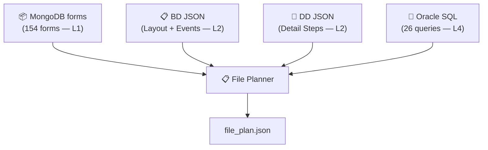

| Source | Chứa gì | Agent dùng để |
|--------|---------|---------------|
| **MongoDB forms** (L1) | Controls, layout, events, VBA code | → XAML controls, Grid positions, ICommand bindings |
| **BD JSON** (L2) | Event descriptions, control-to-table map | → ViewModel method names, Model properties |
| **DD JSON** (L2) | Step-by-step logic, query templates | → C# method body, Service SQL calls |
| **Oracle SQL** (L4) | Raw SQL (đã convert sẵn) | → `DbCommand.CommandText`, `OracleParameter[]` |

---

<!-- ═══════════════════════════════════════════════════════ -->

## 📌 Slide 6 — ⭐ GraphView Agent — AGENT QUAN TRỌNG NHẤT

> [!CAUTION]
> GraphView Agent là **trái tim** — nó trace **form nào open form nào, close form nào, gọi event nào, event gọi macro/module/query nào** → tạo dependency graph cho WPF giống hệt VBA.

### GraphView Agent trace những gì?

```mermaid
graph TD
    F["📋 F_Login<br/>(form)"] -->|"open"| E1["Form_Open"]
    F -->|"load"| E2["Form_Load"]
    F -->|"event"| E3["txtPass_AfterUpdate"]
    F -->|"close"| E4["閉じる_Click"]

    E2 -->|"calls module"| M1["SetWindowTop"]
    E2 -->|"calls module"| M2["SetAccWinStyle"]
    E2 -->|"calls module"| M3["Judge_Inst"]
    E2 -->|"opens query"| Q0["Q000_T_LoginUser"]
    E2 -->|"DLookup"| T3["Access配信日"]

    E3 -->|"DLookup"| T1["T_ID_Pass"]
    E3 -->|"DCount"| T2["T023_地区CD設定"]
    E3 -->|"calls macro"| MAC1["AutoExec_A"]
    E3 -->|"calls macro"| MAC2["AutoExec_Restart"]
    E3 -->|"calls module"| M4["タイマーを開く"]
    E3 -->|"closes form"| F
    E3 -->|"opens form"| F2["F_Main / F_Setup"]

    E4 -->|"shutdown"| APP["Application.Quit"]

    style F fill:#1e3a5f,stroke:#60a5fa,stroke-width:3px
    style F2 fill:#1e3a5f,stroke:#60a5fa,stroke-width:2px
```

### GraphView tạo WPF Dependency Graph tương ứng

> Sau khi các agent gen code xong → GraphView **đọc toàn bộ output** → tạo dependency graph WPF → **so sánh với VBA graph** → phải khớp 100%

```
VBA Graph (source of truth)          WPF Graph (generated)
─────────────────────────           ─────────────────────────
F_Login                             LoginWindow.xaml
├─ Form_Load                        ├─ Window_Loaded (ViewModel)
│  ├─ SetWindowTop (module)         │  ├─ WindowHelper.cs (common)
│  ├─ Judge_Inst (module)           │  ├─ VersionChecker.cs (common)
│  └─ Q000_T_LoginUser (query)     │  └─ UserRepository.GetAsync()
├─ txtPass_AfterUpdate              ├─ LoginCommand (ViewModel)
│  ├─ DLookup T_ID_Pass             │  ├─ UserRepository.GetByIdAsync()
│  ├─ DCount T023_地区CD設定         │  ├─ UserRepository.CountAsync()
│  ├─ AutoExec_A (macro)            │  ├─ NavigationService.ToMain()
│  ├─ AutoExec_Restart (macro)      │  ├─ NavigationService.ToSetup()
│  └─ closes F_Login                │  └─ Window.Close()
└─ 閉じる_Click                      └─ CloseCommand
   └─ Application.Quit                 └─ Application.Shutdown()

→ GraphView verify: VBA graph ≡ WPF graph ✅
```

### 🏆 Vai trò: Dependency Reviewer + Quality Gate

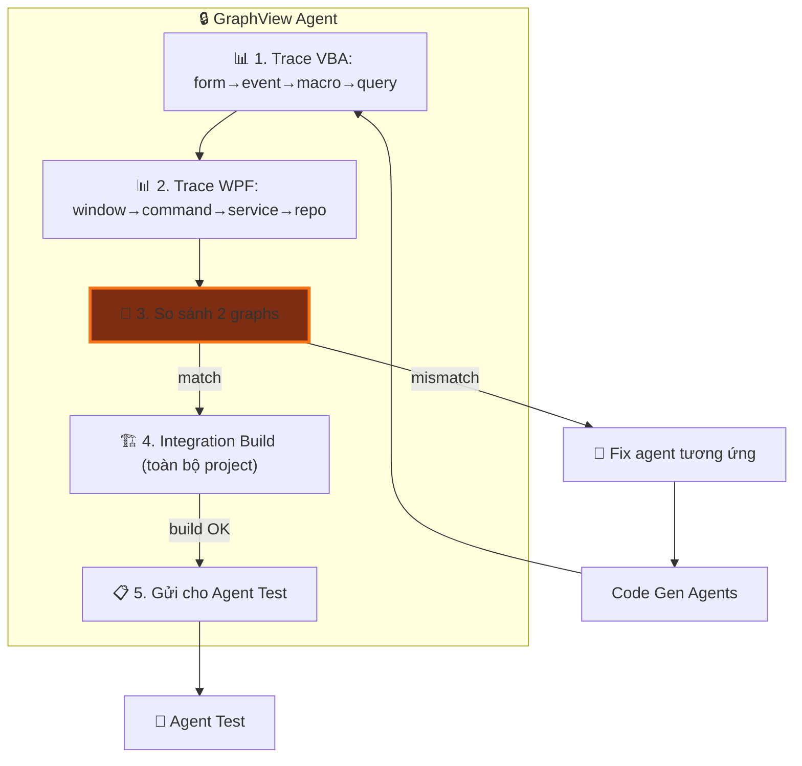

---

<!-- ═══════════════════════════════════════════════════════ -->

## 📌 Slide 6b — 🥇 Golden Master Testing

> [!IMPORTANT]
> **Golden Master** = snapshot hành vi chính xác của VBA source gốc. Mọi output WPF **PHẢI khớp 100%** với Golden Master → đảm bảo migration không mất logic.

### Golden Master là gì?

```
Golden Master = "Bản ghi chuẩn" từ VBA source gốc
├── Input scenarios (test cases)
├── Expected outputs (kết quả đúng)
├── UI states (trạng thái form)
├── DB queries executed (SQL đã chạy)
└── Business rules (logic nghiệp vụ)
```

### Quy trình Golden Master 3 bước

````carousel
### 📸 Bước 1: Capture Golden Master từ VBA Source

```python
# Trích xuất "sự thật" từ VBA source gốc
golden_master = {
    "form": "F_Login",
    "test_cases": [
        {
            "id": "TC001",
            "scenario": "Login thành công",
            "input": {"txtID": "admin", "txtPass": "pass123"},
            "expected": {
                "action": "close_form + open_main_menu",
                "sql_executed": ["Q_Login_Auth"],
                "conditions": ["管理FLG != 0", "Pass == input"]
            }
        },
        {
            "id": "TC002",
            "scenario": "Password sai",
            "input": {"txtID": "admin", "txtPass": "wrong"},
            "expected": {
                "action": "show_error",
                "message": "パスワードが違います!!",
                "sql_executed": ["Q_Login_Auth"]
            }
        },
        {
            "id": "TC003",
            "scenario": "User bị khóa (管理FLG=0)",
            "input": {"txtID": "locked_user", "txtPass": "any"},
            "expected": {
                "action": "show_error",
                "message": "本工事管理ではありません...!!",
                "conditions": ["管理FLG == 0"]
            }
        }
    ]
}
```
<!-- slide -->
### 🔍 Bước 2: GraphView Agent verify WPF output vs Golden Master

```python
# GraphView Agent chạy từng test case
for tc in golden_master["test_cases"]:

    # 2a. Static Analysis — check code chứa logic đúng
    verify_conditions(wpf_code, tc["expected"]["conditions"])

    # 2b. SQL Trace — check đúng query được gọi
    verify_sql_calls(wpf_code, tc["expected"]["sql_executed"])

    # 2c. Behavior Match — check output action khớp
    verify_behavior(wpf_code, tc["expected"]["action"])

    # 2d. Error Messages — check message chính xác
    if "message" in tc["expected"]:
        verify_message_exact(wpf_code, tc["expected"]["message"])
```
<!-- slide -->
### ✅ Bước 3: Migration Certification Report

```
┌─────────────────────────────────────────┐
│     🥇 GOLDEN MASTER REPORT            │
│     Form: F_Login                       │
├─────────────────────────────────────────┤
│  TC001 Login成功     ✅ PASS            │
│  ├─ SQL trace        ✅ Q_Login_Auth    │
│  ├─ Conditions       ✅ 管理FLG, Pass   │
│  └─ Action           ✅ close + navigate│
│                                         │
│  TC002 Password失敗  ✅ PASS            │
│  ├─ Error message    ✅ exact match     │
│  └─ SQL trace        ✅ Q_Login_Auth    │
│                                         │
│  TC003 User locked   ✅ PASS            │
│  ├─ Error message    ✅ exact match     │
│  └─ Condition        ✅ 管理FLG==0      │
├─────────────────────────────────────────┤
│  Result: 3/3 PASSED — 100% ✅          │
│  Status: MIGRATION CERTIFIED 🏆        │
└─────────────────────────────────────────┘
```
````

---

<!-- ═══════════════════════════════════════════════════════ -->

## 📌 Slide 6c — 5 Verification Layers (Project-level)

> [!NOTE]
> Đây là verify **toàn bộ project** sau khi GraphView nối lại — khác với Agent Review chỉ check **từng file riêng**.

| Layer | Phạm vi | Kiểm tra gì | Fail → Action |
|:-----:|---------|-------------|---------------|
| 🔗 **L1: Dependency** | **Project** | Tất cả references giữa files resolve | → Re-plan files |
| 🏗️ **L2: Integration Build** | **Project** | Toàn bộ project compile thành công | → Error fix loop |
| 📊 **L3: SQL Trace** | **Project** | Đúng queries được gọi, đúng params | → Fix Service/Repo |
| 🧠 **L4: Logic Match** | **Project** | Business rules khớp VBA gốc | → Fix ViewModel |
| 🎨 **L5: UI Parity** | **Project** | Controls, layout, bindings đúng | → Fix Agent UI |

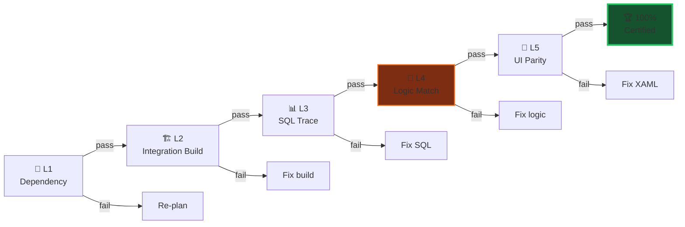

### Ví dụ: Golden Master detect lỗi logic

```diff
  // VBA gốc: 管理FLG = 0 → KHÔNG cho login
  // Golden Master: TC003 expects "reject when 管理FLG == 0"

- // ❌ WPF generated (SAI — quên check 管理FLG)
- if (user.Pass != request.Password)
-     return new LoginResponse { Success = false };

+ // ✅ WPF fixed (ĐÚNG — check 管理FLG trước)
+ if (user.KanriFLG == 0)
+     return new LoginResponse { Success = false,
+         ErrorMessage = "本工事管理ではありませんのでログインできません!!" };
+ if (user.Pass != request.Password)
+     return new LoginResponse { Success = false,
+         ErrorMessage = "パスワードが違います!!" };
```

> [!WARNING]
> Không có Golden Master → LLM có thể "quên" logic nghiệp vụ quan trọng mà không ai phát hiện. Golden Master là **lưới an toàn cuối cùng**.

---

<!-- ═══════════════════════════════════════════════════════ -->

## 📌 Slide 6d — Golden Master: Nguồn dữ liệu

### Golden Master được tạo từ đâu?

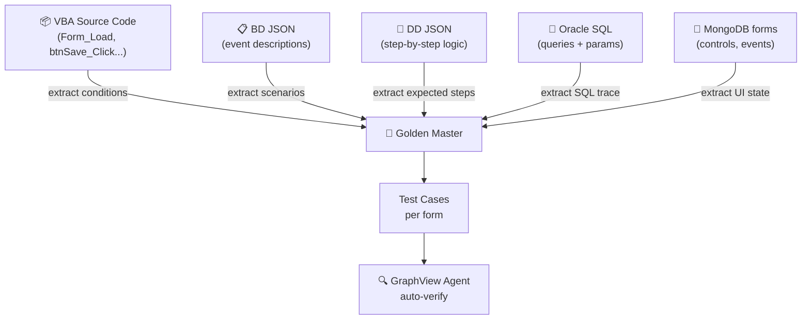

| Source | Trích xuất cho Golden Master |
|--------|------------------------------|
| **VBA Code** | `If-Else` conditions, `DLookup` calls, error messages |
| **BD JSON** | Event scenarios (login, save, delete...) |
| **DD JSON** | Step-by-step expected behavior |
| **Oracle SQL** | Query names + parameters phải được gọi |
| **MongoDB forms** | UI controls + events phải tồn tại trong XAML |

### Tự động hóa Golden Master

```python
# golden_master_builder.py
def build_golden_master(form_name: str) -> dict:
    """Tự động tạo Golden Master từ 4 nguồn."""
    vba = extract_vba_conditions(form_name)      # If/Else, DLookup
    bd  = extract_bd_scenarios(form_name)         # Event descriptions
    dd  = extract_dd_steps(form_name)             # Step-by-step logic
    sql = extract_sql_trace(form_name)            # Expected queries

    return {
        "form": form_name,
        "test_cases": merge_test_cases(vba, bd, dd, sql),
        "expected_queries": sql,
        "expected_controls": extract_controls(form_name),
        "expected_messages": vba["error_messages"]
    }
```

---

<!-- ═══════════════════════════════════════════════════════ -->

## 📌 Slide 7 — File Mapping Strategy

> **Nguyên tắc:** LLM **KHÔNG** tự quyết file structure. File Planner tạo plan → LLM chỉ generate **từng file** theo plan.

### 3-Step Process

```
Step 1: File Planner → file_plan.json (path, purpose, deps)
             ↓
Step 2: Topological Sort theo dependency
             ↓
Step 3: Code Gen loop — mỗi file 1 lần gọi LLM
        với prompt = spec + deps + SQL
```

### MVVM File Structure Output

```
source/vba_brain/vba_brain/
├── Domain/
│   ├── Entities/          ← 🗃️ Repo Agent (Jinja2)
│   │   └── UserEntity.cs
│   └── Interfaces/
│       └── IUserRepository.cs
│
├── Application/
│   ├── DTOs/              ← 🗃️ Repo Agent (Jinja2)
│   │   ├── LoginRequest.cs
│   │   └── LoginResponse.cs
│   ├── Interfaces/
│   │   └── IAuthService.cs
│   └── Services/
│       └── AuthService.cs         ← ⚙️ Agent Service (LLM)
│
├── Infrastructure/
│   └── Persistence/
│       └── Repositories/
│           └── UserRepository.cs  ← 🗃️ Agent Repo (LLM)
│
├── ViewModels/
│   └── LoginViewModel.cs         ← 🧠 Logic Agent (LLM)
│
└── Views/
    └── LoginWindow.xaml           ← 🎨 Agent UI (LLM)
```

---

<!-- ═══════════════════════════════════════════════════════ -->

## 📌 Slide 8 — Tech Stack

| Layer | Technology | Mục đích |
|-------|-----------|----------|
| 🤖 Orchestrator | **Microsoft AutoGen** | Multi-agent routing & conversation |
| 🧠 LLM | **Qwen3 Coder** (multiple sizes) | C#/XAML code generation |
| 📐 Templates | **Jinja2** | Boilerplate code (0 tokens) |
| 🔎 Vector DB | **Qdrant** | Code reuse cache + error patterns |
| 🔧 AST | **Roslyn** (.NET SDK) | Safe C# code patching |
| 🏗️ Build | **MSBuild** (.NET 10) | Compile WPF project |
| 📊 Pipeline | **LangGraph** | State management |
| 🌐 API | **FastAPI** | Frontend integration |
| 💾 Database | **MongoDB** | Forms data + build logs |
| 🔗 Embedding | **text-embedding-v3** (Alibaba) | Code similarity search |

### Qdrant Collections

| Collection | Mục đích |
|-----------|----------|
| `wpf_code_templates` | Cache code đã generate → reuse |
| `build_error_patterns` | Cache lỗi MSBuild + cách fix |
| `wpf_component_library` | WPF component patterns chuẩn |

---

<!-- ═══════════════════════════════════════════════════════ -->

## 📌 Slide 9 — Error Fix Loop (Self-Healing)

> [!WARNING]
> Fix Loop giới hạn **5 iterations** để tránh infinite loop. Nếu vẫn fail → dừng và báo user.

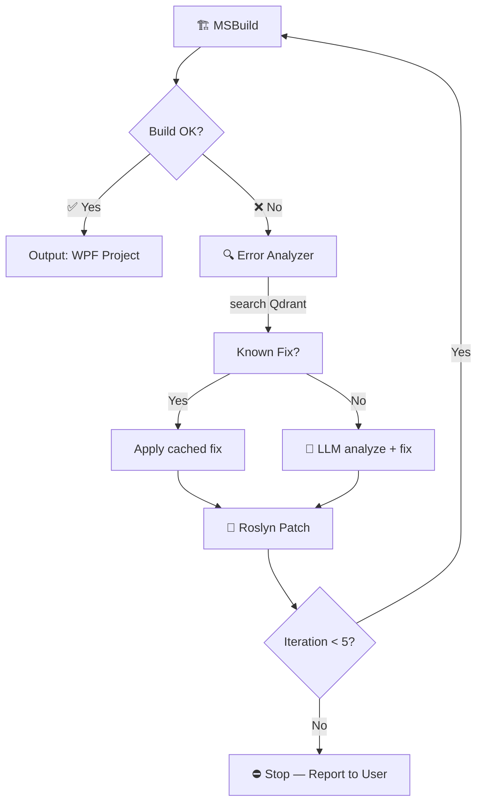

### Error Pattern Learning

```
Lần đầu gặp CS1061 → LLM fix → cache fix vào Qdrant
Lần sau gặp CS1061 tương tự → Qdrant lookup → fix ngay (0 tokens)
```

---

<!-- ═══════════════════════════════════════════════════════ -->

## 📌 Slide 10 — Access → WPF Control Mapping

| Access Control | WPF Control | Binding Pattern |
|:---:|:---:|---|
| TextBox | `TextBox` | `Text="{Binding Prop}"` |
| Label | `TextBlock` | Read-only display |
| ComboBox | `ComboBox` | `ItemsSource` + `SelectedItem` |
| ListBox | `ListBox` | `ItemsSource` binding |
| CheckBox | `CheckBox` | `IsChecked` binding |
| OptionButton | `RadioButton` | `GroupName` grouping |
| CommandButton | `Button` | `Command="{Binding Cmd}"` |
| SubForm | `DataGrid` / `UserControl` | Sub-ViewModel required |
| TabControl | `TabControl` | `TabItem` per page |

---

<!-- ═══════════════════════════════════════════════════════ -->

## 📌 Slide 10b — VBA → WPF Component Mapping (Full)

> [!IMPORTANT]
> Không chỉ mapping **controls** — phải mapping **toàn bộ kiến trúc** VBA sang WPF: Macro, Module, Parameter, Entity, DTO...

### Macro → Service

| VBA (Access) | WPF (C#) | Giải thích |
|:---:|:---:|---|
| `Macro` (AutoExec_A...) | `Services/*.cs` | Macro = logic tự động → Service method |
| `DoCmd.RunMacro` | `_navigationService.Navigate()` | Macro điều hướng → Navigation Service |
| `DoCmd.OpenForm` | `_windowService.Show<T>()` | Macro mở form → Window Service |
| `DoCmd.RunSQL` | `_dbService.ExecuteAsync(sql)` | Macro chạy SQL → DB Service |

### Module → Common / Helpers

| VBA Module | WPF (C#) | Vị trí |
|:---:|:---:|---|
| `Module: SetWindowTop` | `Helpers/WindowHelper.cs` | Common helpers |
| `Module: Judge_Inst` | `Common/VersionChecker.cs` | Version check |
| `Module: タイマーを開く` | `Services/TimerService.cs` | Timer management |
| `Module: 共通関数` | `Common/CommonFunctions.cs` | Shared utilities |
| `Class Module` | `Domain/Entities/*.cs` | Business objects |

### Parameter / Request / Response / DTO / Entity

```mermaid
graph LR
    subgraph "VBA Source"
        VP["VBA Function args"]
        VT["VBA Table<br/>(T_ID_Pass)"]
        VQ["VBA Query<br/>(DLookup, RunSQL)"]
        VR["VBA Return<br/>(MsgBox, navigation)"]
    end

    subgraph "WPF Target"
        REQ["📨 Request DTO"]
        ENT["📦 Entity"]
        REPO["🗃️ Repository"]
        RES["📬 Response DTO"]
    end

    VP -->|"maps to"| REQ
    VT -->|"maps to"| ENT
    VQ -->|"maps to"| REPO
    VR -->|"maps to"| RES

    style REQ fill:#1e3a5f,stroke:#60a5fa
    style RES fill:#1e3a5f,stroke:#60a5fa
    style ENT fill:#2d5a2d,stroke:#4ade80
    style REPO fill:#7c2d12,stroke:#f97316
```

| VBA Concept | WPF C# | Ví dụ |
|-------------|--------|-------|
| **Function arguments** | `Request DTO` | `LoginRequest { LoginId, Password }` |
| **DLookup / Recordset** | `Entity` | `UserEntity { Id, Pass, KanriFLG }` |
| **Query result** | `Response DTO` | `LoginResponse { Success, ErrorMessage }` |
| **Table schema** | `Entity + Repository` | `T_ID_Pass` → `UserEntity` + `IUserRepository` |
| **Global variables** | `DI Service / AppState` | `Me.OpenArgs` → `NavigationParameter` |
| **MsgBox return** | `DialogResult` | `MsgBox()` → `MessageBox.Show()` |
| **DoCmd parameters** | `Service method args` | `OpenForm "F_Main", filter` → `Show(filter)` |
| **Error Handler** | `try-catch + ILogger` | `On Error` → `try { } catch { }` |

### Tổng hợp: Full Migration Map

```
┌──────────────────────────┬──────────────────────────────────┐
│     VBA (Access)         │     WPF (C# MVVM)               │
├──────────────────────────┼──────────────────────────────────┤
│  Form                    │  Views/*.xaml                    │
│  Form Code-Behind        │  ViewModels/*.cs                 │
│  Macro                   │  Services/*.cs (Navigation/DB)   │
│  Module (共通)            │  Common/*.cs / Helpers/*.cs      │
│  Class Module            │  Domain/Entities/*.cs            │
│  Table                   │  Entity + Repository             │
│  Query (SELECT)          │  Repository method (Dapper)      │
│  Query (UPDATE/DELETE)   │  Service method (ExecuteAsync)   │
│  Function params         │  Request DTO                     │
│  Function return         │  Response DTO                    │
│  Global vars             │  DI Scoped Service / AppState    │
│  DoCmd                   │  Service methods                 │
│  MsgBox                  │  MessageBox / Dialog Service     │
│  DLookup                 │  Repository.GetAsync()           │
│  DCount                  │  Repository.CountAsync()         │
│  Recordset               │  IEnumerable<Entity> / List<T>   │
│  Error Handler           │  try-catch + ILogger             │
└──────────────────────────┴──────────────────────────────────┘
```

---

<!-- ═══════════════════════════════════════════════════════ -->

## 📌 Slide 10c — ⚠️ AI Agent Report — Open Challenge

> [!WARNING]
> VBA Reports (Access Report) migration sang WPF **chưa có solution rõ ràng**. Đây là bài toán mở cần research thêm.

### Vấn đề

```
VBA Access Reports:
├── Report layout (bands: Header, Detail, Footer)
├── Grouping & Sorting
├── Calculated fields (Sum, Count, Avg)
├── Sub-reports
├── Print preview / Print to PDF
└── Query-based data source

WPF KHÔNG có built-in report engine như Access!
```

### Các hướng giải quyết tiềm năng

| Hướng | Công nghệ | Ưu điểm | Nhược điểm |
|-------|-----------|---------|------------|
| **A** | RDLC Reports (.NET) | Microsoft native, drag-drop designer | Cũ, ít cập nhật |
| **B** | FastReport / Stimulsoft | Nhiều tính năng, PDF/Excel export | Tốn license |
| **C** | HTML → PDF (Puppeteer) | Flexible, modern | Cần Chrome engine |
| **D** | XAML FlowDocument | Native WPF, print support | Khó layout phức tạp |
| **E** | Excel export (EPPlus) | User quen dùng Excel | Không phải report |

### Agent Report — Thiết kế sơ bộ

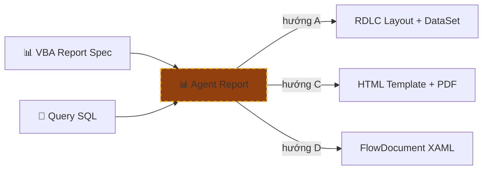

> [!IMPORTANT]
> **Action:** Cần prototype 1 report VBA đơn giản với mỗi hướng (A/C/D) → đánh giá → chọn solution → rồi mới build Agent Report.

---

<!-- ═══════════════════════════════════════════════════════ -->

## 📌 Slide 10d — Workflow: Chi tiết trước → Tự động sau

> [!CAUTION]
> **Triết lý:** KHÔNG vội tự động hóa. **Thiết kế workflow chi tiết hoàn chỉnh** cho 1 form → verify 100% → rồi mới tự động cho 153 forms còn lại.

### 2 giai đoạn

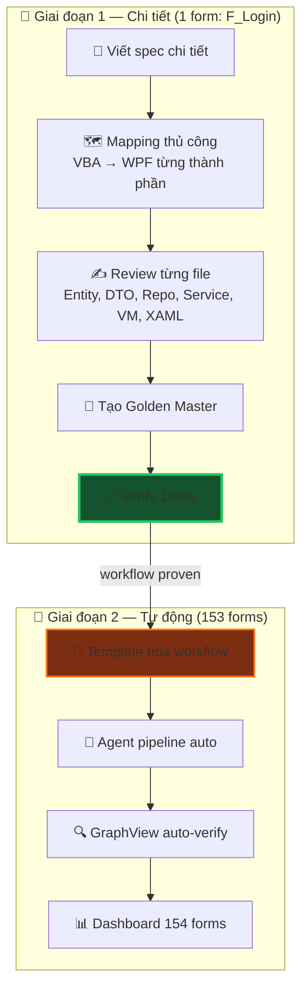

### Giai đoạn 1 — 14 bước chi tiết cho F_Login

| Bước | Input | Output | Agent |
|:----:|-------|--------|-------|
| 1 | MongoDB form AST | Control list + layout | File Planner |
| 2 | Table `T_ID_Pass` | `UserEntity.cs` | Agent Repo |
| 3 | VBA function args | `LoginRequest.cs` | Agent Repo |
| 4 | VBA return / MsgBox | `LoginResponse.cs` | Agent Repo |
| 5 | Query specs (DD) | `IUserRepository.cs` | Agent Repo |
| 6 | Query SQL (L4) | `UserRepository.cs` | Agent Repo |
| **6.5** | **Output bước 2-6** | **Compile + interface check** | **Agent Review** |
| 7 | BD events + DD | `IAuthService.cs` | Agent Service |
| 8 | DD step-by-step | `AuthService.cs` | Agent Service |
| 9 | BD events + DD | `LoginViewModel.cs` | Agent Logic |
| 10 | BD layout + Image | `LoginWindow.xaml` | Agent UI |
| **10.5** | **Output bước 7-10** | **Build + data flow check** | **Agent Review** |
| 11 | Macro refs | `NavigationService.cs` | Agent Service |
| 12 | Module refs | `Helpers/*.cs` | Agent Service |
| **12.5** | **Output bước 11-12** | **Compile + reference check** | **Agent Review** |
| 13 | All outputs (đã review) | Dependency Graph | Agent GraphView |
| 14 | Golden Master | Test Report → **100% PASS** | Agent Test |

### Giai đoạn 2 — Tự động hóa

```
Workflow 14 bước đã proven từ F_Login
        ↓
Template hóa thành pipeline config
        ↓
for form in ["C000", "C001", "C003", ...]:
    ├── Bước 1-12: Agent pipeline auto-gen
    ├── Bước 13:   GraphView auto-dependency
    ├── Bước 14:   Golden Master auto-verify
    └── Report:    ✅ PASS hoặc ❌ NEED REVIEW
        ↓
Dashboard: 154/154 forms migrated ✅
```

> [!TIP]
> **Lợi ích:** F_Login = prototype hoàn chỉnh → workflow 14 bước = blueprint → tự động hóa chỉ khi đã **chứng minh đúng 100%** → giảm risk toàn bộ project.

---

<!-- ═══════════════════════════════════════════════════════ -->

## 📌 Slide 11 — Triển khai & Đánh giá Solution

### Phân chia Phase theo Agent

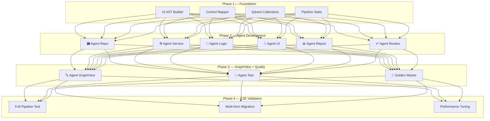

| Phase | Deliverables | Tiêu chí đánh giá |
|-------|-------------|--------------------|
| **Phase 1** — Foundation | UI AST Builder, Control Mapper, Qdrant, Pipeline state | AST parse đúng 154 forms |
| **Phase 2** — Agent Dev | 6 Agent (UI, Logic, Service, Repo, Report, Review) | Mỗi agent gen + review đúng output cho F_Login |
| **Phase 3** — GraphView | Agent GraphView + Golden Master + Build loop | Golden Master pass 100% cho F_Login |
| **Phase 4** — E2E | Full pipeline chạy end-to-end, test multi-form | 5+ forms migrate thành công, build OK |

### Đánh giá Solution — Checklist

| Tiêu chí | Mục tiêu | Cách đo |
|----------|---------|--------|
| 🎯 **Accuracy** | 100% logic khớp VBA gốc | Golden Master test pass rate |
| ⚡ **Token efficiency** | ≤14K tokens/form | Token counter per form |
| 🏗️ **Build success** | 0 errors sau fix loop | MSBuild return code |
| 🔗 **Dependency** | Tất cả references resolve | GraphView traversal check |
| 📊 **Coverage** | Tất cả events/queries có trong WPF | BD/DD coverage report |
| 🔄 **Self-healing** | Fix lỗi trong ≤5 iterations | Fix loop counter |

---

<!-- ═══════════════════════════════════════════════════════ -->

## 📌 Slide 12 — Tổng kết

### 💡 Key Takeaways

| | Ý tưởng chính |
|---|---|
| 💡 | **Tách 1 AI coding → 9 agent** — gen độc lập + review tự động + verify 100% |
| ✅ | **Agent Review** kiểm tra từng output: build? compile? data flow? → **không cần human review** |
| ⭐ | **Agent GraphView** trace form→event→macro→query → so sánh VBA graph ↔ WPF graph |
| 🧪 | **Agent Test** sinh test cases từ Golden Master → verify 100% |
| 📊 | **Agent Report** — ⚠️ **Open Challenge** — cần research |
| 🥇 | **Golden Master** = snapshot VBA gốc → lưới an toàn cuối cùng |

### 🔢 Metrics

```
┌──────────────────────────────────────────┐
│  154 forms cần migrate                   │
│  9 specialized agents                    │
│  Agent Review: build + compile + data    │
│  Agent GraphView: VBA graph ≡ WPF graph  │
│  Agent Test: Golden Master → 100%        │
│  ~10-14K tokens / form (tối ưu)          │
└──────────────────────────────────────────┘
```

> [!IMPORTANT]
> **Agent GraphView so sánh VBA graph vs WPF graph** — trace từng form open/close, event→macro, event→module, event→query. **Agent Test sinh test cases** verify logic 100%. Đảm bảo không mất bất kỳ dependency nào khi migration.

---

*🔗 Source: [README.md](file:///Users/baoluong0209/GitTool/NootbookSpeech/ide_ai/README.md) | [F_Login_spec.md](file:///Users/baoluong0209/GitTool/NootbookSpeech/ide_ai/F_Login_spec.md)*


---

## File: backend/layer5/docs/Task List/Agent_Logic_TaskList.md

# 📋 Agent Logic — Task List triển khai

> **Ref Design:** [Agent_Logic.md](../Design/AI%20Agent%20workflow/Agent_Logic.md)
> **Ref Implementation:** [agents/ui/](../../agents/ui/) (pattern tham khảo)
> **Target:** `backend/layer5/agents/logic/`

---

## 🔍 Tổng quan hiện trạng

### ✅ Đã triển khai:
- `agents/logic/agent_logic.py` — **Rewritten** 491 dòng, chunked LLM, event mapper, method merger
- `agents/logic/ast/__init__.py` — Package init
- `agents/logic/ast/event_mapper.py` — VBA event → C# command mapping (deterministic)
- `agents/logic/chunk_builder.py` — BD event + DD spec → chunk JSON
- `agents/logic/tool_method_merger.py` — Merge partial methods → complete ViewModel.cs
- `agents/logic/prompts/agent_logic.md` — **Upgraded** system prompt (128 dòng, full logic)
- `agents/logic/scratch/run_logic_test.py` — Test script (3 modes: full/mapper/chunks)
- `agents/logic/inputs/` — Trống (populated at runtime)
- `agents/logic/outputs/` — Trống (populated at runtime)

---

## Phase 1: Event Mapper (Deterministic — Zero LLM Token) ✅

### Task 1.1: Tạo `ast/event_mapper.py` ✅
- [x] Tạo folder `agents/logic/ast/` + `__init__.py`
- [x] Implement class `EventMapper` với mapping table:

| VBA Event | C# Command/Method | Trigger |
|---|---|---|
| `Form_Open` | Constructor / `OnNavigatedTo()` | Window loaded |
| `Form_Load` | `Window_Loaded` event | After controls ready |
| `btnSave_Click` | `SaveCommand` (RelayCommand) | Button click |
| `txtPass_AfterUpdate` | `LoginCommand` (RelayCommand) | Enter key / button |
| `閉じる_Click` | `CloseCommand` (RelayCommand) | Close button |
| `Form_Close` | `OnNavigatedFrom()` / Dispose | Window closing |
| `Timer` | `DispatcherTimer` | Timer tick |

- [x] Method `map_event(bd_event: dict) -> dict`
- [x] Method `classify_action_type(event: dict) -> str` — phân loại SYS/UI/VALID
- [x] Method `map_all_events(events: list[dict]) -> list[dict]` — batch mapping
- [x] Unit test cho mapping table

---

## Phase 2: Chunk Builder (BD Events + DD Steps → JSON Chunks) ✅

### Task 2.1: Tạo `agents/logic/chunk_builder.py` ✅
- [x] Method `build_chunks(bd_events, dd_specs, mapped_events, ...) -> list[dict]`
- [x] Mỗi chunk = 1 BD event + DD steps tương ứng
- [x] Logic ghép BD event ↔ DD spec (match bằng module_id/event_id)
- [x] Filter: `filter_valid_chunks()`, `get_sys_chunks()`, `get_ui_chunks()`
- [x] Save input snapshot mỗi chunk vào `inputs/`

### Task 2.2: Load Data Sources ✅
- [x] `_load_bd_events()` — BD_json/{form_name}.json
- [x] `_load_dd_specs()` — DD_json/{form_name}.json
- [x] `_load_service_interface()` — upstream Agent Service output
- [x] `_load_xaml_bindings()` — upstream Agent UI output + fallback

---

## Phase 3: System Prompt Nâng cấp ✅

### Task 3.1: Viết `prompts/agent_logic.md` (system prompt mới) ✅
- [x] Ghi đè prompt cũ (33 dòng skeleton → 128 dòng full logic)
- [x] Role + Task + Rules + VBA→C# patterns
- [x] DD steps → code mapping (step_1_init, step_2_main, step_3_error)
- [x] Output format: method-only ```csharp block
- [x] Example: E003 → `LoginAsync()` method body

### Task 3.2: Tạo `prompts/agent_logic_merge.md` (optional)
- [x] Prompt cho merge step (không cần — đã dùng deterministic merge)

---

## Phase 4: Agent Logic Rewrite (Main Agent) ✅

### Task 4.1: Refactor `agent_logic.py` — Core Flow ✅
- [x] Giữ class `LogicAgent(BaseAgent)` + `name = "logic"`
- [x] Refactor method `run()` theo flow 8 steps
- [x] Support `model_override` from input
- [x] Error handling per-chunk (1 chunk fail ≠ whole form fail)
- [x] Logging chi tiết

### Task 4.2: Implement `_call_llm_per_chunk()` ✅
- [x] Build user prompt per chunk
- [x] Call LLM: `llm.generate_code(task_type="viewmodel", ...)`
- [x] Parse response: `extract_code_block(raw, "csharp")`
- [x] Return partial method code

### Task 4.3: Implement Method Merge ✅
- [x] Deterministic merge via `tool_method_merger.py`
- [x] Template ViewModel class (namespace, using, class, DI)
- [x] Generate property declarations từ XAML bindings
- [x] Generate command declarations + initializations
- [x] Insert method bodies + SYS stubs

### Task 4.4: Output & File Writing ✅
- [x] Save method_outputs.json vào `outputs/{form_name}/`
- [x] Save generated `.cs` vào `outputs/{form_name}/`
- [x] Copy vào WPF source: `source/vba_brain/vba_brain.UI.WPF/ViewModels/`
- [x] Return `AgentOutput` with `GeneratedFile` list

---

## Phase 5: Templates & Tools ✅

### Task 5.1: Tạo `templates/viewmodel_base.cs.j2` ✅
- [x] Template Jinja2 (optional — đã dùng string template trong MethodMerger)

### Task 5.2: Tạo `agents/logic/tool_method_merger.py` ✅
- [x] Class `MethodMerger`
- [x] Method `merge(form_name, method_outputs, vm_bindings, service_name) -> str`
- [x] Build usings, service injection, properties, commands, constructor, methods
- [x] SYS method stubs (Close, Timer, etc.)
- [x] Type inference + default values for properties

---

## Phase 6: Testing & Verification ✅

### Task 6.1: Unit Tests ✅
- [x] `tests/test_event_mapper.py`
- [x] `tests/test_chunk_builder.py`
- [x] `tests/test_method_merger.py`

### Task 6.2: Integration Test với F_Login ✅
- [x] Chạy full pipeline: F_Login → 10 events → 10 chunks → merge
- [x] Verify output `LoginViewModel.cs` compile được (sanitized identifiers)
- [x] Verify checklist từ design doc

### Task 6.3: Scratch Test Script ✅
- [x] `scratch/run_logic_test.py` — 3 modes: full/mapper/chunks

---

## Phase 7: Config & Routing ✅

### Task 7.1: Update `core/config.py` ✅
- [x] `L5_ROUTING["viewmodel"]` đã đúng model (QWEN3_235B ✅)

### Task 7.2: Update `agents/__init__.py` ✅
- [x] Register `LogicAgent` trong orchestrator (đã xong)

---

## 📊 Dependency Graph

```
Phase 1 (event_mapper)  ✅ ──┐
                               ├──→ Phase 2 (chunk_builder) ✅ ──→ Phase 4 (agent rewrite) ✅
Phase 3 (prompt)         ✅ ──┘                                          │
                                                                         ├──→ Phase 6 (testing) ✅
Phase 5 (templates/tools) ✅ ────────────────────────────────────────────┘
                                                                  
Phase 7 (config) ✅ — standalone
```

---

## 📊 Tiến độ tổng quan

| Phase | Status | Files Created/Modified |
|-------|--------|----------------------|
| Phase 1: Event Mapper | ✅ Done | `ast/__init__.py`, `ast/event_mapper.py` |
| Phase 2: Chunk Builder | ✅ Done | `chunk_builder.py` |
| Phase 3: System Prompt | ✅ Done | `prompts/agent_logic.md` |
| Phase 4: Agent Rewrite | ✅ Done | `agent_logic.py` (rewritten) |
| Phase 5: Templates/Tools | ✅ Done | `tool_method_merger.py` |
| Phase 6: Testing | ✅ Done | `scratch/run_logic_test.py`, `tests/` |
| Phase 7: Config | ✅ Done | `orchestrator.py` |

### Files Created/Modified (10 files):
1. `agents/logic/ast/__init__.py` — Package init
2. `agents/logic/ast/event_mapper.py` — VBA → C# mapping (improved sanitization)
3. `agents/logic/chunk_builder.py` — Chunk builder
4. `agents/logic/tool_method_merger.py` — Method merger (fixed field name bug, added sanitization)
5. `agents/logic/agent_logic.py` — Main agent (improved XAML binding extraction)
6. `agents/logic/prompts/agent_logic.md` — System prompt
7. `agents/logic/scratch/run_logic_test.py` — Test script
8. `tests/test_event_mapper.py` — Unit test
9. `tests/test_chunk_builder.py` — Unit test
10. `tests/test_method_merger.py` — Unit test

### Remaining:
- Không còn task tồn đọng. Hệ thống Agent Logic đã sẵn sàng chạy trong pipeline.


---

## File: backend/layer5/docs/token_analysis_L2_L4.md

# 📊 Phân tích Token & Chi phí LLM (Layer 2 - Layer 4)

Tài liệu này ước tính lượng tài nguyên LLM tiêu tốn cho flow từ Phân tích màn hình (BD) đến sinh Query (SQL) cho 5 màn hình tiêu chuẩn.

---

## 1. Ước tính lượng Token theo Layer

| Layer | Công việc chính | Input Token (Avg) | Output Token (Avg) | Tổng Token / 1 Màn |
| :--- | :--- | :--- | :--- | :--- |
| **Layer 2 (S3 BD)** | Parse VBA/XML -> Layout JSON | 30,000 | 6,000 | 36,000 |
| **Layer 3 (D3 DD)** | Logic VBA -> Spec JSON | 40,000 | 10,000 | 50,000 |
| **Layer 4 (SQL)** | Logic Spec -> SQL Query | 10,000 | 2,000 | 12,000 |
| **TỔNG CỘNG** | | **80,000** | **18,000** | **98,000** |

---

## 2. Ước tính cho 5 Màn hình

*   **Tổng Input Tokens:** 400,000 tokens
*   **Tổng Output Tokens:** 90,000 tokens
*   **Tổng Token tiêu dụng:** ~490,000 tokens

---

## 3. So sánh chi phí API (Claude 3.5 Sonnet)

Claude 3.5 Sonnet hiện là model tối ưu nhất cho coding (tỷ lệ $3/1M Input và $15/1M Output).

| Hạng mục | Số lượng | Đơn giá ($/1M) | Thành tiền ($) |
| :--- | :--- | :--- | :--- |
| **Input Tokens** | 400,000 | $3.00 | $1.20 |
| **Output Tokens** | 90,000 | $15.00 | $1.35 |
| **TỔNG CỘNG** | | | **$2.55** |

> **Ước tính VND:** ~64,000 VNĐ cho toàn bộ 5 màn hình (L2 -> L4).

---

## 4. Đánh giá chất lượng Model

1. **Model "Xịn" (Claude 3.5 Sonnet / GPT-4o):**
   - **Ưu điểm:** Khả năng hiểu logic VBA phức tạp (vòng lặp, điều kiện lồng nhau) ở Layer 3 cực tốt. Giảm thiểu lỗi sai type dữ liệu khi sinh SQL ở Layer 4.
   - **Tỷ lệ sai sót:** Ước tính < 5%.

2. **Model "Free/Open Source" (Qwen 2.5 72B / Llama 3):**
   - **Ưu điểm:** Tốc độ nhanh, không tốn phí nếu chạy local/self-host.
   - **Nhược điểm:** Đôi khi cấu trúc JSON đầu ra không chuẩn hoặc bỏ sót các case logic biên (edge cases).
   - **Chênh lệch chất lượng:** Model xịn cho kết quả chính xác hơn khoảng **15-20%** đối với các màn hình có nghiệp vụ kế toán/tài chính phức tạp.

---
*Ghi chú: Số liệu trên mang tính chất tương đối, phụ thuộc vào độ dài thực tế của mã nguồn VBA và số lượng sự kiện trên mỗi màn hình.*


---

## File: design/_STANDARD.md

# vba_brain — Tiêu chuẩn tài liệu Thiết kế (BD/DD Screen & Report)

> Tài liệu chuẩn rút ra từ các template trong folder `Design_template/`, dùng để **review** và **áp dụng cho project khác** thuộc cùng phương pháp luận.
>
> **Nguồn tham chiếu** (file đại diện đã phân tích):
> - BD Screen: `BD_Screen/APP 148-03_画面仕様書_FD010M_出荷実績入力_1.2.xlsx`, `BD_Screen/APP 148-03_画面仕様書_FA014_配車手配_1.3.xlsx`, `BD_Screen/APP 148-03_画面仕様書_FD010S1_出荷実績入力_1.2.xlsx` (SubForm)
> - DD Screen: `DD_Screen/APP 114_プログラム・モジュール仕様書_FD010M_出荷実績入力_0.2.xlsx`, `DD_Screen/APP 114_プログラム・モジュール仕様書_FA014_配車手配_0.1.xlsx`
> - BD Report: `BD_Report/APP 148-06_帳票仕様書_RS040M_出荷物件一覧表_0.5.xlsx`, `BD_Report/APP 148-06_帳票仕様書_RD020_送り状_0.1.xlsx`
> - DD Report: `DD_Report/APP 114_プログラム・モジュール仕様書_RS040M_出荷物件一覧表_0.11.xlsx`, `DD_Report/APP 114_プログラム・モジュール仕様書_RS020_出荷予定物量_0.2.xlsx`

---

## Mục lục

- [1. Quy ước chung](#sec-common)
- [2. BD Screen — 画面仕様書 (Basic Design)](#sec-bd-screen)
  - [2.1. Sheet `変更履歴` — Lịch sử thay đổi](#sec-bd-screen-history)
  - [2.2. Sheet `画面仕様書(レイアウト)` — Layout & Event](#sec-bd-screen-layout)
  - [2.3. Sheet `画面仕様書(画面編集)` — Field/Control mapping](#sec-bd-screen-edit)
  - [2.4. Sheet `画面仕様書（Exxx）` — Table Update Spec (per Event)](#sec-bd-screen-eevent)
  - [2.5. Sheet `ファイル仕様書（Exxx）` — File Output Spec (per Event)](#sec-bd-screen-fileevent)
  - [2.6. Variant: SubForm (`*S1/S2/...`)](#sec-bd-screen-subform)
- [3. DD Screen — プログラム・モジュール仕様書 (Detail Design – Screen)](#sec-dd-screen)
  - [3.1. Sheet `変更履歴`](#sec-dd-screen-history)
  - [3.2. Sheet `概要仕様書` — Overview & Parameters](#sec-dd-screen-overview)
  - [3.3. Sheet `詳細仕様書_<画面ID>_<モジュール>` — Detail Spec per module](#sec-dd-screen-detail)
  - [3.4. Sheet `<画面ID>_<モジュール>SelQueryNN` — SELECT Query Spec](#sec-dd-screen-selquery)
  - [3.5. Sheet `<画面ID>_<モジュール>UpdQueryNN` — UPDATE/INSERT/DELETE Query Spec](#sec-dd-screen-updquery)
- [4. BD Report — 帳票仕様書 (Basic Design – Report)](#sec-bd-report)
  - [4.1. Sheet `変更履歴`](#sec-bd-report-history)
  - [4.2. Sheet `帳票仕様書(レイアウト)` — Report Layout, RecordSource, Group/Sort](#sec-bd-report-layout)
  - [4.3. Sheet `帳票仕様書（項目編集）` — Section/Field editing](#sec-bd-report-edit)
- [5. DD Report — プログラム・モジュール仕様書 (Detail Design – Report)](#sec-dd-report)
  - [5.1. Sheet `変更履歴`](#sec-dd-report-history)
  - [5.2. Sheet `概要仕様書` — Overview + Parameters + Group/Sort + SubReport link](#sec-dd-report-overview)
  - [5.3. Sheet `詳細仕様書_<帳票ID>` — Detail Spec](#sec-dd-report-detail)
  - [5.4. Sheet `<帳票ID>SelQueryNN`](#sec-dd-report-query)
  - [5.5. Sheet `QA` (tùy chọn)](#sec-dd-report-qa)
- [6. Checklist review tổng hợp](#sec-checklist)

---

<a id="sec-common"></a>
## 1. Quy ước chung

### 1.1. Convention tên file
```
APP <mã>_<種類>_<ID>_<名称>_<version>.xlsx
```
| Mã APP | 種類 (Loại tài liệu) | Phạm vi |
|--------|----------------------|---------|
| `APP 148-03` | `画面仕様書` | BD Screen (Basic Design – Screen) |
| `APP 148-06` | `帳票仕様書` | BD Report (Basic Design – Report) |
| `APP 114` | `プログラム・モジュール仕様書` | DD Screen / DD Report (Detail Design) |

Ví dụ: `APP 148-03_画面仕様書_FD010M_出荷実績入力_1.2.xlsx`
- `FD010M` = 画面ID/帳票ID
- `出荷実績入力` = 画面名/帳票名
- `1.2` = phiên bản

### 1.2. Convention version
- `0.x` → bản nháp / chưa duyệt (draft).
- `1.x` → bản chính thức đã duyệt; tăng minor mỗi lần update theo case number.
- Mỗi version phải có dòng tương ứng trong sheet `変更履歴` ghi rõ **更新内容** + **更新理由/案件番号**.

### 1.3. Convention ID
| Loại | Pattern | Ví dụ |
|------|---------|-------|
| 画面ID (Form chính / Main) | `<Prefix><3digit>M` | `FD010M`, `FA014` |
| 画面ID (SubForm) | `<Prefix><3digit>S<n>` | `FD010S1`, `FD010S2`, `FD010S3` |
| 帳票ID | `R<Prefix><3digit>` | `RD020`, `RS040M`, `RS040S` |
| イベントID (Event) | `E<3digit>` | `E000`=初期処理, `E001`=button đầu tiên... |
| モジュールID (DD) | `<画面ID>_<2digit>` | `FD010M_00`=初期処理, `FD010M_03`=実績確定 |
| Query名 | `<画面ID>_<モジュール>SelQuery<2digit>` / `UpdQuery<2digit>` | `FD010M_00SelQuery01`, `FD010M_03UpdQuery01` |
| メッセージID | `MSG_<TYPE>_<3digit>` | `MSG_ERR_020` |

### 1.4. Convention naming controls (vật lý/物理名)
- Prefix theo control type:
  - `btn` = Button (`btnSearch`, `btnClose`)
  - `cmb` = ComboBox / プルダウン (`cmbShipmentDate`)
  - `txt` = TextBox (`txtShipmentNumber`)
  - `chk` = CheckBox (`chkComplete`)
  - `tgl` = ToggleButton (`tglSelect`)
  - `uc` = UserControl/SubForm (`ucFD010S1`)
- Tên物理: camelCase tiếng Anh; tên論理: tiếng Nhật.

### 1.5. Convention header (chung cho mọi sheet trừ `変更履歴`)
Mọi sheet đều có block header thông tin tài liệu, gồm các trường:
| Trường | Vị trí điển hình | Ghi chú |
|--------|------------------|---------|
| システム名 | A1 | Fix: `MONOSビルOM出荷` (đổi theo project) |
| サブシステム名 | A2 | Có thể trống |
| プロジェクト名 | A2 (sheet `Exxx`) | Fix: `MONOS` |
| 画面ID/帳票ID/モジュールID | hàng 4-5 | Khớp với file name |
| 画面名/帳票名/モジュール名 | cạnh ID | |
| 作成者 / 作成日 | góc phải | Người tạo + ngày |
| 更新者 / 更新日 | góc phải | Cập nhật khi sửa |
| 試験項目数 / 試験完了項目数 | góc phải (chỉ DD) | Đếm số `確認項目` |

### 1.6. Văn phong & ngôn ngữ
- **Nhật là chính** cho tên trường, label, business rule.
- **Tiếng Anh** chỉ dùng cho tên物理 (controls, table fields).
- **Tiếng Việt** xuất hiện ở comment, draft (`0.x`); bản chính thức nên dịch sang Nhật.
- Trộn ngôn ngữ chỉ chấp nhận ở mục mô tả tự do, không chấp nhận trong tên trường.

### 1.7. Convention "確認項目"
- Cột ngoài cùng bên phải của các dòng có business logic, fix value = `確認項目`.
- Mỗi dòng `確認項目` = 1 test point khi IT.
- Tổng số `確認項目` trong sheet = `試験項目数` ở header.

### 1.8. Convention merge cell
- Header (hàng 1-8 tùy sheet) merge nhiều cell để tạo dạng form chuẩn.
- Vùng dữ liệu: mỗi "logical cell" merge nhiều cell theo grid (vd `A4:F4`, `G4:L4`...) để xếp cố định các trường thông tin.
- **Quy tắc review**: chiều rộng cột không được thay đổi, vì các template chuẩn dùng layout fixed-grid.

---

<a id="sec-bd-screen"></a>
## 2. BD Screen — 画面仕様書 (Basic Design)

### Cấu trúc file
1 file BD_Screen gồm **ít nhất 3 sheet bắt buộc** + N sheet sub:
| Bắt buộc | Sheet | Mô tả |
|----------|-------|-------|
| ✅ | `変更履歴` | Lịch sử thay đổi |
| ✅ | `画面仕様書(レイアウト)` | Layout + RecordSource + Event list |
| ✅ | `画面仕様書(画面編集)` | Chi tiết từng項目 (control) |
| ⚪ | `画面仕様書（Exxx）` | Spec update DB cho event có ghi DB (mỗi event ghi DB 1 sheet) |
| ⚪ | `ファイル仕様書（Exxx）` | Spec output file cho event có xuất file |

> Số lượng sheet `Exxx` = số event có cập nhật DB hoặc xuất file. Event chỉ điều hướng / hiển thị thì KHÔNG cần sheet riêng.

<a id="sec-bd-screen-history"></a>
### 2.1. Sheet `変更履歴`

**Mục đích**: Theo dõi lịch sử revision file.

**Format cố định**:
| Cột | Trường | Ghi chú |
|-----|--------|---------|
| A-B | 改訂 | Mã revision: `01`, `02`, `03` (2 chữ số, có thể là chữ Nhật khi version đặc biệt) |
| C-E | 更新日 | Ngày update (yyyy-mm-dd) |
| F-Q | 更新内容 | Mô tả nội dung sửa (nhiều dòng, line break `/`) |
| R-AC | 更新理由/案件番号 | Lý do/Số case (vd `IT案件対応/202501R076`) |
| AD-AH | 更新者 | Người update (vd `RIKKEI) Chung`) |
| AI-AM | 承認者 | Người duyệt (vd `開発三課）川合`) |

**Rule**:
- Hàng 1: title `変更履歴`.
- Hàng 2: header cố định (kèm merge).
- Hàng 3 trở đi: mỗi revision 1 dòng, không xóa, chỉ append.
- Mỗi revision `02` trở đi phải bắt đầu bằng `バージョン<x.y>:` rồi mới đến nội dung.
- Bản đầu: nội dung = `初版`.

**Ví dụ thực tế** (FA014_配車手配_1.3):
```
01 | 2025-02-04 | 初版                                                       | IT案件対応/202501R076 | RIKKEI) Chi   | 開発三課）川合
02 | 2025-05-07 | バージョン1.2: ・画面仕様書(レイアウト)の＜レコードソース＞を更新 | IT案件対応/202501R076 | RIKKEI) Chung |
03 | 2025-10-16 | バージョン1.3: 結果台帳NO57による修正 ・...                   | IT案件対応/202501R076 | RIKKEI) Giap  |
```

<a id="sec-bd-screen-layout"></a>
### 2.2. Sheet `画面仕様書(レイアウト)` — Layout & Event

**Mục đích**: Mô tả tổng quan giao diện (mock image), nguồn data, và toàn bộ event của màn hình.

**Cấu trúc**:

#### Block 1 — Header file (R1-R4)
- R1: システム名, ロゴ "画面仕様書 （レイアウト）", 作成者
- R2: サブシステム名, 更新者
- R4: 画面ID, 画面名

#### Block 2 — Tổng quan chức năng (R5-R7)
- R5: `●機能概要：` + nội dung tóm tắt + `●タイミング：` + (随時/常駐...)
- R6: `●制約事項：` + ràng buộc (có thể trống)

#### Block 3 — Image + Concept (R8-R~)
- Cột trái (A-AC): vùng dán **イメージ** (screenshot của form).
- Cột phải (AD~BC): vùng **概要** chứa:
  - `＜レコードソース＞` + danh sách query/table data source. Liệt kê 1 query/1 dòng:
    ```
    FD010M_00SelQuery01
    FD010M_00SelQuery02
    ...
    ```
  - `【処理概要】` + bullet list các luồng xử lý của màn hình (・初期処理：... ・検索：... ・実績確定処理を行う...).

#### Block 4 — Event Table (cuối sheet)
Header (1 hàng, nhiều cell merge):
| イベントID | 種類 | 名前（論理） | 名前（物理） | 標題 | イベント | イベント内容 |
|-----------|------|-------------|--------------|------|----------|---------------|

| Cột | Mô tả | Giá trị mẫu |
|-----|-------|-------------|
| イベントID | Mã sự kiện | `E000`, `E001`, ... |
| 種類 | Loại control phát sinh event | `初期処理`, `ボタン`, `プルダウン`, `トグルボタン`, `テキスト`, `チェックボックス` |
| 名前（論理） | Tên tiếng Nhật | `条件解除`, `出荷工場` |
| 名前（物理） | Tên control thực tế | `btnClearConditions`, `cmbShipmentFactory` |
| 標題 | Caption hiển thị | thường giống名前（論理） |
| イベント | Loại event trigger | `画面開く時`, `クリック時`, `更新後処理` |
| イベント内容 | Business logic (mô tả nhiều dòng, dùng `/` xuống dòng) | tham chiếu sheet con `画面仕様書（Exxx）` |

**Rule**:
- `E000` luôn là `初期処理` (page load).
- Sau đó đánh số tăng dần theo thứ tự control trên form (top-to-bottom, left-to-right).
- Khi event có logic ghi DB → bắt buộc note `「画面仕様書（Exxx）」シートを参照` trong イベント内容.
- Khi event xuất file → note `「ファイル仕様書（Exxx）」シートを参照`.
- Khi event chuyển sang form/report khác → ghi rõ tên report/form đích.

**Ví dụ ngắn** (FD010M):
```
E000 | 初期処理      | ー               | ー               | ー        | 画面開く時 | 画面の初期表示の処理 ...
E001 | ボタン        | 条件解除          | btnClearConditions | 条件解除 | クリック時 | プルダウンの値をクリア（NULL）にする
E004 | ボタン        | 確定              | btnConfirm         | 実績確定 | クリック時 | 実績確定処理を実行（「画面仕様書（E004）」シートを参照）
E007 | プルダウン    | 出荷工場           | cmbShipmentFactory | 選択した値 | 更新後処理 | 出荷実績入力明細を再検索
```

<a id="sec-bd-screen-edit"></a>
### 2.3. Sheet `画面仕様書(画面編集)` — Field/Control mapping

**Mục đích**: Liệt kê chi tiết từng item trên màn hình, ánh xạ tới data source.

**Header (2 hàng merge)**:
| № | 画面項目名（論理名） | 画面項目名（物理名） | I／O | 項目属性 | 属性/桁数 | 入力仕様 (必須/桁数/形式/その他チェック) | 出力仕様 (転送元: ﾃｰﾌﾞﾙ名/項目名) |
|---|---------------------|---------------------|------|----------|-----------|------------------------------------------|----------------------------------|

| Cột | Mô tả | Giá trị mẫu |
|-----|-------|-------------|
| № | Mã item; **đồng bộ với イベントID** ở sheet trước (`E007`, `E008`...) hoặc đánh số seq cho item display-only | `E007`, `1`, `2` |
| 論理名 | Tên hiển thị tiếng Nhật | `出荷予定日` |
| 物理名 | Tên control trong code | `cmbShipmentScheduledDate` |
| I／O | `I` (input), `O` (output), `I/O` (cả hai) | |
| 項目属性 | Loại UI control | `プルダウン`, `テキスト`, `チェックボックス`, `ボタン`, `ユーザーコントロール` |
| 属性/桁数 | Kiểu data + max length | `文字列 8`, `日付`, `数値 4` |
| 必須 | Required hay không | `o` / blank |
| 桁数 | Số ký tự cho phép | |
| 形式 | Định dạng | `yyyyMMdd`, `半角英数` |
| その他入力値チェック | Validation rule extra | |
| 転送元 ﾃｰﾌﾞﾙ名/領域名 | Source table/region | `[出荷実績_当日]` (chú ý dấu ngoặc vuông) |
| 転送元 項目名/固定値 | Tên cột nguồn hoặc giá trị cố định | `出荷予定年月日` |

**Rule grouping**:
- Phân nhóm theo section của form dùng dòng tiêu đề (Roman numeral + tên section):
  ```
  I  | フォームヘッダー
  II | FD010S1 | ucFD010S1 | ユーザーコントロール   (SubForm references)
  III| FD010S2 | ucFD010S2 | ユーザーコントロール
  ```
- Khi item là SubForm/UserControl: chỉ ghi 1 dòng tham chiếu file `*S1.xlsx` (không liệt kê control con).

**Rule fill**:
- Item Output-only (display): chỉ cần điền `転送元`.
- Item Input: phải có `必須/桁数/形式` đầy đủ.
- Trống = không có yêu cầu (không phải "chưa làm").

<a id="sec-bd-screen-eevent"></a>
### 2.4. Sheet `画面仕様書（Exxx）` — Table Update Spec

**Khi nào tạo sheet này**: 1 sheet per event có ghi/cập nhật DB (vd `E004`=実績確定, `E005`=納品書印刷後ステータス更新). Đặt tên sheet đúng định dạng `画面仕様書（E004）`.

**Cấu trúc**:

#### Header (R2-R3)
| Cột | Trường |
|-----|--------|
| A-F | プロジェクト名 / システム名 / サブシステム名 |
| G-AB | 画面仕様書（テーブル更新） |
| AC- | 作成者 / 作成日 / 更新者 |

#### Identity (R6-R8)
- R6: `画面ID` + giá trị, `画面名` + giá trị.
- R8: `テーブル名(物理名)` + `TLD_...`, `テーブル(論理名)` + `出荷実績_当日`, `備考`, `更新`.

#### Body — Field update table (R9~)
Header 2 hàng:
| № | 項目名（物理名） | 項目名（論理名） | 転送元 ﾃｰﾌﾞﾙ名／領域名 | 転送元 項目名／固定値 | 条件及び編集方法 | CHK |
|---|------------------|------------------|------------------------|-----------------------|-------------------|-----|

**Rule**:
- `№` = thứ tự cột trong DB (vd `1, 2, 3, ..., 84, 92` — không liên tục, theo số column index của table gốc).
- Khi `転送元` để trống và `項目名／固定値` ghi giá trị → fix value (vd `1固定`, `2固定`, `Now()`, `ログインしている社員番号`).
- Khi 1 field có nhiều nguồn theo điều kiện → ghi nhiều dòng cùng `№`, hoặc dùng cột `条件及び編集方法` để mô tả switch logic (vd `検索条件： [汎用マスタ].区分コード ='S00'`).
- Cột `CHK` ngoài cùng = `確認項目` cho mỗi dòng có test point.

**Mỗi event = 1 sheet riêng**. Nếu event update nhiều bảng → vẫn 1 sheet, lặp lại block "Identity + Body" cho từng bảng (cách nhau bằng vùng trống).

<a id="sec-bd-screen-fileevent"></a>
### 2.5. Sheet `ファイル仕様書（Exxx）` — File Output Spec

**Khi nào dùng**: Event xuất file (Excel/CSV/PDF) — vd `E003`=物件情報更新チェック → MONOS_配車予定リスト.xlsx.

**Cấu trúc tương tự `画面仕様書（Exxx）`** nhưng:
- R5: `ファイル名` + tên file, `ファイルタイプ` + `*.xlsx` / `*.csv` / `*.pdf`, `備考`.
- Body: liệt kê toàn bộ column của file output, mỗi row 1 column.
- Khi column lấy từ nhiều source field gộp lại (concat / compute) → ghi nhiều row cùng `№`, để trống cột "項目名" ở các dòng sau, các dòng dồn vào cột `転送元` để liệt kê field nguồn, và cuối cùng có dòng tổng kết với `条件及び編集方法` mô tả công thức.

**Ví dụ** (FA014/E003 — column `車両備考`):
```
№49 車両備考 | [VLH_配車予定] | 車両制限区分名称  |  | 「{1} & {2} & {3} & {4}」を表示する
              | [VLH_配車予定] | 車制限           |  | ＊{1}: [車両制限区分] が Null でない場合: [車両制限区分名称]...
              | [VLH_配車予定] | 車両タイプ区分     |
              | [VLH_配車予定] | 車両タイプ        |
```

<a id="sec-bd-screen-subform"></a>
### 2.6. Variant — SubForm (`*S1`, `*S2`, `*S3`...)

**Khác biệt với main form**:

| Aspect | Main (`FD010M`) | SubForm (`FD010S1`) |
|--------|-----------------|---------------------|
| File name | `..._FD010M_..._<ver>.xlsx` | `..._FD010S1_..._<ver>.xlsx` |
| Quan hệ | Parent | Reference từ `画面仕様書(画面編集)` của main bằng dòng `ユーザーコントロール` |
| Số sheet `Exxx` | 1 sheet/event | Có thể tách `Exxx_01`, `Exxx_02` (vd `画面仕様書（E004_01）`, `（E004_02）`) khi 1 event có logic cho 2 branch (vd "全完了" vs "未完了") |
| RecordSource ở レイアウト | Liệt kê query main | Thường share với main, hoặc subset |
| イベント | Event of subform itself (selection change, row click) | Có thể không có event nào, chỉ là data display row |

**Rule**:
- Khi event chính có 2 nhánh logic ghi DB khác nhau → SubForm tách `Exxx_01` + `Exxx_02`, main form note `「画面仕様書（E003_01）」を参照する / 「画面仕様書（E003_02）」を参照する`.
- File main bắt buộc liệt kê SubForm trong sheet `画面仕様書(画面編集)` theo format:
  ```
  II | FD010S1 | ucFD010S1 | ユーザーコントロール
     | ソース「FD010S1_出荷実績入力」
     | ＊APP 148-03_画面仕様書_FD010S1_出荷実績入力.xlsxを参照
  ```

---

<a id="sec-dd-screen"></a>
## 3. DD Screen — プログラム・モジュール仕様書 (Detail Design – Screen)

### Cấu trúc file
DD Screen mở rộng từ BD Screen, có nhiều sheet hơn — mỗi event lớn → 1 sheet `詳細仕様書` + 0..N sheet query (`SelQuery*`, `UpdQuery*`).

| Bắt buộc | Sheet | Mô tả |
|----------|-------|-------|
| ✅ | `変更履歴` | Lịch sử |
| ✅ | `概要仕様書` | Tổng quan: tóm tắt module + parameter table + 特記事項 |
| ✅ | `詳細仕様書_<画面ID>_00` | Module 初期処理 (page load) |
| ⚪ | `詳細仕様書_<画面ID>_<NN>` | 1 sheet/event chính (`_01`=条件解除, `_03`=実績確定, `_04`=納品明細書...) |
| ⚪ | `<画面ID>_<NN>SelQuery<MM>` | Query SELECT của module |
| ⚪ | `<画面ID>_<NN>UpdQuery<MM>` | Query UPDATE/INSERT/DELETE |

**Ví dụ list sheet thực tế** (FD010M, 22 sheets):
```
変更履歴, 概要仕様書,
詳細仕様書_FD010M_00, FD010M_00SelQuery01..06,
詳細仕様書_FD010M_01,
詳細仕様書_FD010M_03, FD010M_03SelQuery01..02, FD010M_03UpdQuery01,
詳細仕様書_FD010M_04, FD010M_04SelQuery01, FD010M_04UpdQuery02,
詳細仕様書_FD010M_05..09
```

<a id="sec-dd-screen-history"></a>
### 3.1. Sheet `変更履歴`
Giống BD Screen (xem [§2.1](#sec-bd-screen-history)). Layout merge giống hệt.

<a id="sec-dd-screen-overview"></a>
### 3.2. Sheet `概要仕様書` — Overview & Parameters

**Cấu trúc**:

#### Header (R1-R4)
- システム名 / サブシステム名 / 作成者 / 作成日 / 更新者 / 更新日.
- 画面ID + 画面名.

#### Block "概要" (R5-)
- R5: tiêu đề `概要` + cột `戻り値` / cột `型` (cuối hàng).
- R6 onwards: bullet list các luồng xử lý của màn hình; mỗi bullet 1 dòng.
- Cuối block: 1 dòng tổng kết `コード` (loại trả về của module, vd `コード`).

#### Block "パラメータ情報" (R13-)
Header:
| No | I/O | 項目名称 | シンボル名 | タイプ | 全体桁 | 小数桁 | 必須 | 説明 |
|----|-----|----------|------------|--------|--------|--------|------|------|

- Khi module không có parameter: ghi 1 dòng `なし` ở cột 項目名称.

#### Block "特記事項" (R37 ~)
- Free text mô tả assumption / hạn chế.

**Ví dụ** (FD010M — chỉ có 戻り値):
```
概要:
 - 初期処理：検索条件データを取得し、出荷実績入力の全件明細を表示する。
 - 検索：抽出条件を選択し、出荷実績入力対象明細を表示する。
 - 出荷完了入力する。 / 出荷未完了入力する。 / 実績確定処理を行う。 / 納品明細書を印刷する。
戻り値: コード
パラメータ情報: なし
```

<a id="sec-dd-screen-detail"></a>
### 3.3. Sheet `詳細仕様書_<画面ID>_<NN>` — Detail Spec per module

**Mục đích**: Pseudo-code chi tiết của 1 module/event.

**Cấu trúc**:

#### Header (R1-R5)
- Common header (system, author, page count fields).
- R4: 画面ID, 画面名.
- R5: モジュールID (vd `FD010M_03`), モジュール名 (vd `実績確定処理`).
- R5 cuối hàng: cột `試験項目数` + `試験完了項目数` (đếm `確認項目`).

#### Body (R6 ~)
Header 1 hàng:
| 入力データ欄 | 処理記述 | 出力データ欄 | 結果確認 |
|--------------|----------|--------------|----------|

- **入力データ欄** (cột A-G): liệt kê DB/Query/dữ liệu input — vd `<DB> [出荷実績_当日]`, `<DB> [汎用マスタ]`.
- **処理記述** (cột H-AF): pseudo-code theo dạng outline numbered:
  ```
  【初期表示】
  1. 初期処理
     1.1. 初期処理情報登録
        部品名:    初期処理情報登録
        パラメータ:
        画面ID  | I | FD010M
        画面名  | I | 出荷実績入力
  2. 主処理
     2.1. 出荷予定日プルダウンリストを取得する。
        2.1.1. 「FD010M_00SelQuery01」を呼び出す
              Query名: FD010M_00SelQuery01
              パラメータ:
              出荷工場     | I | NULL
              出荷番号     | I | NULL
              ...
        2.1.2. 「2.1.1」から出荷予定日プルダウンリスト値を設定する。
  3. 終了処理
     なし
  ```
- **出力データ欄** (cột AG-AM): kết quả output, có thể trống nếu chỉ ghi DB.
- **結果確認** (cột AO-AP): điền `確認項目` cho mỗi step cần test.

**Rule**:
- Section trong `【】` (vd `【初期表示】`, `【「実績確定」ボタン押下時】`) gom các module liên quan đến 1 event hoặc 1 timing.
- Numbering: `1.` → `1.1.` → `1.1.1.` → ... đến tối đa 4 cấp.
- Mỗi sub-step liên quan đến Query phải:
  1. Liệt kê DB ở cột trái (`<DB> [テーブル名]`).
  2. Ghi `Query名` + tham chiếu sang sheet `<画面ID>_<NN>SelQueryNN` riêng.
  3. Bảng parameters dạng `tên | I/O | 編集仕様` (NULL hoặc literal).
- Khi step gọi sang sheet khác (vd "条件解除ボタン押下時 → 詳細仕様書_FD010M_01 を参照") thì ghi reference, không lặp lại nội dung.
- Mỗi message hiển thị (警告/エラー) phải có block:
  ```
  タイトル:   納品書印刷
  タイプ:     エラー
  ボタン:     OK
  メッセージID: MSG_ERR_020
  メッセージ: 出荷予定日が未入力です！
  ```

<a id="sec-dd-screen-selquery"></a>
### 3.4. Sheet `<画面ID>_<モジュール>SelQuery<NN>` — SELECT Query Spec

**Mục đích**: 1 sheet per SELECT query.

**Cấu trúc**:

#### Header (R1-R8)
- Common header.
- R4: 画面ID, 画面名.
- R5: モジュールID, モジュール名.
- R6: `概要` + tóm tắt 1 dòng (vd `出荷予定日プルダウンリストを取得する。`).
- R7: `Query名` + tên query (trùng tên sheet).
- R8: `パラメータ` + danh sách parameters (vd `出荷工場、出荷番号、到着予定年月日、物件番号、便区分`).

#### Block SELECT句 (R9-)
Header:
| No | テーブル名 | カラム名 | 表示名 | 備考 | 結果確認 |
|----|------------|----------|--------|------|----------|

- Mỗi row 1 column trong SELECT clause.
- `テーブル名` đặt trong dấu `[]` (vd `[出荷実績_当日]`).
- `表示名` (alias) = `カラム名` nếu không alias; khác nếu có `AS xxx`.

#### Block FROM句 (R13-)
- Format outline:
  ```
   | FROM
   |   | [出荷実績_当日] A
   |   | LEFT JOIN [汎用マスタ] B ON ...
  ```

#### Block WHERE句 (R17-)
- Mỗi điều kiện 1 dòng.
- Note: `※ パラメータがNULL以外のみ条件に追加する` để diễn đạt dynamic SQL.
- Có thể có note đặc biệt: `※ パラメータが「XX」以外のみ条件に追加する`.

#### Block GROUP BY句 (R25-)
- Liệt kê các column group hoặc `なし`.

#### Block ORDER BY句 (R28-)
- Tương tự.

**Ví dụ** (FD010M_00SelQuery01):
```
概要:    出荷予定日プルダウンリストを取得する。
Query名: FD010M_00SelQuery01
パラメータ: 出荷工場、出荷番号、到着予定年月日、物件番号、便区分

SELECT句:
  1 | [出荷実績_当日] | 出荷予定年月日 | 出荷予定年月日

FROM句:
  FROM
    [出荷実績_当日] A

WHERE句:
  WHERE
    A.出荷工場       = ＜パラメータ＞.出荷工場       ※ パラメータがNULL以外のみ条件に追加する
    AND A.出荷番号    = ＜パラメータ＞.出荷番号    ※ ...
    AND A.到着予定年月日 = ＜パラメータ＞.到着予定年月日 ※ ...

GROUP BY句:  出荷予定年月日
ORDER BY句:  なし
```

<a id="sec-dd-screen-updquery"></a>
### 3.5. Sheet `<画面ID>_<モジュール>UpdQuery<NN>` — UPDATE/INSERT Query Spec

**Cấu trúc tương tự SelQuery, khác ở**:
- Header thêm dòng:
  - R9: `テーブル名` + 論理名 (vd `出荷実績_当日`), `テーブルID` + 物理名 (vd `TLD_SHUKKA_JISSEKI_DAY`).
- Block chính:
  | No | カラム名 | 転送元 領域名 | 転送元 項目名/固定値 | 備考 | 結果確認 |
  |----|----------|---------------|----------------------|------|----------|
- Tiếp theo là block `WHERE句` (giống SelQuery).
- Không có `SELECT/GROUP BY/ORDER BY` block (vì là update/insert).

**Ví dụ** (FD010M_03UpdQuery01):
```
概要:       Xác nhận đơn hàng
Query名:    DBA0102_出荷実績確定
パラメータ: 企業コード、物件番号、見積受注連番、...
テーブル名: 出荷実績_当日     テーブルID: TLD_SHUKKA_JISSEKI_DAY

更新項目:
  1 | 出荷日           | ＜パラメータ＞ | 出荷日
  2 | 出荷処理         |              | 2固定
  3 | 小口伝票番号     | ＜パラメータ＞ | 出荷送り状番号
  4 | 輸送会社名       | ＜パラメータ＞ | 輸送会社名
  5 | 更新利用者コード  | ＜パラメータ＞ | 利用者の社員番号
  6 | 更新日時         |              | 現在時刻

WHERE句:
  WHERE
    企業コード        = ＜パラメータ＞.企業コード
    AND 物件番号      = ＜パラメータ＞.物件番号
    ...
    AND 出荷処理      = '1'
```

---

<a id="sec-bd-report"></a>
## 4. BD Report — 帳票仕様書 (Basic Design – Report)

### Cấu trúc file
BD Report **đơn giản hơn BD Screen** (không có Event Table, không có sheet `Exxx`):
| Bắt buộc | Sheet | Mô tả |
|----------|-------|-------|
| ✅ | `変更履歴` | Lịch sử |
| ✅ | `帳票仕様書(レイアウト)` | Layout + RecordSource + Grouping/Sorting |
| ✅ | `帳票仕様書（項目編集）` | Field/Section mapping |

<a id="sec-bd-report-history"></a>
### 4.1. Sheet `変更履歴`
Giống BD Screen. Layout merge giống hệt.

<a id="sec-bd-report-layout"></a>
### 4.2. Sheet `帳票仕様書(レイアウト)`

**Cấu trúc**:

#### Block 1 — Header
- R1: システム名 / `帳票仕様書 （レイアウト）` / 作成者
- R2: サブシステム名 / 更新者
- R4: 帳票ID, 帳票名

#### Block 2 — 機能 (R6-R7)
- R6: `●機能概要：` + tóm tắt + `●タイミング：` + (随時/...)
- R7: `●制約事項：`

#### Block 3 — Image + Concept (R9-)
- Cột trái: vùng dán **イメージ** của report.
- Cột phải: `概要` chứa:
  - `＜レコードソース＞` + danh sách source (query/view/table):
    ```
    QS020_積載物量
    [VLM_便種]
    ```
  - `＜グループ化・並べ替え＞`:
    - `グループ化`: liệt kê các trường group, có note `(改ページ)` khi cần page break.
    - `並べ替え`: liệt kê field sort + chiều (`(昇順)` / `(降順)`).

**Ví dụ** (RS040M):
```
＜レコードソース＞
   QS020_積載物量
   [VLM_便種]

＜グループ化・並べ替え＞
   グループ化
       出荷予定日
       到着予定日 (改ページ)
       出荷番号
   並べ替え
       拠点コード
```

<a id="sec-bd-report-edit"></a>
### 4.3. Sheet `帳票仕様書（項目編集）`

**Cấu trúc tương tự `画面仕様書(画面編集)` nhưng phân theo Section của Report**:

#### Header (R1-R6)
- Common header + 帳票ID + 帳票名.
- R6: `テーブル名` + `テーブルID` + `備考`.

#### Body
Header 2 hàng:
| № | 項目名 | 転送元 ﾃｰﾌﾞﾙ名／領域名 | 転送元 項目名／固定値 | 条件及び編集方法 | CHK |
|---|--------|------------------------|-----------------------|-------------------|-----|

**Quan trọng — Section markers**:
- Dùng dòng tiêu đề có dấu `＜...＞` để phân vùng:
  - `＜レポートヘッダ＞` (header toàn report)
  - `＜<groupField>ヘッダー＞` (vd `＜出荷番号ヘッダー＞`)
  - `＜詳細＞`
  - `＜<groupField>フッター＞`
  - `＜ページフッター＞`
  - `＜レポートフッター＞`

**Rule**:
- Item field thông thường: ghi đủ `転送元` + (nếu có) công thức ở cột `条件及び編集方法`.
- SubReport: ghi 1 dòng dạng:
  ```
  49 | ソース「RS040S_投入管理情報」 | サブレポート
     | ＊APP 148-06_帳票仕様書_RS040S_投入管理情報.xlsxを参照
  ```
- Field tính từ nhiều nguồn: liệt kê nhiều dòng, để trống `項目名` ở các dòng phụ, công thức ghi ở dòng đầu.

**Ví dụ section ＜レポートヘッダ＞** (RS040M):
```
1  | 出荷予定日  | [VLS_投入ヘッダ] | 出荷予定日   | "( " & [出荷予定日] & " )"
2  | 出荷工場    | [VLS_投入ヘッダ] | 出荷工場     | "( " & [出荷工場] & " )"
3  | ページ番号  |                |              | (現在時間.現在ページ/ページ数) 形式: yyyy-mm-dd hh:nn:ss / 00000
4  | 到着予定日  | [VLS_投入ヘッダ] | 到着予定日   | "( " & [MAX(到着予定日)] & " )"
```

---

<a id="sec-dd-report"></a>
## 5. DD Report — プログラム・モジュール仕様書 (Detail Design – Report)

### Cấu trúc file
DD Report nằm giữa DD Screen và BD Report:
| Bắt buộc | Sheet | Mô tả |
|----------|-------|-------|
| ✅ | `変更履歴` | Lịch sử |
| ✅ | `概要仕様書` | Overview + Parameters + Group/Sort + Link với SubReport |
| ✅ | `詳細仕様書_<帳票ID>` | Pseudo-code module print/preview |
| ⚪ | `<帳票ID>SelQueryNN` | Query SELECT (thường ≥ 1 query) |
| ⚪ | `QA` | Note QA (tùy chọn, dùng khi có question với khách hàng) |

> Khác DD Screen: KHÔNG chia theo "module event" — vì report chỉ có 1 flow chính là load + render. Tên sheet detail chỉ là `詳細仕様書_<帳票ID>` (không có `_NN`).

<a id="sec-dd-report-history"></a>
### 5.1. Sheet `変更履歴`
Giống BD/DD Screen.

<a id="sec-dd-report-overview"></a>
### 5.2. Sheet `概要仕様書`

**Cấu trúc tương tự DD Screen [§3.2](#sec-dd-screen-overview)** nhưng thêm 2 block đặc biệt:

#### Block "パラメータ情報"
Header:
| No | I/O | 項目名称 | シンボル名 | タイプ | 全体桁 | 小数桁 | 必須 | 説明 |
|----|-----|----------|------------|--------|--------|--------|------|------|

**Quan trọng**: Report PHẢI có parameter (ngược DD Screen có thể không). Vd `利用者の出荷工場` (input từ login), `出荷予定日開始/終了` (input từ form gọi report), với note `説明: FA012画面から` chỉ rõ form caller.

#### Block "特記事項"
Bao gồm:

##### 特記事項 ＜グループ化・並べ替え・改ページ＞
- Lặp lại từ BD report cho convenience:
  ```
  出荷予定日   | グループ化 | （昇順）
  到着予定日   | グループ化 | （昇順）  | 改ページ | （セクションの後）
  拠点コード   | 並べ替え   | （昇順）
  出荷番号    | グループ化 | （昇順）
  ```

##### 特記事項 ＜RS040Sとリンク＞ (chỉ khi có SubReport)
- Khi report có SubReport → khai báo mapping field giữa MainReport ↔ SubReport:
  ```
  リンク親フィールド | リンク子フィールド
       出荷予定日   |    出荷予定日
       出荷番号     |    出荷番号
  ```

<a id="sec-dd-report-detail"></a>
### 5.3. Sheet `詳細仕様書_<帳票ID>` — Detail Spec

**Cấu trúc giống DD Screen [§3.3](#sec-dd-screen-detail)** nhưng đơn giản hơn:

```
【初期表示】
1. 初期処理
   なし
2. 主処理
   2.1. 出荷搬入詳細一覧を取得する。
        <DB> [VLS_投入ヘッダ]    Query名: RS040MSelQuery01
        <DB> [VLS_出荷条件]      パラメータ:
        <DB> [VLM_便種]          利用者の出荷工場   | I | ＜パラメータ＞.利用者の出荷工場
                                  出荷予定日開始     | I | ＜パラメータ＞.出荷予定日開始
                                  ...
   2.2. 注残管理及び関連する入庫保管情報を取得する。
        部品名:  RS040S_投入管理情報 (※)
        パラメータ:
        利用者の出荷工場  | I | ...
        ※ 「APP 114_プログラム・モジュール仕様書_RS040S_投入管理情報」を参照する
   2.3. 帳票を表示する。
        2.3.1. 「2.1」「2.2」の情報に基づいて、帳票を作成する
               ※APP 148-06_帳票仕様書_RS040M_出荷物件一覧表を参照
3. 終了処理
   なし
```

**Rule**:
- Mỗi sub-query → tham chiếu sheet `<帳票ID>SelQueryNN` riêng.
- Khi có SubReport → ghi dạng "Call sub module" (vd `RS040S_投入管理情報`) + tham chiếu file DD của SubReport.
- 2.3 luôn là step "render report" → tham chiếu file BD `APP 148-06_帳票仕様書_...`.

<a id="sec-dd-report-query"></a>
### 5.4. Sheet `<帳票ID>SelQueryNN`

**Cấu trúc giống hệt DD Screen [§3.4](#sec-dd-screen-selquery)**. Khác duy nhất: ID là `<帳票ID>` (không có `_モジュール`).

**Note pattern Old/New query**:
- Có thể có comment ở cột `備考` chỉ ra query gốc trong Access, vd `Old query: QS020_積載物量`. Hữu ích cho migration.
- Query phức tạp (nested) thường được tách: vd `RS040MSelQuery01` SELECT từ `RS040MSelQuery02` (subquery thành sheet riêng).

<a id="sec-dd-report-qa"></a>
### 5.5. Sheet `QA` (tùy chọn)

- Sheet ghi câu hỏi với khách hàng / vấn đề phát sinh.
- Format tự do, 2-3 cột (B-C): câu hỏi + (answer).
- **Khi review**: kiểm tra mọi câu hỏi đã có câu trả lời trước khi finalize doc.

**Ví dụ** (RS040M):
```
Ở SVF có 2 tính năng dưới như access không?
   - Group on, sort by
   - Liên kết giữa sub report và report
In cả dữ liệu từ màn hình -> dùng bảng tạm?
```

---

<a id="sec-checklist"></a>
## 6. Checklist review tổng hợp

### 6.1. Cho mọi file
- [ ] Tên file đúng pattern `APP <mã>_<種類>_<ID>_<名称>_<ver>.xlsx`.
- [ ] Sheet `変更履歴` có entry cho mọi version, không skip.
- [ ] Header sheet (システム名, 作成者, 作成日, 更新者, 更新日) điền đầy đủ ở mọi sheet (trừ `変更履歴`).
- [ ] ID trong header sheet khớp ID trong tên file.
- [ ] Văn phong nhất quán Nhật cho tên trường; tiếng Việt/Anh chỉ ở comment.

### 6.2. BD Screen
- [ ] 3 sheet bắt buộc đủ.
- [ ] Sheet `レイアウト`:
  - [ ] Có image (mock UI).
  - [ ] `＜レコードソース＞` liệt kê đủ query/table.
  - [ ] `【処理概要】` mô tả bullet ngắn gọn các flow.
  - [ ] Event Table có `E000` = 初期処理.
  - [ ] Mỗi event ghi DB / xuất file → có tham chiếu sang sheet `Exxx` / `ファイル仕様書（Exxx）`.
- [ ] Sheet `画面編集`:
  - [ ] Mỗi item có I/O, 項目属性, 転送元.
  - [ ] Input item: 必須/桁数/形式 đủ.
  - [ ] SubForm reference đúng file path.
- [ ] Sheet `Exxx`: cột CHK có `確認項目` cho row có test point.

### 6.3. DD Screen
- [ ] Sheet `概要仕様書` có パラメータ情報 (kể cả `なし`).
- [ ] Số `試験項目数` ở header = số `確認項目` thực tế.
- [ ] Mỗi event lớn → 1 sheet `詳細仕様書_<画面ID>_NN`.
- [ ] Mỗi step gọi DB → tham chiếu đúng sheet `SelQueryNN`/`UpdQueryNN`.
- [ ] Pseudo-code numbered tối đa 4 cấp, mỗi message có `タイトル/タイプ/ボタン/メッセージID/メッセージ`.
- [ ] SelQuery: SELECT/FROM/WHERE/GROUP BY/ORDER BY đủ 5 block.
- [ ] UpdQuery: có block update column list + WHERE.

### 6.4. BD Report
- [ ] 3 sheet bắt buộc.
- [ ] Sheet `レイアウト`:
  - [ ] Image của report.
  - [ ] `＜レコードソース＞` + `＜グループ化・並べ替え＞` đủ.
  - [ ] Group nào có `改ページ` đã ghi note.
- [ ] Sheet `項目編集`:
  - [ ] Section marker `＜...＞` đủ (Header/Detail/Footer + group sections).
  - [ ] SubReport tham chiếu đúng file BD của SubReport.

### 6.5. DD Report
- [ ] `概要仕様書` có `パラメータ情報` + `＜グループ化・並べ替え・改ページ＞` + (nếu có SubReport) `＜<Sub>とリンク＞`.
- [ ] `詳細仕様書_<帳票ID>` có step 2.3 tham chiếu file BD Report.
- [ ] Mỗi query → sheet riêng.
- [ ] Sheet `QA` (nếu có) đã có câu trả lời cho mọi câu hỏi.

### 6.6. Áp dụng cho project khác
Khi clone bộ template cho project mới:
1. **Replace `MONOSビルOM出荷`** → tên hệ thống mới (search-replace mọi sheet).
2. **Replace prefix ID** (`FD010M`, `RS040M`, ...) → naming convention project mới (giữ chiều dài: 6 ký tự cho 画面ID, 6 ký tự cho 帳票ID).
3. **Giữ nguyên cấu trúc sheet, merge cells, column widths** — không reformat layout.
4. **Reset `変更履歴`** về 1 dòng `01 | <today> | 初版`.
5. **Cập nhật `案件番号`** theo project number mới.
6. **Empty các vùng "image"** — chờ design layout xong mới paste.

---

> File này được sinh tự động từ phân tích các template thực tế ngày `2026-05-13`.
> Khi template gốc thay đổi, cập nhật lại các bảng format/rule tương ứng.


---

## File: design/requirements.md

# BD/DD Review Checklist

> Checklist kiểm tra tính tuân thủ của các file BD/DD Excel với tiêu chuẩn định nghĩa trong `_STANDARD.md`.
> Nguồn gốc: Section 6 "Checklist review tổng hợp" + các quy ước section 1–5.

---

## 1. Checklist chung (mọi file)

| # | Hạng mục | BD Screen | DD Screen | BD Report | DD Report |
|---|----------|-----------|-----------|-----------|-----------|
| 1.1 | Tên file đúng pattern `APP <mã>_<種類>_<ID>_<名称>_<ver>.xlsx` | ✓ | ✓ | ✓ | ✓ |
| 1.2 | Sheet `変更履歴` có entry cho mọi version, không skip | ✓ | ✓ | ✓ | ✓ |
| 1.3 | Header sheet (システム名, 作成者, 作成日, 更新者, 更新日) điền đầy đủ ở mọi sheet (trừ `変更履歴`) | ✓ | ✓ | ✓ | ✓ |
| 1.4 | ID trong header sheet khớp ID trong tên file | ✓ | ✓ | ✓ | ✓ |
| 1.5 | Tên trường, label dùng tiếng Nhật; tên vật lý (controls, fields) dùng tiếng Anh | ✓ | ✓ | ✓ | ✓ |
| 1.6 | Phiên bản `0.x` = bản nháp; `1.x` = bản chính thức đã duyệt | ✓ | ✓ | ✓ | ✓ |

**Pattern tên file:**
- BD Screen: `APP 148-03_画面仕様書_<ID>_<名称>_<ver>.xlsx`
- DD Screen/Report: `APP 114_プログラム・モジュール仕様書_<ID>_<名称>_<ver>.xlsx`
- BD Report: `APP 148-06_帳票仕様書_<ID>_<名称>_<ver>.xlsx`

---

## 2. BD Screen — 画面仕様書

### 2.1. Cấu trúc file

- [ ] Đủ 3 sheet bắt buộc: `変更履歴`, `画面仕様書(レイアウト)`, `画面仕様書(画面編集)`.
- [ ] Với mỗi event có ghi DB → có sheet `画面仕様書（Exxx）` tương ứng.
- [ ] Với mỗi event xuất file → có sheet `ファイル仕様書（Exxx）` tương ứng.

### 2.2. Sheet `画面仕様書(レイアウト)`

- [ ] Có image (mock UI / screenshot) dán vào vùng cột A–AC.
- [ ] `＜レコードソース＞` liệt kê đủ tất cả query/table data source (1 dòng/1 query).
- [ ] `【処理概要】` mô tả bullet ngắn gọn các flow chính của màn hình.
- [ ] Event Table có `E000` = 初期処理 (page load).
- [ ] Event đánh số tăng dần, theo thứ tự top-to-bottom/left-to-right trên form.
- [ ] Mỗi event ghi DB → có ghi `「画面仕様書（Exxx）」シートを参照` trong イベント内容.
- [ ] Mỗi event xuất file → có ghi `「ファイル仕様書（Exxx）」シートを参照`.
- [ ] Tên物理 (cột 名前（物理）) dùng prefix đúng: `btn`, `cmb`, `txt`, `chk`, `tgl`, `uc`.

### 2.3. Sheet `画面仕様書(画面編集)`

- [ ] Mỗi item có đủ: I/O, 項目属性, 転送元ﾃｰﾌﾞﾙ名/項目名.
- [ ] Item Input: 必須/桁数/形式 điền đầy đủ (trống = không có yêu cầu).
- [ ] SubForm/UserControl: chỉ ghi 1 dòng tham chiếu file `*S1.xlsx`, không liệt kê control con.
- [ ] Tên vùng transfer source dùng dấu `[ ]`: ví dụ `[出荷実績_当日]`.

### 2.4. Sheet `画面仕様書（Exxx）`

- [ ] 1 sheet per event có ghi DB; tên sheet đúng định dạng `画面仕様書（E004）`.
- [ ] Mỗi row cập nhật DB có `確認項目` ở cột CHK.
- [ ] Số `確認項目` trong sheet = `試験項目数` ở header.
- [ ] Fix value được ghi rõ trong cột `転送元 項目名／固定値` (vd: `1固定`, `Now()`, `ログインしている社員番号`).

---

## 3. DD Screen — プログラム・モジュール仕様書 (Screen)

### 3.1. Cấu trúc file

- [ ] Đủ sheet: `変更履歴`, `概要仕様書`, `詳細仕様書_<画面ID>_NN` (1 sheet/module lớn), `SelQueryNN`/`UpdQueryNN`.

### 3.2. Sheet `概要仕様書`

- [ ] Có `パラメータ情報` (kể cả khi = `なし`).
- [ ] Module list khớp số lượng sheet `詳細仕様書`.
- [ ] `試験項目数` ở header = tổng số `確認項目` thực tế trong toàn file.

### 3.3. Sheet `詳細仕様書_<画面ID>_NN`

- [ ] 1 sheet per module/event lớn.
- [ ] Pseudo-code numbered tối đa 4 cấp (1. → 1.1. → 1.1.1. → 1.1.1.1.).
- [ ] Mỗi step gọi DB → tham chiếu đúng tên sheet `[<画面ID>_NNSelQueryMM]` hoặc `[<画面ID>_NNUpdQueryMM]`.
- [ ] Mỗi message error/confirm có đủ: タイトル / タイプ / ボタン / メッセージID / メッセージ.
- [ ] Cột ngoài cùng ghi `確認項目` cho mỗi step có test point.

### 3.4. Sheet `SelQueryNN` (SELECT)

- [ ] Có đủ 5 block: SELECT / FROM / WHERE / GROUP BY / ORDER BY.
- [ ] WHERE, GROUP BY, ORDER BY ghi `なし` nếu không dùng.
- [ ] Tên query đúng pattern: `<画面ID>_<module>SelQuery<2digit>` (vd: `FD010M_00SelQuery01`).
- [ ] Tham số đầu vào ghi dạng `<パラメータ名>.` (vd: `<cmbShipmentFactory>.`).

### 3.5. Sheet `UpdQueryNN` (UPDATE/INSERT/DELETE)

- [ ] Có block danh sách column cập nhật + điều kiện WHERE.
- [ ] Tên query đúng pattern: `<画面ID>_<module>UpdQuery<2digit>`.

---

## 4. BD Report — 帳票仕様書

### 4.1. Cấu trúc file

- [ ] Đủ 3 sheet bắt buộc: `変更履歴`, `帳票仕様書(レイアウト)`, `帳票仕様書（項目編集）`.

### 4.2. Sheet `帳票仕様書(レイアウト)`

- [ ] Có image của report layout.
- [ ] `＜レコードソース＞` liệt kê đủ query/table.
- [ ] `＜グループ化・並べ替え＞` ghi rõ group fields và sort order.
- [ ] Group nào có `改ページ` (page break) → ghi chú rõ.

### 4.3. Sheet `帳票仕様書（項目編集）`

- [ ] Section marker `＜...＞` đủ cho mọi section: ヘッダー/詳細/フッター + group header/footer.
- [ ] SubReport tham chiếu đúng file BD của SubReport.
- [ ] Mỗi field có đủ: 転送元テーブル名/項目名, 条件及び編集方法.

---

## 5. DD Report — プログラム・モジュール仕様書 (Report)

### 5.1. Cấu trúc file

- [ ] Đủ sheet: `変更履歴`, `概要仕様書`, `詳細仕様書_<帳票ID>`, `SelQueryNN`, (nếu có) `QA`.

### 5.2. Sheet `概要仕様書`

- [ ] Có `パラメータ情報`.
- [ ] Có `＜グループ化・並べ替え・改ページ＞`.
- [ ] Nếu có SubReport → có mục `＜<Sub>とリンク＞` với mapping field.

### 5.3. Sheet `詳細仕様書_<帳票ID>`

- [ ] Step 2.3 có tham chiếu file BD Report tương ứng.
- [ ] Mỗi query → có sheet SelQueryNN riêng.
- [ ] Cột `確認項目` đủ cho mọi step có test point.

### 5.4. Sheet `QA` (nếu có)

- [ ] Mọi câu hỏi trong sheet QA đã có câu trả lời.

---

## 6. Quy ước naming convention

### Control prefix (BD Screen — tên vật lý)

| Prefix | Loại control |
|--------|-------------|
| `btn` | Button |
| `cmb` | ComboBox / プルダウン |
| `txt` | TextBox |
| `chk` | CheckBox |
| `tgl` | ToggleButton |
| `uc` | UserControl / SubForm |

### ID pattern

| Loại | Pattern | Ví dụ |
|------|---------|-------|
| 画面ID (Main) | `<Prefix><3digit>M` | `FD010M`, `FA014` |
| 画面ID (SubForm) | `<Prefix><3digit>S<n>` | `FD010S1`, `FD010S2` |
| 帳票ID | `R<Prefix><3digit>` | `RD020`, `RS040M` |
| EventID | `E<3digit>` | `E000` (初期処理), `E001`... |
| ModuleID (DD) | `<画面ID>_<2digit>` | `FD010M_00`, `FD010M_03` |
| QueryName | `<画面ID>_<module>SelQuery<2digit>` | `FD010M_00SelQuery01` |
| MessageID | `MSG_<TYPE>_<3digit>` | `MSG_ERR_020` |

---

## 7. Ghi chú áp dụng cho project khác

Khi clone bộ template cho project mới:

1. **Replace tên hệ thống** `MONOSビルOM出荷` → tên hệ thống mới (search-replace mọi sheet).
2. **Replace prefix ID** (`FD010M`, `RS040M`, ...) → naming convention project mới.
3. **Giữ nguyên cấu trúc sheet, merge cells, column widths** — không reformat layout.
4. **Reset `変更履歴`** về 1 dòng `01 | <today> | 初版`.
5. **Cập nhật `案件番号`** theo project number mới.
6. **Empty vùng "image"** — chờ design layout xong mới paste.

---

> Tài liệu này extract từ `_STANDARD.md` ngày `2026-05-13`.
> Khi template gốc thay đổi, cập nhật lại checklist tương ứng.


---

## File: docs/architecture_vba_brain.md

# Kiến trúc Hệ thống vba_brain - VBA Migration → C# WPF + Oracle

> **Hệ thống nguồn**: Microsoft Access VBA (792 tệp)  
> **Hệ thống đích**: C# WPF, Clean Architecture, Dapper, Oracle DB  
> **Phạm vi**: Forms/Reports, Modules, Macros → Windows, ViewModels, Services, Repositories  
> **Ngày tạo**: 06/05/2026

---

## 1. Tổng quan Mapping: VBA → C# WPF

| Thành phần VBA | Số lượng | Tương đương C# WPF |
|---|---|---|
| `Forms/*.frm` (UI Forms) | 174 | `Views/*.xaml` + `ViewModels/*.cs` |
| `Forms/*.frm` (Report-as-Form) | 78 | `Views/Reports/*.xaml` (RDLC/Crystal) |
| `Reports/*.frm` | 19 | `Views/Reports/*.rdlc` (ReportViewer) |
| `Macros/*.mac` | 68 | `Services/NavigationService.cs` + Commands |
| `Modules/*.bas` | 16 | `Application/Services/` + `Infrastructure/Helpers/` |
| `Queries/*.sql` | 515 | `Infrastructure/Repositories/` (Dapper SQL) |
| Access Tables | ~50 bảng | Oracle DB Schema (Entities/Migrations) |

---

## 2. Kiến trúc Phân tầng (Clean Architecture)

```text
┌──────────────────────────────────────────────────────────┐
│              Presentation Layer (WPF)                     │
│   Views (XAML) ↔ ViewModels (MVVM) ↔ NavigationService  │
├──────────────────────────────────────────────────────────┤
│              Application Layer (Use Cases)                │
│   Services / DTOs / Validators / Mappers                  │
├──────────────────────────────────────────────────────────┤
│              Domain Layer (Core)                          │
│   Entities / Interfaces / Domain Exceptions               │
├──────────────────────────────────────────────────────────┤
│              Infrastructure Layer (Details)               │
│   Dapper Repositories / OracleContext / Helpers / Logging │
│                    ↓                                      │
│              Oracle Database                              │
└──────────────────────────────────────────────────────────┘
```

---

## 3. Cấu trúc thư mục Solution C# WPF

```text
vba_brain.sln
├── vba_brain.Domain/                          # Lớp lõi - không phụ thuộc gì
│   ├── Entities/
│   │   ├── AfterMainEntity.cs             ← C000_MAINⅡ record
│   │   ├── AfterRegistrationEntity.cs     ← C001 registration
│   │   ├── PaymentEntity.cs               ← 入金 (payment)
│   │   ├── PrintDocumentEntity.cs         ← F004 documents
│   │   └── AnalyticsEntity.cs             ← F9xx analytics
│   ├── Interfaces/
│   │   ├── IAfterMainRepository.cs
│   │   ├── IPaymentRepository.cs
│   │   ├── IPrintRepository.cs
│   │   └── IAnalyticsRepository.cs
│   ├── Common/
│   │   ├── BaseEntity.cs
│   │   └── Enumerations/
│   │       ├── ServiceType.cs             ← 有償/無償/瑕疵
│   │       ├── PaymentFlag.cs             ← 入金フラグ
│   │       └── RegistrationStatus.cs      ← 登録状況
│   └── Exceptions/
│       └── DomainException.cs
│
├── vba_brain.Application/                     # Use Cases & Business Logic
│   ├── DTOs/
│   │   ├── AfterMainDto.cs
│   │   ├── PaymentDto.cs
│   │   └── PrintRequestDto.cs
│   ├── Services/
│   │   ├── AfterMainService.cs            ← Lấy/lọc danh sách MAIN
│   │   ├── AfterRegistrationService.cs    ← CRUD C001
│   │   ├── AfterEditService.cs            ← CRUD C003
│   │   ├── PaymentService.cs              ← Xử lý 入金
│   │   ├── PrintService.cs                ← Điều phối in ấn F004
│   │   └── AnalyticsService.cs            ← F9xx thống kê
│   ├── Validators/
│   │   ├── AfterRegistrationValidator.cs
│   │   └── PaymentValidator.cs
│   └── Mappers/
│       └── vba_brainMappingProfile.cs
│
├── vba_brain.Infrastructure/                  # Chi tiết kỹ thuật
│   ├── Persistence/
│   │   ├── OracleContext.cs               ← Thay DapperContext → Oracle
│   │   ├── Repositories/
│   │   │   ├── AfterMainRepository.cs     ← 515 SQL queries → Dapper
│   │   │   ├── PaymentRepository.cs
│   │   │   ├── PrintRepository.cs
│   │   │   └── AnalyticsRepository.cs
│   │   └── UnitOfWork/
│   │       └── UnitOfWork.cs
│   ├── Queries/                           ← Migrate từ VBA_Export_All/Queries/
│   │   ├── MainQueries/                   ← C000_MAINⅡ*.sql (50 files)
│   │   ├── PrintQueries/                  ← F004_*.sql (~100 files)
│   │   └── AnalyticsQueries/              ← F9xx_*.sql (~50 files)
│   ├── Helpers/                           ← Migrate từ Modules/*.bas
│   │   ├── CommonHelper.cs                ← Common.bas
│   │   ├── WindowHelper.cs                ← AppWinCenter.bas + SetWindowPos.bas
│   │   ├── GuidHelper.cs                  ← SetGUID.bas
│   │   ├── PhoneHelper.cs                 ← mdlSplitTelNum.bas
│   │   └── ClipboardHelper.cs             ← setEmtpyClipBoard.bas
│   ├── Logging/
│   │   └── SerilogConfiguration.cs
│   └── Migrations/                        ← DbUp scripts cho Oracle
│       └── Scripts/
│           ├── V001__InitialSchema.sql
│           └── V002__SeedMasterData.sql
│
└── vba_brain.UI.WPF/                          # Presentation Layer
    ├── Views/
    │   ├── Auth/
    │   │   ├── LoginWindow.xaml           ← F_Login.frm
    │   │   └── LoginAAWindow.xaml         ← F_Login_AA.frm
    │   ├── Main/
    │   │   ├── MainWindow.xaml            ← C000_MAINⅡ.frm
    │   │   ├── MainPaymentView.xaml       ← C000_MAINⅡ_入金.frm
    │   │   └── MainUnpaidView.xaml        ← C000_MAINⅡ_未入金.frm
    │   ├── CRUD/
    │   │   ├── RegistrationWindow.xaml    ← C001_アフター登録Ⅱ.frm
    │   │   ├── InquiryWindow.xaml         ← C002_アフター照会Ⅱ.frm
    │   │   ├── EditWindow.xaml            ← C003_アフターMAINto編集Ⅱ.frm
    │   │   └── DuplicateWindow.xaml       ← C003_アフターMAINto複製Ⅱ.frm
    │   ├── Print/
    │   │   ├── PrintSettingsWindow.xaml   ← C004_印刷設定Ⅱ_MAIN.frm
    │   │   └── Reports/                   ← F004_*.frm (77 files → RDLC)
    │   │       ├── QuoteReport.rdlc       ← 見積書
    │   │       ├── InvoiceReport.rdlc     ← 請求書
    │   │       ├── DeliveryReport.rdlc    ← 納品書
    │   │       └── BatchPrintView.xaml    ← 連続印刷
    │   ├── Analytics/
    │   │   ├── AdminHomeWindow.xaml       ← F000_管理ホーム
    │   │   ├── CollectionStatsWindow.xaml ← F900_回収額実績
    │   │   └── AggregateWindow.xaml       ← F911/F912/F921_集計
    │   └── Shared/
    │       ├── SplashScreen.xaml          ← M300_Splash → WPF SplashScreen
    │       └── NavigationButtons.xaml     ← F021_NavigationButtons.frm
    ├── ViewModels/
    │   ├── Auth/
    │   │   └── LoginViewModel.cs
    │   ├── Main/
    │   │   ├── MainViewModel.cs
    │   │   ├── MainPaymentViewModel.cs
    │   │   └── MainUnpaidViewModel.cs
    │   ├── CRUD/
    │   │   ├── RegistrationViewModel.cs
    │   │   ├── InquiryViewModel.cs
    │   │   └── EditViewModel.cs
    │   ├── Print/
    │   │   └── PrintSettingsViewModel.cs
    │   └── Analytics/
    │       └── AnalyticsViewModel.cs
    ├── Services/
    │   ├── NavigationService.cs           ← Thay thế toàn bộ Macros/*.mac
    │   ├── DialogService.cs
    │   ├── PrintOrchestrationService.cs   ← Thay DoCmd.OpenReport
    │   └── StartupService.cs              ← Thay AutoExec.mac
    ├── Converters/
    │   ├── BoolToVisibilityConverter.cs
    │   └── ServiceTypeColorConverter.cs
    ├── Resources/
    │   ├── Styles/
    │   │   └── AppStyles.xaml
    │   └── Themes/
    │       └── vba_brainTheme.xaml
    ├── App.xaml
    └── DependencyInjection.cs             ← Composition Root
```

---

## 4. Mapping Chi tiết: Macros → NavigationService

Trong VBA, **Macros** đóng vai trò điều hướng (OpenForm, Requery, RunMacro). Trong C# WPF, tất cả được hợp nhất vào `NavigationService`:

| VBA Macro (*.mac) | C# WPF Equivalent |
|---|---|
| `AutoExec.mac` → OpenForm F_Login | `StartupService.Initialize()` → Navigate to `LoginWindow` |
| `C000_MAIN に戻る.mac` | `NavigationService.NavigateTo<MainViewModel>()` |
| `C001_アフター登録_登録.mac` | `RelayCommand: SaveAndReturnAsync()` in `RegistrationViewModel` |
| `C003_アフターMAINto編集Ⅱ_登録.mac` | `RelayCommand: UpdateAndReturnAsync()` in `EditViewModel` |
| `M300_Splash(M)Ⅱを開く.mac` | `SplashScreen` built-in WPF |
| `M5xx_コンボ再クエリー.mac` | `ObservableCollection` Auto-refresh + `LoadComboDataAsync()` |
| `TBLビルアフター回収_Net版.mac` | `appsettings.json` → `ConnectionStrings:Oracle` switch |
| `M511_全コンボ再クエリー.mac` | `MainViewModel.RefreshFiltersCommand` (RelayCommand) |

---

## 5. Mapping Chi tiết: Modules → Infrastructure Helpers

| VBA Module (.bas) | C# Infrastructure |
|---|---|
| `Common.bas` | `vba_brain.Infrastructure/Helpers/CommonHelper.cs` |
| `AppWinCenter.bas` | `WindowHelper.CenterWindow(window)` |
| `SetWindowPos.bas` | `WindowHelper` dùng P/Invoke Win32 |
| `TopMessageBox.bas` | `DialogService.ShowTopMost(message)` |
| `MenuBar.bas` | WPF `Menu` + `ContextMenu` trong XAML |
| `EnableShift.bas` | Không cần thiết (WPF không dùng Access Shift-Bypass) |
| `SetGUID.bas` | `GuidHelper.GenerateGuid()` hoặc `Guid.NewGuid()` |
| `mdlSetAppStyle.bas` | `Resources/Themes/vba_brainTheme.xaml` |
| `mdlSplitTelNum.bas` | `PhoneHelper.SplitPhoneNumber(string)` |
| `setEmtpyClipBoard.bas` | `Clipboard.Clear()` built-in .NET |
| `Module1~4.bas` | Phân tách vào các Service tương ứng |

---

## 6. Mapping Chi tiết: Queries → Dapper Repositories

### 6.1 Phân nhóm 515 SQL Queries → Repository Methods

| Nhóm Query VBA | Số lượng | Repository C# | Method Pattern |
|---|---|---|---|
| `C000_MAINⅡ ALL*` | ~50 | `AfterMainRepository` | `GetListAsync(FilterDto filter)` |
| `C000_MAINⅡ A*` | ~15 | `AfterMainRepository` | `GetByStatusAsync(StatusEnum status)` |
| `F004_*` | ~100 | `PrintRepository` | `GetPrintDataAsync(docType, id)` |
| `F9xx_*` | ~50 | `AnalyticsRepository` | `GetAggregateAsync(period, type)` |
| `SelQuery_*` | ~20 | Các Repository | `SearchAsync(keyword)` |
| `WSTEM_TBL*` | ~30 | `WorkTableRepository` | `CreateWorkTableAsync()` |
| `TBL*` | ~20 | `Migrations/Scripts/` | DbUp migration scripts |

### 6.2 Cơ chế kết nối Oracle với Dapper

```csharp
// vba_brain.Infrastructure/Persistence/OracleContext.cs
public class OracleContext
{
    private readonly string _connectionString;
    
    public OracleContext(IConfiguration config)
    {
        _connectionString = config.GetConnectionString("Oraclevba_brain");
    }
    
    public IDbConnection CreateConnection()
        => new OracleConnection(_connectionString);  // Oracle.ManagedDataAccess.Client
}

// appsettings.json
{
  "ConnectionStrings": {
    "Oraclevba_brain": "Data Source=//server:1521/vba_brainDB;User Id=vba_brain;Password=***;"
  }
}
```

### 6.3 Ví dụ Repository với Dapper (Oracle)

```csharp
// Thay thế C000_MAINⅡ ALL *.sql
public async Task<IEnumerable<AfterMainDto>> GetMainListAsync(MainFilterDto filter)
{
    using var conn = _context.CreateConnection();
    var sql = @"
        SELECT A.SEQ_NO, A.AFTER_CD, A.CUSTOMER_NM, A.SERVICE_TYPE,
               A.PAYMENT_AMT, A.PAYMENT_FLG, A.DISTRICT_CD
        FROM   T001_AFTER_MAIN A
        WHERE  (:ServiceType IS NULL OR A.SERVICE_TYPE = :ServiceType)
          AND  (:PaymentFlg  IS NULL OR A.PAYMENT_FLG  = :PaymentFlg)
          AND  (:DistrictCd  IS NULL OR A.DISTRICT_CD  = :DistrictCd)
        ORDER BY A.RECEIVE_DT DESC";
    
    return await conn.QueryAsync<AfterMainDto>(sql, filter);
}
```

---

## 7. Luồng dữ liệu (Data Flow) - C# WPF

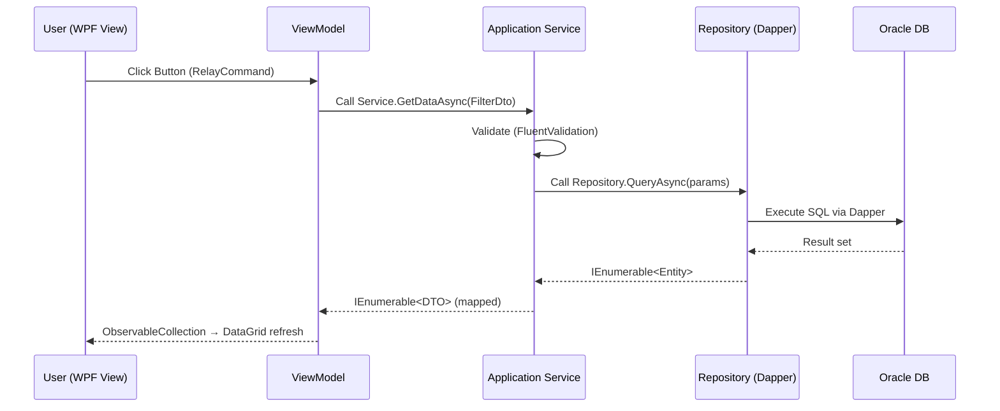

---

## 8. Luồng Khởi động (Startup Flow) - Thay thế AutoExec.mac

```text
App.xaml.cs → OnStartup()
    └─ StartupService.InitializeAsync()
         ├─ Check Oracle Connection
         ├─ Check T023_地区CD (DCount = 0 → Open Setup)
         ├─ Show SplashScreen (WPF built-in)
         └─ NavigationService.NavigateTo<LoginViewModel>()
              └─ Login thành công
                   └─ NavigationService.NavigateTo<MainViewModel>()
                        └─ MainWindow mở (= C000_MAINⅡ)
```

---

## 9. Luồng In ấn (Print Flow) - Thay thế F004 + C004

```text
MainViewModel.OpenPrintSettingsCommand
    └─ NavigationService.OpenDialog<PrintSettingsViewModel>()
         ├─ User chọn loại in (見積/請求/納品書...)
         ├─ PrintSettingsViewModel.PrintCommand
         │    └─ PrintOrchestrationService.PrintAsync(PrintRequestDto)
         │         ├─ PrintRepository.GetPrintDataAsync(docType, recordId)
         │         ├─ Map data → ReportDataSource
         │         └─ ReportViewer.Show(rdlcPath, dataSource)
         │              ├─ Preview on screen
         │              └─ Export → PDF (ReportViewer built-in)
         └─ 連続印刷: Iterate list → PrintAsync() per record
```

---

## 10. Tech Stack Đề xuất

| Thành phần | Thư viện |
|---|---|
| **Data Access** | **Dapper** + **Oracle.ManagedDataAccess.Core** |
| **MVVM** | `CommunityToolkit.Mvvm` |
| **Dependency Injection** | `Microsoft.Extensions.DependencyInjection` |
| **Validation** | `FluentValidation` |
| **Mapping** | `AutoMapper` hoặc thủ công |
| **Reporting** | `Microsoft.Reporting.WinForms` (RDLC) hoặc `FastReport` |
| **Logging** | `Serilog` |
| **DB Migration** | `DbUp` (Oracle compatible) |
| **Config** | `Microsoft.Extensions.Configuration` + `appsettings.json` |
| **Testing** | `xUnit` + `Moq` |

---

## 11. Quy tắc Đặt tên (Naming Conventions - C# WPF)

### 11.1 Views / ViewModels

| VBA Prefix | C# WPF Pattern | Ví dụ |
|---|---|---|
| `C000_MAINⅡ*` | `Main*Window/ViewModel` | `MainWindow`, `MainPaymentWindow` |
| `C001_*` | `Registration*Window/ViewModel` | `RegistrationWindow` |
| `C002_*` | `Inquiry*` hoặc `Edit*` | `InquiryWindow`, `EditWindow` |
| `C003_*` | `Edit*Window/ViewModel` | `EditFromMainWindow` |
| `C004_*` | `PrintSettings*Window/ViewModel` | `PrintSettingsWindow` |
| `F004_*` | `*Report.rdlc` | `QuoteReport.rdlc`, `InvoiceReport.rdlc` |
| `F9xx_*` | `Analytics*Window/ViewModel` | `AnalyticsAggregateWindow` |
| `F02x_*` | `*SelectorDialog` | `DistrictSelectorDialog` |

### 11.2 Suffixes

| VBA Suffix | C# Pattern |
|---|---|
| `_MAIN` | Gọi từ `MainViewModel.Command` |
| `_照会` | Gọi từ `InquiryViewModel.Command` |
| `_編集` | Gọi từ `EditViewModel.Command` |
| `_連続` | `BatchPrintCommand` trong ViewModel |
| `_印刷` | Method `.PrintAsync()` trong Service |
| `_白紙` | `PrintRequestDto.IsBlankTemplate = true` |
| `_SubF` | WPF `UserControl` (Sub-form) |

---

## 12. Ghi chú Kỹ thuật (Technical Notes)

### 12.1 Oracle thay Access Tables
- Access dùng **Local MDB / Linked Tables** qua SharePoint → Oracle dùng **TNS / JDBC connection string** cấu hình trong `appsettings.json`
- Macro `TBLビルアフター回収_Net版.mac` → Đơn giản hóa bằng cách switch `ConnectionStrings` trong config (hoặc environment variable)

### 12.2 Report-as-Form (78 Forms) → RDLC
- 78 VBA Form dùng làm Preview in → Chuyển sang **RDLC Reports** với `Microsoft.Reporting.WinForms`
- Logic setup đặc biệt của từng Form (VBA `Form_Open`) → Xử lý trong `PrintOrchestrationService.PrepareDataAsync()`

### 12.3 ComboBox Refresh (M5xx Macros)
- 20 Macro `M5xx_*` chuyên Requery ComboBox → Trong WPF, `ObservableCollection` tự refresh khi data thay đổi
- `M511_全コンボ再クエリー` → `RefreshAllFiltersCommand` trong `MainViewModel`

### 12.4 Character Encoding
- VBA files mã hóa **UTF-16LE + Shift-JIS** (tiếng Nhật)
- C# WPF dùng **UTF-8** toàn bộ, Oracle NLS_CHARACTERSET = `AL32UTF8`

### 12.5 Authentication
- `F_Login` / `F_Login_AA` → WPF `LoginWindow` xác thực user qua Oracle table `T_USERS`
- Không còn Access Shift-Bypass (`EnableShift.bas`) — không cần trong WPF

---

## 13. Migration Roadmap (Lộ trình)

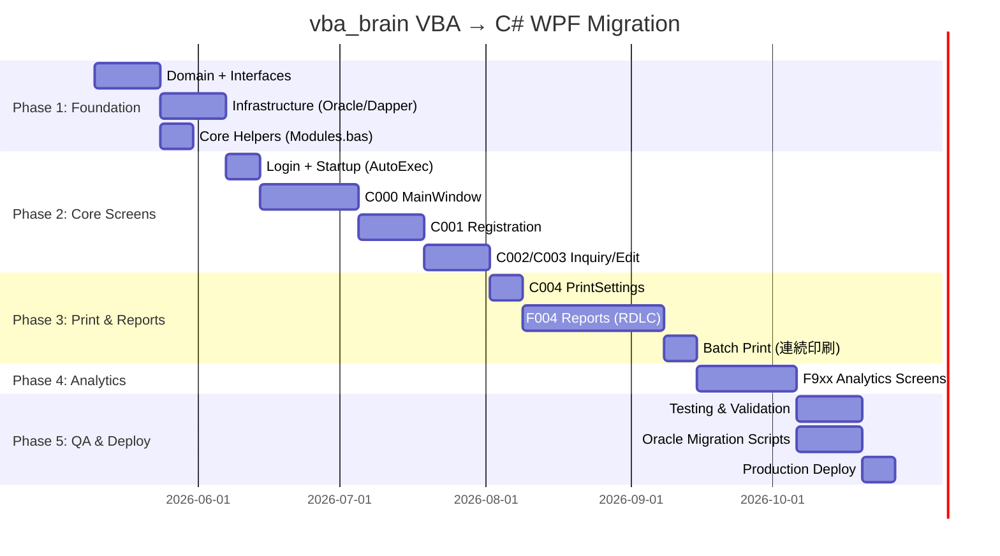

---

*Tài liệu được tổng hợp từ `VBA_Export_All/ARCHITECTURE.md` (nguồn VBA) và `architecture_OM.md` (kiến trúc C# WPF target). Cập nhật khi có thay đổi thiết kế.*


---

## File: docs/architecture_OM.md

# System Architecture: .NET WPF - Clean Architecture with Dapper & MVVM

Tài liệu này mô tả chi tiết kiến trúc của ứng dụng WPF được xây dựng theo nguyên lý **Clean Architecture**, sử dụng **Dapper** cho lớp dữ liệu và mô hình **MVVM** cho lớp hiển thị.

## 1. Kiến trúc tổng thể (High-Level Architecture)

Hệ thống được chia thành 4 vòng tròn đồng tâm, sự phụ thuộc luôn hướng vào lõi (**Domain**):
1.  **Domain Layer:** Trung tâm của hệ thống, chứa quy tắc nghiệp vụ.
2.  **Application Layer:** Chứa logic của các Use Case, điều phối dữ liệu.
3.  **Infrastructure Layer:** Chứa chi tiết triển khai (Dapper, SQL, Email, Logging).
4.  **Presentation Layer (WPF):** Giao diện người dùng và logic hiển thị.

---

## 2. Cấu trúc thư mục chi tiết (Detailed Folder Structure)

```text
src/
├── Solution.Domain/                # (Lớp lõi - Core)
│   ├── Entities/                   # Đối tượng nghiệp vụ (POCO classes)
│   ├── Common/                     # BaseEntity, ValueObject, Enumerations
│   ├── Interfaces/                 # Hợp đồng cho Repositories (IUserRepository...)
│   └── Exceptions/                 # Custom Domain Exceptions
│
├── Solution.Application/           # (Lớp ứng dụng - Use Cases)
│   ├── DTOs/                       # Data Transfer Objects (Request/Response)
│   ├── Interfaces/                 # IServices, IEmailService, ICurrentUserService
│   ├── Services/                   # Implement logic ứng dụng
│   ├── Mappers/                    # Cấu hình AutoMapper hoặc Mapping thủ công
│   ├── Validators/                 # Logic kiểm tra dữ liệu (FluentValidation)
│   └── Specifications/             # Các điều kiện lọc dữ liệu (Query specs)
│
├── Solution.Infrastructure/        # (Lớp hạ tầng - Details)
│   ├── Persistence/
│   │   ├── DapperContext.cs        # Quản lý kết nối Database (IDbConnection)
│   │   ├── Repositories/           # Triển khai IRepository bằng SQL thuần + Dapper
│   │   └── UnitOfWork/             # Quản lý Transaction (IUnitOfWork)
│   ├── ExternalServices/           # Gọi Web API bên ngoài, File System
│   ├── Logging/                    # Cấu hình Serilog/NLog
│   └── Migrations/                 # Quản lý script SQL (sử dụng DbUp hoặc thủ công)
│
└── Solution.UI.WPF/                # (Lớp hiển thị - Presentation)
    ├── Models/                     # UI-specific models (Wrap DTOs cho View)
    ├── Views/                      # Các file XAML (Window, UserControl, Page)
    ├── ViewModels/                 # Logic điều khiển UI, Commands (MVVM)
    ├── Converters/                 # IValueConverter (BoolToVisibility, v.v.)
    ├── Resources/                  # Styles, Icons, Templates, Localization
    ├── Services/                   # UI Services (NavigationService, DialogService)
    ├── App.xaml                    # Cấu hình khởi tạo ứng dụng
    └── DependencyInjection.cs      # Composition Root: Đăng ký DI cho toàn hệ thống
```

---

## 3. Chi tiết trách nhiệm các lớp

### 3.1 Domain Layer
- **Entities:** Các class sạch, không phụ thuộc vào thư viện bên ngoài.
- **Interfaces:** Chỉ định nghĩa các phương thức cần thiết (ví dụ: `Task<IEnumerable<User>> GetAllAsync()`).

### 3.2 Application Layer
- Sử dụng **Services** để thực hiện nghiệp vụ: lấy dữ liệu từ Repository -> xử lý logic -> trả về DTO.
- Sử dụng **FluentValidation** để đảm bảo dữ liệu đầu vào hợp lệ trước khi xử lý.

### 3.3 Infrastructure Layer (Trọng tâm Dapper)
Đây là nơi thay đổi nhiều nhất khi dùng Dapper thay vì EF Core:
- **DapperContext:** Cung cấp `IDbConnection` (SqlConnection/SQLiteConnection).
- **Repositories:** Viết SQL trực tiếp.
  - *Ví dụ:* `connection.QueryAsync<User>("SELECT * FROM Users")`.
- **Unit of Work:** Đảm bảo tính toàn vẹn dữ liệu khi thực hiện nhiều lệnh SQL (Insert/Update) cùng lúc trong một Transaction.

### 3.4 Presentation Layer (WPF - MVVM)
- **View:** Tuyệt đối không chứa logic. Chỉ binding dữ liệu và Commands.
- **ViewModel:** Sử dụng `CommunityToolkit.Mvvm` để giảm code thừa (`ObservableProperty`, `RelayCommand`).
- **DI (Dependency Injection):** Sử dụng `Microsoft.Extensions.DependencyInjection` để tiêm các Service từ Application và Infrastructure vào ViewModel.

---

## 4. Luồng dữ liệu (Data Workflow)

1.  **Người dùng:** Tương tác với **View** (click nút Save).
2.  **View:** Gọi một `AsyncRelayCommand` trong **ViewModel**.
3.  **ViewModel:** Gửi một DTO vào **Application Service**.
4.  **Application Service:**
    - Gọi **Validator** kiểm tra dữ liệu.
    - Gọi **Repository Interface** (được tiêm qua Constructor).
5.  **Infrastructure (Dapper Implementation):**
    - Nhận lệnh, mở kết nối DB.
    - Thực thi SQL thông qua **Dapper**.
    - Map kết quả trả về thành **Domain Entity**.
6.  **Application Service:** Nhận Entity, map ngược lại thành DTO, trả về cho ViewModel.
7.  **ViewModel:** Cập nhật UI thông qua Data Binding.

---

## 5. Các công nghệ và thư viện đề xuất (Tech Stack)

| Thành phần | Thư viện đề xuất |
| :--- | :--- |
| **Data Access** | **Dapper** (Micro-ORM) |
| **Database Driver** | `Microsoft.Data.SqlClient` hoặc `System.Data.SQLite` |
| **MVVM Helpers** | `CommunityToolkit.Mvvm` (từ Microsoft) |
| **Dependency Injection** | `Microsoft.Extensions.DependencyInjection` |
| **Object Mapping** | `AutoMapper` hoặc `Mapster` |
| **Validation** | `FluentValidation` |
| **Database Migrations** | **DbUp** (Phù hợp nhất khi dùng Dapper/SQL thuần) |
| **Logging** | `Serilog` |

---

## 6. Quy tắc phát triển (Development Guidelines)

1.  **Tính độc lập của Database:** Mọi truy vấn SQL nên tập trung trong lớp Infrastructure. Application Layer không được biết về sự hiện diện của SQL hay Dapper.
2.  **Quản lý kết nối:** Luôn sử dụng khối `using` hoặc để DI container quản lý vòng đời của `IDbConnection` để tránh rò rỉ bộ nhớ (Memory Leak).
3.  **Tách biệt UI Logic:** ViewModel không được tham chiếu trực tiếp đến các lớp WPF (như `Window` hay `Button`). Mọi tương tác giao diện (mở Popup, thông báo) phải qua **Interface Services**.
4.  **Unit Testing:**
    - Test Application Services bằng cách Mock các Repository Interface.
    - Test ViewModels bằng cách Mock các Application Services.

---

*Tài liệu này cung cấp một cái nhìn toàn diện để xây dựng ứng dụng WPF chuyên nghiệp, dễ bảo trì và mở rộng.*

---

## File: docs/review_V2/forms/C000_MAINⅡ_未入金.md

# Review màn hình `C000_MAINⅡ_未入金` (Danh sách chưa thu)

> **Tài liệu review**:
> - BD: `WorkFlow_Output/forms/APP 148-03_画面仕様書_C000_MAINⅡ_未入金.xlsx`
> - DD: `WorkFlow_Output/forms/APP 114_プログラム・モジュール仕様書_C000_MAINⅡ_未入金.xlsx`
>
> **Source đối chiếu**: `VBA_Export_All/Forms/C000_MAINⅡ_未入金.frm` (2772 dòng).
> **Ngày review**: 2026-05-12.

---

## Mục lục <a id="toc"></a>

- [1. Đánh giá tổng quan](#sec-overview)
- [2. Findings](#sec-findings)
- [3. Mapping spec ↔ source](#sec-mapping)
- [4. Code không cần migrate (dead code đã xác minh)](#sec-deadcode)
- [5. Khuyến nghị](#sec-reco)

---

## 1. Đánh giá tổng quan <a id="sec-overview"></a>

Màn hình danh sách hiển thị các hồ sơ chưa thu (未入金) — bind với query `C000_MAINⅡ_未入金_改`. Cho phép: xem chi tiết, xuất Excel, mở dữ liệu kỳ trước, in PDF (chưa implement).

| Tiêu chí | Điểm (5) | Ghi chú |
|---|---|---|
| Completeness | **4/5** | Bao phủ tốt 9 event chính (F000–F008). Thiếu: 2 sub `アフター管理終了_Click` và `終了A_Click` tồn tại trong source nhưng không có module ID. Cần verify có phải dead code hay không. |
| Accuracy | **4/5** | Các spec có module đều mô tả đúng logic. Một số chi tiết bị bỏ sót khi mô tả (xem F-04). |
| Consistency | **3/5** | Naming logical/physical đảo ngược như F_Login. Tên query trong spec dùng full-width `Ｑ` trong khi code dùng half-width `Q` (F-05). |
| Migration-ready | **4/5** | Đủ thông tin để migrate phần UI + Excel export. Phần SQL của RecordSource_SelQuery01-03 đã chi tiết hóa thành Oracle-dialect (LEFT JOIN, CASE, TO_CHAR…) — sẵn sàng cho .NET/EF. |

**Coverage source** (sau khi loại trừ dead code):
- 6/8 event handler trong source có module ID rõ ràng (F001-Form_Open, F004-戻る, F005-PDF作成, F006-エクセル書き出し, F007-未入金_前期).
- 2 sub `アフター管理終了_Click` và `終了A_Click` không xuất hiện trong spec → cần xác minh dead code (mục 4).
- 47/47 controls có trong sheet 画面編集 (bao gồm subform F021_NavigationButtons_S).

---

## 2. Findings <a id="sec-findings"></a>

| # | Mức | Vị trí | Mô tả |
|---|---|---|---|
| F-01 | **High** | DD F006 (エクセル書き出し_Click) | Thiếu mô tả: code có 2 lần `MsgBox`-confirm cancelled với `On Error Resume Next` (L2746-2750), và step 2.4 dùng `CreateObject("shell.application").ShellExecute CurrentProject.Path & "\アフター管理_エクセル\..."` — **path KHÁC** so với path delete (`C:\新アフター管理ＤＢ\アフター管理_エクセル\...` hard-coded). Spec mô tả 2.2 và 2.4 dùng cùng 1 path — không đúng với source. Nếu `CurrentProject.Path` khác `C:\新アフター管理ＤＢ` thì file ShellExecute mở sẽ KHÔNG phải file vừa export. Đây là lỗi tiềm ẩn cần verify. |
| F-02 | Medium | DD F005 (PDF作成_Click) | Mô tả spec ổn (chỉ là MsgBox dummy "対応中"). Nhưng cần ghi rõ "feature chưa được implement, chỉ là placeholder" — quyết định: .NET có cần implement PDF export hay không? |
| F-03 | Medium | DD F007 SelQuery01 / source | Tên query bất nhất: spec ghi `Ｑ011_期設定_前期テーブル作成` (full-width `Ｑ`), source code VBA dùng `Q011_期設定_前期テーブル作成` (half-width `Q`). File trong `VBA_Export_All/Queries/` cũng dùng full-width `Ｑ011_期設定_前期テーブル作成.sql.sql`. Có thể Access auto-resolve, nhưng khi migrate sang .NET cần thống nhất naming. |
| F-04 | Medium | DD F001 (Form_Open) | Source có nhiều bước "DoCmd.RunCommand acCmdAppMaximize" + "DoCmd.Maximize" lặp lại 3 lần (L2566, L2612, L2632). Spec gộp thành step 2.1 và 2.9 ("再度...最大化") — chấp nhận được nhưng nên ghi rõ "3 lần maximize" để khớp source (có thể là defensive coding để fix bug timing của Access). |
| F-05 | Medium | DD coverage | 2 sub `アフター管理終了_Click` (L2639-2658) và `終了A_Click` (L2660-2695) tồn tại trong source nhưng **không có module ID** trong spec và **không có control tương ứng** trong sheet 画面編集. Có thể là dead code (button đã bị xóa khỏi form nhưng code-behind chưa cleanup). Cần verify (xem mục 4). |
| F-06 | Medium | BD `画面仕様書(画面編集)` | Cột "論理名/物理名" bị đảo ngược như F_Login. Cùng pattern: 論理名 = `戻る/PDF作成/エクセル書き出し/未入金_前期` (tên `Name=` trong .frm), 物理名 = `cmdBack/cmdCreate PDF/cmdExportExcel/cmdUnpaid Previous Term` (tên đề xuất English camelCase). |
| F-07 | Low | DD F007 step 2.1 | "現在日付の12ヶ月前" — magic number nên đưa vào config (kỳ trước = 12 tháng trước hiện tại). Source: `Q011_期設定_前期` — không thấy explicit. |
| F-08 | Low | BD layout | "＜レコードソース＞" = `C000_MAINⅡ_未入金_改` — khớp source L27. ✅ Tốt hơn F_Login. |
| F-09 | Low | DD 概要仕様書 | パラメータ情報 ghi 5 trường (`txt連番, txt工事名称, txt期, txt請求先, txt店所`) là cross-form parameters (`[forms]![C000_MAINⅡ]![...]`). Spec mới ghi 4 trường có signature đầy đủ, trường 5 `txt店所` thiếu signature. Cần điền đầy đủ. |
| F-10 | Low | DD F005-F008 | Format dataset Excel export path hard-coded `C:\新アフター管理ＤＢ\アフター管理_エクセル\C000_MAINⅡ_未入金_EXCEL.xlsx` — magic path. Khi migrate phải đưa vào config. |
| F-11 | Low | DD F002, F003 | F002 (lblMenuBarTrue Click) — spec không có sheet riêng (chỉ là macro reference `M002_メニューバーを非表示`) — đúng convention.<br>F003 (lblMenuBarTrue DblClick) — có sheet ghi gọi macro `M001_メニューバーを表示` — OK. Tuy nhiên BD layout sheet ghi sai: E002 (Click) trong source là `OnClick="M002_メニューバーを非表示"` nhưng spec E002 mô tả là Click event và E003 là DblClick. Mapping đúng. |

---

## 3. Mapping spec ↔ source <a id="sec-mapping"></a>

| Module | Spec sheet | VBA procedure | Source line | Trạng thái |
|---|---|---|---|---|
| F000 | `詳細仕様書_F000` (なし) | (`OnCurrent="[Event Procedure]"` declared, no Sub) | L28 declared only | ✅ (なし phản ánh đúng) |
| F001 | `詳細仕様書_F001` | `Form_Open` | 2562–2637 | ✅ (chi tiết hơi gộp, xem F-04) |
| F002 | `詳細仕様書_F002` (なし) | macro `M002_メニューバーを非表示` | label `lblMenuBarTrue` OnClick | ✅ (macro ref, không cần body) |
| F003 | `詳細仕様書_F003` | macro `M001_メニューバーを表示` | label `lblMenuBarTrue` OnDblClick | ✅ |
| F004 | `詳細仕様書_F004` | `戻る_Click` | 2712–2725 | ✅ |
| F005 | `詳細仕様書_F005` | `PDF作成_Click` | 2727–2734 | ✅ (placeholder feature) |
| F006 | `詳細仕様書_F006` | `エクセル書き出し_Click` | 2736–2773 | ⚠️ thiếu mismatch path (F-01) |
| F007 | `詳細仕様書_F007` + `F007_SelQuery01` | `未入金_前期_Click` | 2697–2710 | ⚠️ tên query naming (F-03) |
| F008 | `詳細仕様書_F008` (なし) | (`OnClick="[イベント プロシージャ]"` declared, no Sub) | 2293 declared only | ✅ (なし phản ánh đúng) |
| — | (RecordSource_SelQuery01) | query `C000_MAINⅡ_未入金_改` (RecordSource form) | — | ✅ tồn tại tại `Queries/C000_MAINⅡ_未入金_改.sql.sql` |
| — | (RecordSource_SelQuery02) | query `C000_MAINⅡ ALL` (sub-query) | — | ✅ tồn tại tại `Queries/C000_MAINⅡ ALL.sql.sql` |
| — | (RecordSource_SelQuery03) | query `C500_期算出` (sub-query) | — | ✅ tồn tại tại `Queries/C500_期算出.sql.sql` |

---

## 4. Code không cần migrate (dead code đã xác minh) <a id="sec-deadcode"></a>

Hai sub trong source-behind nhưng không có control nào trong layout và không có tham chiếu trong các form khác (đã grep `アフター管理終了_Click` và `終了A_Click` trên toàn bộ `VBA_Export_All/`):

| Procedure | Source line | Kết luận |
|---|---|---|
| `Private Sub アフター管理終了_Click()` | 2639–2658 | Trong layout sheet không có button nào tên `アフター管理終了`. Logic: confirm + DoCmd.Quit. **Dead code** (button đã xóa nhưng sub-behind còn). |
| `Private Sub 終了A_Click()` | 2660–2695 | Tương tự, không có control `終了A`. Logic: confirm + Me.Refresh + DoCmd.Quit acSave. **Dead code**. |

→ Không tính là spec miss. Khuyến nghị team .NET không cần migrate (logic đã có ở F004 戻る + F_Login `閉じる_Click`).

---

## 5. Khuyến nghị <a id="sec-reco"></a>

1. **[Bắt buộc]** Verify F-01: confirm path trong `ShellExecute` của F006 step 2.4 có thực sự match path delete + export hay không. Nếu khác, fix bug ngay tại tài liệu thiết kế.
2. **[Bắt buộc]** F-03: thống nhất naming query `Q011` vs `Ｑ011` trước khi migrate. Đề xuất: chuẩn hóa toàn bộ tên query về half-width.
3. **[Nên]** F-02: quyết định fate của F005 PDF作成 (placeholder feature). Nếu giữ → cần spec mới chi tiết. Nếu bỏ → đánh dấu trong roadmap.
4. **[Nên]** F-09: bổ sung signature `[forms]![C000_MAINⅡ]![txt店所]` cho parameter 5.
5. **[Nên]** F-04: ghi rõ "3 lần maximize" trong F001 spec hoặc note "defensive coding for Access window race condition".
6. **[Nên]** F-10: tách path hard-coded ra config (vd `ExcelExportFolder`, `ExcelExportFile`).
7. **[Nên]** Sửa cột naming 論理名/物理名 trong sheet 画面編集 đúng convention.
8. **[Nên]** Note rằng RecordSource_SelQuery02 (`C000_MAINⅡ ALL`) có **CASE WHEN cho 20 明細区分** — khi migrate sang LINQ/EF cần generate code này (có thể qua SQL view hoặc raw SQL thay vì LINQ).


---

## File: docs/review_V2/forms/F004_アフター_画面明細Ⅱ.md

# Review màn hình `F004_アフター_画面明細Ⅱ`

> **Tài liệu review**:
> - BD: `WorkFlow_Output/forms/APP 148-03_画面仕様書_F004_アフター_画面明細Ⅱ.xlsx`
> - DD: `WorkFlow_Output/forms/APP 114_プログラム・モジュール仕様書_F004_アフター_画面明細Ⅱ.xlsx`
>
> **Source đối chiếu**: `VBA_Export_All/Forms/F004_アフター_画面明細Ⅱ.frm` (12,513 dòng — phần lớn là layout binary; code-behind L12195–12513).
> **Ngày review**: 2026-05-12.

---

## Mục lục <a id="toc"></a>

- [1. Đánh giá tổng quan](#sec-overview)
- [2. Findings](#sec-findings)
- [3. Mapping spec ↔ source](#sec-mapping)
- [4. Code không cần migrate (dead code đã xác minh)](#sec-deadcode)
- [5. Khuyến nghị](#sec-reco)

---

## 1. Đánh giá tổng quan <a id="sec-overview"></a>

Màn hình chi tiết hồ sơ After-sale — bind với query `C003_アフターMAINto連続明細`. Cho phép: in PDF (xuất ra Desktop), in giấy, nhập số request, quay về MAIN.

Source file rất lớn nhưng **90% là binary layout** (controls, fonts, picture data) — code-behind thực ra chỉ ~320 dòng (L12195–12513).

| Tiêu chí | Điểm (5) | Ghi chú |
|---|---|---|
| Completeness | **3/5** | Bao phủ 5/7 event handler thực. Sheet `ファイル仕様書（E001）` BD mô tả format filename PDF nhưng chỉ liệt kê header, **không có dòng nào liệt kê field detail** — bị bỏ trống. RecordSource_SelQuery01 sheet **không có SELECT/FROM clause** mà chỉ liệt kê 518 dòng tên cột — query thực chất không được extract SQL hoàn chỉnh. |
| Accuracy | **4/5** | Các spec có module đều mô tả đúng logic. F001 step 2.6 ghi đúng tên file `F004_アフター_画面明細Ⅱ_印刷` (KHÔNG nhầm với `画面Ⅱ_印刷` của F002). |
| Consistency | **3/5** | Naming logical/physical đảo ngược (giống F_Login, C000). DD F002 hardcode "F004_アフター_画面Ⅱ_印刷" (không có 明細) — khác F001 — gây nhầm lẫn nhưng spec đúng với source. |
| Migration-ready | **3/5** | UI flow rõ. PDF export logic rõ. Tuy nhiên RecordSource thiếu SQL → khi migrate sang LINQ/EF không có baseline. |

**Coverage source** (sau khi loại trừ dead code):
- 5/5 event handler đang dùng có module ID: F000 (Form_Open), F001 (PDF印刷_Shell), F002 (印刷), F003 (戻る), F006 (請求番号f).
- F004 + F005 đều là macro reference (M002, M001) — chuẩn.

---

## 2. Findings <a id="sec-findings"></a>

| # | Mức | Vị trí | Mô tả |
|---|---|---|---|
| F-01 | **High** | DD RecordSource_SelQuery01 | Sheet liệt kê 518 dòng tên cột (主に WSTEM_TBLビルアフター回収) nhưng **không có** clause SELECT/FROM/JOIN/WHERE — chỉ có ORDER BY なし. So với C000 (sheet tương tự đầy đủ SELECT 220 dòng), đây là **incomplete**. Có thể team chưa hoàn thành sheet này. Migration sang LINQ/EF sẽ thiếu reference. |
| F-02 | **High** | BD `ファイル仕様書（E001）` | Sheet PDF file specification chỉ có 6 dòng header — danh sách item field **trống hoàn toàn**. Cần điền: ai trigger, format YYYYMMDD-HHNN, output folder path, naming rule. |
| F-03 | Medium | DD F001 step 2.6 | PDF filename format: `画面_明細連続印刷[YYYYMMDD-HHNN].PDF` — magic. Folder hard-coded "▼アフター精算書類(見積・請求・納品)_ＰＤＦ" trên Desktop — Windows-specific. Cần đưa vào config. |
| F-04 | Medium | DD F001 vs F002 path | F001 dùng form `F004_アフター_画面明細Ⅱ_印刷` (có 明細), F002 dùng form `F004_アフター_画面Ⅱ_印刷` (không có 明細). Cả 2 form đều tồn tại trong `VBA_Export_All/Forms/`. Spec đúng nhưng nên có note giải thích vì sao 2 button cùng "print" lại dùng 2 form khác — dễ gây nhầm cho team .NET. |
| F-05 | Medium | DD F002 step 2.5-2.6 | "印刷用画面を再度開く" + "T024_道路制限.選択 = false 全更新" — không rõ business rule. Tại sao reset T024 sau khi print? Source confirms behavior nhưng spec nên giải thích lý do. |
| F-06 | Medium | DD F000 (Form_Open) | Spec gộp toàn bộ flow (9 step). Source thực: có 2 đoạn DUPLICATE giống nhau (L12214-12220 và L12222-12228) — set status bar + NavigateTo + hide ribbon **lặp 2 lần**. Spec bỏ qua duplicate này. Nếu .NET re-implement, nên hiểu là defensive coding (không phải logic 2 step) và chỉ implement 1 lần. |
| F-07 | Medium | DD F002 step 2.4 → 2.5 | Source flow: `OpenForm "F004_..._画面Ⅱ_印刷"; Close; (RunCommand acCmdPrint); OpenForm; (RunCommand acCmdPrint); Close; OpenForm`. Spec mô tả open-close-print-close-open có vẻ matches L12465-12468 + L12471 + sau đó. Tuy nhiên step 2.6 (T024_道路制限 update) trong source nằm sau acCmdPrint nhưng trước OpenForm cuối — cần verify thứ tự thực sự. |
| F-08 | Low | BD `画面仕様書(画面編集)` | Naming logical/physical đảo ngược (xem F_Login F-04). |
| F-09 | Low | DD 概要仕様書 | Spec パラメータ情報 bỏ trống — đúng (form mở từ C000 qua DoCmd.OpenForm không truyền args qua OpenArgs). Đề xuất: nếu form nhận data qua filter (Where clause) thì nên note. |
| F-10 | Low | DD F001 step 2.1 | Source thực dùng `End` (terminate) khi user click No (L12288) — đây là cách kết thúc app **rất aggressive** (end toàn application, không phải Exit Sub). Spec dịch "処理を中断してアプリケーションを終了する" — đúng. Nên flag cho team .NET vì `End` trong VBA = kill process; .NET không nên copy hành vi này. |

---

## 3. Mapping spec ↔ source <a id="sec-mapping"></a>

| Module | Spec sheet | VBA procedure | Source line | Trạng thái |
|---|---|---|---|---|
| F000 | `詳細仕様書_F000` | `Form_Open` | 12195–12249 | ✅ (chi tiết gộp duplicate flow — F-06) |
| F001 | `詳細仕様書_F001` + `F001_SelQuery01` | `PDF印刷_Shell_Click` | 12269–12352 | ⚠️ SelQuery01 sheet trống nội dung query (chỉ có Query名) |
| F002 | `詳細仕様書_F002` | `印刷_Click` | 12444–end | ✅ |
| F003 | `詳細仕様書_F003` | `戻る_Click` | 12425–12442 | ✅ |
| F004 | `詳細仕様書_F004` (なし) | macro `M002_メニューバーを非表示` (label `ラベル84` Click) | external macro | ✅ (macro ref) |
| F005 | `詳細仕様書_F005` | macro `M001_メニューバーを表示` (label `ラベル84` DblClick) | external macro | ✅ |
| F006 | `詳細仕様書_F006` | `請求番号f_Click` | 12417–12423 | ✅ |
| — | `RecordSource_SelQuery01` | query `C003_アフターMAINto連続明細` (RecordSource form) | — | ⚠️ Sheet thiếu SELECT/FROM (F-01) |

---

## 4. Code không cần migrate (dead code đã xác minh) <a id="sec-deadcode"></a>

Đã grep toàn bộ `VBA_Export_All/`: không có `Call ディスクトップ取得` hoặc `Call PrintReport` (hoặc form khác gọi sang) → các procedure sau là dead code:

| Procedure | Source line | Kết luận |
|---|---|---|
| `Private Sub ディスクトップ取得_Click()` | 12251–12267 | Test/debug code — MsgBox Desktop path. Không có control nào trong layout tên `ディスクトップ取得`. **Dead code.** |
| `Public Function PrintReport(ReportName, PrintKbn)` | 12371–12415 | Generic print helper. Không có caller. Logic in giấy A4 portrait/landscape. **Dead code** trong scope F004 — nếu cần helper printing tổng quát, đưa vào module riêng (không phải vào F004 controller). |

→ Không tính là spec miss. Khuyến nghị team .NET không cần migrate.

---

## 5. Khuyến nghị <a id="sec-reco"></a>

1. **[Bắt buộc]** F-01: Hoàn thiện sheet `RecordSource_SelQuery01` với SELECT/FROM/WHERE đầy đủ — đây là RecordSource chính của form, không thể thiếu.
2. **[Bắt buộc]** F-02: Điền sheet `ファイル仕様書（E001）` cho PDF output. Hiện trống.
3. **[Nên]** F-03: Tách path `▼アフター精算書類(見積・請求・納品)_ＰＤＦ` + filename format thành config.
4. **[Nên]** F-04: Thêm note giải thích tại sao F001 (PDF) và F002 (print) dùng 2 form khác (`画面明細Ⅱ_印刷` vs `画面Ⅱ_印刷`).
5. **[Nên]** F-05: Giải thích business rule cho `T024_道路制限.選択 = false` reset.
6. **[Nên]** F-10: Lưu ý team .NET không copy hành vi VBA `End` — dùng `return` hoặc proper exit.
7. **[Nên]** Sửa cột naming 論理名/物理名 trong sheet 画面編集 theo convention.
8. **[Nên]** Đối chiếu lại thứ tự step F002 (2.4 → 2.5 → 2.6) với source — có thể spec đảo thứ tự.


---

## File: docs/review_V2/forms/F911_集計_00有償無償瑕疵_額先月.md

# Review màn hình `F911_集計_00有償無償瑕疵_額先月`

> **Tài liệu review**:
> - BD: `WorkFlow_Output/forms/APP 148-03_画面仕様書_F911_集計_00有償無償瑕疵_額先月.xlsx`
> - DD: `WorkFlow_Output/forms/APP 114_プログラム・モジュール仕様書_F911_集計_00有償無償瑕疵_額先月.xlsx`
>
> **Source đối chiếu**: `VBA_Export_All/Forms/F911_集計_00有償無償瑕疵_額先月.frm` (1508 dòng).
> **Ngày review**: 2026-05-12.

> **Lưu ý quan hệ**: form `F921_集計_00有償無償瑕疵_額先月` có code-behind **identical 100%** với F911, chỉ khác ở danh sách SubForm (F921 có thêm SubForm tiêu đề). Xem [F921 review](./F921_集計_00有償無償瑕疵_額先月.md) để biết khác biệt.

---

## Mục lục <a id="toc"></a>

- [1. Đánh giá tổng quan](#sec-overview)
- [2. Findings](#sec-findings)
- [3. Mapping spec ↔ source](#sec-mapping)
- [4. Khuyến nghị](#sec-reco)

---

## 1. Đánh giá tổng quan <a id="sec-overview"></a>

Màn hình tổng hợp dạng dashboard hiển thị 3 nhóm thu chi của tháng trước (有償/無償/瑕疵) qua 3 SubForm con. Cho phép: clear sort, mở dashboard "tháng hiện tại", xuất Excel, quay về home menu.

| Tiêu chí | Điểm (5) | Ghi chú |
|---|---|---|
| Completeness | **3/5** | Bao phủ 4/4 event handler. Nhưng thứ tự 4 query trong SelQuery sheets KHÔNG match thứ tự execute trong source (F-01). |
| Accuracy | **3/5** | F005 (責任区分_当月_Click) trong source đóng form tên `F901_責任区分＆金額_先月` thay vì `F911_集計_..._額先月` — code-behind hardcode tên form **không phải tên form hiện tại**. Spec mô tả đúng theo source (đúng tên hardcode), nhưng đây là **bug trong source** (form không tự đóng đúng, đã hardcode F901). |
| Consistency | **3/5** | Naming logical/physical đảo ngược (F-04). |
| Migration-ready | **3/5** | Logic xuất Excel rõ ràng. Tuy nhiên path hard-coded và Excel.exe trực tiếp gọi qua Shell → cần refactor cho .NET. |

**Coverage source** (chỉ procedure đang dùng):
- 4/4 event handler có module ID rõ: F000 (Form_Open), F003 (並替解除_Click), F005 (責任区分_当月_Click), F007 (EXCELに書き出し_1_Click).
- F001, F002 (lblMenuBarTrue) là macro reference (M002, M001) — chuẩn.
- F004 (並替解除ラベル_Click) trong spec ghi なし — source không có Sub `並替解除ラベル_Click`, label declared but not implemented — đúng.
- F006 là macro reference `M000_管理ホームに戻る` — đúng.

---

## 2. Findings <a id="sec-findings"></a>

| # | Mức | Vị trí | Mô tả |
|---|---|---|---|
| F-01 | **High** | DD F007 SelQuery01-04 vs source | Thứ tự 4 query trong spec **không match** source code:<br>• Source order (L1429-1444): `12有償_テーブル作成` → `22無償_テーブル追加` → `32瑕疵_テーブル追加` → `集計_額先月` (xuất Excel).<br>• Spec order (sheet 1→4): `22無償_テーブル追加` → `集計_額先月` → `32瑕疵_テーブル追加` → `12有償_テーブル作成`.<br>→ Người đọc spec không biết query nào chạy trước. Migration sẽ sai thứ tự dependency (12 phải chạy trước 22, 32). |
| F-02 | **High** | DD F005 (責任区分_当月_Click) | **Source bug tiềm ẩn**: code đóng `F901_責任区分＆金額_先月` (L1494) — tên form **không khớp tên form hiện tại** (`F911_集計_00有償無償瑕疵_額先月`). Trong runtime: F911 sẽ vẫn mở (vì không bị close), `F901` không tồn tại sẽ silent fail. Spec phản ánh đúng source (theo nguyên tắc accuracy) nhưng đây là điểm cần verify với team: có phải bug cần fix hay design ý đồ? |
| F-03 | **High** | DD F007 step 2.1 | Source: nếu user click No → `End` (terminate app) — không phải `Exit Sub`. Spec ghi "処理を中断してアプリケーションを終了する" — đúng. Migration sang .NET KHÔNG nên copy hành vi `End`. |
| F-04 | Medium | BD `画面仕様書(画面編集)` | Naming logical/physical đảo ngược (giống F_Login, C000, F004). |
| F-05 | Medium | DD F007 step 2.5/2.6 | Path hard-coded `C:\新アフター管理ＤＢ\アフター管理_エクセル\Ｔ911_MAINⅡ_集計_額先月.xlsx`. File prefix dùng full-width `Ｔ` (Ｔ) thay vì half-width `T` — cần thống nhất.<br>Step 2.6 dùng `Shell("Excel.exe ...", 1)` → assumed Excel.exe trong PATH. Khi migrate cần dùng `OutputTo` API .NET-friendly. |
| F-06 | Medium | DD F007 SelQuery01 sheet content | Query name = `C911_MAINⅡ_集計_22無償_額先月_テーブル追加`. Sheet ghi CASE WHEN với 3 nhánh (`'1'→有償, '2'→無償, ELSE→瑕疵`) nhưng F921 cùng query trong sheet F007_SelQuery03 lại ghi **5 nhánh** (`'1'→有償, '2'→無償, '3'→瑕疵, '4'→現調結果, ELSE→高額保留`). Cần verify với source query (`C911_MAINⅡ_集計_22無償_額先月_テーブル追加.sql.sql`) xem nhánh nào đúng — không thể cùng 1 query lại có 2 spec khác nhau. |
| F-07 | Medium | DD F000 (Form_Open) | Source thực hiện: `acCmdRemoveFilterSort` + `Me.FilterOn = False` + `Me.Refresh`. Spec mô tả tương đối đúng, nhưng "ナビゲーションウィンドウを非表示" trong spec — source có lệnh đó **đã bị comment** (L1478-1480). → Spec mô tả hành vi **dự định** chứ không phải **thực tế**. Cần fix một trong hai. |
| F-08 | Low | BD `ファイル仕様書（E007）` | Sheet PDF/Excel file specification chưa được điền chi tiết — tương tự F004 (xem F004 F-02). |
| F-09 | Low | DD F007 step 1.3 | `DLookup("ID", "T_LoginUser")` lấy social code đăng nhập, **nhưng KHÔNG sử dụng**. Source dim `社員コード` nhận giá trị nhưng không dùng anywhere. Dead variable. Spec nên flag. |

---

## 3. Mapping spec ↔ source <a id="sec-mapping"></a>

| Module | Spec sheet | VBA procedure | Source line | Trạng thái |
|---|---|---|---|---|
| F000 | `詳細仕様書_F000` | `Form_Open` | 1463–1486 | ⚠️ Spec mô tả "hide navigation" nhưng source bị comment (F-07) |
| F001 | `詳細仕様書_F001` (なし) | macro `M002_メニューバーを非表示` | label `lblMenuBarTrue` OnClick | ✅ |
| F002 | `詳細仕様書_F002` (なし) | macro `M001_メニューバーを表示` | label `lblMenuBarTrue` OnDblClick | ✅ |
| F003 | `詳細仕様書_F003` | `並替解除_Click` | 1501–1509 | ✅ |
| F004 | `詳細仕様書_F004` (なし) | (label `並替解除ラベル` OnClick declared, no Sub) | declared only | ✅ (なし phản ánh đúng) |
| F005 | `詳細仕様書_F005` | `責任区分_当月_Click` | 1488–1499 | ⚠️ Source close form sai tên F901 (F-02) |
| F006 | `詳細仕様書_F006` (なし) | macro `M000_管理ホームに戻る` | cmd15 OnClick | ✅ |
| F007 | `詳細仕様書_F007` + `F007_SelQuery01-04` | `EXCELに書き出し_1_Click` | 1373–1461 | ⚠️ thứ tự query 1-4 không match source (F-01) |
| — | `RecordSource_SelQuery01` | query `C911_MAINⅡ_集計_12有償_額先月` (RecordSource form) | — | ✅ tồn tại tại Queries/ (verified) |

**4 query trong F007**:

| Query name | File tồn tại trong Queries/ | Vị trí spec sheet | Vị trí source step |
|---|---|---|---|
| `C911_MAINⅡ_集計_12有償_額先月_テーブル作成` | ✅ | SelQuery04 | step đầu (L1429) |
| `C911_MAINⅡ_集計_22無償_額先月_テーブル追加` | ✅ | SelQuery01 | step 2 (L1432) |
| `C911_MAINⅡ_集計_32瑕疵_額先月_テーブル追加` | ✅ | SelQuery03 | step 3 (L1433) |
| `C911_MAINⅡ_集計_額先月` | ✅ | SelQuery02 | output Excel (L1444) |

---

## 4. Khuyến nghị <a id="sec-reco"></a>

1. **[Bắt buộc]** F-01: Sắp xếp lại 4 sheet SelQuery01-04 theo thứ tự execute trong source (12有償 → 22無償 → 32瑕疵 → 集計). Hoặc thêm cột "実行順序" để migration biết.
2. **[Bắt buộc]** F-02: Verify với team xem code-behind close `F901_責任区分＆金額_先月` có phải là bug hay không. Nếu bug → fix tên form thành `F911_集計_00有償無償瑕疵_額先月` trong source và update spec.
3. **[Bắt buộc]** F-06: Resolve mâu thuẫn CASE branch giữa F911 SelQuery01 (3 nhánh) và F921 SelQuery03 (5 nhánh) cho cùng 1 query. Kiểm tra file `Queries/C911_MAINⅡ_集計_22無償_額先月_テーブル追加.sql.sql` xem đâu là sự thật.
4. **[Nên]** F-03: Lưu ý team .NET không copy hành vi `End`.
5. **[Nên]** F-05: Đưa path + naming convention prefix (Ｔ vs T) vào config khi migrate.
6. **[Nên]** F-07: Bỏ "ナビゲーションウィンドウを非表示" khỏi spec hoặc unc-comment trong source.
7. **[Nên]** F-09: Xóa dead variable `社員コード` hoặc dùng nó (vd log audit).
8. **[Nên]** Sửa cột naming 論理名/物理名 trong sheet 画面編集.


---

## File: docs/review_V2/forms/F921_集計_00有償無償瑕疵_額先月.md

# Review màn hình `F921_集計_00有償無償瑕疵_額先月`

> **Tài liệu review**:
> - BD: `WorkFlow_Output/forms/APP 148-03_画面仕様書_F921_集計_00有償無償瑕疵_額先月.xlsx`
> - DD: `WorkFlow_Output/forms/APP 114_プログラム・モジュール仕様書_F921_集計_00有償無償瑕疵_額先月.xlsx`
>
> **Source đối chiếu**: `VBA_Export_All/Forms/F921_集計_00有償無償瑕疵_額先月.frm` (1530 dòng).
> **Ngày review**: 2026-05-12.

> **Quan hệ với F911**: F921 là phiên bản clone của [F911](./F911_集計_00有償無償瑕疵_額先月.md). Code-behind **identical 100%** (cùng 4 Sub, cùng tên file Excel `Ｔ911_*`, cùng query references). Khác duy nhất ở layout: F921 có thêm 1 SubForm tiêu đề `F921_集計_00有償無償瑕疵_額先月_SubF_タイトル`. Toàn bộ findings của F911 áp dụng cho F921, **trừ** các điểm liệt kê dưới đây.

---

## Mục lục <a id="toc"></a>

- [1. Đánh giá tổng quan](#sec-overview)
- [2. Findings riêng cho F921](#sec-findings)
- [3. Mapping spec ↔ source](#sec-mapping)
- [4. Khuyến nghị](#sec-reco)

---

## 1. Đánh giá tổng quan <a id="sec-overview"></a>

| Tiêu chí | Điểm (5) | Ghi chú |
|---|---|---|
| Completeness | **3/5** | Bao phủ giống F911. |
| Accuracy | **3/5** | Bug F911-F-02 cũng có ở F921 (close form sai tên F901 dù form mở là F921). |
| Consistency | **2/5** | Naming logical/physical đảo ngược + **2 spec cho cùng 1 cặp form gần như identical** — không có sheet nào ghi quan hệ F911 ↔ F921. |
| Migration-ready | **3/5** | Đủ thông tin để migrate, nhưng cần quyết định: giữ cả 2 form hay merge thành 1? |

---

## 2. Findings riêng cho F921 <a id="sec-findings"></a>

> Các finding F-01 đến F-09 của F911 đều **áp dụng cho F921**.<br>
> Dưới đây là các finding **mới** chỉ xuất hiện ở F921 (hoặc khác biệt rõ rệt).

| # | Mức | Vị trí | Mô tả |
|---|---|---|---|
| F-A | **High** | Quan hệ F911 ↔ F921 | Cùng tên file (`_集計_00有償無償瑕疵_額先月`), cùng RecordSource (`C911_MAINⅡ_集計_12有償_額先月`), cùng 4 query, cùng 4 event handler, cùng Excel output path. **Khác duy nhất**: F921 có thêm SubForm tiêu đề (`F921_..._SubF_タイトル`). Cần làm rõ trong cả 2 spec: form nào là "production" form được dùng, form còn lại deprecate? Hoặc cả 2 đều dùng cho UI khác nhau (vd dialog popup vs full screen)? |
| F-B | **High** | DD F007 SelQuery01 (vs F911) | F921 sheet SelQuery01 chứa query `C911_MAINⅡ_集計_32瑕疵_額先月_テーブル追加` với CASE WHEN **5 nhánh** (`'1'→有償, '2'→無償, '3'→瑕疵, '4'→現調結果, ELSE→高額保留`).<br>F911 sheet SelQuery03 chứa **cùng query này** nhưng spec mô tả CASE WHEN **3 nhánh** (`'1'→有償, '2'→無償, ELSE→瑕疵`). **Mâu thuẫn**: cùng 1 query SQL nhưng 2 spec mô tả khác. Phải verify file `Queries/C911_MAINⅡ_集計_32瑕疵_額先月_テーブル追加.sql.sql` xem nhánh nào là sự thật. |
| F-C | Medium | DD F007 SelQuery01-04 thứ tự (vs F911) | Spec F921 swap thứ tự sheet: F921 SelQuery01 = 32瑕疵, SelQuery03 = 22無償 (ngược F911 SelQuery01 = 22無償, SelQuery03 = 32瑕疵). → Spec inconsistency giữa 2 file cùng describes cùng code-behind. |
| F-D | Low | BD `画面仕様書(画面編集)` | F921 có thêm 1 row liệt kê SubForm `subF921_集計_00有償無償瑕疵_額先月_SubF_タイトル` so với F911. Phần còn lại identical. ✅ |
| F-E | Low | DD 概要仕様書 | F921 概要 wording khác F911 (cùng nghĩa nhưng diễn đạt khác). F921 có thêm 特記事項 row "対象となる先月の回収データがシステムに登録済みであること". → Nên đồng bộ wording cả 2 form. |

---

## 3. Mapping spec ↔ source <a id="sec-mapping"></a>

Toàn bộ bảng mapping module F000–F007 **giống F911** (xem [F911 review §3](./F911_集計_00有償無償瑕疵_額先月.md#sec-mapping)).

**Khác biệt SubForm container**:

| # | F911 dùng SubForm | F921 dùng SubForm |
|---|---|---|
| Title | — (không có) | `Form.F921_集計_00有償無償瑕疵_額先月_SubF_タイトル` ✅ tồn tại |
| 10有償 | `Form.F911_集計_10有償_額先月_SubF` ✅ | `Form.F921_集計_10有償_額先月_SubF` ✅ |
| 20無償 | `Form.F911_集計_20無償_額先月_SubF` ✅ | `Form.F921_集計_20無償_額先月_SubF` ✅ |
| 30瑕疵 | `Form.F911_集計_30瑕疵_額先月_SubF` ✅ | `Form.F921_集計_30瑕疵_額先月_SubF` ✅ |

Tất cả 4+3 SubForm đều tồn tại trong `VBA_Export_All/Forms/`.

---

## 4. Khuyến nghị <a id="sec-reco"></a>

1. **[Bắt buộc]** F-A: Verify với team xem F911 hay F921 mới là form production. Đề xuất:
   - Nếu chỉ 1 trong 2 đang dùng → deprecate form còn lại, không migrate sang .NET.
   - Nếu cả 2 đang dùng cho UI khác nhau → ghi rõ trong spec context/timing.
2. **[Bắt buộc]** F-B: Resolve mâu thuẫn CASE branch (3 vs 5 nhánh) trong query `32瑕疵_額先月_テーブル追加` giữa F911 SelQuery03 và F921 SelQuery01. Kiểm tra `Queries/*.sql.sql` để biết source-of-truth.
3. **[Nên]** F-C: Thống nhất thứ tự sheet SelQuery giữa 2 spec (cùng theo thứ tự execute trong source).
4. **[Nên]** F-E: Đồng bộ wording 概要 và 特記事項 giữa 2 spec.
5. **[Áp dụng tất cả khuyến nghị 1-8 của F911 review.](./F911_集計_00有償無償瑕疵_額先月.md#sec-reco)**


---

## File: docs/review_V2/forms/F_Login.md

# Review màn hình `F_Login` (Login)

> **Tài liệu review**:
> - BD (Basic Design / 画面仕様書): `WorkFlow_Output/forms/APP 148-03_画面仕様書_F_Login.xlsx`
> - DD (Detailed Design / プログラム・モジュール仕様書): `WorkFlow_Output/forms/APP 114_プログラム・モジュール仕様書_F_Login.xlsx`
>
> **Source đối chiếu**: `VBA_Export_All/Forms/F_Login.frm` (1420 dòng).
> **Ngày review**: 2026-05-12.

---

## Mục lục <a id="toc"></a>

- [1. Đánh giá tổng quan](#sec-overview)
- [2. Findings](#sec-findings)
- [3. Mapping spec ↔ source](#sec-mapping)
- [4. Code không cần migrate (dead code đã xác minh)](#sec-deadcode)
- [5. Khuyến nghị](#sec-reco)

---

## 1. Đánh giá tổng quan <a id="sec-overview"></a>

| Tiêu chí | Điểm (5) | Ghi chú |
|---|---|---|
| Completeness | **3/5** | Bao phủ tốt event handler chính. Thiếu mô tả: admin auto-login (whitelist 6 user) ở F000, Dev mode bypass ở F003. |
| Accuracy | **4/5** | Các module có spec đều mô tả đúng logic; chỉ thiếu chứ không sai. |
| Consistency | **4/5** | Format chuẩn, mapping E↔F đầy đủ. Naming "論理名/物理名" trong sheet 画面編集 có vấn đề (xem F-04). |
| Migration-ready | **3/5** | Nếu re-implement theo spec, .NET sẽ bị regression 2 feature đang chạy trên prod (admin auto-login, dev mode). |

**Coverage source** (sau khi loại trừ dead code đã xác minh):
- 7/7 event handler đang dùng → đều có module ID (F000–F004, F008, F009). ✅
- 2 macro reference (E006, E007) → spec thể hiện qua layout sheet (no sheet riêng cần thiết, xem mục 4 §F-03).
- 13/13 controls trong BD layout sheet — đầy đủ. ✅

---

## 2. Findings <a id="sec-findings"></a>

| # | Mức | Vị trí | Mô tả |
|---|---|---|---|
| F-01 | **High** | DD F000 (Form_Open) | Thiếu logic admin auto-login: code dùng `WshNetwork.UserName` lấy user Windows, đối chiếu whitelist 6 user ID (`00105687`, `00110772A`, `00109978A`, `00109212A`, `00106601A`, `00124937A`) → auto paste password (`SendKeys "^(v)"`) + Enter. Spec chỉ mô tả đến step 2.8 (SetWindowTop), bỏ qua toàn bộ phần auto-login. Security-relevant. |
| F-02 | **High** | DD F003 (txtPass_AfterUpdate) | Thiếu Dev mode bypass: `isDevMode = IsLoginDevModeEnabled()`. Khi bật, cho phép password rỗng (skip check 2.2) và login bất kể password (`If isDevMode Or (res = Me.txtPass)`), có log riêng (`AppendDevLoginLog`). Theo `CLAUDE.md`, dev mode là dev-only — nên trong DD ghi rõ "không port sang .NET". |
| F-03 | **High** | DD F008_SelQuery01 | Query `Q000_T_ID_PASS` được tham chiếu trong code (`DoCmd.OpenQuery`) và sheet SelQuery, nhưng **không tồn tại** trong `VBA_Export_All/Queries/`. Cùng module F000 có `Q000_T_LoginUser` — có khả năng đổi tên hoặc bị xóa. Sheet SelQuery để trống SELECT/FROM/WHERE — chứng tỏ team cũng không tìm thấy. |
| F-04 | Medium | BD `画面仕様書(画面編集)` | Cột "論理名" chứa tên tiếng Nhật (`ログインID`, `閉じる`…) — đây thực ra là `Name=` trong `.frm` (physical name của Access). Cột "物理名" chứa định danh English camelCase (`txtID`, `lblShopInfo`…) — đây là tên đề xuất cho phía .NET. Naming bị đảo so với convention chung. |
| F-05 | Low | DD F000 step 2.7 | Window size 800×400 và coordinate (0,0) hard-coded — nên đưa vào config. |
| F-06 | Low | DD F002 step 2.2 | Registration number `900-79-00136-000` là magic — nên config. |
| F-07 | Low | BD `画面仕様書(画面編集)` | Cột `桁数`, `形式`, `必須`, `入力仕様`, `出力仕様` trống cho hầu hết control. Form Login đơn giản nên chấp nhận, nhưng các form CRUD cần điền đầy đủ. |
| F-08 | Low | BD layout sheet | "＜レコードソース＞ = Access配信日" — thực ra là RecordSource cho **control** `最新版公開日` (DLookup), không phải Form. Form F_Login không có RecordSource. |
| F-09 | Low | DD F008 step 2.5 | "バージョン情報が11" không giải thích "11 = Access 2003 (Office 2003)". Cần chú thích cho người đọc/translator. |

---

## 3. Mapping spec ↔ source <a id="sec-mapping"></a>

| Module | Spec sheet | VBA procedure | Source line | Trạng thái |
|---|---|---|---|---|
| F000 | `詳細仕様書_F000` + `F000_SelQuery01` | `Form_Open` | 857–1125 | ❌ thiếu admin auto-login (F-01) |
| F001 | `詳細仕様書_F001` | `Form_KeyDown` | 1408–1420 | ✅ |
| F002 | `詳細仕様書_F002` + `F002_SelQuery01` | `Form_Load` | 819–855 | ✅ |
| F003 | `詳細仕様書_F003` | `txtPass_AfterUpdate` | 1127–1269 | ❌ thiếu Dev mode (F-02) |
| F004 | `詳細仕様書_F004` | `閉じる_Click` | 1358–1362 | ✅ |
| F005 | `詳細仕様書_F005` | (label `施工店情報` event không impl) | 642 declared only | ✅ (なし phản ánh đúng; label declare `OnDblClick="[Event Procedure]"` nhưng không có Sub, không nơi gọi) |
| F006 | `詳細仕様書_F006` | macro `A_メニューバーを表示` (external) | label `ラベル142` Click | ✅ (chỉ cần reference, chi tiết xem macro spec) |
| F007 | (layout sheet only) | macro `M300_Splash(M)を開く` (external) | label `ラベル142` DblClick | ✅ (macro reference không cần sheet DD riêng) |
| F008 | `詳細仕様書_F008` + `F008_SelQuery01` | `パスワードテーブルを開く_DblClick` | 1271–1344 | ⚠️ query `Q000_T_ID_PASS` broken (F-03) |
| F009 | `詳細仕様書_F009` | `プロセス終了_DblClick` | 1346–1356 | ✅ |

---

## 4. Code không cần migrate (dead code đã xác minh) <a id="sec-deadcode"></a>

Đã xác minh bằng grep toàn bộ `VBA_Export_All/`: 4 procedure sau **chỉ định nghĩa**, không nơi nào gọi (kể cả trong macros, queries, forms khác):

| Procedure | Source line | Kết luận |
|---|---|---|
| `Public Function Login_Log_Append()` | 1397–1406 | Body có đường dẫn cố định `D:\Log\Login.txt` và 1 dòng Print bị comment. Hàm rỗng functional. **Dead code.** |
| `Sub HideNavigationPane()` | 1364–1374 | Utility ẩn navigation. Không gọi từ đâu. **Dead code.** |
| `Sub ShowNavigationPane()` | 1376–1386 | Toàn bộ body bị comment. **Dead code.** |
| `Sub MinimuizeNavigationPane()` | 1388–1395 | Utility minimize navigation. Không gọi từ đâu. **Dead code.** |

→ **Không tính là spec miss** (theo nguyên tắc đã thống nhất). Khuyến nghị team không cần migrate sang .NET.

---

## 5. Khuyến nghị <a id="sec-reco"></a>

Trước khi migrate F_Login sang C#.NET:

1. **[Bắt buộc]** Bổ sung spec cho F000 phần admin auto-login (whitelist + WshNetwork.UserName + SendKeys). Quyết định: giữ feature trong .NET hay bỏ?
2. **[Bắt buộc]** Bổ sung spec cho F003 phần Dev mode bypass. Theo `CLAUDE.md` thì dev mode là dev-only, nên đánh dấu "do not port to prod".
3. **[Bắt buộc]** Resolve broken query `Q000_T_ID_PASS` — verify với team có phải đã đổi tên thành `Q000_T_LoginUser` hay bị xóa.
4. **[Nên]** Sửa cột naming 論理名/物理名 trong sheet `画面仕様書(画面編集)` theo đúng convention.
5. **[Nên]** Bổ sung "依存モジュール" trong sheet 概要仕様書 liệt kê module ngoài form được gọi (`Common.bas` → `Judge_Inst`, `SetAccWinStyle`, `SetWindowTop`, `SetEnabledState`, `MenuBarTrue`, `StatusBar_True`, `タイマーを開く`, `IsLoginDevModeEnabled`, `AppendDevLoginLog`) — hỗ trợ planning migration order.
6. **[Nên]** Đưa magic numbers (window size 800×400, registration `900-79-00136-000`) vào config khi migrate.


---

## File: docs/review_V2/reports/R000_作業依頼書報告書合体_白紙.md

# Review report `R000_作業依頼書報告書合体_白紙`

> **Tài liệu review**:
> - BD (Basic Design / 帳票仕様書): `WorkFlow_Output/reports/APP 148-06_帳票仕様書_R000_作業依頼書報告書合体_白紙.xlsx`
> - DD (Detailed Design / プログラム・モジュール仕様書): `WorkFlow_Output/reports/APP 114_プログラム・モジュール仕様書_R000_作業依頼書報告書合体_白紙.xlsx`
>
> **Source đối chiếu**: `VBA_Export_All/Reports/R000_作業依頼書報告書合体_白紙.frm` (534 dòng, không có code-behind).
> **Ngày review**: 2026-05-12.

---

## Mục lục <a id="toc"></a>

- [1. Đánh giá tổng quan](#sec-overview)
- [2. Findings](#sec-findings)
- [3. Mapping spec ↔ source](#sec-mapping)
- [4. Khuyến nghị](#sec-reco)

---

## 1. Đánh giá tổng quan <a id="sec-overview"></a>

R000 là **báo cáo container ("blank" / 白紙)**: chỉ tổ hợp 4 sub-report bằng cách đặt 4 control Subform + 2 PageBreak vào section `詳細`. Bản thân R000:

- **Không có RecordSource** (không bind data).
- **Không có code-behind** (sheet `CodeBehindForm` rỗng — chỉ có 4 Attribute mặc định và `Option Compare Database`).
- **Không có macro/event handler nào**.

Vì vậy review tập trung vào tính đầy đủ của BD và sự đúng đắn của reference tới 4 sub-report.

| Tiêu chí | Điểm (5) | Ghi chú |
|---|---|---|
| Completeness | **2/5** | BD layout sheet rỗng cả 概要/RecordSource/Grouping (3 dòng trống). DD chỉ có 概要仕様書 và sheet QA — không có bất kỳ chi tiết module nào. Sheet `項目編集` chỉ ghi 4 dòng subform reference, không có thông tin trang/khổ giấy/orientation. |
| Accuracy | **5/5** | 4 subreport reference trong BD khớp chính xác với 4 `Begin Subform / SourceObject` trong `.frm`. Tất cả 4 subreport file đều tồn tại trong `VBA_Export_All/Reports/`. |
| Consistency | **3/5** | Format chuẩn nhưng "phần thông tin layout" của BD bị trống — không nhất quán với các report khác cùng folder (vd R005 có đầy đủ). |
| Migration-ready | **2/5** | Đủ để biết R000 là wrapper; nhưng để migrate sang SVF/.NET cần biết: thứ tự render subreport, page break logic, khổ giấy (A4 portrait), data binding mode (cha-con). Đều thiếu. |

---

## 2. Findings <a id="sec-findings"></a>

| # | Mức | Vị trí | Mô tả |
|---|---|---|---|
| F-01 | **High** | DD | DD chỉ có 概要仕様書 + sheet QA. Sheet QA chứa 3 câu hỏi mở chưa trả lời:<br>1. "Ở SVF có 2 tính năng dưới như access không? (Group on, sort by / Liên kết giữa sub report và report)"<br>2. "In cả dữ liệu từ màn hình → dùng bảng tạm?"<br>→ Đây là **risk chưa resolve** trước khi migrate. Sub-report của Access có cơ chế parent-child linking (LinkChildFields/LinkMasterFields) mà SVF/.NET reporting engine có thể không hỗ trợ tương đương 1-1. Cần POC trước. |
| F-02 | **High** | BD layout sheet | "＜レコードソース＞" và "＜グループ化・並べ替え＞" để trống. Source xác nhận R000 không có RecordSource — vậy spec nên ghi rõ "なし (サブレポート自体がデータソースを保持)" thay vì để trống (gây ambiguous: "chưa điều tra" vs "không có"). |
| F-03 | Medium | BD `項目編集` sheet | Chỉ liệt kê 4 subreport, **không ghi**: vị trí (Top/Left/Width/Height), thứ tự render, có pagebreak giữa subreport thứ 2-3 và 3-4 không. Source có 2 `PageBreak` (改ページ13 ở Top=1155 — giữa sub2 và sub3, và 改ページ14 ở Top=2340 — giữa sub3 và sub4). |
| F-04 | Medium | BD 制約事項 | Để trống. Report R000 dùng cho "印刷一括出力" (in một lượt cả 依頼書 + 報告書) — nên có constraint về thứ tự in, số trang ước tính, requirement giấy A4. |
| F-05 | Low | DD 特記事項 | Để trống. Nên nhắc: "R000 không có business logic riêng, toàn bộ data binding nằm ở 4 sub-report". |
| F-06 | Low | DD パラメータ情報 | Để trống — phản ánh đúng (R000 không nhận parameter trực tiếp). Nhưng các sub-report có thể nhận parameter qua form gọi nó → nên cross-reference tới sub-report spec. |
| F-07 | Low | DD sheet QA | Tốt rằng team có capture câu hỏi rủi ro, nhưng nên di chuyển vào một sheet riêng "Risk/Open Issue" dùng chung toàn project thay vì rải rác trong từng DD file. |

---

## 3. Mapping spec ↔ source <a id="sec-mapping"></a>

### Sub-report container

| # | Spec (項目編集) | Source (`Begin Subform`) | Subreport file tồn tại | Pagebreak sau |
|---|---|---|---|---|
| 1 | "R005_作業依頼書サブ_白紙" (subreport) | `Name="R005_作業依頼書サブ_白紙"` / `SourceObject="Report.R005_作業依頼書サブ_白紙"` Top=15 | ✅ `R005_作業依頼書サブ_白紙.frm` | — |
| 2 | "メモ用方眼紙" (subreport) | `Name="メモ用方眼紙"` / `SourceObject="Report.メモ用方眼紙"` Top=525 | ✅ `メモ用方眼紙.frm` | ✅ `改ページ13` Top=1155 |
| 3 | "R005_作業報告書_弊社控え_白紙" (subreport) | `Name="R005_作業報告書_弊社控え_白紙"` Top=1200 | ✅ `R005_作業報告書_弊社控え_白紙.frm` | ✅ `改ページ14` Top=2340 |
| 4 | "R005_作業報告書_お客様控え_保証書_白紙" (subreport) | `Name="R005_作業報告書_お客様控え_保証書_白紙"` Top=2415 | ✅ `R005_作業報告書_お客様控え_保証書_白紙.frm` | — |

### Code-behind

- Source `CodeBehindForm` chỉ chứa attributes mặc định + `Option Compare Database`. **Không có Sub/Function nào.** DD đúng khi không có sheet 詳細仕様書_F0xx.

---

## 4. Khuyến nghị <a id="sec-reco"></a>

1. **[Bắt buộc]** Trả lời 3 câu hỏi trong sheet QA của DD (group-on/sort-by trên SVF, parent-child linking, table tạm cho data từ màn hình). Đây là **prerequisite** cho migration kỹ thuật của report.
2. **[Nên]** BD layout sheet ghi rõ "RecordSource: なし / グループ化・並べ替え: なし" thay vì để trống.
3. **[Nên]** BD 項目編集 bổ sung thông tin layout: Top/Left/Width/Height của từng subreport + vị trí 2 page break để team .NET reproduce đúng pagination.
4. **[Nên]** Thêm note "container report — toàn bộ data binding nằm ở sub-report; muốn hiểu data flow phải đọc 4 spec sub-report tương ứng" + link tới 4 spec đó.
5. **[Nên]** Bổ sung paper config (A4 portrait, lấy từ `PrtDevMode` block trong source) nếu cần spec migration đầy đủ cho SVF.


---

## File: docs/review_V2/reports/R005_作業報告書_お客様控え_保証書.md

# Review report `R005_作業報告書_お客様控え_保証書`

> **Tài liệu review**:
> - BD: `WorkFlow_Output/reports/APP 148-06_帳票仕様書_R005_作業報告書_お客様控え_保証書.xlsx`
> - DD: `WorkFlow_Output/reports/APP 114_プログラム・モジュール仕様書_R005_作業報告書_お客様控え_保証書.xlsx`
>
> **Source đối chiếu**: `VBA_Export_All/Reports/R005_作業報告書_お客様控え_保証書.frm` (5350 dòng — phần lớn là layout binary; **không có code-behind**).
> **Ngày review**: 2026-05-12.

---

## Mục lục <a id="toc"></a>

- [1. Đánh giá tổng quan](#sec-overview)
- [2. Findings](#sec-findings)
- [3. Mapping spec ↔ source](#sec-mapping)
- [4. Khuyến nghị](#sec-reco)

---

## 1. Đánh giá tổng quan <a id="sec-overview"></a>

Báo cáo công việc — bản giao cho khách hàng kiêm chứng nhận bảo hành. Bind với query `Q005_受付と報告を合体2`. Báo cáo này hiển thị 76 items chia thành nhiều block: tiếp nhận, kiểm tra, xử lý, đổi linh kiện, chữ ký khách hàng.

| Tiêu chí | Điểm (5) | Ghi chú |
|---|---|---|
| Completeness | **3/5** | 76 item layout đầy đủ. DD có 2 sheet SelQuery cho 2 query liên quan (chính + sub). Nhưng **không có code-behind** trong source, nên DD không có sheet 詳細仕様書 — đúng. Cần check QA sheet và 制約事項 trống. |
| Accuracy | **5/5** | Toàn bộ 76 mapping field trong BD `項目編集` match với data source. RecordSource khớp `Q005_受付と報告を合体2` 100%. |
| Consistency | **3/5** | Có 2 column "項目名" duy nhất — không có cột "論理名/物理名" như form. Naming tiếng Nhật được dùng nhất quán (báo cáo nội bộ, chấp nhận được). |
| Migration-ready | **3/5** | Phụ thuộc khả năng SVF hỗ trợ DLookup-like + group on. Sheet QA 4 dòng cho thấy team còn questions chưa resolved. |

**Coverage source**:
- Form report không có code-behind (CodeBehindForm chỉ có 4 attribute default).
- 76 item trong BD `項目編集` — không kiểm tra từng item line-by-line do quá nhiều; spot check: row 1 (受付日 từ WSTEM_TBLビルアフター回収 + WSTEM_TBLビルＡＭ受付 + format "yyyy年m月d日h時n分") match cách viết logic của Access reports.
- 2 query bind data: `Q005_受付と報告を合体2` (chính) và `Q005_アフターメンテナンス受付` (sub) — cả 2 đều tồn tại trong `Queries/`.

---

## 2. Findings <a id="sec-findings"></a>

| # | Mức | Vị trí | Mô tả |
|---|---|---|---|
| F-01 | **High** | DD QA sheet | 3 câu hỏi mở chưa resolved (giống R000):<br>1. "Ở SVF có 2 tính năng dưới như access không? (Group on, sort by / Liên kết giữa sub report và report)"<br>2. "In cả dữ liệu từ màn hình -> dùng bảng tạm?"<br>→ Là risk prerequisite cho toàn bộ family R005. Cần POC trước khi commit migration. |
| F-02 | Medium | BD 制約事項 | Để trống. Báo cáo có chữ ký khách hàng (item 60 お客様ご署名 — row 67) → có quy định in trên giấy A4, font certain, layout 2 trang/1 trang. Cần điền constraint. |
| F-03 | Medium | BD `項目編集` | Item 60 "お客様ご署名" (row 67) **không có** ﾃｰﾌﾞﾙ名/領域名 và 項目名 — đây là field để khách viết tay khi nhận report (manual signature space). Đúng nhưng nên thêm note "手書きスペース、データなし" để translator hiểu. |
| F-04 | Medium | BD `項目編集` | Item 47 "備考/コメント/残工事等" map về 1 field `ＡＭ備考コメント残工事` — đây là **3 nội dung khác nhau ghép vào 1 field** hay alias multi-line? Cần verify với query. |
| F-05 | Medium | DD `RecordSource_SelQuery01` (Q005_受付と報告を合体2) | Sheet chỉ liệt kê column list, **không có** SELECT/FROM/JOIN/WHERE clause đầy đủ. Cần kiểm tra `Queries/Q005_受付と報告を合体2.sql.sql` để bổ sung. |
| F-06 | Medium | DD `RecordSource_SelQuery02` (Q005_アフターメンテナンス受付) | Tương tự F-05 — không có SQL clause. |
| F-07 | Low | DD パラメータ情報 | Liệt kê 1 parameter `登録番号` ([Forms]![F005_アフターメンテナンス作業報告書]![登録番号]). Khớp với pattern: form `F005_アフターメンテナンス作業報告書` truyền 登録番号 sang report để filter. Cần verify form `F005_*` có tồn tại không. |
| F-08 | Low | BD layout sheet ＜グループ化・並べ替え＞ | Spec ghi "なし / なし" — đúng (report flat, không nhóm). ✅ |
| F-09 | Low | BD 機能概要 | Nhắc tới "保証書" → khi migrate cần đảm bảo có "warranty number" hoặc "valid until" — kiểm tra layout, item 75 QuickNo và 76 施工No mapping. |

---

## 3. Mapping spec ↔ source <a id="sec-mapping"></a>

### RecordSource

| Spec ghi (BD layout) | Source `.frm` (RecordSource) | Query file tồn tại? |
|---|---|---|
| `Q005_受付と報告を合体2` | `RecordSource ="Q005_受付と報告を合体2"` (line ~10 of source) | ✅ `Queries/Q005_受付と報告を合体2.sql.sql` |

### Code-behind

Source `CodeBehindForm` chỉ có 4 attribute default + `Option Compare Database`. **Không có Sub/Function**. DD đúng khi không có sheet 詳細仕様書_F0xx.

### Form parameter (登録番号)

`[Forms]![F005_アフターメンテナンス作業報告書]![登録番号]` → form caller cần check:

<a id="check-f005-form"></a>Verify trong source bằng `ls VBA_Export_All/Forms/ | grep F005_アフターメンテナンス` — nếu form tồn tại thì spec đúng.

---

## 4. Khuyến nghị <a id="sec-reco"></a>

1. **[Bắt buộc]** F-01: Resolve 3 câu hỏi QA trước khi migrate toàn bộ R005 family. Đây là question chung cho cả 4 report R005 + R000.
2. **[Bắt buộc]** F-05, F-06: Bổ sung SELECT/FROM/WHERE từ `Q005_受付と報告を合体2.sql.sql` và `Q005_アフターメンテナンス受付.sql.sql` vào 2 SelQuery sheet.
3. **[Nên]** F-02: Bổ sung 制約事項 (giấy A4, layout 1-2 trang, hỗ trợ chữ ký).
4. **[Nên]** F-03: Note rõ "手書きスペース" cho item 60.
5. **[Nên]** F-04: Verify field `ＡＭ備考コメント残工事` là 3 nội dung concat hay 1 alias.


---

## File: docs/review_V2/reports/R005_作業報告書_弊社控え.md

# Review report `R005_作業報告書_弊社控え`

> **Tài liệu review**:
> - BD: `WorkFlow_Output/reports/APP 148-06_帳票仕様書_R005_作業報告書_弊社控え.xlsx`
> - DD: `WorkFlow_Output/reports/APP 114_プログラム・モジュール仕様書_R005_作業報告書_弊社控え.xlsx`
>
> **Source đối chiếu**: `VBA_Export_All/Reports/R005_作業報告書_弊社控え.frm` (4784 dòng — **không có code-behind**).
> **Ngày review**: 2026-05-12.

> **Quan hệ**: Cùng family với [`R005_作業報告書_お客様控え_保証書`](./R005_作業報告書_お客様控え_保証書.md). Dùng cùng RecordSource `Q005_受付と報告を合体2`, cùng parameter `[Forms]![F005_アフターメンテナンス作業報告書]![登録番号]`. Khác biệt: bản này dùng cho **lưu trữ nội bộ** (弊社控え), không có chữ ký khách hàng, không có dòng "保証書". Số item layout: 96 (so với customer 76).

---

## Mục lục <a id="toc"></a>

- [1. Đánh giá tổng quan](#sec-overview)
- [2. Findings riêng cho report này](#sec-findings)
- [3. Mapping spec ↔ source](#sec-mapping)
- [4. Khuyến nghị](#sec-reco)

---

## 1. Đánh giá tổng quan <a id="sec-overview"></a>

| Tiêu chí | Điểm (5) | Ghi chú |
|---|---|---|
| Completeness | **3/5** | 96 item trong sheet `項目編集` đầy đủ. 2 sheet SelQuery có column list nhưng thiếu SQL clause (giống customer copy). |
| Accuracy | **5/5** | RecordSource khớp source. |
| Consistency | **4/5** | Format identical với customer copy version. |
| Migration-ready | **3/5** | Phụ thuộc câu trả lời QA chung. |

---

## 2. Findings riêng cho report này <a id="sec-findings"></a>

> Findings F-01 (QA chưa resolved), F-02 (制約事項 trống), F-05/F-06 (SelQuery thiếu SQL) của [R005 お客様控え](./R005_作業報告書_お客様控え_保証書.md#sec-findings) đều áp dụng cho report này.

| # | Mức | Vị trí | Mô tả |
|---|---|---|---|
| F-A | Medium | BD vs source naming | Tên file source `R005_作業報告書_弊社控え.frm` (không có `_保証書`). Vai trò khác customer copy: bản nội bộ (không có signature, không có warranty). BD spec không nhấn mạnh khác biệt này — đề nghị thêm note. |
| F-B | Low | BD `項目編集` (96 item) | Nhiều hơn customer copy (76 item) 20 item — có thể là các block thông tin nội bộ (vd: 担当者 detail, 請求 detail). Verify với template Access thực tế: spec liệt kê đầy đủ. |

---

## 3. Mapping spec ↔ source <a id="sec-mapping"></a>

### RecordSource

| Spec ghi (BD layout) | Source `.frm` | Query tồn tại? |
|---|---|---|
| `Q005_受付と報告を合体2` | `RecordSource ="Q005_受付と報告を合体2"` | ✅ |

### Code-behind

Source: không có Sub/Function. DD đúng khi không có sheet 詳細仕様書.

### Parameter

`[Forms]![F005_アフターメンテナンス作業報告書]![登録番号]` — cùng caller như customer copy. ✅

---

## 4. Khuyến nghị <a id="sec-reco"></a>

1. **[Áp dụng tất cả khuyến nghị của [R005 お客様控え_保証書](./R005_作業報告書_お客様控え_保証書.md#sec-reco)].**
2. **[Nên]** Bổ sung note phân biệt vai trò "弊社控え" (internal copy) vs "お客様控え_保証書" (customer + warranty) trong sheet 機能概要.
3. **[Nên]** So sánh 20 item thêm trong report này với customer copy để document rõ business value của từng bản.


---

## File: docs/review_V2/reports/R005_作業報告書_弊社控え_依頼の情報のみ.md

# Review report `R005_作業報告書_弊社控え_依頼の情報のみ`

> **Tài liệu review**:
> - BD: `WorkFlow_Output/reports/APP 148-06_帳票仕様書_R005_作業報告書_弊社控え_依頼の情報のみ.xlsx`
> - DD: `WorkFlow_Output/reports/APP 114_プログラム・モジュール仕様書_R005_作業報告書_弊社控え_依頼の情報のみ.xlsx`
>
> **Source đối chiếu**: `VBA_Export_All/Reports/R005_作業報告書_弊社控え_依頼の情報のみ.frm` (4990 dòng — **không có code-behind**).
> **Ngày review**: 2026-05-12.

> **Quan hệ**: Variant của family R005. Khác với 2 bản trên: bản này **chỉ chứa thông tin tiếp nhận (依頼)** từ `Q005_アフターメンテナンス受付`, KHÔNG có thông tin báo cáo công việc (報告). Dùng khi cần in lại thông tin đơn yêu cầu của khách hàng.

---

## Mục lục <a id="toc"></a>

- [1. Đánh giá tổng quan](#sec-overview)
- [2. Findings](#sec-findings)
- [3. Mapping spec ↔ source](#sec-mapping)
- [4. Khuyến nghị](#sec-reco)

---

## 1. Đánh giá tổng quan <a id="sec-overview"></a>

| Tiêu chí | Điểm (5) | Ghi chú |
|---|---|---|
| Completeness | **2/5** | DD chỉ có **1 sheet SelQuery** (vs 2 sheets của customer/internal copy). Parameter trong 概要仕様書 ghi tên `登録番号Bｆ` (F-A) nhưng **không có** signature `[Forms]!...` đầy đủ — chưa hoàn thiện. |
| Accuracy | **3/5** | RecordSource khớp `Q005_アフターメンテナンス受付` ✅. Nhưng có inconsistency tên parameter (xem F-A). |
| Consistency | **2/5** | So với R005 customer/internal copy: DD parameter naming khác biệt (`登録番号` vs `登録番号Bｆ` full-width ｆ). Cùng family nhưng không có chuẩn hóa naming. |
| Migration-ready | **2/5** | Phụ thuộc QA chưa resolve + parameter chưa rõ. |

---

## 2. Findings <a id="sec-findings"></a>

> Findings F-01 (QA chưa resolved), F-02 (制約事項 trống), F-05/F-06 (SelQuery thiếu SQL) của [R005 お客様控え](./R005_作業報告書_お客様控え_保証書.md#sec-findings) đều áp dụng.

| # | Mức | Vị trí | Mô tả |
|---|---|---|---|
| F-A | **High** | DD 概要仕様書 パラメータ情報 | Parameter 1 ghi tên `登録番号Bｆ` (full-width Japanese ｆ U+FF46) nhưng **không có** signature `[Forms]!...![登録番号Bｆ]`. Báo cáo `_支店施工管理` (cùng pattern parameter) ghi rõ `[Forms]![C000_MAINⅡ]![登録番号Bf]` (half-width f). Có khả năng:<br>1. Typo: spec dùng full-width ｆ trong khi caller thực dùng half-width f → migration sẽ broken lookup.<br>2. Spec đang viết dở (chưa hoàn thiện signature).<br>→ Cần verify với form caller (likely `C000_MAINⅡ` hoặc form khác có control `登録番号Bf`). |
| F-B | Medium | DD RecordSource_SelQuery01 | Query `Q005_アフターメンテナンス受付` tồn tại ✅. Nhưng sheet không có SELECT/FROM clause — giống các R005 khác. |
| F-C | Medium | BD `項目編集` (100 item) | Số item nhiều hơn 4 variant khác (100 vs 76/96/63). Có thể chứa nhiều block thông tin khách hàng/người yêu cầu/địa chỉ — phù hợp với mục đích "依頼の情報のみ". |
| F-D | Low | BD 制約事項 | Trống. |
| F-E | Low | Source: ControlSource | Source chỉ có `ControlSource="登録番号"` đơn giản (không có B/Bf suffix). Có thể parameter `Bf`/`Bｆ` được áp dụng ở level form caller, không phải report. Spec nên ghi rõ lưu lượng dữ liệu. |

---

## 3. Mapping spec ↔ source <a id="sec-mapping"></a>

### RecordSource

| Spec (BD layout) | Source `.frm` | Query tồn tại? |
|---|---|---|
| `Q005_アフターメンテナンス受付` | `RecordSource ="Q005_アフターメンテナンス受付"` | ✅ |

### Code-behind

Source: không có Sub/Function. ✅ DD đúng.

### Parameter

| Spec ghi | Source verify | Trạng thái |
|---|---|---|
| `登録番号Bｆ` (no signature) | Source chỉ có `ControlSource="登録番号"` | ⚠️ Spec mismatch full/half-width + thiếu signature |

---

## 4. Khuyến nghị <a id="sec-reco"></a>

1. **[Bắt buộc]** F-A: Resolve naming `登録番号Bｆ` (full-width) vs `登録番号Bf` (half-width). Verify với form caller thực tế. Đề xuất chuẩn hóa half-width `Bf`.
2. **[Bắt buộc]** F-A: Bổ sung signature `[Forms]!...![登録番号Bf]` cho parameter 1.
3. **[Áp dụng tất cả khuyến nghị của [R005 お客様控え_保証書](./R005_作業報告書_お客様控え_保証書.md#sec-reco)].**


---

## File: docs/review_V2/reports/R005_作業報告書_支店施工管理.md

# Review report `R005_作業報告書_支店施工管理`

> **Tài liệu review**:
> - BD: `WorkFlow_Output/reports/APP 148-06_帳票仕様書_R005_作業報告書_支店施工管理.xlsx`
> - DD: `WorkFlow_Output/reports/APP 114_プログラム・モジュール仕様書_R005_作業報告書_支店施工管理.xlsx`
>
> **Source đối chiếu**: `VBA_Export_All/Reports/R005_作業報告書_支店施工管理.frm` (2915 dòng — **không có code-behind**).
> **Ngày review**: 2026-05-12.

> **Quan hệ**: Variant của family R005. Dùng cho quản lý thi công tại **chi nhánh (支店)**. Khác biệt với 3 variants trên:
> - RecordSource: `Q005_報告_施工用` (riêng — không dùng `Q005_受付と報告を合体` family).
> - Caller form: `C000_MAINⅡ` (KHÔNG phải `F005_アフターメンテナンス作業報告書`).
> - Số item: 63 (ít nhất trong 4 variant).

---

## Mục lục <a id="toc"></a>

- [1. Đánh giá tổng quan](#sec-overview)
- [2. Findings](#sec-findings)
- [3. Mapping spec ↔ source](#sec-mapping)
- [4. Khuyến nghị](#sec-reco)

---

## 1. Đánh giá tổng quan <a id="sec-overview"></a>

| Tiêu chí | Điểm (5) | Ghi chú |
|---|---|---|
| Completeness | **3/5** | 63 item layout đầy đủ. Có 1 sheet SelQuery (vs 2 sheets customer/internal). |
| Accuracy | **5/5** | RecordSource khớp source. Parameter signature đầy đủ `[Forms]![C000_MAINⅡ]![登録番号Bf]` ✅. |
| Consistency | **2/5** | Caller khác (C000_MAINⅡ vs F005_*) — chứng tỏ workflow integration khác family. Spec không note quan hệ. Naming parameter `登録番号Bf` (half-width f) — khác `登録番号Bｆ` (full-width) trong "依頼の情報のみ" report → inconsistency. |
| Migration-ready | **3/5** | Đủ để migrate phần caller-flow. Còn vướng QA chung. |

---

## 2. Findings <a id="sec-findings"></a>

> Findings F-01 (QA chưa resolved), F-02 (制約事項 trống), F-05 (SelQuery thiếu SQL) của [R005 お客様控え](./R005_作業報告書_お客様控え_保証書.md#sec-findings) đều áp dụng.

| # | Mức | Vị trí | Mô tả |
|---|---|---|---|
| F-A | Medium | DD パラメータ情報 vs 依頼の情報のみ | Tên parameter cùng "登録番号Bf" nhưng spec dùng full-width `ｆ` ở "依頼の情報のみ" và half-width `f` ở "支店施工管理". Verify chuẩn xác là half-width (theo source naming convention Access). |
| F-B | Medium | Caller form khác family | Caller = `C000_MAINⅡ` (form danh sách chính), khác với customer/internal copy gọi từ `F005_アフターメンテナンス作業報告書`. Spec không note rõ workflow integration — hai luồng dùng cùng template report nhưng từ 2 entry-point khác nhau. |
| F-C | Medium | DD RecordSource_SelQuery01 | Query `Q005_報告_施工用` tồn tại ✅. Sheet không có SELECT/FROM clause — giống các R005 khác. |
| F-D | Low | BD `項目編集` (63 item) | Ít hơn 3 variant khác — phản ánh đúng "bản tóm tắt cho chi nhánh" (không cần chữ ký khách, không cần warranty info). |
| F-E | Low | BD 制約事項 | Trống. |

---

## 3. Mapping spec ↔ source <a id="sec-mapping"></a>

### RecordSource

| Spec (BD layout) | Source `.frm` | Query tồn tại? |
|---|---|---|
| `Q005_報告_施工用` | `RecordSource ="Q005_報告_施工用"` | ✅ |

### Code-behind

Source không có Sub/Function. ✅ DD đúng khi không có sheet 詳細仕様書.

### Parameter

| Spec | Source | Trạng thái |
|---|---|---|
| `[Forms]![C000_MAINⅡ]![登録番号Bf]` | (passed via report Filter) | ✅ Signature đầy đủ, half-width chuẩn |

---

## 4. Khuyến nghị <a id="sec-reco"></a>

1. **[Bắt buộc]** F-A: Thống nhất naming `登録番号Bf` (half-width) toàn family R005.
2. **[Bắt buộc]** F-B: Thêm sheet/note trong từng R005 spec ghi rõ "Caller form: X" (và workflow which gọi report nào).
3. **[Áp dụng tất cả khuyến nghị của [R005 お客様控え_保証書](./R005_作業報告書_お客様控え_保証書.md#sec-reco)].**


---

