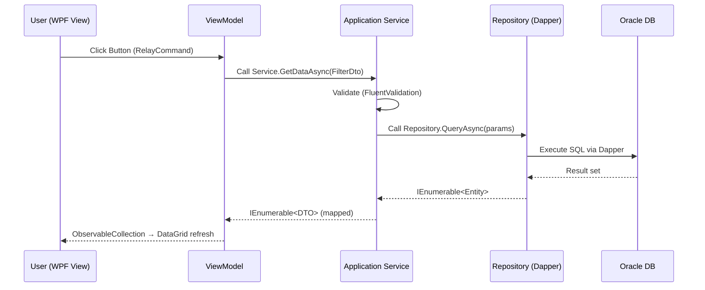
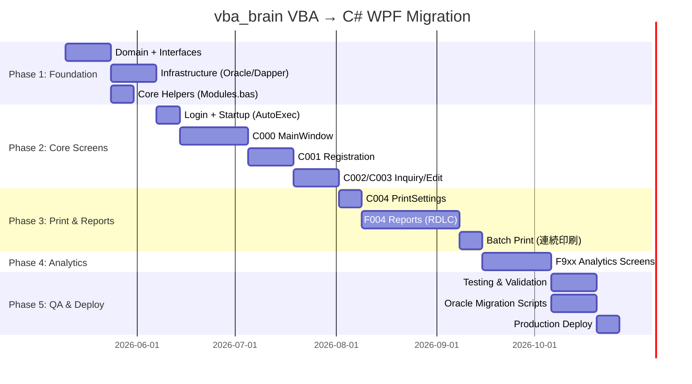

# Kiến trúc Hệ thống vba_brain - VBA Migration → C# WPF + Oracle

> **Hệ thống nguồn**: Microsoft Access VBA (792 tệp)  
> **Hệ thống đích**: C# WPF, Clean Architecture, Dapper, Oracle DB  
> **Phạm vi**: Forms/Reports, Modules, Macros → Windows, ViewModels, Services, Repositories  
> **Ngày tạo**: 06/05/2026

---

## 1. Tổng quan Mapping: VBA → C# WPF

| Thành phần VBA | Số lượng | Tương đương C# WPF |
|---|---|---|
| `Forms/*.frm` (UI Forms) | 174 | `Views/*.xaml` + `ViewModels/*.cs` |
| `Forms/*.frm` (Report-as-Form) | 78 | `Views/Reports/*.xaml` (RDLC/Crystal) |
| `Reports/*.frm` | 19 | `Views/Reports/*.rdlc` (ReportViewer) |
| `Macros/*.mac` | 68 | `Services/NavigationService.cs` + Commands |
| `Modules/*.bas` | 16 | `Application/Services/` + `Infrastructure/Helpers/` |
| `Queries/*.sql` | 515 | `Infrastructure/Repositories/` (Dapper SQL) |
| Access Tables | ~50 bảng | Oracle DB Schema (Entities/Migrations) |

---

## 2. Kiến trúc Phân tầng (Clean Architecture)

```text
┌──────────────────────────────────────────────────────────┐
│              Presentation Layer (WPF)                     │
│   Views (XAML) ↔ ViewModels (MVVM) ↔ NavigationService  │
├──────────────────────────────────────────────────────────┤
│              Application Layer (Use Cases)                │
│   Services / DTOs / Validators / Mappers                  │
├──────────────────────────────────────────────────────────┤
│              Domain Layer (Core)                          │
│   Entities / Interfaces / Domain Exceptions               │
├──────────────────────────────────────────────────────────┤
│              Infrastructure Layer (Details)               │
│   Dapper Repositories / OracleContext / Helpers / Logging │
│                    ↓                                      │
│              Oracle Database                              │
└──────────────────────────────────────────────────────────┘
```

---

## 3. Cấu trúc thư mục Solution C# WPF

```text
vba_brain.sln
├── vba_brain.Domain/                          # Lớp lõi - không phụ thuộc gì
│   ├── Entities/
│   │   ├── AfterMainEntity.cs             ← C000_MAINⅡ record
│   │   ├── AfterRegistrationEntity.cs     ← C001 registration
│   │   ├── PaymentEntity.cs               ← 入金 (payment)
│   │   ├── PrintDocumentEntity.cs         ← F004 documents
│   │   └── AnalyticsEntity.cs             ← F9xx analytics
│   ├── Interfaces/
│   │   ├── IAfterMainRepository.cs
│   │   ├── IPaymentRepository.cs
│   │   ├── IPrintRepository.cs
│   │   └── IAnalyticsRepository.cs
│   ├── Common/
│   │   ├── BaseEntity.cs
│   │   └── Enumerations/
│   │       ├── ServiceType.cs             ← 有償/無償/瑕疵
│   │       ├── PaymentFlag.cs             ← 入金フラグ
│   │       └── RegistrationStatus.cs      ← 登録状況
│   └── Exceptions/
│       └── DomainException.cs
│
├── vba_brain.Application/                     # Use Cases & Business Logic
│   ├── DTOs/
│   │   ├── AfterMainDto.cs
│   │   ├── PaymentDto.cs
│   │   └── PrintRequestDto.cs
│   ├── Services/
│   │   ├── AfterMainService.cs            ← Lấy/lọc danh sách MAIN
│   │   ├── AfterRegistrationService.cs    ← CRUD C001
│   │   ├── AfterEditService.cs            ← CRUD C003
│   │   ├── PaymentService.cs              ← Xử lý 入金
│   │   ├── PrintService.cs                ← Điều phối in ấn F004
│   │   └── AnalyticsService.cs            ← F9xx thống kê
│   ├── Validators/
│   │   ├── AfterRegistrationValidator.cs
│   │   └── PaymentValidator.cs
│   └── Mappers/
│       └── vba_brainMappingProfile.cs
│
├── vba_brain.Infrastructure/                  # Chi tiết kỹ thuật
│   ├── Persistence/
│   │   ├── OracleContext.cs               ← Thay DapperContext → Oracle
│   │   ├── Repositories/
│   │   │   ├── AfterMainRepository.cs     ← 515 SQL queries → Dapper
│   │   │   ├── PaymentRepository.cs
│   │   │   ├── PrintRepository.cs
│   │   │   └── AnalyticsRepository.cs
│   │   └── UnitOfWork/
│   │       └── UnitOfWork.cs
│   ├── Queries/                           ← Migrate từ VBA_Export_All/Queries/
│   │   ├── MainQueries/                   ← C000_MAINⅡ*.sql (50 files)
│   │   ├── PrintQueries/                  ← F004_*.sql (~100 files)
│   │   └── AnalyticsQueries/              ← F9xx_*.sql (~50 files)
│   ├── Helpers/                           ← Migrate từ Modules/*.bas
│   │   ├── CommonHelper.cs                ← Common.bas
│   │   ├── WindowHelper.cs                ← AppWinCenter.bas + SetWindowPos.bas
│   │   ├── GuidHelper.cs                  ← SetGUID.bas
│   │   ├── PhoneHelper.cs                 ← mdlSplitTelNum.bas
│   │   └── ClipboardHelper.cs             ← setEmtpyClipBoard.bas
│   ├── Logging/
│   │   └── SerilogConfiguration.cs
│   └── Migrations/                        ← DbUp scripts cho Oracle
│       └── Scripts/
│           ├── V001__InitialSchema.sql
│           └── V002__SeedMasterData.sql
│
└── vba_brain.UI.WPF/                          # Presentation Layer
    ├── Views/
    │   ├── Auth/
    │   │   ├── LoginWindow.xaml           ← F_Login.frm
    │   │   └── LoginAAWindow.xaml         ← F_Login_AA.frm
    │   ├── Main/
    │   │   ├── MainWindow.xaml            ← C000_MAINⅡ.frm
    │   │   ├── MainPaymentView.xaml       ← C000_MAINⅡ_入金.frm
    │   │   └── MainUnpaidView.xaml        ← C000_MAINⅡ_未入金.frm
    │   ├── CRUD/
    │   │   ├── RegistrationWindow.xaml    ← C001_アフター登録Ⅱ.frm
    │   │   ├── InquiryWindow.xaml         ← C002_アフター照会Ⅱ.frm
    │   │   ├── EditWindow.xaml            ← C003_アフターMAINto編集Ⅱ.frm
    │   │   └── DuplicateWindow.xaml       ← C003_アフターMAINto複製Ⅱ.frm
    │   ├── Print/
    │   │   ├── PrintSettingsWindow.xaml   ← C004_印刷設定Ⅱ_MAIN.frm
    │   │   └── Reports/                   ← F004_*.frm (77 files → RDLC)
    │   │       ├── QuoteReport.rdlc       ← 見積書
    │   │       ├── InvoiceReport.rdlc     ← 請求書
    │   │       ├── DeliveryReport.rdlc    ← 納品書
    │   │       └── BatchPrintView.xaml    ← 連続印刷
    │   ├── Analytics/
    │   │   ├── AdminHomeWindow.xaml       ← F000_管理ホーム
    │   │   ├── CollectionStatsWindow.xaml ← F900_回収額実績
    │   │   └── AggregateWindow.xaml       ← F911/F912/F921_集計
    │   └── Shared/
    │       ├── SplashScreen.xaml          ← M300_Splash → WPF SplashScreen
    │       └── NavigationButtons.xaml     ← F021_NavigationButtons.frm
    ├── ViewModels/
    │   ├── Auth/
    │   │   └── LoginViewModel.cs
    │   ├── Main/
    │   │   ├── MainViewModel.cs
    │   │   ├── MainPaymentViewModel.cs
    │   │   └── MainUnpaidViewModel.cs
    │   ├── CRUD/
    │   │   ├── RegistrationViewModel.cs
    │   │   ├── InquiryViewModel.cs
    │   │   └── EditViewModel.cs
    │   ├── Print/
    │   │   └── PrintSettingsViewModel.cs
    │   └── Analytics/
    │       └── AnalyticsViewModel.cs
    ├── Services/
    │   ├── NavigationService.cs           ← Thay thế toàn bộ Macros/*.mac
    │   ├── DialogService.cs
    │   ├── PrintOrchestrationService.cs   ← Thay DoCmd.OpenReport
    │   └── StartupService.cs              ← Thay AutoExec.mac
    ├── Converters/
    │   ├── BoolToVisibilityConverter.cs
    │   └── ServiceTypeColorConverter.cs
    ├── Resources/
    │   ├── Styles/
    │   │   └── AppStyles.xaml
    │   └── Themes/
    │       └── vba_brainTheme.xaml
    ├── App.xaml
    └── DependencyInjection.cs             ← Composition Root
```

---

## 4. Mapping Chi tiết: Macros → NavigationService

Trong VBA, **Macros** đóng vai trò điều hướng (OpenForm, Requery, RunMacro). Trong C# WPF, tất cả được hợp nhất vào `NavigationService`:

| VBA Macro (*.mac) | C# WPF Equivalent |
|---|---|
| `AutoExec.mac` → OpenForm F_Login | `StartupService.Initialize()` → Navigate to `LoginWindow` |
| `C000_MAIN に戻る.mac` | `NavigationService.NavigateTo<MainViewModel>()` |
| `C001_アフター登録_登録.mac` | `RelayCommand: SaveAndReturnAsync()` in `RegistrationViewModel` |
| `C003_アフターMAINto編集Ⅱ_登録.mac` | `RelayCommand: UpdateAndReturnAsync()` in `EditViewModel` |
| `M300_Splash(M)Ⅱを開く.mac` | `SplashScreen` built-in WPF |
| `M5xx_コンボ再クエリー.mac` | `ObservableCollection` Auto-refresh + `LoadComboDataAsync()` |
| `TBLビルアフター回収_Net版.mac` | `appsettings.json` → `ConnectionStrings:Oracle` switch |
| `M511_全コンボ再クエリー.mac` | `MainViewModel.RefreshFiltersCommand` (RelayCommand) |

---

## 5. Mapping Chi tiết: Modules → Infrastructure Helpers

| VBA Module (.bas) | C# Infrastructure |
|---|---|
| `Common.bas` | `vba_brain.Infrastructure/Helpers/CommonHelper.cs` |
| `AppWinCenter.bas` | `WindowHelper.CenterWindow(window)` |
| `SetWindowPos.bas` | `WindowHelper` dùng P/Invoke Win32 |
| `TopMessageBox.bas` | `DialogService.ShowTopMost(message)` |
| `MenuBar.bas` | WPF `Menu` + `ContextMenu` trong XAML |
| `EnableShift.bas` | Không cần thiết (WPF không dùng Access Shift-Bypass) |
| `SetGUID.bas` | `GuidHelper.GenerateGuid()` hoặc `Guid.NewGuid()` |
| `mdlSetAppStyle.bas` | `Resources/Themes/vba_brainTheme.xaml` |
| `mdlSplitTelNum.bas` | `PhoneHelper.SplitPhoneNumber(string)` |
| `setEmtpyClipBoard.bas` | `Clipboard.Clear()` built-in .NET |
| `Module1~4.bas` | Phân tách vào các Service tương ứng |

---

## 6. Mapping Chi tiết: Queries → Dapper Repositories

### 6.1 Phân nhóm 515 SQL Queries → Repository Methods

| Nhóm Query VBA | Số lượng | Repository C# | Method Pattern |
|---|---|---|---|
| `C000_MAINⅡ ALL*` | ~50 | `AfterMainRepository` | `GetListAsync(FilterDto filter)` |
| `C000_MAINⅡ A*` | ~15 | `AfterMainRepository` | `GetByStatusAsync(StatusEnum status)` |
| `F004_*` | ~100 | `PrintRepository` | `GetPrintDataAsync(docType, id)` |
| `F9xx_*` | ~50 | `AnalyticsRepository` | `GetAggregateAsync(period, type)` |
| `SelQuery_*` | ~20 | Các Repository | `SearchAsync(keyword)` |
| `WSTEM_TBL*` | ~30 | `WorkTableRepository` | `CreateWorkTableAsync()` |
| `TBL*` | ~20 | `Migrations/Scripts/` | DbUp migration scripts |

### 6.2 Cơ chế kết nối Oracle với Dapper

```csharp
// vba_brain.Infrastructure/Persistence/OracleContext.cs
public class OracleContext
{
    private readonly string _connectionString;
    
    public OracleContext(IConfiguration config)
    {
        _connectionString = config.GetConnectionString("Oraclevba_brain");
    }
    
    public IDbConnection CreateConnection()
        => new OracleConnection(_connectionString);  // Oracle.ManagedDataAccess.Client
}

// appsettings.json
{
  "ConnectionStrings": {
    "Oraclevba_brain": "Data Source=//server:1521/vba_brainDB;User Id=vba_brain;Password=***;"
  }
}
```

### 6.3 Ví dụ Repository với Dapper (Oracle)

```csharp
// Thay thế C000_MAINⅡ ALL *.sql
public async Task<IEnumerable<AfterMainDto>> GetMainListAsync(MainFilterDto filter)
{
    using var conn = _context.CreateConnection();
    var sql = @"
        SELECT A.SEQ_NO, A.AFTER_CD, A.CUSTOMER_NM, A.SERVICE_TYPE,
               A.PAYMENT_AMT, A.PAYMENT_FLG, A.DISTRICT_CD
        FROM   T001_AFTER_MAIN A
        WHERE  (:ServiceType IS NULL OR A.SERVICE_TYPE = :ServiceType)
          AND  (:PaymentFlg  IS NULL OR A.PAYMENT_FLG  = :PaymentFlg)
          AND  (:DistrictCd  IS NULL OR A.DISTRICT_CD  = :DistrictCd)
        ORDER BY A.RECEIVE_DT DESC";
    
    return await conn.QueryAsync<AfterMainDto>(sql, filter);
}
```

---

## 7. Luồng dữ liệu (Data Flow) - C# WPF



---

## 8. Luồng Khởi động (Startup Flow) - Thay thế AutoExec.mac

```text
App.xaml.cs → OnStartup()
    └─ StartupService.InitializeAsync()
         ├─ Check Oracle Connection
         ├─ Check T023_地区CD (DCount = 0 → Open Setup)
         ├─ Show SplashScreen (WPF built-in)
         └─ NavigationService.NavigateTo<LoginViewModel>()
              └─ Login thành công
                   └─ NavigationService.NavigateTo<MainViewModel>()
                        └─ MainWindow mở (= C000_MAINⅡ)
```

---

## 9. Luồng In ấn (Print Flow) - Thay thế F004 + C004

```text
MainViewModel.OpenPrintSettingsCommand
    └─ NavigationService.OpenDialog<PrintSettingsViewModel>()
         ├─ User chọn loại in (見積/請求/納品書...)
         ├─ PrintSettingsViewModel.PrintCommand
         │    └─ PrintOrchestrationService.PrintAsync(PrintRequestDto)
         │         ├─ PrintRepository.GetPrintDataAsync(docType, recordId)
         │         ├─ Map data → ReportDataSource
         │         └─ ReportViewer.Show(rdlcPath, dataSource)
         │              ├─ Preview on screen
         │              └─ Export → PDF (ReportViewer built-in)
         └─ 連続印刷: Iterate list → PrintAsync() per record
```

---

## 10. Tech Stack Đề xuất

| Thành phần | Thư viện |
|---|---|
| **Data Access** | **Dapper** + **Oracle.ManagedDataAccess.Core** |
| **MVVM** | `CommunityToolkit.Mvvm` |
| **Dependency Injection** | `Microsoft.Extensions.DependencyInjection` |
| **Validation** | `FluentValidation` |
| **Mapping** | `AutoMapper` hoặc thủ công |
| **Reporting** | `Microsoft.Reporting.WinForms` (RDLC) hoặc `FastReport` |
| **Logging** | `Serilog` |
| **DB Migration** | `DbUp` (Oracle compatible) |
| **Config** | `Microsoft.Extensions.Configuration` + `appsettings.json` |
| **Testing** | `xUnit` + `Moq` |

---

## 11. Quy tắc Đặt tên (Naming Conventions - C# WPF)

### 11.1 Views / ViewModels

| VBA Prefix | C# WPF Pattern | Ví dụ |
|---|---|---|
| `C000_MAINⅡ*` | `Main*Window/ViewModel` | `MainWindow`, `MainPaymentWindow` |
| `C001_*` | `Registration*Window/ViewModel` | `RegistrationWindow` |
| `C002_*` | `Inquiry*` hoặc `Edit*` | `InquiryWindow`, `EditWindow` |
| `C003_*` | `Edit*Window/ViewModel` | `EditFromMainWindow` |
| `C004_*` | `PrintSettings*Window/ViewModel` | `PrintSettingsWindow` |
| `F004_*` | `*Report.rdlc` | `QuoteReport.rdlc`, `InvoiceReport.rdlc` |
| `F9xx_*` | `Analytics*Window/ViewModel` | `AnalyticsAggregateWindow` |
| `F02x_*` | `*SelectorDialog` | `DistrictSelectorDialog` |

### 11.2 Suffixes

| VBA Suffix | C# Pattern |
|---|---|
| `_MAIN` | Gọi từ `MainViewModel.Command` |
| `_照会` | Gọi từ `InquiryViewModel.Command` |
| `_編集` | Gọi từ `EditViewModel.Command` |
| `_連続` | `BatchPrintCommand` trong ViewModel |
| `_印刷` | Method `.PrintAsync()` trong Service |
| `_白紙` | `PrintRequestDto.IsBlankTemplate = true` |
| `_SubF` | WPF `UserControl` (Sub-form) |

---

## 12. Ghi chú Kỹ thuật (Technical Notes)

### 12.1 Oracle thay Access Tables
- Access dùng **Local MDB / Linked Tables** qua SharePoint → Oracle dùng **TNS / JDBC connection string** cấu hình trong `appsettings.json`
- Macro `TBLビルアフター回収_Net版.mac` → Đơn giản hóa bằng cách switch `ConnectionStrings` trong config (hoặc environment variable)

### 12.2 Report-as-Form (78 Forms) → RDLC
- 78 VBA Form dùng làm Preview in → Chuyển sang **RDLC Reports** với `Microsoft.Reporting.WinForms`
- Logic setup đặc biệt của từng Form (VBA `Form_Open`) → Xử lý trong `PrintOrchestrationService.PrepareDataAsync()`

### 12.3 ComboBox Refresh (M5xx Macros)
- 20 Macro `M5xx_*` chuyên Requery ComboBox → Trong WPF, `ObservableCollection` tự refresh khi data thay đổi
- `M511_全コンボ再クエリー` → `RefreshAllFiltersCommand` trong `MainViewModel`

### 12.4 Character Encoding
- VBA files mã hóa **UTF-16LE + Shift-JIS** (tiếng Nhật)
- C# WPF dùng **UTF-8** toàn bộ, Oracle NLS_CHARACTERSET = `AL32UTF8`

### 12.5 Authentication
- `F_Login` / `F_Login_AA` → WPF `LoginWindow` xác thực user qua Oracle table `T_USERS`
- Không còn Access Shift-Bypass (`EnableShift.bas`) — không cần trong WPF

---

## 13. Migration Roadmap (Lộ trình)



---

*Tài liệu được tổng hợp từ `VBA_Export_All/ARCHITECTURE.md` (nguồn VBA) và `architecture_OM.md` (kiến trúc C# WPF target). Cập nhật khi có thay đổi thiết kế.*
