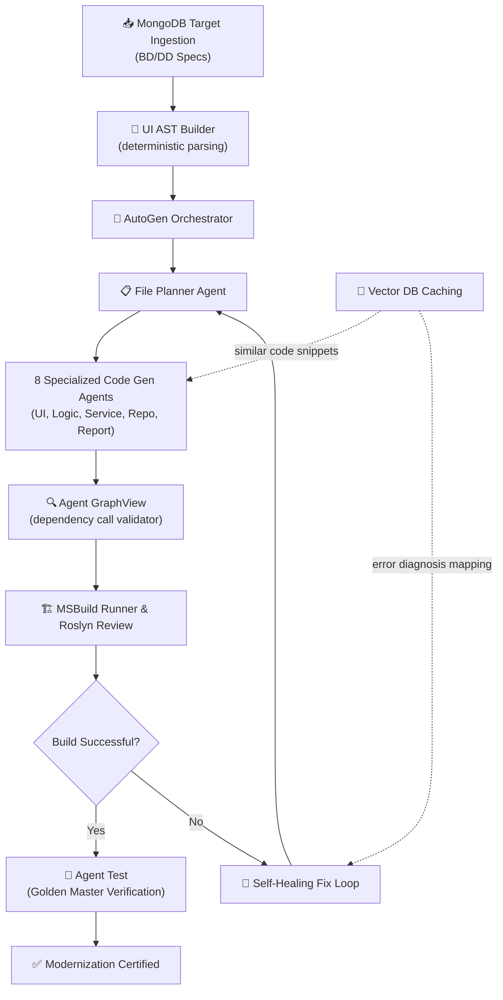

# AI Agent Codegen Pipeline & Source Design Specification

This document details the high-level architecture, multi-agent execution pipeline, vector database caching mechanisms, code self-healing loop, and conflict-free developer directory structure for the modern **WPF C# Modernizer** platform.

---

## 1. System Vision & The Core Solution

Legacy migrations involving hundreds of custom MS Access UI forms and associated VBA macro workflows are traditionally manual, error-prone, and slow. The modernizer platform introduces a **deterministic and AI-driven compiler pipeline** capable of:
- Ingesting structured UI definitions (BD) and logical schemas (DD) from a normalized MongoDB repository.
- Generating clean C# code matching the **MVVM pattern** with constructor Dependency Injection (DI) and Dapper repositories.
- Automating compiler feedback runs to capture, diagnose, and self-heal build issues.
- Utilizing semantic template lookups and caching parameters to minimize LLM token costs.

---

## 2. Multi-Agent Orchestration Pipeline



---

## 3. Conflict-Free Folder Layout Design

To enable multiple developers to extend agents and modify system prompts simultaneously without git conflicts, every specialized agent is isolated inside its own module folder. Shared logic remains decoupled inside `core/`, `llm/`, or `pipeline/`:

```text
src/backend/workflow/layer5/
│
├── __init__.py
│
├── agents/                          ← INDEPENDENT AGENT MODULES
│   │
│   ├── ui/                          ← 🎨 Agent UI
│   │   ├── __init__.py
│   │   ├── agent_ui.py              # XAML view generator agent logic
│   │   ├── inputs/                  # Target BD models & visual references
│   │   ├── outputs/                 # Snapshots of generated WPF XAML views
│   │   ├── prompts/
│   │   │   └── agent_ui.md          # Visual control layout prompt rules
│   │   └── templates/
│   │       └── Window.xaml.j2       # Optional UI Jinja2 templates
│   │
│   ├── logic/                       ← 🧠 Agent Logic
│   │   ├── __init__.py
│   │   ├── agent_logic.py           # ViewModel generation agent logic
│   │   ├── inputs/                  # Target DD specs & event descriptions
│   │   ├── outputs/                 # Snapshots of generated ViewModels
│   │   └── prompts/
│   │       └── agent_logic.md       # MVVM design and property prompts
│   │
│   ├── service/                     ← ⚙️ Agent Service
│   │   ├── __init__.py
│   │   ├── agent_service.py         # Business service generator logic
│   │   ├── inputs/                  # DD business rules & VBA codes
│   │   ├── outputs/                 # Snapshots of generated Services
│   │   └── prompts/
│   │       ├── agent_service_form.md
│   │       └── agent_service_macro.md
│   │
│   ├── repo/                        ← 🗃️ Agent Repo
│   │   ├── __init__.py
│   │   ├── agent_repo.py            # Dapper repository generator logic
│   │   ├── inputs/                  # Mapped SQL structures & table schemas
│   │   ├── outputs/                 # Generated Entities & Repositories
│   │   ├── prompts/
│   │   │   └── agent_repo.md        # Dapper SQL design rules
│   │   └── templates/
│   │       ├── Entity.cs.j2
│   │       └── DTO.cs.j2
│   │       └── Interface.cs.j2
│   │
│   ├── report/                      ← 📊 Agent Report
│   │   ├── __init__.py
│   │   ├── agent_report.py          # Report designer migration logic
│   │   ├── inputs/                  # Mapped VBA print dimensions
│   │   ├── outputs/                 # Generated RDLC layouts
│   │   └── prompts/
│   │       └── agent_report.md
│   │
│   ├── graphview/                   ← 🔍 Agent GraphView
│   │   ├── __init__.py
│   │   ├── agent_graphview.py       # Validates structural bindings
│   │   ├── dependency_builder.py    # Parsers WPF code to build actual call tree
│   │   ├── inputs/                  # VBA call graphs
│   │   ├── outputs/                 # Validation review reports
│   │   └── prompts/
│   │       └── agent_graphview.md
│   │
│   └── test/                        ← 🧪 Agent Test
│       ├── __init__.py
│       ├── agent_test.py            # Integration test generator logic
│       ├── inputs/                  # Mapped operational contracts
│       ├── outputs/                 # Generated C# xUnit test cases
│       └── golden_master/
│           ├── builder.py
│           └── verifier.py
```

---

## 4. Optimization & Vector DB Caching

To decrease high LLM operating costs and improve response consistency, the orchestrator implements a dual caching strategy:
1. **Structural Jinja2 Templating:** Mapped models (such as Repository Entities, DTOs, and Interfaces) are generated strictly through deterministic Jinja2 templates using local schemas, utilizing 0 LLM tokens.
2. **Semantic Context Retrieval:** For complex logic translations (such as ViewModels and Services), the orchestrator queries a local vector database using raw VBA snippets. It retrieves previously migrated code structures that have passing compilation runs, embedding them inside system prompts as highly accurate few-shot examples.

---

## 5. Self-Healing Compilation Loop

If compilation fails during the MSBuild verification phase, the orchestrator triggers the **Self-Healing Loop**:
- The failing compiler error trace (including file location, line number, error code, and description) is parsed.
- A targeted repair prompt is structured, pairing the failing code block with the compiler diagnostic.
- The File Planner coordinates with the specialized agent responsible for that component to rewrite and compile the repaired file.
- The system runs up to 3 repair iterations before alerting human reviewers.
