# 🎤 AI Agent Coding — Slide Deck

> **Project:** AI IDE: WPF Auto Builder  
> **Mục tiêu:** Tự động chuyển VBA/Access source → WPF Application (MVVM) thông qua multi-agent pipeline  
> **Author:** Bảo Lương

---

<!-- ═══════════════════════════════════════════════════════ -->

## 📌 Slide 1 — Vision & Vấn đề cần giải quyết

### ❓ Vấn đề

| Hiện tại (Manual) | Mong muốn (Automated) |
|---|---|
| 154 forms VBA/Access cần migrate | AI tự đọc specs + VBA → sinh code |
| Dev viết tay từng file C#/XAML | Multi-agent pipeline tự generate |
| Check dependency thủ công | GraphView agent review tự động |
| Token LLM tốn 40K+/form | Tối ưu chỉ còn ~10-14K/form |

### 🎯 Solution

> Xây dựng **AI Compiler Pipeline** — hệ thống multi-agent có khả năng:
> - Đọc UI specs (BD/DD) + VBA source code → **hiểu** form cần build
> - Tự động generate code theo **MVVM pattern** (WPF)
> - Tự **compile, phát hiện lỗi, và sửa** theo feedback loop
> - Giảm tối đa token qua **Jinja2 template + Qdrant cache**

---

<!-- ═══════════════════════════════════════════════════════ -->

## 📌 Slide 2 — Kiến trúc tổng quan (Core Architecture)

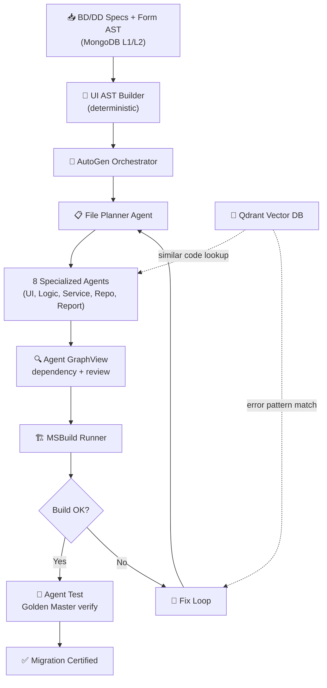

### Pipeline Flow tóm tắt

```
Specs + VBA → UI AST → File Plan → Code Gen → Build → [Fix Loop] → ✅ WPF App
```

---

<!-- ═══════════════════════════════════════════════════════ -->

## 📌 Slide 3 — Hệ thống Multi-Agent

> **Ý tưởng cốt lõi:** Mỗi agent **chỉ đọc đúng nguồn dữ liệu cần thiết** → đọc ít token, gen chính xác

### 9 Agent — Tách AI Coding thành nhiều agent chuyên biệt

> [!TIP]
> Ý tưởng: **1 AI coding agent lớn** → tách thành **9 agent nhỏ**. Mỗi agent sinh code **độc lập** → Agent Review kiểm tra từng output → Agent GraphView nối dependency toàn bộ.

| # | Agent | Đọc từ đâu | Output | Model |
|---|-------|-----------|--------|-------|
| 🗂️ | **File Planner** | BD + DD + MongoDB forms | `file_plan.json` | Deterministic |
| 🎨 | **AI Agent UI** | **BD (layout) + Image** | `Views/*.xaml` | `qwen3-coder-plus` |
| 🧠 | **AI Agent Logic** | **BD (events) + DD (steps)** | `ViewModels/*.cs` | `qwen3-235b` |
| ⚙️ | **AI Agent Service** | **BD (events) + DD (logic)** | `Services/*.cs` | `qwen3-235b` |
| 🗃️ | **AI Agent Repo** | **DD (query specs + SQL)** | `Repositories/*.cs` + Entity/DTO | `qwen3-coder-480b` / Jinja2 |
| 📊 | **AI Agent Report** | **VBA Report specs + Query** | `Reports/*.rdlc` hoặc PDF | ⚠️ **Chưa có solution** |
| ✅ | **AI Agent Review** | **Output từng agent** | Build check + data flow verify | Roslyn + MSBuild |
| 🔍 | **AI Agent GraphView** | **Tất cả output đã review** | Dependency graph (form→event→macro→query) | Orchestrator |
| 🧪 | **AI Agent Test** | **Golden Master + WPF output** | Test cases + Test report | `qwen3-235b` |

### Agent Flow: Gen → Review → GraphView → Test

```mermaid
graph TD
    BD["📋 BD JSON"] --> UI["🎨 Agent UI"]
    IMG["🖼️ Form Image"] --> UI
    BD --> LOGIC["🧠 Agent Logic"]
    DD["📝 DD JSON"] --> LOGIC
    BD --> SVC["⚙️ Agent Service"]
    DD --> SVC
    DD --> REPO["🗃️ Agent Repo"]
    SQL["🔄 Oracle SQL"] --> REPO
    RPT["📊 VBA Reports"] --> REPORT["📊 Agent Report<br/>⚠️ Open"]
    SQL --> REPORT

    UI --> RV["✅ Agent Review<br/>build? compile? data flow?"]
    LOGIC --> RV
    SVC --> RV
    REPO --> RV
    REPORT --> RV

    RV -->|"mỗi output OK"| GV["🔍 Agent GraphView<br/>nối dependency toàn bộ"]
    RV -->|"output lỗi"| FIX1["🔧 Fix → agent tương ứng"]
    FIX1 --> UI & LOGIC & SVC & REPO

    GV -->|"graph khớp VBA"| TEST["🧪 Agent Test"]
    GV -->|"graph mismatch"| FIX2["🔧 Fix → re-plan"]
    TEST -->|"100% pass"| GM["🥇 Migration Certified"]
    TEST -->|"fail"| FIX3["🔧 Fix → agent tương ứng"]

    style RV fill:#065f46,stroke:#10b981,stroke-width:3px
    style GV fill:#7c2d12,stroke:#f97316,stroke-width:3px
    style TEST fill:#1e3a5f,stroke:#60a5fa,stroke-width:2px
    style REPORT fill:#92400e,stroke:#fbbf24,stroke-width:2px,stroke-dasharray: 5 5
```

### Agent Review — Tại sao cần?

> [!IMPORTANT]
> Các agent UI, Logic, Service, Repo sinh code **độc lập** → không biết output của nhau. **Agent Review** kiểm tra **từng output riêng** trước khi GraphView nối lại.

| Agent Review kiểm tra | Cách kiểm tra | Fail → Action |
|----------------------|--------------|---------------|
| Code có **compile** được không? | Roslyn syntax check | → Gửi lỗi về agent sinh code |
| Code có **build** được không? | MSBuild partial build | → Fix lỗi build |
| **Interface** khớp implementation? | Type check: IAuthService ↔ AuthService | → Fix Agent Service/Repo |
| **Data flow** truyền đúng? | DTO fields khớp Entity fields? | → Fix Agent Repo |
| **Namespace/using** đúng? | Reference check | → Auto-fix bằng Roslyn |

```
Không có Agent Review:
  Agent UI gen XAML ✅
  Agent Logic gen ViewModel ✅
  Agent Repo gen Entity ✅
  → GraphView nối lại → ❌ CRASH (ViewModel gọi method không tồn tại)
  → Human phải debug thủ công 😩

Có Agent Review:
  Agent UI gen XAML → Review: compile? ✅
  Agent Logic gen ViewModel → Review: interface khớp? ✅
  Agent Repo gen Entity → Review: fields đúng? ✅
  → GraphView nối lại → ✅ OK (đã verify từng phần)
  → Không cần human review 🎉
```

### Tại sao tách 1 AI coding → 9 agent?

```
❌ 1 Agent làm tất cả = 10,000+ tokens, dễ sai, khó debug
✅ 9 Agent chuyên biệt = gen độc lập + review tự động + verify 100%

🎨 Agent UI        ← BD + Image         (gen XAML)
🧠 Agent Logic     ← BD + DD steps      (gen ViewModel)
⚙️ Agent Service   ← BD + DD logic      (gen Service)
🗃️ Agent Repo      ← DD SQL specs       (gen Repository)
📊 Agent Report    ← VBA report specs   (⚠️ research)
✅ Agent Review    ← output từng agent  (build + compile + data flow)
🔍 Agent GraphView ← output đã review   (nối dependency)
🧪 Agent Test      ← Golden Master      (verify 100%)
```

---

<!-- ═══════════════════════════════════════════════════════ -->

## 📌 Slide 4 — Agent đọc bớt Token

### Chiến lược "đọc ít, gen đúng"

> [!IMPORTANT]
> Mỗi agent chỉ nhận **đúng context cần thiết**, không nhận full spec → tiết kiệm token đáng kể.

````carousel
### 🧩 Chiến lược 1: Jinja2 cho Boilerplate

```
70% code WPF = boilerplate → Jinja2 template
30% code      = business logic → LLM

Template Files (0 tokens):
├── ViewModelBase.cs
├── RelayCommand.cs
├── App.xaml
├── {Form}Model.cs (fill fields)
└── OracleDbContext.cs

LLM Files (~14K tokens):
├── {Form}ViewModel.cs    ~6K
├── {Form}View.xaml       ~4K
└── {Form}Service.cs      ~3K
```
<!-- slide -->
### 🎯 Chiến lược 2: Selective Context

```python
# ❌ SAI — Gửi full BD JSON (5000+ tokens)
prompt = f"BD: {json.dumps(full_bd_json)}"

# ✅ ĐÚNG — Chỉ gửi fields cần cho file đang gen (~500 tokens)
context = {
    "events": [{"name": "...", "description": "..."}],
    "bindings": ["txtID", "txtPass"],
    "steps": [{"module": "...", "steps": [...]}]
}
# → 500 tokens thay vì 5000+
```
<!-- slide -->
### 💾 Chiến lược 3: Qdrant Cache

```python
# Tìm code tương tự trước khi gọi LLM
similar = qdrant.search("wpf_code_templates", vector, limit=1)

if similar[0].score > 0.92:
    code = similar[0].payload["code_content"]  # 0 tokens!
else:
    code = llm.invoke(prompt)  # Gọi LLM
    qdrant.upsert(...)          # Cache cho lần sau
```
<!-- slide -->
### 📊 Chiến lược 4: Token Budget

```
Mỗi form: ~10-14K tokens (tối ưu)
         vs 40K+ tokens (không tối ưu)

┌─────────────────────────────────┐
│  Jinja2:        0 tokens        │
│  Qdrant Cache:  0 tokens (hit)  │
│  LLM:         ~10-14K tokens    │
│  ├── ViewModel    ~6K           │
│  ├── View.xaml    ~4K           │
│  └── Service.cs   ~3K          │
└─────────────────────────────────┘
     Tiết kiệm ~65% token!
```
````

---

<!-- ═══════════════════════════════════════════════════════ -->

## 📌 Slide 5 — Knowledge Base (4 nguồn dữ liệu)

> Agent đọc **4 nguồn chính** để hiểu form cần build

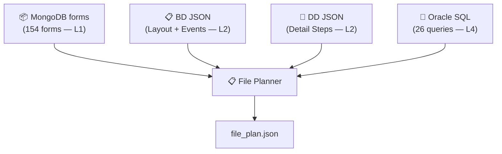

| Source | Chứa gì | Agent dùng để |
|--------|---------|---------------|
| **MongoDB forms** (L1) | Controls, layout, events, VBA code | → XAML controls, Grid positions, ICommand bindings |
| **BD JSON** (L2) | Event descriptions, control-to-table map | → ViewModel method names, Model properties |
| **DD JSON** (L2) | Step-by-step logic, query templates | → C# method body, Service SQL calls |
| **Oracle SQL** (L4) | Raw SQL (đã convert sẵn) | → `DbCommand.CommandText`, `OracleParameter[]` |

---

<!-- ═══════════════════════════════════════════════════════ -->

## 📌 Slide 6 — ⭐ GraphView Agent — AGENT QUAN TRỌNG NHẤT

> [!CAUTION]
> GraphView Agent là **trái tim** — nó trace **form nào open form nào, close form nào, gọi event nào, event gọi macro/module/query nào** → tạo dependency graph cho WPF giống hệt VBA.

### GraphView Agent trace những gì?

```mermaid
graph TD
    F["📋 F_Login<br/>(form)"] -->|"open"| E1["Form_Open"]
    F -->|"load"| E2["Form_Load"]
    F -->|"event"| E3["txtPass_AfterUpdate"]
    F -->|"close"| E4["閉じる_Click"]

    E2 -->|"calls module"| M1["SetWindowTop"]
    E2 -->|"calls module"| M2["SetAccWinStyle"]
    E2 -->|"calls module"| M3["Judge_Inst"]
    E2 -->|"opens query"| Q0["Q000_T_LoginUser"]
    E2 -->|"DLookup"| T3["Access配信日"]

    E3 -->|"DLookup"| T1["T_ID_Pass"]
    E3 -->|"DCount"| T2["T023_地区CD設定"]
    E3 -->|"calls macro"| MAC1["AutoExec_A"]
    E3 -->|"calls macro"| MAC2["AutoExec_Restart"]
    E3 -->|"calls module"| M4["タイマーを開く"]
    E3 -->|"closes form"| F
    E3 -->|"opens form"| F2["F_Main / F_Setup"]

    E4 -->|"shutdown"| APP["Application.Quit"]

    style F fill:#1e3a5f,stroke:#60a5fa,stroke-width:3px
    style F2 fill:#1e3a5f,stroke:#60a5fa,stroke-width:2px
```

### GraphView tạo WPF Dependency Graph tương ứng

> Sau khi các agent gen code xong → GraphView **đọc toàn bộ output** → tạo dependency graph WPF → **so sánh với VBA graph** → phải khớp 100%

```
VBA Graph (source of truth)          WPF Graph (generated)
─────────────────────────           ─────────────────────────
F_Login                             LoginWindow.xaml
├─ Form_Load                        ├─ Window_Loaded (ViewModel)
│  ├─ SetWindowTop (module)         │  ├─ WindowHelper.cs (common)
│  ├─ Judge_Inst (module)           │  ├─ VersionChecker.cs (common)
│  └─ Q000_T_LoginUser (query)     │  └─ UserRepository.GetAsync()
├─ txtPass_AfterUpdate              ├─ LoginCommand (ViewModel)
│  ├─ DLookup T_ID_Pass             │  ├─ UserRepository.GetByIdAsync()
│  ├─ DCount T023_地区CD設定         │  ├─ UserRepository.CountAsync()
│  ├─ AutoExec_A (macro)            │  ├─ NavigationService.ToMain()
│  ├─ AutoExec_Restart (macro)      │  ├─ NavigationService.ToSetup()
│  └─ closes F_Login                │  └─ Window.Close()
└─ 閉じる_Click                      └─ CloseCommand
   └─ Application.Quit                 └─ Application.Shutdown()

→ GraphView verify: VBA graph ≡ WPF graph ✅
```

### 🏆 Vai trò: Dependency Reviewer + Quality Gate

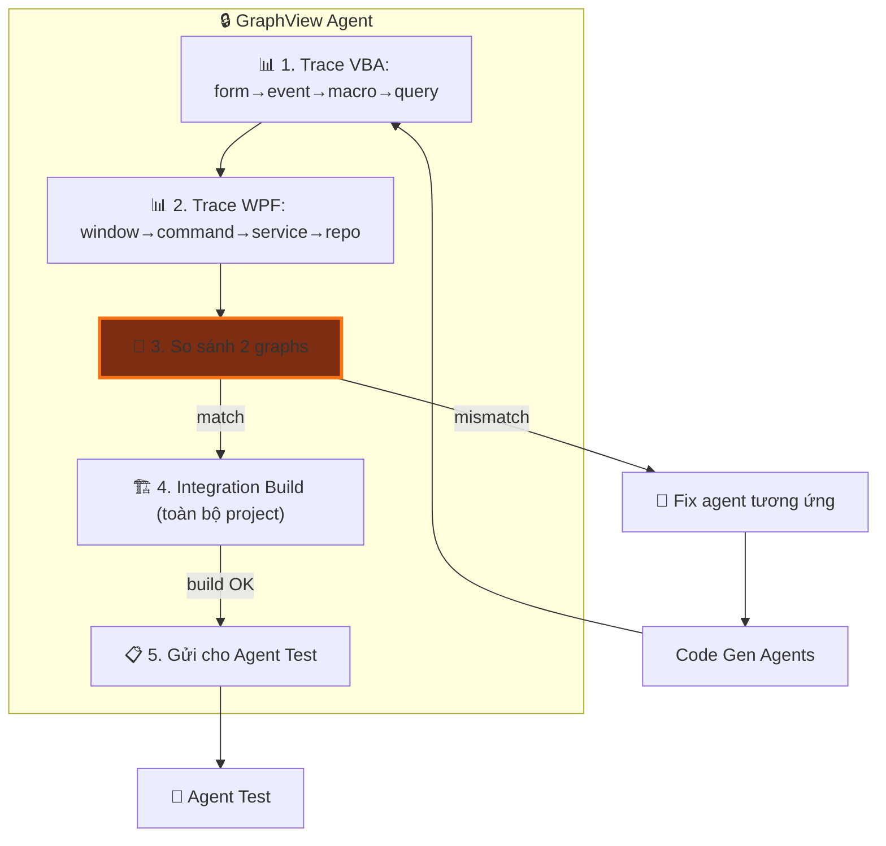

---

<!-- ═══════════════════════════════════════════════════════ -->

## 📌 Slide 6b — 🥇 Golden Master Testing

> [!IMPORTANT]
> **Golden Master** = snapshot hành vi chính xác của VBA source gốc. Mọi output WPF **PHẢI khớp 100%** với Golden Master → đảm bảo migration không mất logic.

### Golden Master là gì?

```
Golden Master = "Bản ghi chuẩn" từ VBA source gốc
├── Input scenarios (test cases)
├── Expected outputs (kết quả đúng)
├── UI states (trạng thái form)
├── DB queries executed (SQL đã chạy)
└── Business rules (logic nghiệp vụ)
```

### Quy trình Golden Master 3 bước

````carousel
### 📸 Bước 1: Capture Golden Master từ VBA Source

```python
# Trích xuất "sự thật" từ VBA source gốc
golden_master = {
    "form": "F_Login",
    "test_cases": [
        {
            "id": "TC001",
            "scenario": "Login thành công",
            "input": {"txtID": "admin", "txtPass": "pass123"},
            "expected": {
                "action": "close_form + open_main_menu",
                "sql_executed": ["Q_Login_Auth"],
                "conditions": ["管理FLG != 0", "Pass == input"]
            }
        },
        {
            "id": "TC002",
            "scenario": "Password sai",
            "input": {"txtID": "admin", "txtPass": "wrong"},
            "expected": {
                "action": "show_error",
                "message": "パスワードが違います!!",
                "sql_executed": ["Q_Login_Auth"]
            }
        },
        {
            "id": "TC003",
            "scenario": "User bị khóa (管理FLG=0)",
            "input": {"txtID": "locked_user", "txtPass": "any"},
            "expected": {
                "action": "show_error",
                "message": "本工事管理ではありません...!!",
                "conditions": ["管理FLG == 0"]
            }
        }
    ]
}
```
<!-- slide -->
### 🔍 Bước 2: GraphView Agent verify WPF output vs Golden Master

```python
# GraphView Agent chạy từng test case
for tc in golden_master["test_cases"]:

    # 2a. Static Analysis — check code chứa logic đúng
    verify_conditions(wpf_code, tc["expected"]["conditions"])

    # 2b. SQL Trace — check đúng query được gọi
    verify_sql_calls(wpf_code, tc["expected"]["sql_executed"])

    # 2c. Behavior Match — check output action khớp
    verify_behavior(wpf_code, tc["expected"]["action"])

    # 2d. Error Messages — check message chính xác
    if "message" in tc["expected"]:
        verify_message_exact(wpf_code, tc["expected"]["message"])
```
<!-- slide -->
### ✅ Bước 3: Migration Certification Report

```
┌─────────────────────────────────────────┐
│     🥇 GOLDEN MASTER REPORT            │
│     Form: F_Login                       │
├─────────────────────────────────────────┤
│  TC001 Login成功     ✅ PASS            │
│  ├─ SQL trace        ✅ Q_Login_Auth    │
│  ├─ Conditions       ✅ 管理FLG, Pass   │
│  └─ Action           ✅ close + navigate│
│                                         │
│  TC002 Password失敗  ✅ PASS            │
│  ├─ Error message    ✅ exact match     │
│  └─ SQL trace        ✅ Q_Login_Auth    │
│                                         │
│  TC003 User locked   ✅ PASS            │
│  ├─ Error message    ✅ exact match     │
│  └─ Condition        ✅ 管理FLG==0      │
├─────────────────────────────────────────┤
│  Result: 3/3 PASSED — 100% ✅          │
│  Status: MIGRATION CERTIFIED 🏆        │
└─────────────────────────────────────────┘
```
````

---

<!-- ═══════════════════════════════════════════════════════ -->

## 📌 Slide 6c — 5 Verification Layers (Project-level)

> [!NOTE]
> Đây là verify **toàn bộ project** sau khi GraphView nối lại — khác với Agent Review chỉ check **từng file riêng**.

| Layer | Phạm vi | Kiểm tra gì | Fail → Action |
|:-----:|---------|-------------|---------------|
| 🔗 **L1: Dependency** | **Project** | Tất cả references giữa files resolve | → Re-plan files |
| 🏗️ **L2: Integration Build** | **Project** | Toàn bộ project compile thành công | → Error fix loop |
| 📊 **L3: SQL Trace** | **Project** | Đúng queries được gọi, đúng params | → Fix Service/Repo |
| 🧠 **L4: Logic Match** | **Project** | Business rules khớp VBA gốc | → Fix ViewModel |
| 🎨 **L5: UI Parity** | **Project** | Controls, layout, bindings đúng | → Fix Agent UI |

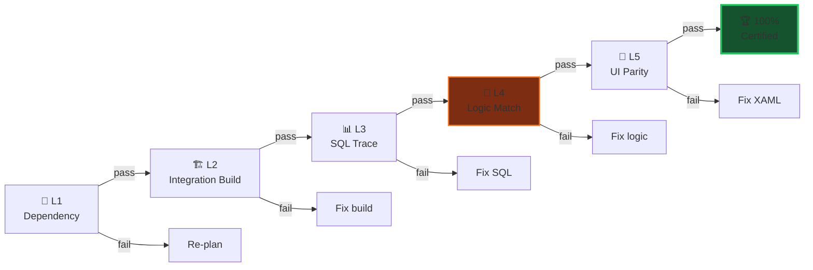

### Ví dụ: Golden Master detect lỗi logic

```diff
  // VBA gốc: 管理FLG = 0 → KHÔNG cho login
  // Golden Master: TC003 expects "reject when 管理FLG == 0"

- // ❌ WPF generated (SAI — quên check 管理FLG)
- if (user.Pass != request.Password)
-     return new LoginResponse { Success = false };

+ // ✅ WPF fixed (ĐÚNG — check 管理FLG trước)
+ if (user.KanriFLG == 0)
+     return new LoginResponse { Success = false,
+         ErrorMessage = "本工事管理ではありませんのでログインできません!!" };
+ if (user.Pass != request.Password)
+     return new LoginResponse { Success = false,
+         ErrorMessage = "パスワードが違います!!" };
```

> [!WARNING]
> Không có Golden Master → LLM có thể "quên" logic nghiệp vụ quan trọng mà không ai phát hiện. Golden Master là **lưới an toàn cuối cùng**.

---

<!-- ═══════════════════════════════════════════════════════ -->

## 📌 Slide 6d — Golden Master: Nguồn dữ liệu

### Golden Master được tạo từ đâu?

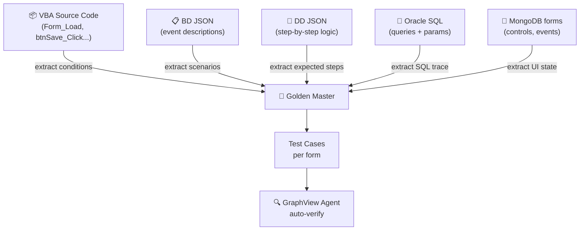

| Source | Trích xuất cho Golden Master |
|--------|------------------------------|
| **VBA Code** | `If-Else` conditions, `DLookup` calls, error messages |
| **BD JSON** | Event scenarios (login, save, delete...) |
| **DD JSON** | Step-by-step expected behavior |
| **Oracle SQL** | Query names + parameters phải được gọi |
| **MongoDB forms** | UI controls + events phải tồn tại trong XAML |

### Tự động hóa Golden Master

```python
# golden_master_builder.py
def build_golden_master(form_name: str) -> dict:
    """Tự động tạo Golden Master từ 4 nguồn."""
    vba = extract_vba_conditions(form_name)      # If/Else, DLookup
    bd  = extract_bd_scenarios(form_name)         # Event descriptions
    dd  = extract_dd_steps(form_name)             # Step-by-step logic
    sql = extract_sql_trace(form_name)            # Expected queries

    return {
        "form": form_name,
        "test_cases": merge_test_cases(vba, bd, dd, sql),
        "expected_queries": sql,
        "expected_controls": extract_controls(form_name),
        "expected_messages": vba["error_messages"]
    }
```

---

<!-- ═══════════════════════════════════════════════════════ -->

## 📌 Slide 7 — File Mapping Strategy

> **Nguyên tắc:** LLM **KHÔNG** tự quyết file structure. File Planner tạo plan → LLM chỉ generate **từng file** theo plan.

### 3-Step Process

```
Step 1: File Planner → file_plan.json (path, purpose, deps)
             ↓
Step 2: Topological Sort theo dependency
             ↓
Step 3: Code Gen loop — mỗi file 1 lần gọi LLM
        với prompt = spec + deps + SQL
```

### MVVM File Structure Output

```
source/vba_brain/vba_brain/
├── Domain/
│   ├── Entities/          ← 🗃️ Repo Agent (Jinja2)
│   │   └── UserEntity.cs
│   └── Interfaces/
│       └── IUserRepository.cs
│
├── Application/
│   ├── DTOs/              ← 🗃️ Repo Agent (Jinja2)
│   │   ├── LoginRequest.cs
│   │   └── LoginResponse.cs
│   ├── Interfaces/
│   │   └── IAuthService.cs
│   └── Services/
│       └── AuthService.cs         ← ⚙️ Agent Service (LLM)
│
├── Infrastructure/
│   └── Persistence/
│       └── Repositories/
│           └── UserRepository.cs  ← 🗃️ Agent Repo (LLM)
│
├── ViewModels/
│   └── LoginViewModel.cs         ← 🧠 Logic Agent (LLM)
│
└── Views/
    └── LoginWindow.xaml           ← 🎨 Agent UI (LLM)
```

---

<!-- ═══════════════════════════════════════════════════════ -->

## 📌 Slide 8 — Tech Stack

| Layer | Technology | Mục đích |
|-------|-----------|----------|
| 🤖 Orchestrator | **Microsoft AutoGen** | Multi-agent routing & conversation |
| 🧠 LLM | **Qwen3 Coder** (multiple sizes) | C#/XAML code generation |
| 📐 Templates | **Jinja2** | Boilerplate code (0 tokens) |
| 🔎 Vector DB | **Qdrant** | Code reuse cache + error patterns |
| 🔧 AST | **Roslyn** (.NET SDK) | Safe C# code patching |
| 🏗️ Build | **MSBuild** (.NET 10) | Compile WPF project |
| 📊 Pipeline | **LangGraph** | State management |
| 🌐 API | **FastAPI** | Frontend integration |
| 💾 Database | **MongoDB** | Forms data + build logs |
| 🔗 Embedding | **text-embedding-v3** (Alibaba) | Code similarity search |

### Qdrant Collections

| Collection | Mục đích |
|-----------|----------|
| `wpf_code_templates` | Cache code đã generate → reuse |
| `build_error_patterns` | Cache lỗi MSBuild + cách fix |
| `wpf_component_library` | WPF component patterns chuẩn |

---

<!-- ═══════════════════════════════════════════════════════ -->

## 📌 Slide 9 — Error Fix Loop (Self-Healing)

> [!WARNING]
> Fix Loop giới hạn **5 iterations** để tránh infinite loop. Nếu vẫn fail → dừng và báo user.

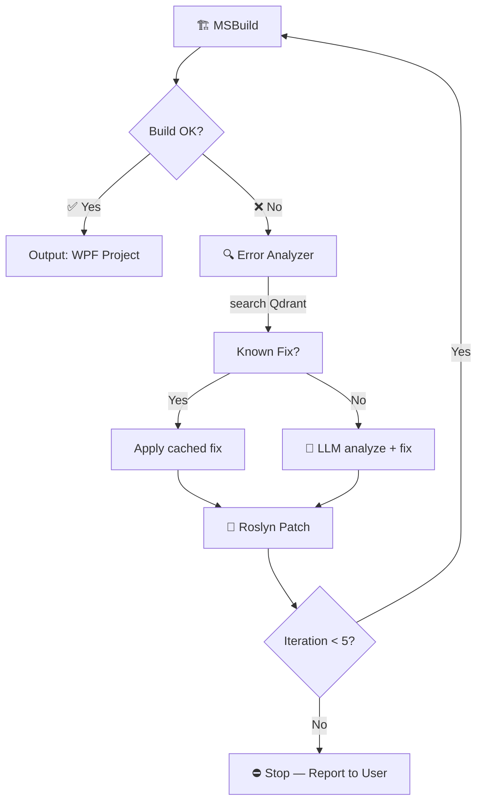

### Error Pattern Learning

```
Lần đầu gặp CS1061 → LLM fix → cache fix vào Qdrant
Lần sau gặp CS1061 tương tự → Qdrant lookup → fix ngay (0 tokens)
```

---

<!-- ═══════════════════════════════════════════════════════ -->

## 📌 Slide 10 — Access → WPF Control Mapping

| Access Control | WPF Control | Binding Pattern |
|:---:|:---:|---|
| TextBox | `TextBox` | `Text="{Binding Prop}"` |
| Label | `TextBlock` | Read-only display |
| ComboBox | `ComboBox` | `ItemsSource` + `SelectedItem` |
| ListBox | `ListBox` | `ItemsSource` binding |
| CheckBox | `CheckBox` | `IsChecked` binding |
| OptionButton | `RadioButton` | `GroupName` grouping |
| CommandButton | `Button` | `Command="{Binding Cmd}"` |
| SubForm | `DataGrid` / `UserControl` | Sub-ViewModel required |
| TabControl | `TabControl` | `TabItem` per page |

---

<!-- ═══════════════════════════════════════════════════════ -->

## 📌 Slide 10b — VBA → WPF Component Mapping (Full)

> [!IMPORTANT]
> Không chỉ mapping **controls** — phải mapping **toàn bộ kiến trúc** VBA sang WPF: Macro, Module, Parameter, Entity, DTO...

### Macro → Service

| VBA (Access) | WPF (C#) | Giải thích |
|:---:|:---:|---|
| `Macro` (AutoExec_A...) | `Services/*.cs` | Macro = logic tự động → Service method |
| `DoCmd.RunMacro` | `_navigationService.Navigate()` | Macro điều hướng → Navigation Service |
| `DoCmd.OpenForm` | `_windowService.Show<T>()` | Macro mở form → Window Service |
| `DoCmd.RunSQL` | `_dbService.ExecuteAsync(sql)` | Macro chạy SQL → DB Service |

### Module → Common / Helpers

| VBA Module | WPF (C#) | Vị trí |
|:---:|:---:|---|
| `Module: SetWindowTop` | `Helpers/WindowHelper.cs` | Common helpers |
| `Module: Judge_Inst` | `Common/VersionChecker.cs` | Version check |
| `Module: タイマーを開く` | `Services/TimerService.cs` | Timer management |
| `Module: 共通関数` | `Common/CommonFunctions.cs` | Shared utilities |
| `Class Module` | `Domain/Entities/*.cs` | Business objects |

### Parameter / Request / Response / DTO / Entity

```mermaid
graph LR
    subgraph "VBA Source"
        VP["VBA Function args"]
        VT["VBA Table<br/>(T_ID_Pass)"]
        VQ["VBA Query<br/>(DLookup, RunSQL)"]
        VR["VBA Return<br/>(MsgBox, navigation)"]
    end

    subgraph "WPF Target"
        REQ["📨 Request DTO"]
        ENT["📦 Entity"]
        REPO["🗃️ Repository"]
        RES["📬 Response DTO"]
    end

    VP -->|"maps to"| REQ
    VT -->|"maps to"| ENT
    VQ -->|"maps to"| REPO
    VR -->|"maps to"| RES

    style REQ fill:#1e3a5f,stroke:#60a5fa
    style RES fill:#1e3a5f,stroke:#60a5fa
    style ENT fill:#2d5a2d,stroke:#4ade80
    style REPO fill:#7c2d12,stroke:#f97316
```

| VBA Concept | WPF C# | Ví dụ |
|-------------|--------|-------|
| **Function arguments** | `Request DTO` | `LoginRequest { LoginId, Password }` |
| **DLookup / Recordset** | `Entity` | `UserEntity { Id, Pass, KanriFLG }` |
| **Query result** | `Response DTO` | `LoginResponse { Success, ErrorMessage }` |
| **Table schema** | `Entity + Repository` | `T_ID_Pass` → `UserEntity` + `IUserRepository` |
| **Global variables** | `DI Service / AppState` | `Me.OpenArgs` → `NavigationParameter` |
| **MsgBox return** | `DialogResult` | `MsgBox()` → `MessageBox.Show()` |
| **DoCmd parameters** | `Service method args` | `OpenForm "F_Main", filter` → `Show(filter)` |
| **Error Handler** | `try-catch + ILogger` | `On Error` → `try { } catch { }` |

### Tổng hợp: Full Migration Map

```
┌──────────────────────────┬──────────────────────────────────┐
│     VBA (Access)         │     WPF (C# MVVM)               │
├──────────────────────────┼──────────────────────────────────┤
│  Form                    │  Views/*.xaml                    │
│  Form Code-Behind        │  ViewModels/*.cs                 │
│  Macro                   │  Services/*.cs (Navigation/DB)   │
│  Module (共通)            │  Common/*.cs / Helpers/*.cs      │
│  Class Module            │  Domain/Entities/*.cs            │
│  Table                   │  Entity + Repository             │
│  Query (SELECT)          │  Repository method (Dapper)      │
│  Query (UPDATE/DELETE)   │  Service method (ExecuteAsync)   │
│  Function params         │  Request DTO                     │
│  Function return         │  Response DTO                    │
│  Global vars             │  DI Scoped Service / AppState    │
│  DoCmd                   │  Service methods                 │
│  MsgBox                  │  MessageBox / Dialog Service     │
│  DLookup                 │  Repository.GetAsync()           │
│  DCount                  │  Repository.CountAsync()         │
│  Recordset               │  IEnumerable<Entity> / List<T>   │
│  Error Handler           │  try-catch + ILogger             │
└──────────────────────────┴──────────────────────────────────┘
```

---

<!-- ═══════════════════════════════════════════════════════ -->

## 📌 Slide 10c — ⚠️ AI Agent Report — Open Challenge

> [!WARNING]
> VBA Reports (Access Report) migration sang WPF **chưa có solution rõ ràng**. Đây là bài toán mở cần research thêm.

### Vấn đề

```
VBA Access Reports:
├── Report layout (bands: Header, Detail, Footer)
├── Grouping & Sorting
├── Calculated fields (Sum, Count, Avg)
├── Sub-reports
├── Print preview / Print to PDF
└── Query-based data source

WPF KHÔNG có built-in report engine như Access!
```

### Các hướng giải quyết tiềm năng

| Hướng | Công nghệ | Ưu điểm | Nhược điểm |
|-------|-----------|---------|------------|
| **A** | RDLC Reports (.NET) | Microsoft native, drag-drop designer | Cũ, ít cập nhật |
| **B** | FastReport / Stimulsoft | Nhiều tính năng, PDF/Excel export | Tốn license |
| **C** | HTML → PDF (Puppeteer) | Flexible, modern | Cần Chrome engine |
| **D** | XAML FlowDocument | Native WPF, print support | Khó layout phức tạp |
| **E** | Excel export (EPPlus) | User quen dùng Excel | Không phải report |

### Agent Report — Thiết kế sơ bộ

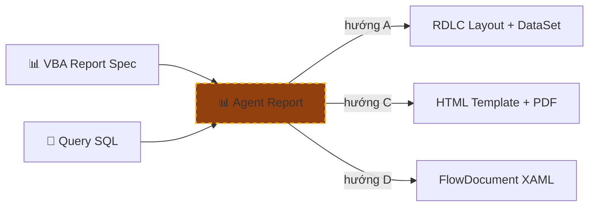

> [!IMPORTANT]
> **Action:** Cần prototype 1 report VBA đơn giản với mỗi hướng (A/C/D) → đánh giá → chọn solution → rồi mới build Agent Report.

---

<!-- ═══════════════════════════════════════════════════════ -->

## 📌 Slide 10d — Workflow: Chi tiết trước → Tự động sau

> [!CAUTION]
> **Triết lý:** KHÔNG vội tự động hóa. **Thiết kế workflow chi tiết hoàn chỉnh** cho 1 form → verify 100% → rồi mới tự động cho 153 forms còn lại.

### 2 giai đoạn

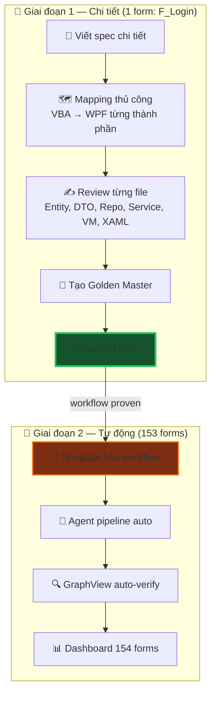

### Giai đoạn 1 — 14 bước chi tiết cho F_Login

| Bước | Input | Output | Agent |
|:----:|-------|--------|-------|
| 1 | MongoDB form AST | Control list + layout | File Planner |
| 2 | Table `T_ID_Pass` | `UserEntity.cs` | Agent Repo |
| 3 | VBA function args | `LoginRequest.cs` | Agent Repo |
| 4 | VBA return / MsgBox | `LoginResponse.cs` | Agent Repo |
| 5 | Query specs (DD) | `IUserRepository.cs` | Agent Repo |
| 6 | Query SQL (L4) | `UserRepository.cs` | Agent Repo |
| **6.5** | **Output bước 2-6** | **Compile + interface check** | **Agent Review** |
| 7 | BD events + DD | `IAuthService.cs` | Agent Service |
| 8 | DD step-by-step | `AuthService.cs` | Agent Service |
| 9 | BD events + DD | `LoginViewModel.cs` | Agent Logic |
| 10 | BD layout + Image | `LoginWindow.xaml` | Agent UI |
| **10.5** | **Output bước 7-10** | **Build + data flow check** | **Agent Review** |
| 11 | Macro refs | `NavigationService.cs` | Agent Service |
| 12 | Module refs | `Helpers/*.cs` | Agent Service |
| **12.5** | **Output bước 11-12** | **Compile + reference check** | **Agent Review** |
| 13 | All outputs (đã review) | Dependency Graph | Agent GraphView |
| 14 | Golden Master | Test Report → **100% PASS** | Agent Test |

### Giai đoạn 2 — Tự động hóa

```
Workflow 14 bước đã proven từ F_Login
        ↓
Template hóa thành pipeline config
        ↓
for form in ["C000", "C001", "C003", ...]:
    ├── Bước 1-12: Agent pipeline auto-gen
    ├── Bước 13:   GraphView auto-dependency
    ├── Bước 14:   Golden Master auto-verify
    └── Report:    ✅ PASS hoặc ❌ NEED REVIEW
        ↓
Dashboard: 154/154 forms migrated ✅
```

> [!TIP]
> **Lợi ích:** F_Login = prototype hoàn chỉnh → workflow 14 bước = blueprint → tự động hóa chỉ khi đã **chứng minh đúng 100%** → giảm risk toàn bộ project.

---

<!-- ═══════════════════════════════════════════════════════ -->

## 📌 Slide 11 — Triển khai & Đánh giá Solution

### Phân chia Phase theo Agent

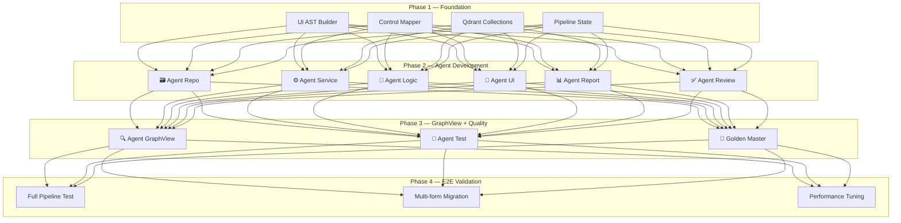

| Phase | Deliverables | Tiêu chí đánh giá |
|-------|-------------|--------------------|
| **Phase 1** — Foundation | UI AST Builder, Control Mapper, Qdrant, Pipeline state | AST parse đúng 154 forms |
| **Phase 2** — Agent Dev | 6 Agent (UI, Logic, Service, Repo, Report, Review) | Mỗi agent gen + review đúng output cho F_Login |
| **Phase 3** — GraphView | Agent GraphView + Golden Master + Build loop | Golden Master pass 100% cho F_Login |
| **Phase 4** — E2E | Full pipeline chạy end-to-end, test multi-form | 5+ forms migrate thành công, build OK |

### Đánh giá Solution — Checklist

| Tiêu chí | Mục tiêu | Cách đo |
|----------|---------|--------|
| 🎯 **Accuracy** | 100% logic khớp VBA gốc | Golden Master test pass rate |
| ⚡ **Token efficiency** | ≤14K tokens/form | Token counter per form |
| 🏗️ **Build success** | 0 errors sau fix loop | MSBuild return code |
| 🔗 **Dependency** | Tất cả references resolve | GraphView traversal check |
| 📊 **Coverage** | Tất cả events/queries có trong WPF | BD/DD coverage report |
| 🔄 **Self-healing** | Fix lỗi trong ≤5 iterations | Fix loop counter |

---

<!-- ═══════════════════════════════════════════════════════ -->

## 📌 Slide 12 — Tổng kết

### 💡 Key Takeaways

| | Ý tưởng chính |
|---|---|
| 💡 | **Tách 1 AI coding → 9 agent** — gen độc lập + review tự động + verify 100% |
| ✅ | **Agent Review** kiểm tra từng output: build? compile? data flow? → **không cần human review** |
| ⭐ | **Agent GraphView** trace form→event→macro→query → so sánh VBA graph ↔ WPF graph |
| 🧪 | **Agent Test** sinh test cases từ Golden Master → verify 100% |
| 📊 | **Agent Report** — ⚠️ **Open Challenge** — cần research |
| 🥇 | **Golden Master** = snapshot VBA gốc → lưới an toàn cuối cùng |

### 🔢 Metrics

```
┌──────────────────────────────────────────┐
│  154 forms cần migrate                   │
│  9 specialized agents                    │
│  Agent Review: build + compile + data    │
│  Agent GraphView: VBA graph ≡ WPF graph  │
│  Agent Test: Golden Master → 100%        │
│  ~10-14K tokens / form (tối ưu)          │
└──────────────────────────────────────────┘
```

> [!IMPORTANT]
> **Agent GraphView so sánh VBA graph vs WPF graph** — trace từng form open/close, event→macro, event→module, event→query. **Agent Test sinh test cases** verify logic 100%. Đảm bảo không mất bất kỳ dependency nào khi migration.

---

*🔗 Source: [README.md](file:///Users/baoluong0209/GitTool/NootbookSpeech/ide_ai/README.md) | [F_Login_spec.md](file:///Users/baoluong0209/GitTool/NootbookSpeech/ide_ai/F_Login_spec.md)*
