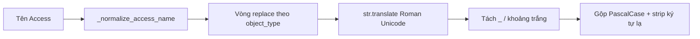

# Quy tắc mapping tên — `export_forms_layer1.py`

Tài liệu mô tả **cách script** `backend/layer5/agents/graphview/inputs/export_forms_layer1.py` biến tên Access / Mongo Layer 1 thành tên gợi ý (.NET / WPF). Mọi rule thực tế nằm trong code; file này để **đọc nhanh** và chỉnh bảng thay thế đúng chỗ.

Xem thêm quy ước MVVM tổng quát: `../form_naming_and_mapping.md` (có thể trỏ đường dẫn output cũ — ưu tiên đọc doc này + docstring trong script).

---

## 1. Chạy script & output

Từ thư mục `03_agents/workflow/`:

```bash
python -X utf8 backend/layer5/agents/graphview/inputs/export_forms_layer1.py
python -X utf8 backend/layer5/agents/graphview/inputs/export_forms_layer1.py --dry-run
```

- Cấu hình Mongo: `workflow/config.json` → `backend/layer5/core/config.py` (`MONGO_URI`, `MONGO_DB`, `COL_FORMS`, `COL_QUERIES`, `COL_MACROS`).
- **Dry-run:** in JSON tóm tắt, **không** ghi file.

**Thư mục output** (`graphview/outputs/`):

| Thư mục | File | Nội dung |
|--------|------|----------|
| `forms/` | `listFormJp.json` | Danh sách tên form + metadata + `duplicate_names_collapsed` |
| `forms/` | `listFormJpToEn.json` | `access_form_name` → `wpf_view_name`, `wpf_viewmodel_name` (gợi ý) |
| `queries/` | `listQueryJp.json`, `listQueryJpToEn.json` | Tên query + `suggested_dotnet_type_name` |
| `macros/` | `listMacroJp.json`, `listMacroJpToEn.json` | Tên macro + `suggested_dotnet_type_name` |
| `events/` | `listEventJp.json`, `listEventJpToEn.json` | Event từ form + `suggested_dotnet_handler_name` |

---

## 2. Luồng tổng quát (tên → identifier Pascal)



1. **`_normalize_access_name`**
   - `strip` + **`unicodedata.normalize("NFKC", …)`**.
   - **Bước bổ sung:** NFKC đổ số La Mã Unicode `Ⅱ` (U+2161) thành hai chữ Latin `II`. Các tuple thay thế trong script dùng ký tự **`Ⅱ`** trong key tiếng Nhật, nên sau NFKC cần đổ **`II` → `Ⅱ`** lại khi `II` đứng sau `[A-Za-z Hiragana Katakana Kanji _]` và trước `_` / khoảng trắng / cuối chuỗi (regex trong code).

2. **`_get_replacements(object_type)`** — chọn bảng:
   - `form` → `_FORM_REPLACEMENTS` + `_COMMON_REPLACEMENTS`
   - `query` → `_QUERY_REPLACEMENTS` + `_COMMON_REPLACEMENTS`
   - `macro` → `_MACRO_REPLACEMENTS` + `_COMMON_REPLACEMENTS`
   - mặc định khác → chỉ `_COMMON_REPLACEMENTS`

3. **`_pascal_identifier_from_access`**
   - Lần lượt `s.replace(jp, en)` theo **thứ tự trong list** (quan trọng: **chuỗi dài / cụm đặc thù trước**, cụm ngắn sau — ví dụ `MAINto編集` phải trước `編集` để không tạo ra `Mainto`).
   - `s.translate(_ROMAN_NUMERAL_COMPAT)` — map `Ⅰ`…`Ⅹ` (Unicode) sang chuỗi ASCII `"1"`…`"10"` cho phần còn sót.
   - Gộp khoảng trắng thành `_`, `re.split(r"[_\s]+", s)`.
   - Mỗi phần: bỏ ký tự không `[0-9A-Za-z]`; nếu là số thì giữ nguyên; không thì **Pascal** một segment (`A` + phần còn lại nguyên văn).
   - Nối các segment → một chuỗi Pascal. Nếu rỗng → `default_stem` (`Form`, `Query`, `Macro`, `Ctl`, … tùy call site).

---

## 3. Bảng thay thế (tuple `("tiếng Nhật / ký tự", "English")`)

- **`_FORM_REPLACEMENTS`:** form (và logic dùng `object_type == "form"` cho event handler tên form/control).
- **`_QUERY_REPLACEMENTS`:** query.
- **`_MACRO_REPLACEMENTS`:** macro.
- **`_COMMON_REPLACEMENTS`:** luôn nối **sau** bảng riêng của từng loại.

**Quy tắc khi thêm dòng mới**

1. **Ưu tiên cụm dài** (nhiều kanji / tên riêng nghiệp vụ) **trước** cụm ngắn có thể là substring (ví dụ `作業依頼書` trước `依頼`).
2. Cụm **`MAINto編集` / `MAINto複製`** phải **trước** rule **`編集` → `Edit`** để tránh tách `MAIN` + `toEdit`.
3. Giữ **`SubF` trước `サブ`** trong list nếu cả hai tồn tại (tránh thay nhầm token tiếng Anh `SubF`).
4. Nếu tên Access dùng **Latin `II`** thay vì `Ⅱ`, bước normalize `II`→`Ⅱ` đã xử lý phần lớn; vẫn nên giữ key trong bảng với **`Ⅱ`** cho đúng nguồn export Access chuẩn.

Sửa mapping = **sửa tuple trong `.py`**, rồi chạy lại script để tái sinh JSON.

---

## 4. Từng loại output

### 4.1 Forms → WPF

- **`_suggest_wpf_view_name`:** `Pascal` + nếu chưa kết thúc bằng `View` thì thêm `View`.
- **`_suggest_viewmodel`:** `…View` → `…ViewModel`; không có `View` thì nối `ViewModel`.

**Trùng `wpf_view_name`:** `_ensure_unique_form_mapping` — lần xuất hiện thứ 2, 3, … đổi thành chèn số **trước** hậu tố `View` (ví dụ `FooView` → `Foo2View`) và gán lại `wpf_viewmodel_name` tương ứng.

**Trùng tên form trong Mongo:** `_dedupe_by_name` — cùng `name` giữ document có `key` (`_id`) **lexicographic lớn hơn**; tên trùng ghi vào `duplicate_names_collapsed`.

### 4.2 Queries → suggested .NET type

- **`_suggest_dotnet_query_type`:** `_pascal_identifier_from_access(..., "Query", "query")` rồi:
  - nếu stem (không phân biệt hoa thường) kết thúc bằng `query` → thêm `Definition`;
  - ngược lại → thêm `AccessQuery`.

**Trùng:** `_ensure_unique(..., "suggested_dotnet_type_name")` — suffix dạng nối thêm `2`, `3`… **vào cuối** chuỗi (khác form view).

### 4.3 Macros → suggested .NET type

- **`_suggest_dotnet_macro_type`:** tương tự với `Macro` / `macro`, hậu tố `MacroWorkflow` hoặc `Workflow` nếu đã có `macro`.

**Trùng:** giống query, `_ensure_unique` trên `suggested_dotnet_type_name`.

### 4.4 Events (từ collection `forms`)

- Đọc `properties.Event` / `properties.event` và đệ quy `items`.
- **`_suggest_dotnet_handler_name`:** ghép Pascal từ tên form + (nếu có) control đã map + event key (chỉ giữ `[0-9A-Za-z]`, capitalize) + chuỗi cố định `Handler`.

**Trùng:** `_ensure_unique(..., "suggested_dotnet_handler_name")`.

---

## 5. Hạn chế & review

- Toàn bộ `list*JpToEn.json` là **gợi ý tự động** — cần review với BA / kiến trúc WPF.
- Tên tiếng Nhật mới không có trong tuple sẽ **bị loại** khi tách Pascal (chỉ còn số/chữ Latin còn sót) → dễ thành `F000View`, `FormView` nếu thiếu rule.
- `logical_to_physical.json` (Layer 2) map **cột DB**, không thay thế file mapping form/query/macro này.

---

## 6. File code tham chiếu nhanh

| Nội dung | Vị trí trong `export_forms_layer1.py` |
|----------|----------------------------------------|
| Bảng `_COMMON` / `_FORM` / `_QUERY` / `_MACRO` | Khoảng dòng 153–340 |
| `_normalize_access_name`, `_pascal_identifier_from_access` | ~387–426 |
| WPF / Query / Macro / Event suggest | ~429–466 |
| `_ensure_unique_form_mapping`, `_ensure_unique` | ~469–513 |
| `main()` build payload & ghi JSON | ~533 trở đi |

Khi đổi rule, cập nhật **bảng tuple + (nếu cần) thứ tự** rồi chạy lại script để đồng bộ toàn bộ `outputs/`.
