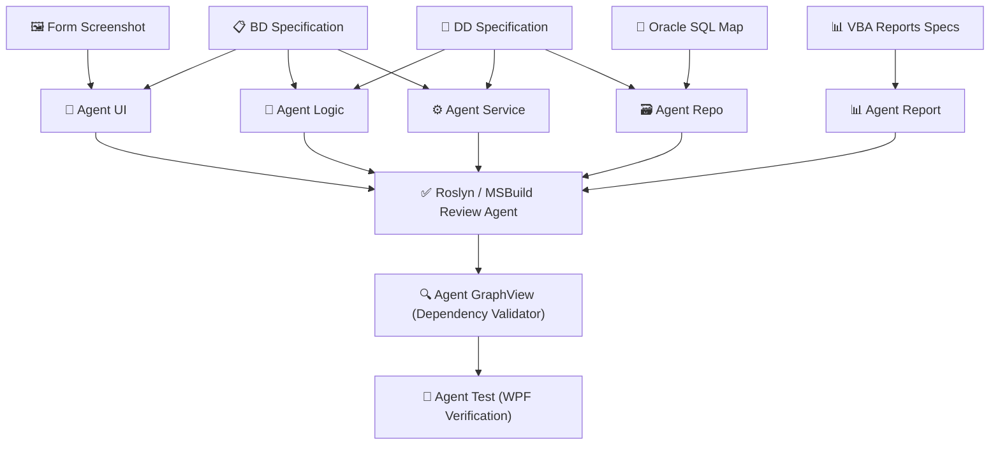

# Layer 5 — Specialized Code Generation Agents Specification

This specification outlines the architecture, inputs, outputs, models, and execution roles of the **8 specialized agents** constituting the Layer 5 Modernization and C# Code Generation pipeline.

---

## 1. General Generation Strategy
Rather than utilizing a single monolithic LLM agent to write the entire WPF application (which results in excessive context size, high token consumption, and code conflicts), the modernization workflow divides generation into **8 specialized agents**. Each agent reads only the narrow data subset it requires, ensuring highly accurate outputs, fast iteration, and zero-conflict multi-developer integration.

---

## 2. Agents Reference Directory

---

## 3. Agent Specifications

### 🎨 3.1. Agent UI (Views Generator)
- **Role:** Translates Access forms and UI layouts into XAML Windows and UserControls conforming to the MVVM pattern.
- **Inputs:**
  - `BD JSON` (UI layout, sizing, and control metadata)
  - `Form Image Screenshot` (Visual reference for styling)
  - `ViewModel Interfaces` (To set up correct bindings)
- **Outputs:**
  - `Views/{Form}Window.xaml`
  - `Views/{Form}Window.xaml.cs` (Code-behind registering DataContext)
- **LLM Model:** `qwen3-coder-plus`

---

### 🧠 3.2. Agent Logic (ViewModels Generator)
- **Role:** Generates C# MVVM ViewModels. Translates events and controls into observable properties and RelayCommands, injecting necessary dependencies.
- **Inputs:**
  - `BD JSON` (UI events definition)
  - `DD JSON` (Detailed logical steps per event)
  - `Service Interfaces` (DI dependencies, e.g., `IAuthService`)
- **Outputs:**
  - `ViewModels/{Form}ViewModel.cs`
- **LLM Model:** `qwen3-235b`
- **Core Generation Task List:**
  1. Declare property backing fields with `INotifyPropertyChanged` notifications.
  2. Implement async RelayCommands mapping to DD functional steps.
  3. Set up constructor-based Dependency Injection (DI) for Services.

---

### ⚙️ 3.3. Agent Service (Services Generator)
- **Role:** Generates Application Services bridging ViewModels and Repositories. Orchestrates Repository database calls.
- **Inputs:**
  - `DD JSON` (Detailed business rules and data calculations)
  - `VBA Code` (Reference logic scripts)
  - `Repository DTO Contracts`
- **Outputs:**
  - `Services/I{Form}Service.cs` (Interfaces)
  - `Services/{Form}Service.cs` (Implementations)
- **Primary Generator:** Deterministic generator (`tool_service_gen.py`), with `--llm` mode fallback using model `qwen3-235b` for complex calculations.

---

### 🗃️ 3.4. Agent Repo (Dapper Repositories Generator)
- **Role:** Generates Domain Entities, DTOs, Repository interfaces, and concrete SQL-based Dapper Repositories for Oracle DB.
- **Inputs:**
  - `DD JSON` (Query specifications and nested SELECT/UPDATE SQL parameters)
  - `Oracle Table Schema Definitions`
- **Outputs:**
  - `Domain/Entities/{Entity}.cs`
  - `Application/DTOs/{Dto}.cs`
  - `Infrastructure/Repositories/{Repository}.cs`
- **LLM Model:** `qwen3-coder-480b` / Deterministic Jinja2 templates.

---

### 📊 3.5. Agent Report (Report Specs Generator)
- **Role:** Migrates Access report layouts and groupings into RDLC layouts (ReportViewer XAML integrations).
- **Inputs:**
  - `VBA Reports Schema JSON`
  - `Dataset Queries`
- **Outputs:**
  - `Views/Reports/{Report}.rdlc`
- **LLM Model:** `qwen3-235b`

---

### ✅ 3.6. Agent Review (Roslyn Code Analyzer)
- **Role:** Automates compile-time checks, identifies code-level syntax errors, and validates data bindings across generated files before building.
- **Inputs:** Generated `.cs` and `.xaml` files.
- **Outputs:** Roslyn Diagnostic logs & compile status codes.
- **Mechanism:** Deterministic Roslyn compiler engine / MSBuild runner.

---

### 🔍 3.7. Agent GraphView (Dependency Validator)
- **Role:** Reconstructs the actual C# dependency call graph (Form → Event → Service → Repo → Query) and compares it with the original VBA dependency tree to verify migration completeness.
- **Inputs:**
  - `VBA Call Graph JSON`
  - Generated C# View/ViewModel/Service files
- **Outputs:**
  - `outputs/review_{Form}.json` (Mismatch detection reports highlighting extra or missing edges)
- **Mechanism:** Deterministic parser with validation summary.

---

### 🧪 3.8. Agent Test (Verifier)
- **Role:** Writes integration tests, generates test case scripts, and verifies WPF visual components against Golden Master outputs.
- **Inputs:** Mapped functional contracts + Compiled WPF Views.
- **Outputs:**
  - `Tests/{Form}IntegrationTests.cs`
  - Verification reports.
- **LLM Model:** `qwen3-235b`
